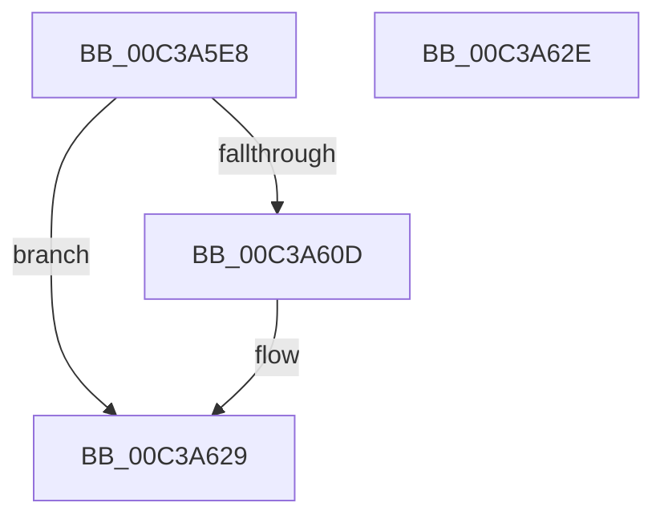

# KiVerifyScopes

- RVA: `0x00C3A5E8`–`0x00C3A62F` (길이 `71` bytes)
- VA: `0x0000000140C3A5E8`
- 실행 섹션: `INIT`
- PDB 이름 있음: `예`; PDB Function 태그: `아니요`
- unwind 정보 RVA: `0x0005D2F4`
- 디코드: `19`개 명령, `71/71` bytes 표시
- 미해석 바이트: `0` (있으면 어셈블리에 `.byte`로 보존)

> 이 문서는 커널 이미지의 기계어와 PDB 기호를 분석해 생성했습니다. 4번과 5번은 함수 원형과 자료형을 바이너리 사용 방식에서 추정한 C 해석이며 원본 소스 복구 결과는 아닙니다.

## 1. Dependencies

- 직접 호출 지점: **2**; 고유 호출 대상: **2**
- 직접 호출자로 확인된 함수: **1**
- RIP 상대 이미지 참조: **1**

### Outgoing calls
- `0x00C3A604` → [KeExpandKernelStackAndCalloutEx](../../text/2F/KeExpandKernelStackAndCalloutEx_function_002F85B0.md) (function, `0x002F85B0`)
- `0x00C3A623` → [KeBugCheckEx](../../text/4F/KeBugCheckEx_function_004FD660.md) (function, `0x004FD660`)

### Direct callers
- [KeInitSystem](../C7/KeInitSystem_function_00C71660.md) at `0x00C719F7`

### Static image references
- `0x00C3A5F2` → RVA `0x00C3A640` (`KiVerifyScopesExecute`; read)

## 2. Other-region calls and transfers

- 다른 실행 섹션으로 향하는 call: **2**
  - `0x00C3A604` → [KeExpandKernelStackAndCalloutEx](../../text/2F/KeExpandKernelStackAndCalloutEx_function_002F85B0.md) (`INIT` → `.text`)
  - `0x00C3A623` → [KeBugCheckEx](../../text/4F/KeBugCheckEx_function_004FD660.md) (`INIT` → `.text`)
- 별도 외부 분기/꼬리 이동을 확인하지 못했습니다.

## 3. Assembly (complete function range)

```asm
00C3A5E8  48 83 EC 38                     sub rsp, 0x38
00C3A5EC  48 83 64 24 20 00               and qword ptr [rsp + 0x20], 0
00C3A5F2  48 8D 0D 47 00 00 00            lea rcx, [rip + 0x47]
00C3A5F9  41 B1 01                        mov r9b, 1
00C3A5FC  33 D2                           xor edx, edx
00C3A5FE  41 B8 00 C0 00 00               mov r8d, 0xc000
00C3A604  E8 A7 DF 6B FF                  call 0x1402f85b0
00C3A609  85 C0                           test eax, eax
00C3A60B  79 1C                           jns 0x140c3a629
00C3A60D  48 83 64 24 20 00               and qword ptr [rsp + 0x20], 0
00C3A613  45 33 C9                        xor r9d, r9d
00C3A616  48 63 D0                        movsxd rdx, eax
00C3A619  41 B8 4B 69 56 53               mov r8d, 0x5356694b
00C3A61F  41 8D 49 32                     lea ecx, [r9 + 0x32]
00C3A623  E8 38 30 8C FF                  call 0x1404fd660
00C3A628  CC                              int3
00C3A629  48 83 C4 38                     add rsp, 0x38
00C3A62D  C3                              ret
00C3A62E  CC                              int3
```

## 4. C-style interpretation (structured pseudocode)

```c
__int64 __fastcall KiVerifyScopes(__int64 a1, int a2)
{
    __int64 result;
    __int64 v_rsp;
    unsigned __int64 v_stack_m18;

    v_rsp = (v_rsp) - (56);
    a2 = 0;
    result = KeExpandKernelStackAndCalloutEx(v_rip + 71, a2, (unsigned int)(0xC000ULL), 1);
    if (sign_flag) {
        a4 = 0;
        a2 = (int)((unsigned int)(result));
        a3 = 0x5356694BULL;
        a1 = a4 + 50;
        result = KeBugCheckEx(a1, a2, a3, a4);
    }
    v_rsp = (v_rsp) + (56);
    return result;
}
```

## 5. (Beta) C Style

```c
int64_t KiVerifyScopes(int64_t Arg1, int32_t Arg2)
{
    int64_t result;
    int64_t local_rsp;
    uint64_t v_stack_m18;

    local_rsp = (local_rsp) - (56);
    Arg2 = 0;
    result = KeExpandKernelStackAndCalloutEx(v_rip + 71, Arg2, (uint32_t)(0xC000ULL), 1);
    if (sign_flag) {
        a4 = 0;
        Arg2 = (int32_t)((uint32_t)(result));
        a3 = 0x5356694BULL;
        Arg1 = a4 + 50;
        result = KeBugCheckEx(Arg1, Arg2, a3, a4);
    }
    local_rsp = (local_rsp) + (56);
    return result;
}
```

## 6. Execution-region graph

[열기: 2D/3D 그래프와 함수 탐색 컨트롤 패널](../../../control-panel.html?section=init&rva=0x00C3A5E8&view=graph)

- 2D 그래프는 위에서 아래로 흐르고, 3D 그래프는 빈 공간을 드래그해 회전합니다. Shift+드래그는 이동, 휠은 확대·축소, 함수 노드 선택은 대상 보고서 이동입니다.

### Static fallback


