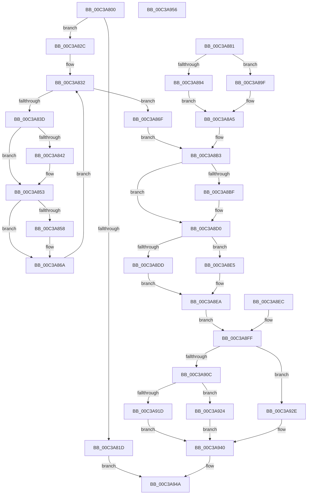

# KiVerifyXcpt10

- RVA: `0x00C3A800`–`0x00C3A957` (길이 `343` bytes)
- VA: `0x0000000140C3A800`
- 실행 섹션: `INIT`
- PDB 이름 있음: `예`; PDB Function 태그: `아니요`
- unwind 정보 RVA: `0x000CAE38`
- 디코드: `104`개 명령, `343/343` bytes 표시
- 미해석 바이트: `0` (있으면 어셈블리에 `.byte`로 보존)

> 이 문서는 커널 이미지의 기계어와 PDB 기호를 분석해 생성했습니다. 4번과 5번은 함수 원형과 자료형을 바이너리 사용 방식에서 추정한 C 해석이며 원본 소스 복구 결과는 아닙니다.

## 1. Dependencies

- 직접 호출 지점: **5**; 고유 호출 대상: **2**
- 직접 호출자로 확인된 함수: **0**
- RIP 상대 이미지 참조: **2**

### Outgoing calls
- `0x00C3A84E` → [local_unwind](../../text/4F/local_unwind_function_004FFB40.md) (function, `0x004FFB40`)
- `0x00C3A864` → [local_unwind](../../text/4F/local_unwind_function_004FFB40.md) (function, `0x004FFB40`)
- `0x00C3A8CB` → [local_unwind](../../text/4F/local_unwind_function_004FFB40.md) (function, `0x004FFB40`)
- `0x00C3A927` → [KiVerifyXcptFilter](KiVerifyXcptFilter_function_00C3ADD0.md) (function, `0x00C3ADD0`)
- `0x00C3A93A` → [local_unwind](../../text/4F/local_unwind_function_004FFB40.md) (function, `0x004FFB40`)

### Direct callers
- 이 함수 시작 RVA로 연결되는 직접 call은 확인되지 않았습니다. 간접 호출은 완전히 역산할 수 없습니다.

### Static image references
- `0x00C3A842` → RVA `0x00C3A951` (`INIT`; read)
- `0x00C3A858` → RVA `0x00C3A832` (`INIT`; read)

## 2. Other-region calls and transfers

- 다른 실행 섹션으로 향하는 call: **4**
  - `0x00C3A84E` → [local_unwind](../../text/4F/local_unwind_function_004FFB40.md) (`INIT` → `.text`)
  - `0x00C3A864` → [local_unwind](../../text/4F/local_unwind_function_004FFB40.md) (`INIT` → `.text`)
  - `0x00C3A8CB` → [local_unwind](../../text/4F/local_unwind_function_004FFB40.md) (`INIT` → `.text`)
  - `0x00C3A93A` → [local_unwind](../../text/4F/local_unwind_function_004FFB40.md) (`INIT` → `.text`)
- 별도 외부 분기/꼬리 이동을 확인하지 못했습니다.

## 3. Assembly (complete function range)

```asm
00C3A800  48 89 4C 24 08                  mov qword ptr [rsp + 8], rcx
00C3A805  48 83 EC 38                     sub rsp, 0x38
00C3A809  48 89 64 24 20                  mov qword ptr [rsp + 0x20], rsp
00C3A80E  48 8D 41 0C                     lea rax, [rcx + 0xc]
00C3A812  48 89 44 24 48                  mov qword ptr [rsp + 0x48], rax
00C3A817  83 79 08 01                     cmp dword ptr [rcx + 8], 1
00C3A81B  74 0F                           je 0x140c3a82c
00C3A81D  83 08 FF                        or dword ptr [rax], 0xffffffff
00C3A820  C7 41 10 01 00 00 00            mov dword ptr [rcx + 0x10], 1
00C3A827  E9 1E 01 00 00                  jmp 0x140c3a94a
00C3A82C  C7 00 01 00 00 00               mov dword ptr [rax], 1
00C3A832  48 8B 4C 24 48                  mov rcx, qword ptr [rsp + 0x48]
00C3A837  8B 01                           mov eax, dword ptr [rcx]
00C3A839  85 C0                           test eax, eax
00C3A83B  74 32                           je 0x140c3a86f
00C3A83D  83 F8 0B                        cmp eax, 0xb
00C3A840  75 11                           jne 0x140c3a853
00C3A842  48 8D 15 08 01 00 00            lea rdx, [rip + 0x108]
00C3A849  48 8B 4C 24 20                  mov rcx, qword ptr [rsp + 0x20]
00C3A84E  E8 ED 52 8C FF                  call 0x1404ffb40
00C3A853  83 F8 01                        cmp eax, 1
00C3A856  75 12                           jne 0x140c3a86a
00C3A858  48 8D 15 D3 FF FF FF            lea rdx, [rip - 0x2d]
00C3A85F  48 8B 4C 24 20                  mov rcx, qword ptr [rsp + 0x20]
00C3A864  E8 D7 52 8C FF                  call 0x1404ffb40
00C3A869  90                              nop
00C3A86A  83 21 00                        and dword ptr [rcx], 0
00C3A86D  EB C3                           jmp 0x140c3a832
00C3A86F  C7 01 0B 00 00 00               mov dword ptr [rcx], 0xb
00C3A875  48 8B 54 24 40                  mov rdx, qword ptr [rsp + 0x40]
00C3A87A  48 8B 02                        mov rax, qword ptr [rdx]
00C3A87D  FF 00                           inc dword ptr [rax]
00C3A87F  EB 32                           jmp 0x140c3a8b3
00C3A881  48 8B 54 24 40                  mov rdx, qword ptr [rsp + 0x40]
00C3A886  8B 42 0C                        mov eax, dword ptr [rdx + 0xc]
00C3A889  83 C0 0B                        add eax, 0xb
00C3A88C  89 42 0C                        mov dword ptr [rdx + 0xc], eax
00C3A88F  83 F8 42                        cmp eax, 0x42
00C3A892  75 0B                           jne 0x140c3a89f
00C3A894  48 8B 02                        mov rax, qword ptr [rdx]
00C3A897  8B 08                           mov ecx, dword ptr [rax]
00C3A899  FF C1                           inc ecx
00C3A89B  89 08                           mov dword ptr [rax], ecx
00C3A89D  EB 06                           jmp 0x140c3a8a5
00C3A89F  83 C0 0B                        add eax, 0xb
00C3A8A2  89 42 0C                        mov dword ptr [rdx + 0xc], eax
00C3A8A5  8B 42 0C                        mov eax, dword ptr [rdx + 0xc]
00C3A8A8  83 C0 0B                        add eax, 0xb
00C3A8AB  89 42 0C                        mov dword ptr [rdx + 0xc], eax
00C3A8AE  48 8B 4C 24 48                  mov rcx, qword ptr [rsp + 0x48]
00C3A8B3  8B 01                           mov eax, dword ptr [rcx]
00C3A8B5  83 C0 0B                        add eax, 0xb
00C3A8B8  89 01                           mov dword ptr [rcx], eax
00C3A8BA  83 F8 63                        cmp eax, 0x63
00C3A8BD  75 11                           jne 0x140c3a8d0
00C3A8BF  48 8D 15 8B 00 00 00            lea rdx, [rip + 0x8b]
00C3A8C6  48 8B 4C 24 20                  mov rcx, qword ptr [rsp + 0x20]
00C3A8CB  E8 70 52 8C FF                  call 0x1404ffb40
00C3A8D0  48 8B 02                        mov rax, qword ptr [rdx]
00C3A8D3  FF 00                           inc dword ptr [rax]
00C3A8D5  83 01 0B                        add dword ptr [rcx], 0xb
00C3A8D8  83 39 37                        cmp dword ptr [rcx], 0x37
00C3A8DB  75 08                           jne 0x140c3a8e5
00C3A8DD  C7 01 42 00 00 00               mov dword ptr [rcx], 0x42
00C3A8E3  EB 05                           jmp 0x140c3a8ea
00C3A8E5  48 8B 02                        mov rax, qword ptr [rdx]
00C3A8E8  FF 00                           inc dword ptr [rax]
00C3A8EA  EB 13                           jmp 0x140c3a8ff
00C3A8EC  48 8B 54 24 40                  mov rdx, qword ptr [rsp + 0x40]
00C3A8F1  48 8B 02                        mov rax, qword ptr [rdx]
00C3A8F4  8B 08                           mov ecx, dword ptr [rax]
00C3A8F6  FF C1                           inc ecx
00C3A8F8  89 08                           mov dword ptr [rax], ecx
00C3A8FA  48 8B 4C 24 48                  mov rcx, qword ptr [rsp + 0x48]
00C3A8FF  90                              nop
00C3A900  8B 01                           mov eax, dword ptr [rcx]
00C3A902  83 C0 0B                        add eax, 0xb
00C3A905  89 01                           mov dword ptr [rcx], eax
00C3A907  83 F8 63                        cmp eax, 0x63
00C3A90A  75 22                           jne 0x140c3a92e
00C3A90C  48 8B 02                        mov rax, qword ptr [rdx]
00C3A90F  FF 00                           inc dword ptr [rax]
00C3A911  8B 01                           mov eax, dword ptr [rcx]
00C3A913  83 C0 0B                        add eax, 0xb
00C3A916  89 01                           mov dword ptr [rcx], eax
00C3A918  83 F8 63                        cmp eax, 0x63
00C3A91B  75 07                           jne 0x140c3a924
00C3A91D  48 8B 02                        mov rax, qword ptr [rdx]
00C3A920  FF 00                           inc dword ptr [rax]
00C3A922  EB 1C                           jmp 0x140c3a940
00C3A924  48 8B CA                        mov rcx, rdx
00C3A927  E8 A4 04 00 00                  call 0x140c3add0
00C3A92C  EB 12                           jmp 0x140c3a940
00C3A92E  48 8D 15 1C 00 00 00            lea rdx, [rip + 0x1c]
00C3A935  48 8B 4C 24 20                  mov rcx, qword ptr [rsp + 0x20]
00C3A93A  E8 01 52 8C FF                  call 0x1404ffb40
00C3A93F  90                              nop
00C3A940  48 8B 4C 24 40                  mov rcx, qword ptr [rsp + 0x40]
00C3A945  48 8B 44 24 48                  mov rax, qword ptr [rsp + 0x48]
00C3A94A  48 63 00                        movsxd rax, dword ptr [rax]
00C3A94D  48 01 41 18                     add qword ptr [rcx + 0x18], rax
00C3A951  48 83 C4 38                     add rsp, 0x38
00C3A955  C3                              ret
00C3A956  CC                              int3
```

## 4. C-style interpretation (structured pseudocode)

```c
__int64 __fastcall KiVerifyXcpt10(__int64 a1)
{
    __int64 result;
    __int64 v_rsp;
    unsigned __int64 v_stack_m18;
    unsigned __int64 v_stack_p10;
    unsigned __int64 v_stack_p8;

    v_stack_p8 = a1;
    v_rsp = (v_rsp) - (56);
    v_stack_m18 = v_rsp;
    v_stack_p10 = a1 + 12;
    if ((*(unsigned int *)(a1 + 8)) == 1) goto loc_00C3A82C;
    *(unsigned int *)(a1 + 16) = 1;
    goto loc_00C3A94A;
loc_00C3A82C:
    *(unsigned int *)(a1 + 12) = 1;
loc_00C3A832:
    if ((unsigned int)((unsigned int)(*(unsigned int *)(v_stack_p10))) == 0) goto loc_00C3A86F;
    result = (unsigned int)(*(unsigned int *)(v_stack_p10));
    if (((unsigned int)((unsigned int)(*(unsigned int *)(v_stack_p10)))) == 11) {
        a2 = v_rip + 264;
        a1 = v_stack_m18;
        result = local_unwind(a1, a2, a3, a4);
    }
    if (((unsigned int)(result)) == 1) {
        a2 = v_rip - 45;
        a1 = v_stack_m18;
        result = local_unwind(a1, a2, a3, a4);
    }
    goto loc_00C3A832;
loc_00C3A86F:
    *(unsigned int *)(a1) = 11;
    goto loc_00C3A8B3;
loc_00C3A8B3:
    result = (unsigned int)(((unsigned int)(*(unsigned int *)(a1))) + (11));
    *(unsigned int *)(a1) = (unsigned int)(result);
    if (((unsigned int)(result)) == 99) {
        a2 = v_rip + 139;
        a1 = v_stack_m18;
        result = local_unwind(a1, a2, a3, a4);
    }
    if ((*(unsigned int *)(a1)) != 55) goto loc_00C3A8E5;
    *(unsigned int *)(a1) = 66;
    goto loc_00C3A8EA;
loc_00C3A8E5:
loc_00C3A8EA:
    goto loc_00C3A8FF;
loc_00C3A8FF:
    result = (unsigned int)(((unsigned int)(*(unsigned int *)(a1))) + (11));
    *(unsigned int *)(a1) = (unsigned int)(result);
    if (((unsigned int)(result)) != 99) goto loc_00C3A92E;
    result = (unsigned int)(((unsigned int)(*(unsigned int *)(a1))) + (11));
    *(unsigned int *)(a1) = (unsigned int)(result);
    if (((unsigned int)(result)) != 99) goto loc_00C3A924;
    goto loc_00C3A940;
loc_00C3A924:
    result = KiVerifyXcptFilter(a2, a2, a3, a4);
    goto loc_00C3A940;
loc_00C3A92E:
    result = local_unwind(v_stack_m18, v_rip + 28, a3, a4);
loc_00C3A940:
loc_00C3A94A:
    v_rsp = (v_rsp) + (56);
    return (int)(*(unsigned int *)(v_stack_p10));
}
```

## 5. (Beta) C Style

```c
int64_t KiVerifyXcpt10(void *Arg1)
{
    uint8_t *arg1 = (uint8_t *)Arg1;

    int64_t result;
    int64_t local_rsp;
    uint64_t v_stack_m18;
    uint64_t v_stack_p10;
    uint64_t v_stack_p8;

    v_stack_p8 = Arg1;
    local_rsp = (local_rsp) - (56);
    v_stack_m18 = local_rsp;
    v_stack_p10 = Arg1 + 12;
    if ((*(uint32_t *)(arg1 + 0x8)) == 1) goto loc_00C3A82C;
    *(uint32_t *)(arg1 + 0x10) = 1;
    goto loc_00C3A94A;
loc_00C3A82C:
    *(uint32_t *)(arg1 + 0xC) = 1;
loc_00C3A832:
    if ((uint32_t)((uint32_t)(*(uint32_t *)(v_stack_p10))) == 0) goto loc_00C3A86F;
    result = (uint32_t)(*(uint32_t *)(v_stack_p10));
    if (((uint32_t)((uint32_t)(*(uint32_t *)(v_stack_p10)))) == 11) {
        a2 = v_rip + 264;
        Arg1 = v_stack_m18;
        result = local_unwind(Arg1, a2, a3, a4);
    }
    if (((uint32_t)(result)) == 1) {
        a2 = v_rip - 45;
        Arg1 = v_stack_m18;
        result = local_unwind(Arg1, a2, a3, a4);
    }
    goto loc_00C3A832;
loc_00C3A86F:
    *(uint32_t *)(arg1) = 11;
    goto loc_00C3A8B3;
loc_00C3A8B3:
    result = (uint32_t)(((uint32_t)(*(uint32_t *)(arg1))) + (11));
    *(uint32_t *)(arg1) = (uint32_t)(result);
    if (((uint32_t)(result)) == 99) {
        a2 = v_rip + 139;
        Arg1 = v_stack_m18;
        result = local_unwind(Arg1, a2, a3, a4);
    }
    if ((*(uint32_t *)(arg1)) != 55) goto loc_00C3A8E5;
    *(uint32_t *)(arg1) = 66;
    goto loc_00C3A8EA;
loc_00C3A8E5:
loc_00C3A8EA:
    goto loc_00C3A8FF;
loc_00C3A8FF:
    result = (uint32_t)(((uint32_t)(*(uint32_t *)(arg1))) + (11));
    *(uint32_t *)(arg1) = (uint32_t)(result);
    if (((uint32_t)(result)) != 99) goto loc_00C3A92E;
    result = (uint32_t)(((uint32_t)(*(uint32_t *)(arg1))) + (11));
    *(uint32_t *)(arg1) = (uint32_t)(result);
    if (((uint32_t)(result)) != 99) goto loc_00C3A924;
    goto loc_00C3A940;
loc_00C3A924:
    result = KiVerifyXcptFilter(a2, a2, a3, a4);
    goto loc_00C3A940;
loc_00C3A92E:
    result = local_unwind(v_stack_m18, v_rip + 28, a3, a4);
loc_00C3A940:
loc_00C3A94A:
    local_rsp = (local_rsp) + (56);
    return (int32_t)(*(uint32_t *)(v_stack_p10));
}
```

### 관측된 메모리 오프셋

구조체 형식이 확인되지 않은 접근은 인자 기준의 오프셋으로만 기록했습니다.

| 기준 인자 | 오프셋 표현 | 폭 (bit) | 접근 |
|---|---:|---:|---|
| `Arg1` | `+ 0x0` | `32` | `R/W` |
| `Arg1` | `+ 0x0` | `32` | `W` |
| `Arg1` | `+ 0x8` | `32` | `R` |
| `Arg1` | `+ 0xC` | `64` | `R` |
| `Arg1` | `+ 0x10` | `32` | `W` |

## 6. Execution-region graph

[열기: 2D/3D 그래프와 함수 탐색 컨트롤 패널](../../../control-panel.html?section=init&rva=0x00C3A800&view=graph)

- 2D 그래프는 위에서 아래로 흐르고, 3D 그래프는 빈 공간을 드래그해 회전합니다. Shift+드래그는 이동, 휠은 확대·축소, 함수 노드 선택은 대상 보고서 이동입니다.

### Static fallback


