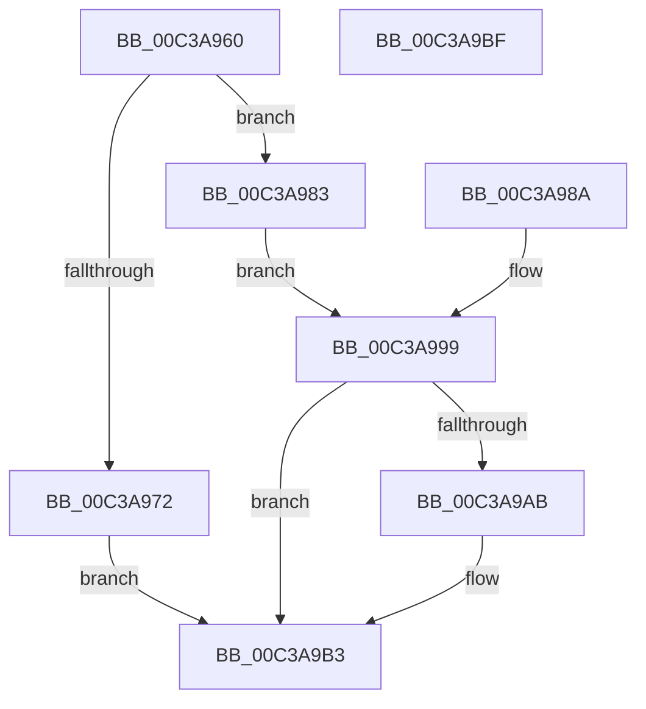

# KiVerifyXcpt11

- RVA: `0x00C3A960`–`0x00C3A9C0` (길이 `96` bytes)
- VA: `0x0000000140C3A960`
- 실행 섹션: `INIT`
- PDB 이름 있음: `예`; PDB Function 태그: `아니요`
- unwind 정보 RVA: `0x000CADF4`
- 디코드: `30`개 명령, `96/96` bytes 표시
- 미해석 바이트: `0` (있으면 어셈블리에 `.byte`로 보존)

> 이 문서는 커널 이미지의 기계어와 PDB 기호를 분석해 생성했습니다. 4번과 5번은 함수 원형과 자료형을 바이너리 사용 방식에서 추정한 C 해석이며 원본 소스 복구 결과는 아닙니다.

## 1. Dependencies

- 직접 호출 지점: **1**; 고유 호출 대상: **1**
- 직접 호출자로 확인된 함수: **0**
- RIP 상대 이미지 참조: **0**

### Outgoing calls
- `0x00C3A9AE` → [KiVerifyXcptFilter](KiVerifyXcptFilter_function_00C3ADD0.md) (function, `0x00C3ADD0`)

### Direct callers
- 이 함수 시작 RVA로 연결되는 직접 call은 확인되지 않았습니다. 간접 호출은 완전히 역산할 수 없습니다.

### Static image references
- 디코드된 RIP-relative 메모리 참조가 없습니다.

## 2. Other-region calls and transfers

- 다른 실행 섹션으로 향하는 call: **0**
- 별도 외부 분기/꼬리 이동을 확인하지 못했습니다.

## 3. Assembly (complete function range)

```asm
00C3A960  48 89 4C 24 08                  mov qword ptr [rsp + 8], rcx
00C3A965  48 83 EC 28                     sub rsp, 0x28
00C3A969  48 8B D1                        mov rdx, rcx
00C3A96C  83 79 08 01                     cmp dword ptr [rcx + 8], 1
00C3A970  74 11                           je 0x140c3a983
00C3A972  4C 8D 41 0C                     lea r8, [rcx + 0xc]
00C3A976  41 83 08 FF                     or dword ptr [r8], 0xffffffff
00C3A97A  C7 41 10 01 00 00 00            mov dword ptr [rcx + 0x10], 1
00C3A981  EB 30                           jmp 0x140c3a9b3
00C3A983  48 8B 01                        mov rax, qword ptr [rcx]
00C3A986  FF 00                           inc dword ptr [rax]
00C3A988  EB 0F                           jmp 0x140c3a999
00C3A98A  48 8B 54 24 30                  mov rdx, qword ptr [rsp + 0x30]
00C3A98F  8B 42 0C                        mov eax, dword ptr [rdx + 0xc]
00C3A992  83 C0 0C                        add eax, 0xc
00C3A995  89 42 0C                        mov dword ptr [rdx + 0xc], eax
00C3A998  90                              nop
00C3A999  4C 8D 42 0C                     lea r8, [rdx + 0xc]
00C3A99D  41 8B 00                        mov eax, dword ptr [r8]
00C3A9A0  83 C0 0C                        add eax, 0xc
00C3A9A3  41 89 00                        mov dword ptr [r8], eax
00C3A9A6  83 F8 24                        cmp eax, 0x24
00C3A9A9  75 08                           jne 0x140c3a9b3
00C3A9AB  48 8B CA                        mov rcx, rdx
00C3A9AE  E8 1D 04 00 00                  call 0x140c3add0
00C3A9B3  49 63 00                        movsxd rax, dword ptr [r8]
00C3A9B6  48 01 42 18                     add qword ptr [rdx + 0x18], rax
00C3A9BA  48 83 C4 28                     add rsp, 0x28
00C3A9BE  C3                              ret
00C3A9BF  CC                              int3
```

## 4. C-style interpretation (structured pseudocode)

```c
__int64 __fastcall KiVerifyXcpt11(__int64 a1)
{
    __int64 result;
    __int64 v_rsp;
    unsigned __int64 v_stack_p8;

    v_stack_p8 = a1;
    v_rsp = (v_rsp) - (40);
    if ((*(unsigned int *)(a1 + 8)) == 1) goto loc_00C3A983;
    *(unsigned int *)(a1 + 16) = 1;
    goto loc_00C3A9B3;
loc_00C3A983:
    goto loc_00C3A999;
loc_00C3A999:
    result = (unsigned int)(((unsigned int)(*(unsigned int *)(a1 + 12))) + (12));
    *(unsigned int *)(a1 + 12) = (unsigned int)(result);
    if (((unsigned int)(result)) == 36) {
        a1 = a1;
        result = KiVerifyXcptFilter(a1, a1, a1 + 12, a4);
    }
    v_rsp = (v_rsp) + (40);
    return (int)(*(unsigned int *)(a1 + 12));
}
```

## 5. (Beta) C Style

```c
int64_t KiVerifyXcpt11(void *Arg1)
{
    uint8_t *arg1 = (uint8_t *)Arg1;

    int64_t result;
    int64_t local_rsp;
    uint64_t v_stack_p8;

    v_stack_p8 = Arg1;
    local_rsp = (local_rsp) - (40);
    if ((*(uint32_t *)(arg1 + 0x8)) == 1) goto loc_00C3A983;
    *(uint32_t *)(arg1 + 0x10) = 1;
    goto loc_00C3A9B3;
loc_00C3A983:
    goto loc_00C3A999;
loc_00C3A999:
    result = (uint32_t)(((uint32_t)(*(uint32_t *)(arg1 + 0xC))) + (12));
    *(uint32_t *)(arg1 + 0xC) = (uint32_t)(result);
    if (((uint32_t)(result)) == 36) {
        Arg1 = Arg1;
        result = KiVerifyXcptFilter(Arg1, Arg1, Arg1 + 12, a4);
    }
    local_rsp = (local_rsp) + (40);
    return (int32_t)(*(uint32_t *)(arg1 + 0xC));
}
```

### 관측된 메모리 오프셋

구조체 형식이 확인되지 않은 접근은 인자 기준의 오프셋으로만 기록했습니다.

| 기준 인자 | 오프셋 표현 | 폭 (bit) | 접근 |
|---|---:|---:|---|
| `Arg1` | `+ 0x0` | `32` | `R` |
| `Arg1` | `+ 0x0` | `32` | `R/W` |
| `Arg1` | `+ 0x0` | `32` | `W` |
| `Arg1` | `+ 0x0` | `64` | `R` |
| `Arg1` | `+ 0x8` | `32` | `R` |
| `Arg1` | `+ 0xC` | `64` | `R` |
| `Arg1` | `+ 0x10` | `32` | `W` |

## 6. Execution-region graph

[열기: 2D/3D 그래프와 함수 탐색 컨트롤 패널](../../../control-panel.html?section=init&rva=0x00C3A960&view=graph)

- 2D 그래프는 위에서 아래로 흐르고, 3D 그래프는 빈 공간을 드래그해 회전합니다. Shift+드래그는 이동, 휠은 확대·축소, 함수 노드 선택은 대상 보고서 이동입니다.

### Static fallback


