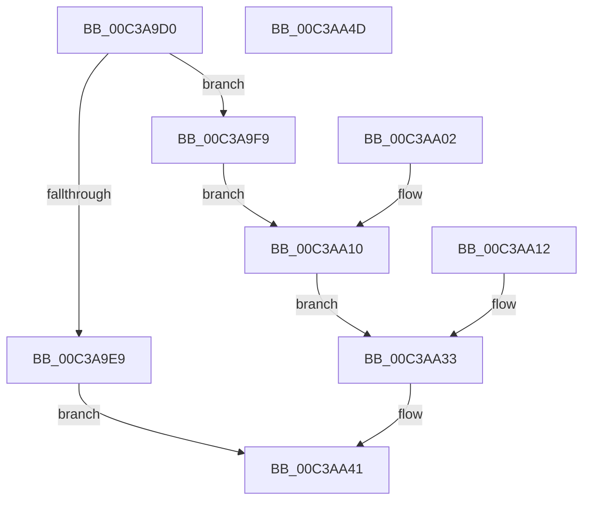

# KiVerifyXcpt12

- RVA: `0x00C3A9D0`–`0x00C3AA4E` (길이 `126` bytes)
- VA: `0x0000000140C3A9D0`
- 실행 섹션: `INIT`
- PDB 이름 있음: `예`; PDB Function 태그: `아니요`
- unwind 정보 RVA: `0x000CAD80`
- 디코드: `38`개 명령, `126/126` bytes 표시
- 미해석 바이트: `0` (있으면 어셈블리에 `.byte`로 보존)

> 이 문서는 커널 이미지의 기계어와 PDB 기호를 분석해 생성했습니다. 4번과 5번은 함수 원형과 자료형을 바이너리 사용 방식에서 추정한 C 해석이며 원본 소스 복구 결과는 아닙니다.

## 1. Dependencies

- 직접 호출 지점: **1**; 고유 호출 대상: **1**
- 직접 호출자로 확인된 함수: **0**
- RIP 상대 이미지 참조: **1**

### Outgoing calls
- `0x00C3AA2C` → [local_unwind](../../text/4F/local_unwind_function_004FFB40.md) (function, `0x004FFB40`)

### Direct callers
- 이 함수 시작 RVA로 연결되는 직접 call은 확인되지 않았습니다. 간접 호출은 완전히 역산할 수 없습니다.

### Static image references
- `0x00C3AA20` → RVA `0x00C3AA48` (`INIT`; read)

## 2. Other-region calls and transfers

- 다른 실행 섹션으로 향하는 call: **1**
  - `0x00C3AA2C` → [local_unwind](../../text/4F/local_unwind_function_004FFB40.md) (`INIT` → `.text`)
- 별도 외부 분기/꼬리 이동을 확인하지 못했습니다.

## 3. Assembly (complete function range)

```asm
00C3A9D0  48 89 4C 24 08                  mov qword ptr [rsp + 8], rcx
00C3A9D5  48 83 EC 38                     sub rsp, 0x38
00C3A9D9  48 89 64 24 20                  mov qword ptr [rsp + 0x20], rsp
00C3A9DE  48 89 4C 24 48                  mov qword ptr [rsp + 0x48], rcx
00C3A9E3  83 79 08 01                     cmp dword ptr [rcx + 8], 1
00C3A9E7  74 10                           je 0x140c3a9f9
00C3A9E9  48 8D 41 0C                     lea rax, [rcx + 0xc]
00C3A9ED  83 08 FF                        or dword ptr [rax], 0xffffffff
00C3A9F0  C7 41 10 01 00 00 00            mov dword ptr [rcx + 0x10], 1
00C3A9F7  EB 48                           jmp 0x140c3aa41
00C3A9F9  48 8B 01                        mov rax, qword ptr [rcx]
00C3A9FC  FF 00                           inc dword ptr [rax]
00C3A9FE  90                              nop
00C3A9FF  90                              nop
00C3AA00  EB 0E                           jmp 0x140c3aa10
00C3AA02  48 8B 54 24 40                  mov rdx, qword ptr [rsp + 0x40]
00C3AA07  48 8B 02                        mov rax, qword ptr [rdx]
00C3AA0A  8B 08                           mov ecx, dword ptr [rax]
00C3AA0C  FF C1                           inc ecx
00C3AA0E  89 08                           mov dword ptr [rax], ecx
00C3AA10  EB 21                           jmp 0x140c3aa33
00C3AA12  48 8B 4C 24 40                  mov rcx, qword ptr [rsp + 0x40]
00C3AA17  8B 41 0C                        mov eax, dword ptr [rcx + 0xc]
00C3AA1A  83 C0 0D                        add eax, 0xd
00C3AA1D  89 41 0C                        mov dword ptr [rcx + 0xc], eax
00C3AA20  48 8D 15 21 00 00 00            lea rdx, [rip + 0x21]
00C3AA27  48 8B 4C 24 20                  mov rcx, qword ptr [rsp + 0x20]
00C3AA2C  E8 0F 51 8C FF                  call 0x1404ffb40
00C3AA31  90                              nop
00C3AA32  90                              nop
00C3AA33  48 8B 44 24 48                  mov rax, qword ptr [rsp + 0x48]
00C3AA38  48 83 C0 0C                     add rax, 0xc
00C3AA3C  48 8B 4C 24 40                  mov rcx, qword ptr [rsp + 0x40]
00C3AA41  48 63 00                        movsxd rax, dword ptr [rax]
00C3AA44  48 01 41 18                     add qword ptr [rcx + 0x18], rax
00C3AA48  48 83 C4 38                     add rsp, 0x38
00C3AA4C  C3                              ret
00C3AA4D  CC                              int3
```

## 4. C-style interpretation (structured pseudocode)

```c
__int64 __fastcall KiVerifyXcpt12(__int64 a1)
{
    __int64 result;
    __int64 v_rsp;
    unsigned __int64 v_stack_m18;
    unsigned __int64 v_stack_p10;
    unsigned __int64 v_stack_p8;

    v_stack_p8 = a1;
    v_rsp = (v_rsp) - (56);
    v_stack_m18 = v_rsp;
    v_stack_p10 = a1;
    if ((*(unsigned int *)(a1 + 8)) == 1) goto loc_00C3A9F9;
    *(unsigned int *)(a1 + 16) = 1;
    goto loc_00C3AA41;
loc_00C3A9F9:
    goto loc_00C3AA10;
loc_00C3AA10:
    goto loc_00C3AA33;
loc_00C3AA33:
    result = (v_stack_p10) + (12);
loc_00C3AA41:
    v_rsp = (v_rsp) + (56);
    return (int)(*(unsigned int *)(result));
}
```

## 5. (Beta) C Style

```c
int64_t KiVerifyXcpt12(void *Arg1)
{
    uint8_t *arg1 = (uint8_t *)Arg1;

    int64_t result;
    int64_t local_rsp;
    uint64_t v_stack_m18;
    uint64_t v_stack_p10;
    uint64_t v_stack_p8;

    v_stack_p8 = Arg1;
    local_rsp = (local_rsp) - (56);
    v_stack_m18 = local_rsp;
    v_stack_p10 = Arg1;
    if ((*(uint32_t *)(arg1 + 0x8)) == 1) goto loc_00C3A9F9;
    *(uint32_t *)(arg1 + 0x10) = 1;
    goto loc_00C3AA41;
loc_00C3A9F9:
    goto loc_00C3AA10;
loc_00C3AA10:
    goto loc_00C3AA33;
loc_00C3AA33:
    result = (v_stack_p10) + (12);
loc_00C3AA41:
    local_rsp = (local_rsp) + (56);
    return (int32_t)(*(uint32_t *)(result));
}
```

### 관측된 메모리 오프셋

구조체 형식이 확인되지 않은 접근은 인자 기준의 오프셋으로만 기록했습니다.

| 기준 인자 | 오프셋 표현 | 폭 (bit) | 접근 |
|---|---:|---:|---|
| `Arg1` | `+ 0x0` | `32` | `R/W` |
| `Arg1` | `+ 0x0` | `64` | `R` |
| `Arg1` | `+ 0x8` | `32` | `R` |
| `Arg1` | `+ 0xC` | `64` | `R` |
| `Arg1` | `+ 0x10` | `32` | `W` |

## 6. Execution-region graph

[열기: 2D/3D 그래프와 함수 탐색 컨트롤 패널](../../../control-panel.html?section=init&rva=0x00C3A9D0&view=graph)

- 2D 그래프는 위에서 아래로 흐르고, 3D 그래프는 빈 공간을 드래그해 회전합니다. Shift+드래그는 이동, 휠은 확대·축소, 함수 노드 선택은 대상 보고서 이동입니다.

### Static fallback


