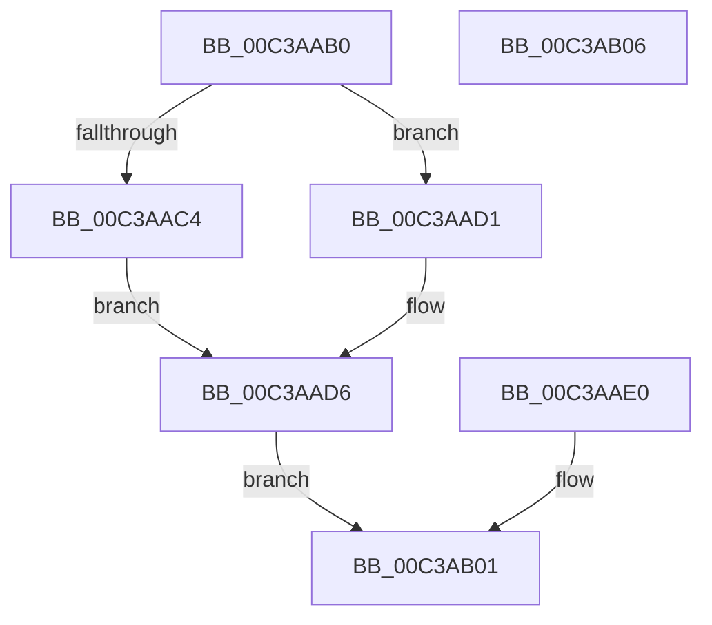

# KiVerifyXcpt14

- RVA: `0x00C3AAB0`–`0x00C3AB07` (길이 `87` bytes)
- VA: `0x0000000140C3AAB0`
- 실행 섹션: `INIT`
- PDB 이름 있음: `예`; PDB Function 태그: `아니요`
- unwind 정보 RVA: `0x000CACD8`
- 디코드: `25`개 명령, `87/87` bytes 표시
- 미해석 바이트: `0` (있으면 어셈블리에 `.byte`로 보존)

> 이 문서는 커널 이미지의 기계어와 PDB 기호를 분석해 생성했습니다. 4번과 5번은 함수 원형과 자료형을 바이너리 사용 방식에서 추정한 C 해석이며 원본 소스 복구 결과는 아닙니다.

## 1. Dependencies

- 직접 호출 지점: **1**; 고유 호출 대상: **1**
- 직접 호출자로 확인된 함수: **0**
- RIP 상대 이미지 참조: **1**

### Outgoing calls
- `0x00C3AAFA` → [local_unwind](../../text/4F/local_unwind_function_004FFB40.md) (function, `0x004FFB40`)

### Direct callers
- 이 함수 시작 RVA로 연결되는 직접 call은 확인되지 않았습니다. 간접 호출은 완전히 역산할 수 없습니다.

### Static image references
- `0x00C3AAEE` → RVA `0x00C3AB01` (`INIT`; read)

## 2. Other-region calls and transfers

- 다른 실행 섹션으로 향하는 call: **1**
  - `0x00C3AAFA` → [local_unwind](../../text/4F/local_unwind_function_004FFB40.md) (`INIT` → `.text`)
- 별도 외부 분기/꼬리 이동을 확인하지 못했습니다.

## 3. Assembly (complete function range)

```asm
00C3AAB0  48 89 4C 24 08                  mov qword ptr [rsp + 8], rcx
00C3AAB5  48 83 EC 38                     sub rsp, 0x38
00C3AAB9  48 89 64 24 20                  mov qword ptr [rsp + 0x20], rsp
00C3AABE  83 79 08 01                     cmp dword ptr [rcx + 8], 1
00C3AAC2  74 0D                           je 0x140c3aad1
00C3AAC4  83 49 0C FF                     or dword ptr [rcx + 0xc], 0xffffffff
00C3AAC8  C7 41 10 01 00 00 00            mov dword ptr [rcx + 0x10], 1
00C3AACF  EB 05                           jmp 0x140c3aad6
00C3AAD1  48 8B 01                        mov rax, qword ptr [rcx]
00C3AAD4  FF 00                           inc dword ptr [rax]
00C3AAD6  48 63 41 0C                     movsxd rax, dword ptr [rcx + 0xc]
00C3AADA  48 01 41 18                     add qword ptr [rcx + 0x18], rax
00C3AADE  EB 21                           jmp 0x140c3ab01
00C3AAE0  48 8B 4C 24 40                  mov rcx, qword ptr [rsp + 0x40]
00C3AAE5  8B 41 0C                        mov eax, dword ptr [rcx + 0xc]
00C3AAE8  83 C0 0F                        add eax, 0xf
00C3AAEB  89 41 0C                        mov dword ptr [rcx + 0xc], eax
00C3AAEE  48 8D 15 0C 00 00 00            lea rdx, [rip + 0xc]
00C3AAF5  48 8B 4C 24 20                  mov rcx, qword ptr [rsp + 0x20]
00C3AAFA  E8 41 50 8C FF                  call 0x1404ffb40
00C3AAFF  90                              nop
00C3AB00  90                              nop
00C3AB01  48 83 C4 38                     add rsp, 0x38
00C3AB05  C3                              ret
00C3AB06  CC                              int3
```

## 4. C-style interpretation (structured pseudocode)

```c
__int64 __fastcall KiVerifyXcpt14(__int64 a1)
{
    __int64 v_rsp;
    unsigned __int64 v_stack_m18;
    unsigned __int64 v_stack_p8;

    v_stack_p8 = a1;
    v_rsp = (v_rsp) - (56);
    v_stack_m18 = v_rsp;
    if ((*(unsigned int *)(a1 + 8)) == 1) goto loc_00C3AAD1;
    *(unsigned int *)(a1 + 16) = 1;
    goto loc_00C3AAD6;
loc_00C3AAD1:
loc_00C3AAD6:
    goto loc_00C3AB01;
loc_00C3AB01:
    v_rsp = (v_rsp) + (56);
    return (int)(*(unsigned int *)(a1 + 12));
}
```

## 5. (Beta) C Style

```c
int64_t KiVerifyXcpt14(void *Arg1)
{
    uint8_t *arg1 = (uint8_t *)Arg1;

    int64_t local_rsp;
    uint64_t v_stack_m18;
    uint64_t v_stack_p8;

    v_stack_p8 = Arg1;
    local_rsp = (local_rsp) - (56);
    v_stack_m18 = local_rsp;
    if ((*(uint32_t *)(arg1 + 0x8)) == 1) goto loc_00C3AAD1;
    *(uint32_t *)(arg1 + 0x10) = 1;
    goto loc_00C3AAD6;
loc_00C3AAD1:
loc_00C3AAD6:
    goto loc_00C3AB01;
loc_00C3AB01:
    local_rsp = (local_rsp) + (56);
    return (int32_t)(*(uint32_t *)(arg1 + 0xC));
}
```

### 관측된 메모리 오프셋

구조체 형식이 확인되지 않은 접근은 인자 기준의 오프셋으로만 기록했습니다.

| 기준 인자 | 오프셋 표현 | 폭 (bit) | 접근 |
|---|---:|---:|---|
| `Arg1` | `+ 0x0` | `64` | `R` |
| `Arg1` | `+ 0x8` | `32` | `R` |
| `Arg1` | `+ 0xC` | `32` | `R` |
| `Arg1` | `+ 0xC` | `32` | `R/W` |
| `Arg1` | `+ 0x10` | `32` | `W` |
| `Arg1` | `+ 0x18` | `64` | `R/W` |

## 6. Execution-region graph

[열기: 2D/3D 그래프와 함수 탐색 컨트롤 패널](../../../control-panel.html?section=init&rva=0x00C3AAB0&view=graph)

- 2D 그래프는 위에서 아래로 흐르고, 3D 그래프는 빈 공간을 드래그해 회전합니다. Shift+드래그는 이동, 휠은 확대·축소, 함수 노드 선택은 대상 보고서 이동입니다.

### Static fallback


