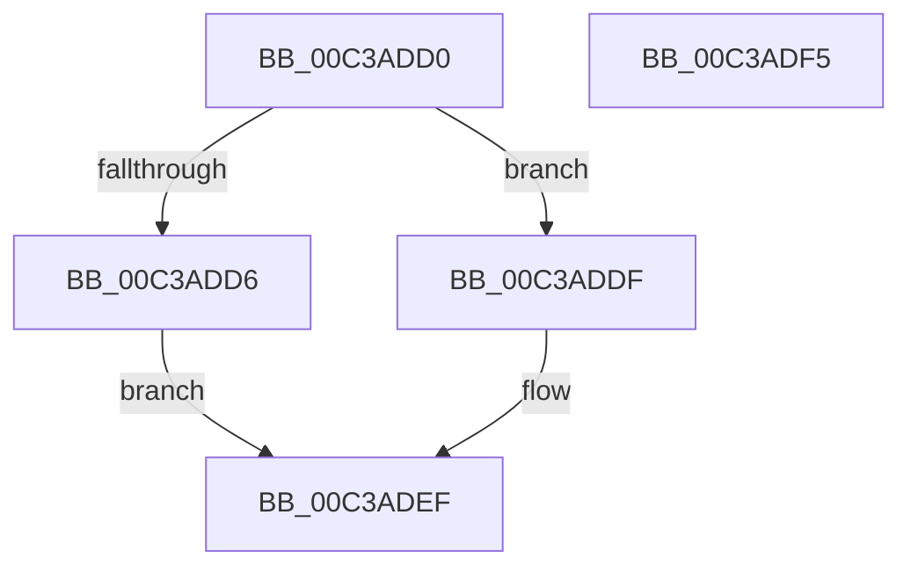

# KiVerifyXcptFilter

- RVA: `0x00C3ADD0`–`0x00C3ADF6` (길이 `38` bytes)
- VA: `0x0000000140C3ADD0`
- 실행 섹션: `INIT`
- PDB 이름 있음: `예`; PDB Function 태그: `아니요`
- unwind 정보 RVA: `0x000DB714`
- 디코드: `11`개 명령, `38/38` bytes 표시
- 미해석 바이트: `0` (있으면 어셈블리에 `.byte`로 보존)

> 이 문서는 커널 이미지의 기계어와 PDB 기호를 분석해 생성했습니다. 4번과 5번은 함수 원형과 자료형을 바이너리 사용 방식에서 추정한 C 해석이며 원본 소스 복구 결과는 아닙니다.

## 1. Dependencies

- 직접 호출 지점: **0**; 고유 호출 대상: **0**
- 직접 호출자로 확인된 함수: **19**
- RIP 상대 이미지 참조: **0**

### Outgoing calls
- 직접 디코드된 call 명령이 없습니다.

### Direct callers
- [KiVerifyXcpt10](KiVerifyXcpt10_function_00C3A800.md) at `0x00C3A927`
- [KiVerifyXcpt11](KiVerifyXcpt11_function_00C3A960.md) at `0x00C3A9AE`
- [KiVerifyXcpt0$filt$1](../C7/KiVerifyXcpt0_filt_1_function_00C7F87F.md) at `0x00C7F899`
- [KiVerifyXcpt1$fin$0](../C7/KiVerifyXcpt1_fin_0_function_00C7F8AF.md) at `0x00C7F8C9`
- [KiVerifyXcpt10$fin$9](../C7/KiVerifyXcpt10_fin_9_function_00C7FA2E.md) at `0x00C7FA73`
- [KiVerifyXcpt10$fin$8](../C7/KiVerifyXcpt10_fin_8_function_00C7FAA1.md) at `0x00C7FACE`
- [KiVerifyXcpt10$fin$7](../C7/KiVerifyXcpt10_fin_7_function_00C7FAEB.md) at `0x00C7FB14`
- [KiVerifyXcpt11$fin$2](../C7/KiVerifyXcpt11_fin_2_function_00C7FB7F.md) at `0x00C7FB9A`
- [KiVerifyXcpt12$fin$6](../C7/KiVerifyXcpt12_fin_6_function_00C7FCB8.md) at `0x00C7FCD7`
- [KiVerifyXcpt13$filt$3](../C7/KiVerifyXcpt13_filt_3_function_00C7FD67.md) at `0x00C7FD82`
- [KiVerifyXcpt14$fin$2](../C7/KiVerifyXcpt14_fin_2_function_00C7FDE7.md) at `0x00C7FE09`
- [KiVerifyXcpt2$filt$2](../C7/KiVerifyXcpt2_filt_2_function_00C7FEA7.md) at `0x00C7FEC2`
- [KiVerifyXcpt3$fin$1](../C7/KiVerifyXcpt3_fin_1_function_00C7FF19.md) at `0x00C7FF3C`
- [KiVerifyXcpt4$filt$2](../C7/KiVerifyXcpt4_filt_2_function_00C7FFF3.md) at `0x00C8000E`
- [KiVerifyXcpt5$fin$1](../C8/KiVerifyXcpt5_fin_1_function_00C80056.md) at `0x00C80079`
- [KiVerifyXcpt6$filt$3](../C8/KiVerifyXcpt6_filt_3_function_00C8016A.md) at `0x00C80185`
- [KiVerifyXcpt7$fin$2](../C8/KiVerifyXcpt7_fin_2_function_00C801F8.md) at `0x00C8021B`
- [KiVerifyXcpt8$filt$1](../C8/KiVerifyXcpt8_filt_1_function_00C802A4.md) at `0x00C802BF`
- [KiVerifyXcpt9$fin$0](../C8/KiVerifyXcpt9_fin_0_function_00C8033D.md) at `0x00C80363`

### Static image references
- 디코드된 RIP-relative 메모리 참조가 없습니다.

## 2. Other-region calls and transfers

- 다른 실행 섹션으로 향하는 call: **0**
- 별도 외부 분기/꼬리 이동을 확인하지 못했습니다.

## 3. Assembly (complete function range)

```asm
00C3ADD0  83 79 10 00                     cmp dword ptr [rcx + 0x10], 0
00C3ADD4  75 09                           jne 0x140c3addf
00C3ADD6  C7 41 10 01 00 00 00            mov dword ptr [rcx + 0x10], 1
00C3ADDD  EB 10                           jmp 0x140c3adef
00C3ADDF  83 61 10 00                     and dword ptr [rcx + 0x10], 0
00C3ADE3  C7 41 0C 55 AA 55 AA            mov dword ptr [rcx + 0xc], 0xaa55aa55
00C3ADEA  48 8B 09                        mov rcx, qword ptr [rcx]
00C3ADED  FF 01                           inc dword ptr [rcx]
00C3ADEF  B8 01 00 00 00                  mov eax, 1
00C3ADF4  C3                              ret
00C3ADF5  CC                              int3
```

## 4. C-style interpretation (structured pseudocode)

```c
__int64 __fastcall KiVerifyXcptFilter(__int64 a1)
{
    if ((*(unsigned int *)(a1 + 16)) != 0) goto loc_00C3ADDF;
    *(unsigned int *)(a1 + 16) = 1;
    goto loc_00C3ADEF;
loc_00C3ADDF:
    *(unsigned int *)(a1 + 12) = 0xAA55AA55ULL;
loc_00C3ADEF:
    return 1;
}
```

## 5. (Beta) C Style

```c
int64_t KiVerifyXcptFilter(void *Arg1)
{
    uint8_t *arg1 = (uint8_t *)Arg1;

    if ((*(uint32_t *)(arg1 + 0x10)) != 0) goto loc_00C3ADDF;
    *(uint32_t *)(arg1 + 0x10) = 1;
    goto loc_00C3ADEF;
loc_00C3ADDF:
    *(uint32_t *)(arg1 + 0xC) = 0xAA55AA55ULL;
loc_00C3ADEF:
    return 1;
}
```

### 관측된 메모리 오프셋

구조체 형식이 확인되지 않은 접근은 인자 기준의 오프셋으로만 기록했습니다.

| 기준 인자 | 오프셋 표현 | 폭 (bit) | 접근 |
|---|---:|---:|---|
| `Arg1` | `+ 0x0` | `64` | `R` |
| `Arg1` | `+ 0xC` | `32` | `W` |
| `Arg1` | `+ 0x10` | `32` | `R` |
| `Arg1` | `+ 0x10` | `32` | `R/W` |
| `Arg1` | `+ 0x10` | `32` | `W` |

## 6. Execution-region graph

[열기: 2D/3D 그래프와 함수 탐색 컨트롤 패널](../../../control-panel.html?section=init&rva=0x00C3ADD0&view=graph)

- 2D 그래프는 위에서 아래로 흐르고, 3D 그래프는 빈 공간을 드래그해 회전합니다. Shift+드래그는 이동, 휠은 확대·축소, 함수 노드 선택은 대상 보고서 이동입니다.

### Static fallback


