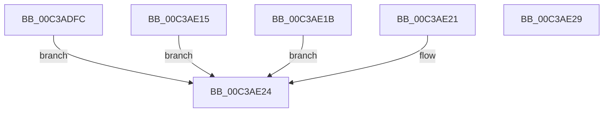

# KiVerifyXcptFinally

- RVA: `0x00C3ADFC`–`0x00C3AE2A` (길이 `46` bytes)
- VA: `0x0000000140C3ADFC`
- 실행 섹션: `INIT`
- PDB 이름 있음: `예`; PDB Function 태그: `아니요`
- unwind 정보 RVA: `0x000CAC94`
- 디코드: `17`개 명령, `46/46` bytes 표시
- 미해석 바이트: `0` (있으면 어셈블리에 `.byte`로 보존)

> 이 문서는 커널 이미지의 기계어와 PDB 기호를 분석해 생성했습니다. 4번과 5번은 함수 원형과 자료형을 바이너리 사용 방식에서 추정한 C 해석이며 원본 소스 복구 결과는 아닙니다.

## 1. Dependencies

- 직접 호출 지점: **0**; 고유 호출 대상: **0**
- 직접 호출자로 확인된 함수: **1**
- RIP 상대 이미지 참조: **0**

### Outgoing calls
- 직접 디코드된 call 명령이 없습니다.

### Direct callers
- [KiVerifyXcpt2$fin$1](../C7/KiVerifyXcpt2_fin_1_function_00C7FE67.md) at `0x00C7FE82`

### Static image references
- 디코드된 RIP-relative 메모리 참조가 없습니다.

## 2. Other-region calls and transfers

- 다른 실행 섹션으로 향하는 call: **0**
- 별도 외부 분기/꼬리 이동을 확인하지 못했습니다.

## 3. Assembly (complete function range)

```asm
00C3ADFC  48 89 4C 24 08                  mov qword ptr [rsp + 8], rcx
00C3AE01  48 83 EC 38                     sub rsp, 0x38
00C3AE05  48 89 64 24 28                  mov qword ptr [rsp + 0x28], rsp
00C3AE0A  48 8B 01                        mov rax, qword ptr [rcx]
00C3AE0D  FF 00                           inc dword ptr [rax]
00C3AE0F  90                              nop
00C3AE10  90                              nop
00C3AE11  33 C0                           xor eax, eax
00C3AE13  EB 0F                           jmp 0x140c3ae24
00C3AE15  8B 44 24 20                     mov eax, dword ptr [rsp + 0x20]
00C3AE19  EB 09                           jmp 0x140c3ae24
00C3AE1B  8B 44 24 24                     mov eax, dword ptr [rsp + 0x24]
00C3AE1F  EB 03                           jmp 0x140c3ae24
00C3AE21  83 C8 FF                        or eax, 0xffffffff
00C3AE24  48 83 C4 38                     add rsp, 0x38
00C3AE28  C3                              ret
00C3AE29  CC                              int3
```

## 4. C-style interpretation (structured pseudocode)

```c
__int64 __fastcall KiVerifyXcptFinally(__int64 a1)
{
    __int64 result;
    __int64 v_rsp;
    unsigned __int64 v_stack_m10;
    unsigned int v_stack_m14;
    unsigned int v_stack_m18;
    unsigned __int64 v_stack_p8;

    v_stack_p8 = a1;
    v_rsp = (v_rsp) - (56);
    v_stack_m10 = v_rsp;
    result = 0;
    goto loc_00C3AE24;
loc_00C3AE24:
    v_rsp = (v_rsp) + (56);
    return result;
}
```

## 5. (Beta) C Style

```c
int64_t KiVerifyXcptFinally(void *Arg1)
{
    uint8_t *arg1 = (uint8_t *)Arg1;

    int64_t result;
    int64_t local_rsp;
    uint64_t v_stack_m10;
    uint32_t v_stack_m14;
    uint32_t v_stack_m18;
    uint64_t v_stack_p8;

    v_stack_p8 = Arg1;
    local_rsp = (local_rsp) - (56);
    v_stack_m10 = local_rsp;
    result = 0;
    goto loc_00C3AE24;
loc_00C3AE24:
    local_rsp = (local_rsp) + (56);
    return result;
}
```

### 관측된 메모리 오프셋

구조체 형식이 확인되지 않은 접근은 인자 기준의 오프셋으로만 기록했습니다.

| 기준 인자 | 오프셋 표현 | 폭 (bit) | 접근 |
|---|---:|---:|---|
| `Arg1` | `+ 0x0` | `64` | `R` |

## 6. Execution-region graph

[열기: 2D/3D 그래프와 함수 탐색 컨트롤 패널](../../../control-panel.html?section=init&rva=0x00C3ADFC&view=graph)

- 2D 그래프는 위에서 아래로 흐르고, 3D 그래프는 빈 공간을 드래그해 회전합니다. Shift+드래그는 이동, 휠은 확대·축소, 함수 노드 선택은 대상 보고서 이동입니다.

### Static fallback


