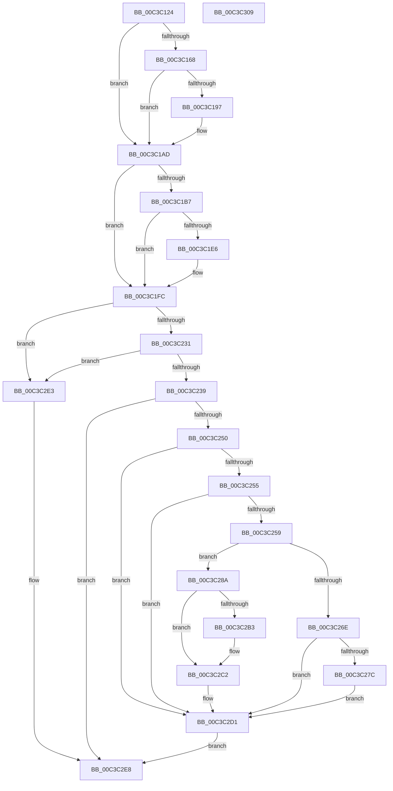

# KseShimDatabaseBootInitialize

- RVA: `0x00C3C124`–`0x00C3C30A` (길이 `486` bytes)
- VA: `0x0000000140C3C124`
- 실행 섹션: `INIT`
- PDB 이름 있음: `예`; PDB Function 태그: `아니요`
- unwind 정보 RVA: `0x000CB46C`
- 디코드: `114`개 명령, `486/486` bytes 표시
- 미해석 바이트: `0` (있으면 어셈블리에 `.byte`로 보존)

> 이 문서는 커널 이미지의 기계어와 PDB 기호를 분석해 생성했습니다. 4번과 5번은 함수 원형과 자료형을 바이너리 사용 방식에서 추정한 C 해석이며 원본 소스 복구 결과는 아닙니다.

## 1. Dependencies

- 직접 호출 지점: **8**; 고유 호출 대상: **6**
- 직접 호출자로 확인된 함수: **1**
- RIP 상대 이미지 참조: **18**

### Outgoing calls
- `0x00C3C1A8` → [RtlAssert](../../text/5E/RtlAssert_function_005E75E0.md) (function, `0x005E75E0`)
- `0x00C3C1F7` → [RtlAssert](../../text/5E/RtlAssert_function_005E75E0.md) (function, `0x005E75E0`)
- `0x00C3C223` → [memset](../../text/6C/memset_function_006C6C40.md) (function, `0x006C6C40`)
- `0x00C3C241` → [KsepSdbBootInitialize](../../page/74/KsepSdbBootInitialize_function_0074A7EC.md) (function, `0x0074A7EC`)
- `0x00C3C265` → [KsepSdbBootInitialize](../../page/74/KsepSdbBootInitialize_function_0074A7EC.md) (function, `0x0074A7EC`)
- `0x00C3C283` → [KsepSdbBootRelease](../../page/74/KsepSdbBootRelease_function_0074A924.md) (function, `0x0074A924`)
- `0x00C3C2BD` → [KsepDebugPrint](../../text/4D/KsepDebugPrint_function_004DCFF0.md) (function, `0x004DCFF0`)
- `0x00C3C2CC` → [KsepLogError](../../text/49/KsepLogError_function_00499A98.md) (function, `0x00499A98`)

### Direct callers
- [KseInitialize](KseInitialize_function_00C3B5AC.md) at `0x00C3B617`

### Static image references
- `0x00C3C141` → RVA `0x00F105E8` (`.data`; read)
- `0x00C3C148` → RVA `0x00F101E0` (`.data`; read)
- `0x00C3C16B` → RVA `0x00F101C0` (`.data`; read/write)
- `0x00C3C18D` → RVA `0x00E66CE8` (`.data`; read)
- `0x00C3C19A` → RVA `0x00C7B760` (` ?? ::PBOPGDP::`string'`; read)
- `0x00C3C1A1` → RVA `0x00C7B780` (` ?? ::PBOPGDP::`string'`; read)
- `0x00C3C1AD` → RVA `0x00F10678` (`.data`; read)
- `0x00C3C1F0` → RVA `0x00C7B700` (` ?? ::PBOPGDP::`string'`; read)
- `0x00C3C1FC` → RVA `0x00F10670` (`.data`; read/write)
- `0x00C3C204` → RVA `0x00F10600` (`.data`; read)
- `0x00C3C20B` → RVA `0x00F10678` (`.data`; read/write)
- `0x00C3C218` → RVA `0x00F105E8` (`.data`; write)
- `0x00C3C259` → RVA `0x00F10638` (`.data`; read)
- `0x00C3C26E` → RVA `0x00F10668` (`.data`; read)
- `0x00C3C274` → RVA `0x00F10630` (`.data`; read)
- `0x00C3C2B3` → RVA `0x00C7B720` (` ?? ::PBOPGDP::`string'`; read)
- `0x00C3C2D1` → RVA `0x00F105E4` (`.data`; read/write)
- `0x00C3C2DA` → RVA `0x00F10678` (`.data`; write)

## 2. Other-region calls and transfers

- 다른 실행 섹션으로 향하는 call: **8**
  - `0x00C3C1A8` → [RtlAssert](../../text/5E/RtlAssert_function_005E75E0.md) (`INIT` → `.text`)
  - `0x00C3C1F7` → [RtlAssert](../../text/5E/RtlAssert_function_005E75E0.md) (`INIT` → `.text`)
  - `0x00C3C223` → [memset](../../text/6C/memset_function_006C6C40.md) (`INIT` → `.text`)
  - `0x00C3C241` → [KsepSdbBootInitialize](../../page/74/KsepSdbBootInitialize_function_0074A7EC.md) (`INIT` → `PAGE`)
  - `0x00C3C265` → [KsepSdbBootInitialize](../../page/74/KsepSdbBootInitialize_function_0074A7EC.md) (`INIT` → `PAGE`)
  - `0x00C3C283` → [KsepSdbBootRelease](../../page/74/KsepSdbBootRelease_function_0074A924.md) (`INIT` → `PAGE`)
  - `0x00C3C2BD` → [KsepDebugPrint](../../text/4D/KsepDebugPrint_function_004DCFF0.md) (`INIT` → `.text`)
  - `0x00C3C2CC` → [KsepLogError](../../text/49/KsepLogError_function_00499A98.md) (`INIT` → `.text`)
- 별도 외부 분기/꼬리 이동을 확인하지 못했습니다.

## 3. Assembly (complete function range)

```asm
00C3C124  48 8B C4                        mov rax, rsp
00C3C127  48 89 58 08                     mov qword ptr [rax + 8], rbx
00C3C12B  48 89 68 10                     mov qword ptr [rax + 0x10], rbp
00C3C12F  48 89 70 18                     mov qword ptr [rax + 0x18], rsi
00C3C133  48 89 78 20                     mov qword ptr [rax + 0x20], rdi
00C3C137  41 54                           push r12
00C3C139  41 55                           push r13
00C3C13B  41 57                           push r15
00C3C13D  48 83 EC 20                     sub rsp, 0x20
00C3C141  83 3D A0 44 2D 00 00            cmp dword ptr [rip + 0x2d44a0], 0
00C3C148  4C 8D 2D 91 40 2D 00            lea r13, [rip + 0x2d4091]
00C3C14F  41 8B F1                        mov esi, r9d
00C3C152  49 8B E8                        mov rbp, r8
00C3C155  8B DA                           mov ebx, edx
00C3C157  48 8B F9                        mov rdi, rcx
00C3C15A  41 BF 01 00 00 00               mov r15d, 1
00C3C160  41 BC 20 04 00 C0               mov r12d, 0xc0000420
00C3C166  74 45                           je 0x140c3c1ad
00C3C168  41 8B C7                        mov eax, r15d
00C3C16B  F0 0F C1 05 4D 40 2D 00         lock xadd dword ptr [rip + 0x2d404d], eax
00C3C173  41 03 C7                        add eax, r15d
00C3C176  41 B8 E3 00 00 00               mov r8d, 0xe3
00C3C17C  83 E0 3F                        and eax, 0x3f
00C3C17F  45 89 64 C5 04                  mov dword ptr [r13 + rax*8 + 4], r12d
00C3C184  41 C7 44 C5 00 E3 00 09 00      mov dword ptr [r13 + rax*8], 0x900e3
00C3C18D  8B 05 55 AB 22 00               mov eax, dword ptr [rip + 0x22ab55]
00C3C193  A8 04                           test al, 4
00C3C195  74 16                           je 0x140c3c1ad
00C3C197  45 33 C9                        xor r9d, r9d
00C3C19A  48 8D 15 BF F5 03 00            lea rdx, [rip + 0x3f5bf]
00C3C1A1  48 8D 0D D8 F5 03 00            lea rcx, [rip + 0x3f5d8]
00C3C1A8  E8 33 B4 9A FF                  call 0x1405e75e0
00C3C1AD  48 83 3D C3 44 2D 00 00         cmp qword ptr [rip + 0x2d44c3], 0
00C3C1B5  74 45                           je 0x140c3c1fc
00C3C1B7  41 8B C7                        mov eax, r15d
00C3C1BA  F0 0F C1 05 FE 3F 2D 00         lock xadd dword ptr [rip + 0x2d3ffe], eax
00C3C1C2  41 03 C7                        add eax, r15d
00C3C1C5  41 B8 E4 00 00 00               mov r8d, 0xe4
00C3C1CB  83 E0 3F                        and eax, 0x3f
00C3C1CE  45 89 64 C5 04                  mov dword ptr [r13 + rax*8 + 4], r12d
00C3C1D3  41 C7 44 C5 00 E4 00 09 00      mov dword ptr [r13 + rax*8], 0x900e4
00C3C1DC  8B 05 06 AB 22 00               mov eax, dword ptr [rip + 0x22ab06]
00C3C1E2  A8 04                           test al, 4
00C3C1E4  74 16                           je 0x140c3c1fc
00C3C1E6  45 33 C9                        xor r9d, r9d
00C3C1E9  48 8D 15 70 F5 03 00            lea rdx, [rip + 0x3f570]
00C3C1F0  48 8D 0D 09 F5 03 00            lea rcx, [rip + 0x3f509]
00C3C1F7  E8 E4 B3 9A FF                  call 0x1405e75e0
00C3C1FC  48 83 25 6C 44 2D 00 00         and qword ptr [rip + 0x2d446c], 0
00C3C204  4C 8D 25 F5 43 2D 00            lea r12, [rip + 0x2d43f5]
00C3C20B  48 83 25 65 44 2D 00 00         and qword ptr [rip + 0x2d4465], 0
00C3C213  33 D2                           xor edx, edx
00C3C215  49 8B CC                        mov rcx, r12
00C3C218  44 89 3D C9 43 2D 00            mov dword ptr [rip + 0x2d43c9], r15d
00C3C21F  44 8D 42 70                     lea r8d, [rdx + 0x70]
00C3C223  E8 18 AA A8 FF                  call 0x1406c6c40
00C3C228  48 85 FF                        test rdi, rdi
00C3C22B  0F 84 B2 00 00 00               je 0x140c3c2e3
00C3C231  85 DB                           test ebx, ebx
00C3C233  0F 84 AA 00 00 00               je 0x140c3c2e3
00C3C239  4D 8B C4                        mov r8, r12
00C3C23C  8B D3                           mov edx, ebx
00C3C23E  48 8B CF                        mov rcx, rdi
00C3C241  E8 A6 E5 B0 FF                  call 0x14074a7ec
00C3C246  8B D8                           mov ebx, eax
00C3C248  85 C0                           test eax, eax
00C3C24A  0F 88 98 00 00 00               js 0x140c3c2e8
00C3C250  48 85 ED                        test rbp, rbp
00C3C253  74 7C                           je 0x140c3c2d1
00C3C255  85 F6                           test esi, esi
00C3C257  74 78                           je 0x140c3c2d1
00C3C259  4C 8D 05 D8 43 2D 00            lea r8, [rip + 0x2d43d8]
00C3C260  8B D6                           mov edx, esi
00C3C262  48 8B CD                        mov rcx, rbp
00C3C265  E8 82 E5 B0 FF                  call 0x14074a7ec
00C3C26A  85 C0                           test eax, eax
00C3C26C  78 1C                           js 0x140c3c28a
00C3C26E  8B 05 F4 43 2D 00               mov eax, dword ptr [rip + 0x2d43f4]
00C3C274  39 05 B6 43 2D 00               cmp dword ptr [rip + 0x2d43b6], eax
00C3C27A  72 55                           jb 0x140c3c2d1
00C3C27C  48 8D 0D B5 43 2D 00            lea rcx, [rip + 0x2d43b5]
00C3C283  E8 9C E6 B0 FF                  call 0x14074a924
00C3C288  EB 47                           jmp 0x140c3c2d1
00C3C28A  41 8B C7                        mov eax, r15d
00C3C28D  F0 0F C1 05 2B 3F 2D 00         lock xadd dword ptr [rip + 0x2d3f2b], eax
00C3C295  41 03 C7                        add eax, r15d
00C3C298  83 E0 3F                        and eax, 0x3f
00C3C29B  41 89 5C C5 04                  mov dword ptr [r13 + rax*8 + 4], ebx
00C3C2A0  41 C7 44 C5 00 1E 01 09 00      mov dword ptr [r13 + rax*8], 0x9011e
00C3C2A9  8B 05 39 AA 22 00               mov eax, dword ptr [rip + 0x22aa39]
00C3C2AF  A8 02                           test al, 2
00C3C2B1  74 0F                           je 0x140c3c2c2
00C3C2B3  48 8D 15 66 F4 03 00            lea rdx, [rip + 0x3f466]
00C3C2BA  41 8B CF                        mov ecx, r15d
00C3C2BD  E8 2E 0D 8A FF                  call 0x1404dcff0
00C3C2C2  48 8D 15 57 F4 03 00            lea rdx, [rip + 0x3f457]
00C3C2C9  41 8B CF                        mov ecx, r15d
00C3C2CC  E8 C7 D7 85 FF                  call 0x140499a98
00C3C2D1  44 01 3D 0C 43 2D 00            add dword ptr [rip + 0x2d430c], r15d
00C3C2D8  33 DB                           xor ebx, ebx
00C3C2DA  4C 89 25 97 43 2D 00            mov qword ptr [rip + 0x2d4397], r12
00C3C2E1  EB 05                           jmp 0x140c3c2e8
00C3C2E3  BB 01 00 00 C0                  mov ebx, 0xc0000001
00C3C2E8  48 8B 6C 24 48                  mov rbp, qword ptr [rsp + 0x48]
00C3C2ED  8B C3                           mov eax, ebx
00C3C2EF  48 8B 5C 24 40                  mov rbx, qword ptr [rsp + 0x40]
00C3C2F4  48 8B 74 24 50                  mov rsi, qword ptr [rsp + 0x50]
00C3C2F9  48 8B 7C 24 58                  mov rdi, qword ptr [rsp + 0x58]
00C3C2FE  48 83 C4 20                     add rsp, 0x20
00C3C302  41 5F                           pop r15
00C3C304  41 5D                           pop r13
00C3C306  41 5C                           pop r12
00C3C308  C3                              ret
00C3C309  CC                              int3
```

## 4. C-style interpretation (structured pseudocode)

```c
__int64 __fastcall KseShimDatabaseBootInitialize(__int64 a1, int a2, __int64 a3, int a4)
{
    __int64 result;
    __int64 v_rbx;
    __int64 v_rsp;
    unsigned __int64 v_stack_p10;
    unsigned __int64 v_stack_p18;
    unsigned __int64 v_stack_p20;
    unsigned __int64 v_stack_p8;

    *(unsigned __int64 *)(v_rsp + 8) = v_rbx;
    *(unsigned __int64 *)(v_rsp + 16) = v_rbp;
    *(unsigned __int64 *)(v_rsp + 24) = v_rsi;
    *(unsigned __int64 *)(v_rsp + 32) = v_rdi;
    v_rsp = (v_rsp) - (32);
    if ((*(unsigned int *)(v_rip + 2966688)) == 0) goto loc_00C3C1AD;
    result = (unsigned int)((1) + (1));
    result = (unsigned int)((result) & (63));
    *(unsigned int *)(v_rip + 2965649 + result * 8 + 4) = (unsigned int)((unsigned int)(0xC0000420ULL));
    *(unsigned int *)(v_rip + 2965649 + result * 8) = 0x900E3ULL;
    result = (unsigned int)(*(unsigned int *)(v_rip + 2272085));
    if ((((unsigned __int8)((unsigned int)(*(unsigned int *)(v_rip + 2272085)))) & (4)) != 0) {
        a4 = 0;
        a2 = v_rip + 259519;
        a1 = v_rip + 259544;
        result = RtlAssert(a1, a2, 227, a4);
    }
    if ((*(unsigned __int64 *)(v_rip + 2966723)) == 0) goto loc_00C3C1FC;
    result = (unsigned int)((1) + (1));
    result = (unsigned int)((result) & (63));
    *(unsigned int *)(v_rip + 2965649 + result * 8 + 4) = (unsigned int)((unsigned int)(0xC0000420ULL));
    *(unsigned int *)(v_rip + 2965649 + result * 8) = 0x900E4ULL;
    result = (unsigned int)(*(unsigned int *)(v_rip + 2272006));
    if ((((unsigned __int8)((unsigned int)(*(unsigned int *)(v_rip + 2272006)))) & (4)) != 0) {
        a4 = 0;
        a2 = v_rip + 259440;
        a1 = v_rip + 259337;
        result = RtlAssert(a1, a2, 228, a4);
    }
    a2 = 0;
    *(unsigned int *)(v_rip + 2966473) = 1;
    result = memset(v_rip + 2966517, a2, a2 + 112, a4);
    if (a1 == 0) goto loc_00C3C2E3;
    if ((unsigned int)((unsigned int)(a2)) == 0) goto loc_00C3C2E3;
    result = KsepSdbBootInitialize(a1, (unsigned int)((unsigned int)((unsigned int)(a2))), v_rip + 2966517, a4);
    if (sign_flag) goto loc_00C3C2E8;
    if (a3 == 0) goto loc_00C3C2D1;
    if ((unsigned int)((unsigned int)(a4)) == 0) goto loc_00C3C2D1;
    result = KsepSdbBootInitialize(a3, (unsigned int)((unsigned int)((unsigned int)(a4))), v_rip + 2966488, a4);
    if (sign_flag) goto loc_00C3C28A;
    if ((*(unsigned int *)(v_rip + 2966454)) < ((unsigned int)((unsigned int)(*(unsigned int *)(v_rip + 2966516))))) goto loc_00C3C2D1;
    result = KsepSdbBootRelease(v_rip + 2966453, (unsigned int)((unsigned int)((unsigned int)(a4))), v_rip + 2966488, a4);
    goto loc_00C3C2D1;
loc_00C3C28A:
    result = (unsigned int)((1) + (1));
    result = (unsigned int)((result) & (63));
    *(unsigned int *)(v_rip + 2965649 + result * 8 + 4) = (unsigned int)((unsigned int)((unsigned int)(result)));
    *(unsigned int *)(v_rip + 2965649 + result * 8) = 0x9011EULL;
    result = (unsigned int)(*(unsigned int *)(v_rip + 2271801));
    if ((((unsigned __int8)((unsigned int)(*(unsigned int *)(v_rip + 2271801)))) & (2)) != 0) {
        a2 = v_rip + 259174;
        a1 = 1;
        result = KsepDebugPrint(a1, a2, v_rip + 2966488, a4);
    }
    result = KsepLogError(1, v_rip + 259159, v_rip + 2966488, a4);
loc_00C3C2D1:
    v_rbx = 0;
    *(unsigned __int64 *)(v_rip + 2966423) = v_rip + 2966517;
    goto loc_00C3C2E8;
loc_00C3C2E3:
loc_00C3C2E8:
    v_rsp = (v_rsp) + (32);
    return (unsigned int)((unsigned int)((unsigned int)(0xC0000001ULL)));
}
```

## 5. (Beta) C Style

```c
int64_t KseShimDatabaseBootInitialize(int64_t Arg1, int32_t Arg2, int64_t Arg3, int32_t Arg4)
{
    int64_t result;
    int64_t local_rbx;
    int64_t local_rsp;
    uint64_t v_stack_p10;
    uint64_t v_stack_p18;
    uint64_t v_stack_p20;
    uint64_t v_stack_p8;

    *(uint64_t *)(local_rsp + 0x8) = local_rbx;
    *(uint64_t *)(local_rsp + 0x10) = local_rbp;
    *(uint64_t *)(local_rsp + 0x18) = local_rsi;
    *(uint64_t *)(local_rsp + 0x20) = local_rdi;
    local_rsp = (local_rsp) - (32);
    if ((*(uint32_t *)(v_rip + 0x2D44A0)) == 0) goto loc_00C3C1AD;
    result = (uint32_t)((1) + (1));
    result = (uint32_t)((result) & (63));
    *(uint32_t *)(v_rip + 0x2D4091 + result * 8 + 0x4) = (uint32_t)((uint32_t)(0xC0000420ULL));
    *(uint32_t *)(v_rip + 0x2D4091 + result * 8) = 0x900E3ULL;
    result = (uint32_t)(*(uint32_t *)(v_rip + 0x22AB55));
    if ((((uint8_t)((uint32_t)(*(uint32_t *)(v_rip + 0x22AB55)))) & (4)) != 0) {
        Arg4 = 0;
        Arg2 = v_rip + 259519;
        Arg1 = v_rip + 259544;
        result = RtlAssert(Arg1, Arg2, 227, Arg4);
    }
    if ((*(uint64_t *)(v_rip + 0x2D44C3)) == 0) goto loc_00C3C1FC;
    result = (uint32_t)((1) + (1));
    result = (uint32_t)((result) & (63));
    *(uint32_t *)(v_rip + 0x2D4091 + result * 8 + 0x4) = (uint32_t)((uint32_t)(0xC0000420ULL));
    *(uint32_t *)(v_rip + 0x2D4091 + result * 8) = 0x900E4ULL;
    result = (uint32_t)(*(uint32_t *)(v_rip + 0x22AB06));
    if ((((uint8_t)((uint32_t)(*(uint32_t *)(v_rip + 0x22AB06)))) & (4)) != 0) {
        Arg4 = 0;
        Arg2 = v_rip + 259440;
        Arg1 = v_rip + 259337;
        result = RtlAssert(Arg1, Arg2, 228, Arg4);
    }
    Arg2 = 0;
    *(uint32_t *)(v_rip + 0x2D43C9) = 1;
    result = memset(v_rip + 2966517, Arg2, Arg2 + 112, Arg4);
    if (Arg1 == 0) goto loc_00C3C2E3;
    if ((uint32_t)((uint32_t)(Arg2)) == 0) goto loc_00C3C2E3;
    result = KsepSdbBootInitialize(Arg1, (uint32_t)((uint32_t)((uint32_t)(Arg2))), v_rip + 2966517, Arg4);
    if (sign_flag) goto loc_00C3C2E8;
    if (Arg3 == 0) goto loc_00C3C2D1;
    if ((uint32_t)((uint32_t)(Arg4)) == 0) goto loc_00C3C2D1;
    result = KsepSdbBootInitialize(Arg3, (uint32_t)((uint32_t)((uint32_t)(Arg4))), v_rip + 2966488, Arg4);
    if (sign_flag) goto loc_00C3C28A;
    if ((*(uint32_t *)(v_rip + 0x2D43B6)) < ((uint32_t)((uint32_t)(*(uint32_t *)(v_rip + 0x2D43F4))))) goto loc_00C3C2D1;
    result = KsepSdbBootRelease(v_rip + 2966453, (uint32_t)((uint32_t)((uint32_t)(Arg4))), v_rip + 2966488, Arg4);
    goto loc_00C3C2D1;
loc_00C3C28A:
    result = (uint32_t)((1) + (1));
    result = (uint32_t)((result) & (63));
    *(uint32_t *)(v_rip + 0x2D4091 + result * 8 + 0x4) = (uint32_t)((uint32_t)((uint32_t)(result)));
    *(uint32_t *)(v_rip + 0x2D4091 + result * 8) = 0x9011EULL;
    result = (uint32_t)(*(uint32_t *)(v_rip + 0x22AA39));
    if ((((uint8_t)((uint32_t)(*(uint32_t *)(v_rip + 0x22AA39)))) & (2)) != 0) {
        Arg2 = v_rip + 259174;
        Arg1 = 1;
        result = KsepDebugPrint(Arg1, Arg2, v_rip + 2966488, Arg4);
    }
    result = KsepLogError(1, v_rip + 259159, v_rip + 2966488, Arg4);
loc_00C3C2D1:
    local_rbx = 0;
    *(uint64_t *)(v_rip + 0x2D4397) = v_rip + 2966517;
    goto loc_00C3C2E8;
loc_00C3C2E3:
loc_00C3C2E8:
    local_rsp = (local_rsp) + (32);
    return (uint32_t)((uint32_t)((uint32_t)(0xC0000001ULL)));
}
```

## 6. Execution-region graph

[열기: 2D/3D 그래프와 함수 탐색 컨트롤 패널](../../../control-panel.html?section=init&rva=0x00C3C124&view=graph)

- 2D 그래프는 위에서 아래로 흐르고, 3D 그래프는 빈 공간을 드래그해 회전합니다. Shift+드래그는 이동, 휠은 확대·축소, 함수 노드 선택은 대상 보고서 이동입니다.

### Static fallback


