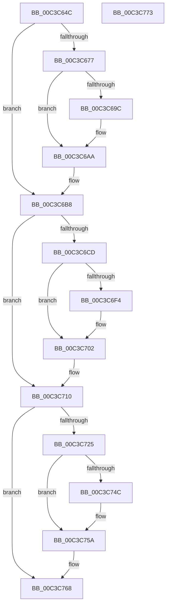

# KseVersionLieInitialize

- RVA: `0x00C3C64C`–`0x00C3C774` (길이 `296` bytes)
- VA: `0x0000000140C3C64C`
- 실행 섹션: `INIT`
- PDB 이름 있음: `예`; PDB Function 태그: `아니요`
- unwind 정보 RVA: `0x0005CAAC`
- 디코드: `73`개 명령, `296/296` bytes 표시
- 미해석 바이트: `0` (있으면 어셈블리에 `.byte`로 보존)

> 이 문서는 커널 이미지의 기계어와 PDB 기호를 분석해 생성했습니다. 4번과 5번은 함수 원형과 자료형을 바이너리 사용 방식에서 추정한 C 해석이며 원본 소스 복구 결과는 아닙니다.

## 1. Dependencies

- 직접 호출 지점: **9**; 고유 호출 대상: **3**
- 직접 호출자로 확인된 함수: **1**
- RIP 상대 이미지 참조: **9**

### Outgoing calls
- `0x00C3C662` → [KseRegisterShim](../../page/74/KseRegisterShim_function_007494B0.md) (function, `0x007494B0`)
- `0x00C3C6A5` → [KsepDebugPrint](../../text/4D/KsepDebugPrint_function_004DCFF0.md) (function, `0x004DCFF0`)
- `0x00C3C6B3` → [KsepLogError](../../text/49/KsepLogError_function_00499A98.md) (function, `0x00499A98`)
- `0x00C3C6C4` → [KseRegisterShim](../../page/74/KseRegisterShim_function_007494B0.md) (function, `0x007494B0`)
- `0x00C3C6FD` → [KsepDebugPrint](../../text/4D/KsepDebugPrint_function_004DCFF0.md) (function, `0x004DCFF0`)
- `0x00C3C70B` → [KsepLogError](../../text/49/KsepLogError_function_00499A98.md) (function, `0x00499A98`)
- `0x00C3C71C` → [KseRegisterShim](../../page/74/KseRegisterShim_function_007494B0.md) (function, `0x007494B0`)
- `0x00C3C755` → [KsepDebugPrint](../../text/4D/KsepDebugPrint_function_004DCFF0.md) (function, `0x004DCFF0`)
- `0x00C3C763` → [KsepLogError](../../text/49/KsepLogError_function_00499A98.md) (function, `0x00499A98`)

### Direct callers
- [KseInitialize](KseInitialize_function_00C3B5AC.md) at `0x00C3B762`

### Static image references
- `0x00C3C659` → RVA `0x00E07248` (`.data`; read)
- `0x00C3C667` → RVA `0x00F101E0` (`.data`; read)
- `0x00C3C67A` → RVA `0x00F101C0` (`.data`; read/write)
- `0x00C3C68B` → RVA `0x00E66CE8` (`.data`; read)
- `0x00C3C69C` → RVA `0x00C7BB20` (` ?? ::PBOPGDP::`string'`; read)
- `0x00C3C6BB` → RVA `0x00E071A8` (`.data`; read)
- `0x00C3C6F4` → RVA `0x00C7BB60` (` ?? ::PBOPGDP::`string'`; read)
- `0x00C3C713` → RVA `0x00E07210` (`.data`; read)
- `0x00C3C74C` → RVA `0x00C7BAE0` (` ?? ::PBOPGDP::`string'`; read)

## 2. Other-region calls and transfers

- 다른 실행 섹션으로 향하는 call: **9**
  - `0x00C3C662` → [KseRegisterShim](../../page/74/KseRegisterShim_function_007494B0.md) (`INIT` → `PAGE`)
  - `0x00C3C6A5` → [KsepDebugPrint](../../text/4D/KsepDebugPrint_function_004DCFF0.md) (`INIT` → `.text`)
  - `0x00C3C6B3` → [KsepLogError](../../text/49/KsepLogError_function_00499A98.md) (`INIT` → `.text`)
  - `0x00C3C6C4` → [KseRegisterShim](../../page/74/KseRegisterShim_function_007494B0.md) (`INIT` → `PAGE`)
  - `0x00C3C6FD` → [KsepDebugPrint](../../text/4D/KsepDebugPrint_function_004DCFF0.md) (`INIT` → `.text`)
  - `0x00C3C70B` → [KsepLogError](../../text/49/KsepLogError_function_00499A98.md) (`INIT` → `.text`)
  - `0x00C3C71C` → [KseRegisterShim](../../page/74/KseRegisterShim_function_007494B0.md) (`INIT` → `PAGE`)
  - `0x00C3C755` → [KsepDebugPrint](../../text/4D/KsepDebugPrint_function_004DCFF0.md) (`INIT` → `.text`)
  - `0x00C3C763` → [KsepLogError](../../text/49/KsepLogError_function_00499A98.md) (`INIT` → `.text`)
- 별도 외부 분기/꼬리 이동을 확인하지 못했습니다.

## 3. Assembly (complete function range)

```asm
00C3C64C  48 89 5C 24 08                  mov qword ptr [rsp + 8], rbx
00C3C651  57                              push rdi
00C3C652  48 83 EC 20                     sub rsp, 0x20
00C3C656  45 33 C0                        xor r8d, r8d
00C3C659  48 8D 0D E8 AB 1C 00            lea rcx, [rip + 0x1cabe8]
00C3C660  33 D2                           xor edx, edx
00C3C662  E8 49 CE B0 FF                  call 0x1407494b0
00C3C667  48 8D 3D 72 3B 2D 00            lea rdi, [rip + 0x2d3b72]
00C3C66E  BB 0C 00 00 00                  mov ebx, 0xc
00C3C673  85 C0                           test eax, eax
00C3C675  79 41                           jns 0x140c3c6b8
00C3C677  8D 4B F5                        lea ecx, [rbx - 0xb]
00C3C67A  F0 0F C1 0D 3E 3B 2D 00         lock xadd dword ptr [rip + 0x2d3b3e], ecx
00C3C682  FF C1                           inc ecx
00C3C684  83 E1 3F                        and ecx, 0x3f
00C3C687  89 44 CF 04                     mov dword ptr [rdi + rcx*8 + 4], eax
00C3C68B  8B 05 57 A6 22 00               mov eax, dword ptr [rip + 0x22a657]
00C3C691  C7 04 CF F1 00 0C 00            mov dword ptr [rdi + rcx*8], 0xc00f1
00C3C698  A8 02                           test al, 2
00C3C69A  74 0E                           je 0x140c3c6aa
00C3C69C  48 8D 15 7D F4 03 00            lea rdx, [rip + 0x3f47d]
00C3C6A3  8B CB                           mov ecx, ebx
00C3C6A5  E8 46 09 8A FF                  call 0x1404dcff0
00C3C6AA  48 8D 15 6F F4 03 00            lea rdx, [rip + 0x3f46f]
00C3C6B1  8B CB                           mov ecx, ebx
00C3C6B3  E8 E0 D3 85 FF                  call 0x140499a98
00C3C6B8  45 33 C0                        xor r8d, r8d
00C3C6BB  48 8D 0D E6 AA 1C 00            lea rcx, [rip + 0x1caae6]
00C3C6C2  33 D2                           xor edx, edx
00C3C6C4  E8 E7 CD B0 FF                  call 0x1407494b0
00C3C6C9  85 C0                           test eax, eax
00C3C6CB  79 43                           jns 0x140c3c710
00C3C6CD  B9 01 00 00 00                  mov ecx, 1
00C3C6D2  F0 0F C1 0D E6 3A 2D 00         lock xadd dword ptr [rip + 0x2d3ae6], ecx
00C3C6DA  FF C1                           inc ecx
00C3C6DC  83 E1 3F                        and ecx, 0x3f
00C3C6DF  89 44 CF 04                     mov dword ptr [rdi + rcx*8 + 4], eax
00C3C6E3  8B 05 FF A5 22 00               mov eax, dword ptr [rip + 0x22a5ff]
00C3C6E9  C7 04 CF F9 00 0C 00            mov dword ptr [rdi + rcx*8], 0xc00f9
00C3C6F0  A8 02                           test al, 2
00C3C6F2  74 0E                           je 0x140c3c702
00C3C6F4  48 8D 15 65 F4 03 00            lea rdx, [rip + 0x3f465]
00C3C6FB  8B CB                           mov ecx, ebx
00C3C6FD  E8 EE 08 8A FF                  call 0x1404dcff0
00C3C702  48 8D 15 57 F4 03 00            lea rdx, [rip + 0x3f457]
00C3C709  8B CB                           mov ecx, ebx
00C3C70B  E8 88 D3 85 FF                  call 0x140499a98
00C3C710  45 33 C0                        xor r8d, r8d
00C3C713  48 8D 0D F6 AA 1C 00            lea rcx, [rip + 0x1caaf6]
00C3C71A  33 D2                           xor edx, edx
00C3C71C  E8 8F CD B0 FF                  call 0x1407494b0
00C3C721  85 C0                           test eax, eax
00C3C723  79 43                           jns 0x140c3c768
00C3C725  BA 01 00 00 00                  mov edx, 1
00C3C72A  F0 0F C1 15 8E 3A 2D 00         lock xadd dword ptr [rip + 0x2d3a8e], edx
00C3C732  FF C2                           inc edx
00C3C734  83 E2 3F                        and edx, 0x3f
00C3C737  89 44 D7 04                     mov dword ptr [rdi + rdx*8 + 4], eax
00C3C73B  8B 05 A7 A5 22 00               mov eax, dword ptr [rip + 0x22a5a7]
00C3C741  C7 04 D7 01 01 0C 00            mov dword ptr [rdi + rdx*8], 0xc0101
00C3C748  A8 02                           test al, 2
00C3C74A  74 0E                           je 0x140c3c75a
00C3C74C  48 8D 15 8D F3 03 00            lea rdx, [rip + 0x3f38d]
00C3C753  8B CB                           mov ecx, ebx
00C3C755  E8 96 08 8A FF                  call 0x1404dcff0
00C3C75A  48 8D 15 7F F3 03 00            lea rdx, [rip + 0x3f37f]
00C3C761  8B CB                           mov ecx, ebx
00C3C763  E8 30 D3 85 FF                  call 0x140499a98
00C3C768  48 8B 5C 24 30                  mov rbx, qword ptr [rsp + 0x30]
00C3C76D  48 83 C4 20                     add rsp, 0x20
00C3C771  5F                              pop rdi
00C3C772  C3                              ret
00C3C773  CC                              int3
```

## 4. C-style interpretation (structured pseudocode)

```c
__int64 __fastcall KseVersionLieInitialize(__int64 a1, int a2, int a3)
{
    __int64 result;
    __int64 v_rsp;
    unsigned __int64 v_stack_p8;

    v_stack_p8 = v_rbx;
    v_rsp = (v_rsp) - (32);
    a3 = 0;
    a2 = 0;
    result = KseRegisterShim(v_rip + 1879016, a2, a3, a4);
    if (!sign_flag) goto loc_00C3C6B8;
    a1 = (unsigned int)((12 - 11) + 1);
    a1 = (unsigned int)((a1) & (63));
    *(unsigned int *)(v_rip + 2964338 + a1 * 8 + 4) = (unsigned int)(result);
    *(unsigned int *)(v_rip + 2964338 + a1 * 8) = 0xC00F1ULL;
    result = (unsigned int)(*(unsigned int *)(v_rip + 2270807));
    if ((((unsigned __int8)((unsigned int)(*(unsigned int *)(v_rip + 2270807)))) & (2)) != 0) {
        a2 = v_rip + 259197;
        a1 = 12;
        result = KsepDebugPrint(a1, a2, a3, a4);
    }
    result = KsepLogError(12, v_rip + 259183, a3, a4);
loc_00C3C6B8:
    a3 = 0;
    a2 = 0;
    result = KseRegisterShim(v_rip + 1878758, a2, a3, a4);
    if (!sign_flag) goto loc_00C3C710;
    a1 = (unsigned int)((1) + 1);
    a1 = (unsigned int)((a1) & (63));
    *(unsigned int *)(v_rip + 2964338 + a1 * 8 + 4) = (unsigned int)(result);
    *(unsigned int *)(v_rip + 2964338 + a1 * 8) = 0xC00F9ULL;
    result = (unsigned int)(*(unsigned int *)(v_rip + 2270719));
    if ((((unsigned __int8)((unsigned int)(*(unsigned int *)(v_rip + 2270719)))) & (2)) != 0) {
        a2 = v_rip + 259173;
        a1 = 12;
        result = KsepDebugPrint(a1, a2, a3, a4);
    }
    result = KsepLogError(12, v_rip + 259159, a3, a4);
loc_00C3C710:
    a3 = 0;
    a2 = 0;
    result = KseRegisterShim(v_rip + 1878774, a2, a3, a4);
    if (!sign_flag) goto loc_00C3C768;
    a2 = (unsigned int)((1) + 1);
    a2 = (unsigned int)((a2) & (63));
    *(unsigned int *)(v_rip + 2964338 + a2 * 8 + 4) = (unsigned int)(result);
    *(unsigned int *)(v_rip + 2964338 + a2 * 8) = 0xC0101ULL;
    result = (unsigned int)(*(unsigned int *)(v_rip + 2270631));
    if ((((unsigned __int8)((unsigned int)(*(unsigned int *)(v_rip + 2270631)))) & (2)) != 0) {
        a2 = v_rip + 258957;
        a1 = 12;
        result = KsepDebugPrint(a1, a2, a3, a4);
    }
    result = KsepLogError(12, v_rip + 258943, a3, a4);
loc_00C3C768:
    v_rsp = (v_rsp) + (32);
    return result;
}
```

## 5. (Beta) C Style

```c
int64_t KseVersionLieInitialize(int64_t Arg1, int32_t Arg2, int32_t Arg3)
{
    int64_t result;
    int64_t local_rsp;
    uint64_t v_stack_p8;

    v_stack_p8 = local_rbx;
    local_rsp = (local_rsp) - (32);
    Arg3 = 0;
    Arg2 = 0;
    result = KseRegisterShim(v_rip + 1879016, Arg2, Arg3, a4);
    if (!sign_flag) goto loc_00C3C6B8;
    Arg1 = (uint32_t)((12 - 11) + 1);
    Arg1 = (uint32_t)((Arg1) & (63));
    *(uint32_t *)(v_rip + 0x2D3B72 + Arg1 * 8 + 0x4) = (uint32_t)(result);
    *(uint32_t *)(v_rip + 0x2D3B72 + Arg1 * 8) = 0xC00F1ULL;
    result = (uint32_t)(*(uint32_t *)(v_rip + 0x22A657));
    if ((((uint8_t)((uint32_t)(*(uint32_t *)(v_rip + 0x22A657)))) & (2)) != 0) {
        Arg2 = v_rip + 259197;
        Arg1 = 12;
        result = KsepDebugPrint(Arg1, Arg2, Arg3, a4);
    }
    result = KsepLogError(12, v_rip + 259183, Arg3, a4);
loc_00C3C6B8:
    Arg3 = 0;
    Arg2 = 0;
    result = KseRegisterShim(v_rip + 1878758, Arg2, Arg3, a4);
    if (!sign_flag) goto loc_00C3C710;
    Arg1 = (uint32_t)((1) + 1);
    Arg1 = (uint32_t)((Arg1) & (63));
    *(uint32_t *)(v_rip + 0x2D3B72 + Arg1 * 8 + 0x4) = (uint32_t)(result);
    *(uint32_t *)(v_rip + 0x2D3B72 + Arg1 * 8) = 0xC00F9ULL;
    result = (uint32_t)(*(uint32_t *)(v_rip + 0x22A5FF));
    if ((((uint8_t)((uint32_t)(*(uint32_t *)(v_rip + 0x22A5FF)))) & (2)) != 0) {
        Arg2 = v_rip + 259173;
        Arg1 = 12;
        result = KsepDebugPrint(Arg1, Arg2, Arg3, a4);
    }
    result = KsepLogError(12, v_rip + 259159, Arg3, a4);
loc_00C3C710:
    Arg3 = 0;
    Arg2 = 0;
    result = KseRegisterShim(v_rip + 1878774, Arg2, Arg3, a4);
    if (!sign_flag) goto loc_00C3C768;
    Arg2 = (uint32_t)((1) + 1);
    Arg2 = (uint32_t)((Arg2) & (63));
    *(uint32_t *)(v_rip + 0x2D3B72 + Arg2 * 8 + 0x4) = (uint32_t)(result);
    *(uint32_t *)(v_rip + 0x2D3B72 + Arg2 * 8) = 0xC0101ULL;
    result = (uint32_t)(*(uint32_t *)(v_rip + 0x22A5A7));
    if ((((uint8_t)((uint32_t)(*(uint32_t *)(v_rip + 0x22A5A7)))) & (2)) != 0) {
        Arg2 = v_rip + 258957;
        Arg1 = 12;
        result = KsepDebugPrint(Arg1, Arg2, Arg3, a4);
    }
    result = KsepLogError(12, v_rip + 258943, Arg3, a4);
loc_00C3C768:
    local_rsp = (local_rsp) + (32);
    return result;
}
```

## 6. Execution-region graph

[열기: 2D/3D 그래프와 함수 탐색 컨트롤 패널](../../../control-panel.html?section=init&rva=0x00C3C64C&view=graph)

- 2D 그래프는 위에서 아래로 흐르고, 3D 그래프는 빈 공간을 드래그해 회전합니다. Shift+드래그는 이동, 휠은 확대·축소, 함수 노드 선택은 대상 보고서 이동입니다.

### Static fallback


