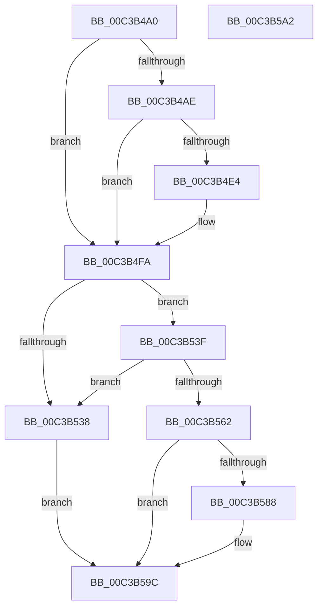

# KsepEngineInitialize

- RVA: `0x00C3B4A0`–`0x00C3B5A3` (길이 `259` bytes)
- VA: `0x0000000140C3B4A0`
- 실행 섹션: `INIT`
- PDB 이름 있음: `예`; PDB Function 태그: `아니요`
- unwind 정보 RVA: `0x0005CF00`
- 디코드: `60`개 명령, `259/259` bytes 표시
- 미해석 바이트: `0` (있으면 어셈블리에 `.byte`로 보존)

> 이 문서는 커널 이미지의 기계어와 PDB 기호를 분석해 생성했습니다. 4번과 5번은 함수 원형과 자료형을 바이너리 사용 방식에서 추정한 C 해석이며 원본 소스 복구 결과는 아닙니다.

## 1. Dependencies

- 직접 호출 지점: **4**; 고유 호출 대상: **3**
- 직접 호출자로 확인된 함수: **1**
- RIP 상대 이미지 참조: **14**

### Outgoing calls
- `0x00C3B4F5` → [RtlAssert](../../text/5E/RtlAssert_function_005E75E0.md) (function, `0x005E75E0`)
- `0x00C3B52A` → [KsepCacheInitialize](../../page/74/KsepCacheInitialize_function_0074AE7C.md) (function, `0x0074AE7C`)
- `0x00C3B554` → [KsepCacheInitialize](../../page/74/KsepCacheInitialize_function_0074AE7C.md) (function, `0x0074AE7C`)
- `0x00C3B57F` → [KsepEngineReadFlags](KsepEngineReadFlags_function_00C3C310.md) (function, `0x00C3C310`)

### Direct callers
- [KseInitialize](KseInitialize_function_00C3B5AC.md) at `0x00C3B64B`

### Static image references
- `0x00C3B4B1` → RVA `0x00F101C0` (`.data`; read/write)
- `0x00C3B4BB` → RVA `0x00F101E0` (`.data`; read)
- `0x00C3B4DA` → RVA `0x00E66CE8` (`.data`; read)
- `0x00C3B4E7` → RVA `0x00C7B4F0` (` ?? ::PBOPGDP::`string'`; read)
- `0x00C3B4EE` → RVA `0x00C7B4E0` (` ?? ::PBOPGDP::`string'`; read)
- `0x00C3B502` → RVA `0x0095AD00` (`KsepCacheDeviceFree`; read)
- `0x00C3B50C` → RVA `0x0097A310` (`KsepCacheDeviceHash`; read)
- `0x00C3B51B` → RVA `0x0074AD60` (`KsepCacheDeviceEqual`; read)
- `0x00C3B53F` → RVA `0x005CBE30` (`KsepCacheHwIdFree`; read)
- `0x00C3B546` → RVA `0x004BD3B0` (`KsepCacheHwIdHash`; read)
- `0x00C3B54D` → RVA `0x004C20C0` (`KsepCacheHwIdEqual`; read)
- `0x00C3B562` → RVA `0x004B0A20` (`KseGetIoCallbacks`; read)
- `0x00C3B56D` → RVA `0x00E66C80` (`.data`; read)
- `0x00C3B574` → RVA `0x004A81C0` (`KseSetCompletionHook`; read)

## 2. Other-region calls and transfers

- 다른 실행 섹션으로 향하는 call: **3**
  - `0x00C3B4F5` → [RtlAssert](../../text/5E/RtlAssert_function_005E75E0.md) (`INIT` → `.text`)
  - `0x00C3B52A` → [KsepCacheInitialize](../../page/74/KsepCacheInitialize_function_0074AE7C.md) (`INIT` → `PAGE`)
  - `0x00C3B554` → [KsepCacheInitialize](../../page/74/KsepCacheInitialize_function_0074AE7C.md) (`INIT` → `PAGE`)
- 별도 외부 분기/꼬리 이동을 확인하지 못했습니다.

## 3. Assembly (complete function range)

```asm
00C3B4A0  40 53                           push rbx
00C3B4A2  48 83 EC 20                     sub rsp, 0x20
00C3B4A6  48 8B D9                        mov rbx, rcx
00C3B4A9  48 85 C9                        test rcx, rcx
00C3B4AC  75 4C                           jne 0x140c3b4fa
00C3B4AE  8D 41 01                        lea eax, [rcx + 1]
00C3B4B1  F0 0F C1 05 07 4D 2D 00         lock xadd dword ptr [rip + 0x2d4d07], eax
00C3B4B9  FF C0                           inc eax
00C3B4BB  48 8D 15 1E 4D 2D 00            lea rdx, [rip + 0x2d4d1e]
00C3B4C2  83 E0 3F                        and eax, 0x3f
00C3B4C5  41 B8 20 03 00 00               mov r8d, 0x320
00C3B4CB  C7 44 C2 04 20 04 00 C0         mov dword ptr [rdx + rax*8 + 4], 0xc0000420
00C3B4D3  C7 04 C2 20 03 02 00            mov dword ptr [rdx + rax*8], 0x20320
00C3B4DA  8B 05 08 B8 22 00               mov eax, dword ptr [rip + 0x22b808]
00C3B4E0  A8 04                           test al, 4
00C3B4E2  74 16                           je 0x140c3b4fa
00C3B4E4  45 33 C9                        xor r9d, r9d
00C3B4E7  48 8D 15 02 00 04 00            lea rdx, [rip + 0x40002]
00C3B4EE  48 8D 0D EB FF 03 00            lea rcx, [rip + 0x3ffeb]
00C3B4F5  E8 E6 C0 9A FF                  call 0x1405e75e0
00C3B4FA  48 8D 43 10                     lea rax, [rbx + 0x10]
00C3B4FE  48 89 40 08                     mov qword ptr [rax + 8], rax
00C3B502  4C 8D 0D F7 F7 D1 FF            lea r9, [rip - 0x2e0809]
00C3B509  48 89 00                        mov qword ptr [rax], rax
00C3B50C  4C 8D 05 FD ED D3 FF            lea r8, [rip - 0x2c1203]
00C3B513  48 8D 43 20                     lea rax, [rbx + 0x20]
00C3B517  48 89 40 08                     mov qword ptr [rax + 8], rax
00C3B51B  48 8D 15 3E F8 B0 FF            lea rdx, [rip - 0x4f07c2]
00C3B522  48 89 00                        mov qword ptr [rax], rax
00C3B525  48 83 63 30 00                  and qword ptr [rbx + 0x30], 0
00C3B52A  E8 4D F9 B0 FF                  call 0x14074ae7c
00C3B52F  48 89 43 48                     mov qword ptr [rbx + 0x48], rax
00C3B533  48 85 C0                        test rax, rax
00C3B536  75 07                           jne 0x140c3b53f
00C3B538  B8 17 00 00 C0                  mov eax, 0xc0000017
00C3B53D  EB 5D                           jmp 0x140c3b59c
00C3B53F  4C 8D 0D EA 08 99 FF            lea r9, [rip - 0x66f716]
00C3B546  4C 8D 05 63 1E 88 FF            lea r8, [rip - 0x77e19d]
00C3B54D  48 8D 15 6C 6B 88 FF            lea rdx, [rip - 0x779494]
00C3B554  E8 23 F9 B0 FF                  call 0x14074ae7c
00C3B559  48 89 43 50                     mov qword ptr [rbx + 0x50], rax
00C3B55D  48 85 C0                        test rax, rax
00C3B560  74 D6                           je 0x140c3b538
00C3B562  48 8D 05 B7 54 87 FF            lea rax, [rip - 0x78ab49]
00C3B569  48 89 43 38                     mov qword ptr [rbx + 0x38], rax
00C3B56D  48 8D 0D 0C B7 22 00            lea rcx, [rip + 0x22b70c]
00C3B574  48 8D 05 45 CC 86 FF            lea rax, [rip - 0x7933bb]
00C3B57B  48 89 43 40                     mov qword ptr [rbx + 0x40], rax
00C3B57F  E8 8C 0D 00 00                  call 0x140c3c310
00C3B584  85 C0                           test eax, eax
00C3B586  78 14                           js 0x140c3b59c
00C3B588  8A 0D F2 B6 22 00               mov cl, byte ptr [rip + 0x22b6f2]
00C3B58E  BA BB 00 00 C0                  mov edx, 0xc00000bb
00C3B593  80 E1 03                        and cl, 3
00C3B596  80 F9 03                        cmp cl, 3
00C3B599  0F 44 C2                        cmove eax, edx
00C3B59C  48 83 C4 20                     add rsp, 0x20
00C3B5A0  5B                              pop rbx
00C3B5A1  C3                              ret
00C3B5A2  CC                              int3
```

## 4. C-style interpretation (structured pseudocode)

```c
__int64 __fastcall KsepEngineInitialize(__int64 a1, __int64 a2, __int64 a3, int a4)
{
    __int64 result;
    __int64 v_rsp;

    v_rsp = (v_rsp) - (32);
    if (a1 != 0) goto loc_00C3B4FA;
    result = (unsigned int)((a1 + 1) + 1);
    result = (unsigned int)((result) & (63));
    *(unsigned int *)(v_rip + 2968862 + result * 8 + 4) = 0xC0000420ULL;
    *(unsigned int *)(v_rip + 2968862 + result * 8) = 0x20320ULL;
    result = (unsigned int)(*(unsigned int *)(v_rip + 2275336));
    if ((((unsigned __int8)((unsigned int)(*(unsigned int *)(v_rip + 2275336)))) & (4)) != 0) {
        a4 = 0;
        a2 = v_rip + 262146;
        a1 = v_rip + 262123;
        result = RtlAssert(a1, a2, 800, a4);
    }
    *(unsigned __int64 *)(a1 + 16 + 8) = a1 + 16;
    *(unsigned __int64 *)(a1 + 16) = a1 + 16;
    *(unsigned __int64 *)(a1 + 32 + 8) = a1 + 32;
    *(unsigned __int64 *)(a1 + 32) = a1 + 32;
    result = KsepCacheInitialize(a1, v_rip - 5179330, v_rip - 2888195, v_rip - 3016713);
    *(unsigned __int64 *)(a1 + 72) = result;
    if (result != 0) goto loc_00C3B53F;
loc_00C3B538:
    goto loc_00C3B59C;
loc_00C3B53F:
    result = KsepCacheInitialize(a1, v_rip - 7836820, v_rip - 7856541, v_rip - 6747926);
    *(unsigned __int64 *)(a1 + 80) = result;
    if (result == 0) goto loc_00C3B538;
    *(unsigned __int64 *)(a1 + 56) = v_rip - 7908169;
    *(unsigned __int64 *)(a1 + 64) = v_rip - 7943099;
    result = KsepEngineReadFlags(v_rip + 2275084, v_rip - 7836820, v_rip - 7856541, v_rip - 6747926);
    if (!(sign_flag)) {
        a1 = *(unsigned __int8 *)(v_rip + 2275058);
        a2 = 0xC00000BBULL;
        a1 = (unsigned __int8)((a1) & (3));
        if (((unsigned __int8)(a1)) == 3) { result = (unsigned int)(a2); }
    }
    v_rsp = (v_rsp) + (32);
    return result;
}
```

## 5. (Beta) C Style

```c
int64_t KsepEngineInitialize(void *Arg1, int64_t Arg2, int64_t Arg3, int32_t Arg4)
{
    uint8_t *arg1 = (uint8_t *)Arg1;

    int64_t result;
    int64_t local_rsp;

    local_rsp = (local_rsp) - (32);
    if (Arg1 != NULL) goto loc_00C3B4FA;
    result = (uint32_t)((Arg1 + 1) + 1);
    result = (uint32_t)((result) & (63));
    *(uint32_t *)(v_rip + 0x2D4D1E + result * 8 + 0x4) = 0xC0000420ULL;
    *(uint32_t *)(v_rip + 0x2D4D1E + result * 8) = 0x20320ULL;
    result = (uint32_t)(*(uint32_t *)(v_rip + 0x22B808));
    if ((((uint8_t)((uint32_t)(*(uint32_t *)(v_rip + 0x22B808)))) & (4)) != 0) {
        Arg4 = 0;
        Arg2 = v_rip + 262146;
        Arg1 = v_rip + 262123;
        result = RtlAssert(Arg1, Arg2, 800, Arg4);
    }
    *(void **)(arg1 + 0x10 + 0x8) = Arg1 + 16;
    *(void **)(arg1 + 0x10) = Arg1 + 16;
    *(void **)(arg1 + 0x20 + 0x8) = Arg1 + 32;
    *(void **)(arg1 + 0x20) = Arg1 + 32;
    result = KsepCacheInitialize(Arg1, v_rip - 5179330, v_rip - 2888195, v_rip - 3016713);
    *(uint64_t *)(arg1 + 0x48) = result;
    if (result != 0) goto loc_00C3B53F;
loc_00C3B538:
    goto loc_00C3B59C;
loc_00C3B53F:
    result = KsepCacheInitialize(Arg1, v_rip - 7836820, v_rip - 7856541, v_rip - 6747926);
    *(uint64_t *)(arg1 + 0x50) = result;
    if (result == 0) goto loc_00C3B538;
    *(uint64_t *)(arg1 + 0x38) = v_rip - 7908169;
    *(uint64_t *)(arg1 + 0x40) = v_rip - 7943099;
    result = KsepEngineReadFlags(v_rip + 2275084, v_rip - 7836820, v_rip - 7856541, v_rip - 6747926);
    if (!(sign_flag)) {
        Arg1 = *(uint8_t *)(v_rip + 0x22B6F2);
        Arg2 = 0xC00000BBULL;
        Arg1 = (uint8_t)((Arg1) & (3));
        if (((uint8_t)(Arg1)) == 3) { result = (uint32_t)(Arg2); }
    }
    local_rsp = (local_rsp) + (32);
    return result;
}
```

### 관측된 메모리 오프셋

구조체 형식이 확인되지 않은 접근은 인자 기준의 오프셋으로만 기록했습니다.

| 기준 인자 | 오프셋 표현 | 폭 (bit) | 접근 |
|---|---:|---:|---|
| `Arg1` | `+ 0x0` | `64` | `W` |
| `Arg1` | `+ 0x8` | `64` | `W` |
| `Arg1` | `+ 0x10` | `64` | `R` |
| `Arg1` | `+ 0x20` | `64` | `R` |
| `Arg1` | `+ 0x30` | `64` | `R/W` |
| `Arg1` | `+ 0x38` | `64` | `W` |
| `Arg1` | `+ 0x40` | `64` | `W` |
| `Arg1` | `+ 0x48` | `64` | `W` |
| `Arg1` | `+ 0x50` | `64` | `W` |

## 6. Execution-region graph

[열기: 2D/3D 그래프와 함수 탐색 컨트롤 패널](../../../control-panel.html?section=init&rva=0x00C3B4A0&view=graph)

- 2D 그래프는 위에서 아래로 흐르고, 3D 그래프는 빈 공간을 드래그해 회전합니다. Shift+드래그는 이동, 휠은 확대·축소, 함수 노드 선택은 대상 보고서 이동입니다.

### Static fallback


