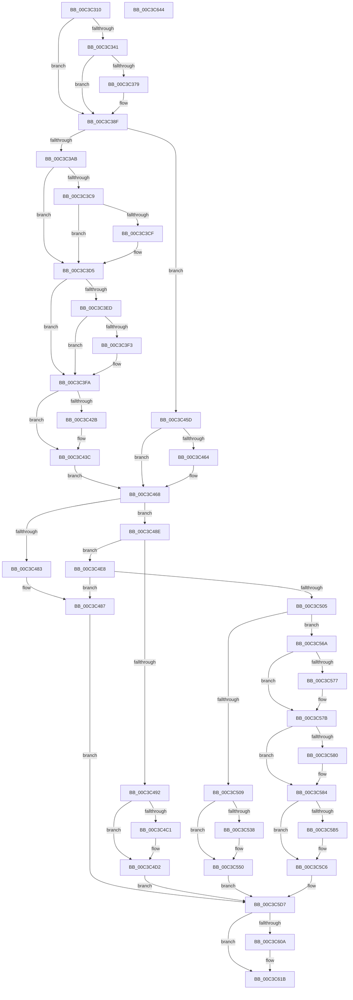

# KsepEngineReadFlags

- RVA: `0x00C3C310`–`0x00C3C645` (길이 `821` bytes)
- VA: `0x0000000140C3C310`
- 실행 섹션: `INIT`
- PDB 이름 있음: `예`; PDB Function 태그: `아니요`
- unwind 정보 RVA: `0x000CB50C`
- 디코드: `199`개 명령, `821/821` bytes 표시
- 미해석 바이트: `0` (있으면 어셈블리에 `.byte`로 보존)

> 이 문서는 커널 이미지의 기계어와 PDB 기호를 분석해 생성했습니다. 4번과 5번은 함수 원형과 자료형을 바이너리 사용 방식에서 추정한 C 해석이며 원본 소스 복구 결과는 아닙니다.

## 1. Dependencies

- 직접 호출 지점: **18**; 고유 호출 대상: **7**
- 직접 호출자로 확인된 함수: **1**
- RIP 상대 이미지 참조: **16**

### Outgoing calls
- `0x00C3C38A` → [RtlAssert](../../text/5E/RtlAssert_function_005E75E0.md) (function, `0x005E75E0`)
- `0x00C3C39E` → [KsepRegistryOpenKey](../../page/95/KsepRegistryOpenKey_function_0095A79C.md) (function, `0x0095A79C`)
- `0x00C3C3C0` → [KsepRegistryQueryDWORD](../../page/74/KsepRegistryQueryDWORD_function_0074B348.md) (function, `0x0074B348`)
- `0x00C3C3E4` → [KsepRegistryQueryDWORD](../../page/74/KsepRegistryQueryDWORD_function_0074B348.md) (function, `0x0074B348`)
- `0x00C3C437` → [KsepDebugPrint](../../text/4D/KsepDebugPrint_function_004DCFF0.md) (function, `0x004DCFF0`)
- `0x00C3C448` → [KsepLogInfo](../../text/49/KsepLogInfo_function_00499A68.md) (function, `0x00499A68`)
- `0x00C3C451` → [KsepRegistryCloseKey](../../page/95/KsepRegistryCloseKey_function_00959500.md) (function, `0x00959500`)
- `0x00C3C475` → [KsepRegistryOpenKey](../../page/95/KsepRegistryOpenKey_function_0095A79C.md) (function, `0x0095A79C`)
- `0x00C3C4CD` → [KsepDebugPrint](../../text/4D/KsepDebugPrint_function_004DCFF0.md) (function, `0x004DCFF0`)
- `0x00C3C4DE` → [KsepLogError](../../text/49/KsepLogError_function_00499A98.md) (function, `0x00499A98`)
- `0x00C3C4F7` → [KsepRegistryQueryDWORD](../../page/74/KsepRegistryQueryDWORD_function_0074B348.md) (function, `0x0074B348`)
- `0x00C3C54B` → [KsepDebugPrint](../../text/4D/KsepDebugPrint_function_004DCFF0.md) (function, `0x004DCFF0`)
- `0x00C3C563` → [KsepLogError](../../text/49/KsepLogError_function_00499A98.md) (function, `0x00499A98`)
- `0x00C3C5C1` → [KsepDebugPrint](../../text/4D/KsepDebugPrint_function_004DCFF0.md) (function, `0x004DCFF0`)
- `0x00C3C5D2` → [KsepLogInfo](../../text/49/KsepLogInfo_function_00499A68.md) (function, `0x00499A68`)
- `0x00C3C616` → [KsepDebugPrint](../../text/4D/KsepDebugPrint_function_004DCFF0.md) (function, `0x004DCFF0`)
- `0x00C3C627` → [KsepLogInfo](../../text/49/KsepLogInfo_function_00499A68.md) (function, `0x00499A68`)
- `0x00C3C630` → [KsepRegistryCloseKey](../../page/95/KsepRegistryCloseKey_function_00959500.md) (function, `0x00959500`)

### Direct callers
- [KsepEngineInitialize](KsepEngineInitialize_function_00C3B4A0.md) at `0x00C3B57F`

### Static image references
- `0x00C3C325` → RVA `0x00000000` (`image boundary/outside`; read)
- `0x00C3C344` → RVA `0x00F101C0` (`.data`; read/write)
- `0x00C3C36E` → RVA `0x00E66CE8` (`.data`; read)
- `0x00C3C37C` → RVA `0x00C7B9A0` (` ?? ::PBOPGDP::`string'`; read)
- `0x00C3C383` → RVA `0x00C7B4E0` (` ?? ::PBOPGDP::`string'`; read)
- `0x00C3C397` → RVA `0x00C7B8D0` (` ?? ::PBOPGDP::`string'`; read)
- `0x00C3C3B6` → RVA `0x00C7B970` (` ?? ::PBOPGDP::`string'`; read)
- `0x00C3C3DD` → RVA `0x00C7B870` (` ?? ::PBOPGDP::`string'`; read)
- `0x00C3C3FD` → RVA `0x00F105E0` (`.data`; read/write)
- `0x00C3C42E` → RVA `0x00C7B8A0` (` ?? ::PBOPGDP::`string'`; read)
- `0x00C3C46E` → RVA `0x00C7B7A0` (` ?? ::PBOPGDP::`string'`; read)
- `0x00C3C4C4` → RVA `0x00C7B830` (` ?? ::PBOPGDP::`string'`; read)
- `0x00C3C4F0` → RVA `0x00C7BA50` (` ?? ::PBOPGDP::`string'`; read)
- `0x00C3C542` → RVA `0x00C7BA70` (` ?? ::PBOPGDP::`string'`; read)
- `0x00C3C5B8` → RVA `0x00C7B9D0` (` ?? ::PBOPGDP::`string'`; read)
- `0x00C3C60D` → RVA `0x00C7BA10` (` ?? ::PBOPGDP::`string'`; read)

## 2. Other-region calls and transfers

- 다른 실행 섹션으로 향하는 call: **18**
  - `0x00C3C38A` → [RtlAssert](../../text/5E/RtlAssert_function_005E75E0.md) (`INIT` → `.text`)
  - `0x00C3C39E` → [KsepRegistryOpenKey](../../page/95/KsepRegistryOpenKey_function_0095A79C.md) (`INIT` → `PAGE`)
  - `0x00C3C3C0` → [KsepRegistryQueryDWORD](../../page/74/KsepRegistryQueryDWORD_function_0074B348.md) (`INIT` → `PAGE`)
  - `0x00C3C3E4` → [KsepRegistryQueryDWORD](../../page/74/KsepRegistryQueryDWORD_function_0074B348.md) (`INIT` → `PAGE`)
  - `0x00C3C437` → [KsepDebugPrint](../../text/4D/KsepDebugPrint_function_004DCFF0.md) (`INIT` → `.text`)
  - `0x00C3C448` → [KsepLogInfo](../../text/49/KsepLogInfo_function_00499A68.md) (`INIT` → `.text`)
  - `0x00C3C451` → [KsepRegistryCloseKey](../../page/95/KsepRegistryCloseKey_function_00959500.md) (`INIT` → `PAGE`)
  - `0x00C3C475` → [KsepRegistryOpenKey](../../page/95/KsepRegistryOpenKey_function_0095A79C.md) (`INIT` → `PAGE`)
  - `0x00C3C4CD` → [KsepDebugPrint](../../text/4D/KsepDebugPrint_function_004DCFF0.md) (`INIT` → `.text`)
  - `0x00C3C4DE` → [KsepLogError](../../text/49/KsepLogError_function_00499A98.md) (`INIT` → `.text`)
  - `0x00C3C4F7` → [KsepRegistryQueryDWORD](../../page/74/KsepRegistryQueryDWORD_function_0074B348.md) (`INIT` → `PAGE`)
  - `0x00C3C54B` → [KsepDebugPrint](../../text/4D/KsepDebugPrint_function_004DCFF0.md) (`INIT` → `.text`)
  - `0x00C3C563` → [KsepLogError](../../text/49/KsepLogError_function_00499A98.md) (`INIT` → `.text`)
  - `0x00C3C5C1` → [KsepDebugPrint](../../text/4D/KsepDebugPrint_function_004DCFF0.md) (`INIT` → `.text`)
  - `0x00C3C5D2` → [KsepLogInfo](../../text/49/KsepLogInfo_function_00499A68.md) (`INIT` → `.text`)
  - `0x00C3C616` → [KsepDebugPrint](../../text/4D/KsepDebugPrint_function_004DCFF0.md) (`INIT` → `.text`)
  - `0x00C3C627` → [KsepLogInfo](../../text/49/KsepLogInfo_function_00499A68.md) (`INIT` → `.text`)
  - `0x00C3C630` → [KsepRegistryCloseKey](../../page/95/KsepRegistryCloseKey_function_00959500.md) (`INIT` → `PAGE`)
- 별도 외부 분기/꼬리 이동을 확인하지 못했습니다.

## 3. Assembly (complete function range)

```asm
00C3C310  40 55                           push rbp
00C3C312  53                              push rbx
00C3C313  56                              push rsi
00C3C314  57                              push rdi
00C3C315  41 54                           push r12
00C3C317  41 57                           push r15
00C3C319  48 8B EC                        mov rbp, rsp
00C3C31C  48 83 EC 28                     sub rsp, 0x28
00C3C320  48 83 65 50 00                  and qword ptr [rbp + 0x50], 0
00C3C325  4C 8D 25 D4 3C 3C FF            lea r12, [rip - 0xc3c32c]
00C3C32C  83 65 48 00                     and dword ptr [rbp + 0x48], 0
00C3C330  33 F6                           xor esi, esi
00C3C332  48 8B D9                        mov rbx, rcx
00C3C335  44 8D 7E 01                     lea r15d, [rsi + 1]
00C3C339  8D 7E 04                        lea edi, [rsi + 4]
00C3C33C  48 85 C9                        test rcx, rcx
00C3C33F  75 4E                           jne 0x140c3c38f
00C3C341  41 8B C7                        mov eax, r15d
00C3C344  F0 0F C1 05 74 3E 2D 00         lock xadd dword ptr [rip + 0x2d3e74], eax
00C3C34C  41 03 C7                        add eax, r15d
00C3C34F  44 8D 41 64                     lea r8d, [rcx + 0x64]
00C3C353  83 E0 3F                        and eax, 0x3f
00C3C356  41 C7 84 C4 E4 01 F1 00 20 04 00 C0  mov dword ptr [r12 + rax*8 + 0xf101e4], 0xc0000420
00C3C362  41 C7 84 C4 E0 01 F1 00 64 00 04 00  mov dword ptr [r12 + rax*8 + 0xf101e0], 0x40064
00C3C36E  8B 05 74 A9 22 00               mov eax, dword ptr [rip + 0x22a974]
00C3C374  40 84 C7                        test dil, al
00C3C377  74 16                           je 0x140c3c38f
00C3C379  45 33 C9                        xor r9d, r9d
00C3C37C  48 8D 15 1D F6 03 00            lea rdx, [rip + 0x3f61d]
00C3C383  48 8D 0D 56 F1 03 00            lea rcx, [rip + 0x3f156]
00C3C38A  E8 51 B2 9A FF                  call 0x1405e75e0
00C3C38F  21 33                           and dword ptr [rbx], esi
00C3C391  4C 8D 45 50                     lea r8, [rbp + 0x50]
00C3C395  33 D2                           xor edx, edx
00C3C397  48 8D 0D 32 F5 03 00            lea rcx, [rip + 0x3f532]
00C3C39E  E8 F9 E3 D1 FF                  call 0x14095a79c
00C3C3A3  85 C0                           test eax, eax
00C3C3A5  0F 85 B2 00 00 00               jne 0x140c3c45d
00C3C3AB  48 8B 4D 50                     mov rcx, qword ptr [rbp + 0x50]
00C3C3AF  4C 8D 45 38                     lea r8, [rbp + 0x38]
00C3C3B3  21 75 38                        and dword ptr [rbp + 0x38], esi
00C3C3B6  48 8D 15 B3 F5 03 00            lea rdx, [rip + 0x3f5b3]
00C3C3BD  21 75 40                        and dword ptr [rbp + 0x40], esi
00C3C3C0  E8 83 EF B0 FF                  call 0x14074b348
00C3C3C5  85 C0                           test eax, eax
00C3C3C7  75 0C                           jne 0x140c3c3d5
00C3C3C9  44 39 7D 38                     cmp dword ptr [rbp + 0x38], r15d
00C3C3CD  75 06                           jne 0x140c3c3d5
00C3C3CF  09 7B 08                        or dword ptr [rbx + 8], edi
00C3C3D2  8D 70 02                        lea esi, [rax + 2]
00C3C3D5  48 8B 4D 50                     mov rcx, qword ptr [rbp + 0x50]
00C3C3D9  4C 8D 45 40                     lea r8, [rbp + 0x40]
00C3C3DD  48 8D 15 8C F4 03 00            lea rdx, [rip + 0x3f48c]
00C3C3E4  E8 5F EF B0 FF                  call 0x14074b348
00C3C3E9  85 C0                           test eax, eax
00C3C3EB  75 0D                           jne 0x140c3c3fa
00C3C3ED  44 39 7D 40                     cmp dword ptr [rbp + 0x40], r15d
00C3C3F1  75 07                           jne 0x140c3c3fa
00C3C3F3  41 0B F7                        or esi, r15d
00C3C3F6  83 4B 08 08                     or dword ptr [rbx + 8], 8
00C3C3FA  41 8B C7                        mov eax, r15d
00C3C3FD  F0 0F C1 05 DB 41 2D 00         lock xadd dword ptr [rip + 0x2d41db], eax
00C3C405  41 03 C7                        add eax, r15d
00C3C408  83 E0 3F                        and eax, 0x3f
00C3C40B  41 83 A4 C4 E4 03 F1 00 00      and dword ptr [r12 + rax*8 + 0xf103e4], 0
00C3C414  41 C7 84 C4 E0 03 F1 00 83 00 04 00  mov dword ptr [r12 + rax*8 + 0xf103e0], 0x40083
00C3C420  8B 05 C2 A8 22 00               mov eax, dword ptr [rip + 0x22a8c2]
00C3C426  41 84 C7                        test r15b, al
00C3C429  74 11                           je 0x140c3c43c
00C3C42B  44 8B C6                        mov r8d, esi
00C3C42E  48 8D 15 6B F4 03 00            lea rdx, [rip + 0x3f46b]
00C3C435  33 C9                           xor ecx, ecx
00C3C437  E8 B4 0B 8A FF                  call 0x1404dcff0
00C3C43C  44 8B C6                        mov r8d, esi
00C3C43F  48 8D 15 5A F4 03 00            lea rdx, [rip + 0x3f45a]
00C3C446  33 C9                           xor ecx, ecx
00C3C448  E8 1B D6 85 FF                  call 0x140499a68
00C3C44D  48 8B 4D 50                     mov rcx, qword ptr [rbp + 0x50]
00C3C451  E8 AA D0 D1 FF                  call 0x140959500
00C3C456  48 83 65 50 00                  and qword ptr [rbp + 0x50], 0
00C3C45B  EB 0B                           jmp 0x140c3c468
00C3C45D  3D 34 00 00 C0                  cmp eax, 0xc0000034
00C3C462  75 04                           jne 0x140c3c468
00C3C464  83 4B 08 02                     or dword ptr [rbx + 8], 2
00C3C468  4C 8D 45 50                     lea r8, [rbp + 0x50]
00C3C46C  33 D2                           xor edx, edx
00C3C46E  48 8D 0D 2B F3 03 00            lea rcx, [rip + 0x3f32b]
00C3C475  E8 22 E3 D1 FF                  call 0x14095a79c
00C3C47A  8B F8                           mov edi, eax
00C3C47C  3D 34 00 00 C0                  cmp eax, 0xc0000034
00C3C481  75 0B                           jne 0x140c3c48e
00C3C483  44 09 7B 08                     or dword ptr [rbx + 8], r15d
00C3C487  33 FF                           xor edi, edi
00C3C489  E9 49 01 00 00                  jmp 0x140c3c5d7
00C3C48E  85 FF                           test edi, edi
00C3C490  79 56                           jns 0x140c3c4e8
00C3C492  41 8B C7                        mov eax, r15d
00C3C495  F0 0F C1 05 23 3D 2D 00         lock xadd dword ptr [rip + 0x2d3d23], eax
00C3C49D  41 03 C7                        add eax, r15d
00C3C4A0  83 E0 3F                        and eax, 0x3f
00C3C4A3  41 89 BC C4 E4 01 F1 00         mov dword ptr [r12 + rax*8 + 0xf101e4], edi
00C3C4AB  41 C7 84 C4 E0 01 F1 00 A0 00 04 00  mov dword ptr [r12 + rax*8 + 0xf101e0], 0x400a0
00C3C4B7  8B 05 2B A8 22 00               mov eax, dword ptr [rip + 0x22a82b]
00C3C4BD  A8 02                           test al, 2
00C3C4BF  74 11                           je 0x140c3c4d2
00C3C4C1  44 8B C7                        mov r8d, edi
00C3C4C4  48 8D 15 65 F3 03 00            lea rdx, [rip + 0x3f365]
00C3C4CB  33 C9                           xor ecx, ecx
00C3C4CD  E8 1E 0B 8A FF                  call 0x1404dcff0
00C3C4D2  44 8B C7                        mov r8d, edi
00C3C4D5  48 8D 15 54 F3 03 00            lea rdx, [rip + 0x3f354]
00C3C4DC  33 C9                           xor ecx, ecx
00C3C4DE  E8 B5 D5 85 FF                  call 0x140499a98
00C3C4E3  E9 EF 00 00 00                  jmp 0x140c3c5d7
00C3C4E8  48 8B 4D 50                     mov rcx, qword ptr [rbp + 0x50]
00C3C4EC  4C 8D 45 48                     lea r8, [rbp + 0x48]
00C3C4F0  48 8D 15 59 F5 03 00            lea rdx, [rip + 0x3f559]
00C3C4F7  E8 4C EE B0 FF                  call 0x14074b348
00C3C4FC  8B F8                           mov edi, eax
00C3C4FE  3D 34 00 00 C0                  cmp eax, 0xc0000034
00C3C503  74 82                           je 0x140c3c487
00C3C505  85 C0                           test eax, eax
00C3C507  79 61                           jns 0x140c3c56a
00C3C509  41 8B C7                        mov eax, r15d
00C3C50C  F0 0F C1 05 AC 3C 2D 00         lock xadd dword ptr [rip + 0x2d3cac], eax
00C3C514  41 03 C7                        add eax, r15d
00C3C517  83 E0 3F                        and eax, 0x3f
00C3C51A  41 89 BC C4 E4 01 F1 00         mov dword ptr [r12 + rax*8 + 0xf101e4], edi
00C3C522  41 C7 84 C4 E0 01 F1 00 B6 00 04 00  mov dword ptr [r12 + rax*8 + 0xf101e0], 0x400b6
00C3C52E  8B 05 B4 A7 22 00               mov eax, dword ptr [rip + 0x22a7b4]
00C3C534  A8 02                           test al, 2
00C3C536  74 18                           je 0x140c3c550
00C3C538  44 8B CF                        mov r9d, edi
00C3C53B  4C 8D 05 0E F5 03 00            lea r8, [rip + 0x3f50e]
00C3C542  48 8D 15 27 F5 03 00            lea rdx, [rip + 0x3f527]
00C3C549  33 C9                           xor ecx, ecx
00C3C54B  E8 A0 0A 8A FF                  call 0x1404dcff0
00C3C550  44 8B CF                        mov r9d, edi
00C3C553  4C 8D 05 F6 F4 03 00            lea r8, [rip + 0x3f4f6]
00C3C55A  48 8D 15 0F F5 03 00            lea rdx, [rip + 0x3f50f]
00C3C561  33 C9                           xor ecx, ecx
00C3C563  E8 30 D5 85 FF                  call 0x140499a98
00C3C568  EB 6D                           jmp 0x140c3c5d7
00C3C56A  8B 4D 48                        mov ecx, dword ptr [rbp + 0x48]
00C3C56D  83 E1 03                        and ecx, 3
00C3C570  89 0B                           mov dword ptr [rbx], ecx
00C3C572  41 84 CF                        test r15b, cl
00C3C575  74 04                           je 0x140c3c57b
00C3C577  83 4B 08 20                     or dword ptr [rbx + 8], 0x20
00C3C57B  F6 C1 02                        test cl, 2
00C3C57E  74 04                           je 0x140c3c584
00C3C580  83 4B 08 10                     or dword ptr [rbx + 8], 0x10
00C3C584  41 8B C7                        mov eax, r15d
00C3C587  F0 0F C1 05 51 40 2D 00         lock xadd dword ptr [rip + 0x2d4051], eax
00C3C58F  41 03 C7                        add eax, r15d
00C3C592  83 E0 3F                        and eax, 0x3f
00C3C595  41 83 A4 C4 E4 03 F1 00 00      and dword ptr [r12 + rax*8 + 0xf103e4], 0
00C3C59E  41 C7 84 C4 E0 03 F1 00 C7 00 04 00  mov dword ptr [r12 + rax*8 + 0xf103e0], 0x400c7
00C3C5AA  8B 05 38 A7 22 00               mov eax, dword ptr [rip + 0x22a738]
00C3C5B0  41 84 C7                        test r15b, al
00C3C5B3  74 11                           je 0x140c3c5c6
00C3C5B5  44 8B 03                        mov r8d, dword ptr [rbx]
00C3C5B8  48 8D 15 11 F4 03 00            lea rdx, [rip + 0x3f411]
00C3C5BF  33 C9                           xor ecx, ecx
00C3C5C1  E8 2A 0A 8A FF                  call 0x1404dcff0
00C3C5C6  44 8B 03                        mov r8d, dword ptr [rbx]
00C3C5C9  48 8D 15 00 F4 03 00            lea rdx, [rip + 0x3f400]
00C3C5D0  33 C9                           xor ecx, ecx
00C3C5D2  E8 91 D4 85 FF                  call 0x140499a68
00C3C5D7  09 33                           or dword ptr [rbx], esi
00C3C5D9  41 8B C7                        mov eax, r15d
00C3C5DC  F0 0F C1 05 FC 3F 2D 00         lock xadd dword ptr [rip + 0x2d3ffc], eax
00C3C5E4  41 03 C7                        add eax, r15d
00C3C5E7  83 E0 3F                        and eax, 0x3f
00C3C5EA  41 83 A4 C4 E4 03 F1 00 00      and dword ptr [r12 + rax*8 + 0xf103e4], 0
00C3C5F3  41 C7 84 C4 E0 03 F1 00 D2 00 04 00  mov dword ptr [r12 + rax*8 + 0xf103e0], 0x400d2
00C3C5FF  8B 05 E3 A6 22 00               mov eax, dword ptr [rip + 0x22a6e3]
00C3C605  41 84 C7                        test r15b, al
00C3C608  74 11                           je 0x140c3c61b
00C3C60A  44 8B 03                        mov r8d, dword ptr [rbx]
00C3C60D  48 8D 15 FC F3 03 00            lea rdx, [rip + 0x3f3fc]
00C3C614  33 C9                           xor ecx, ecx
00C3C616  E8 D5 09 8A FF                  call 0x1404dcff0
00C3C61B  44 8B 03                        mov r8d, dword ptr [rbx]
00C3C61E  48 8D 15 EB F3 03 00            lea rdx, [rip + 0x3f3eb]
00C3C625  33 C9                           xor ecx, ecx
00C3C627  E8 3C D4 85 FF                  call 0x140499a68
00C3C62C  48 8B 4D 50                     mov rcx, qword ptr [rbp + 0x50]
00C3C630  E8 CB CE D1 FF                  call 0x140959500
00C3C635  8B C7                           mov eax, edi
00C3C637  48 83 C4 28                     add rsp, 0x28
00C3C63B  41 5F                           pop r15
00C3C63D  41 5C                           pop r12
00C3C63F  5F                              pop rdi
00C3C640  5E                              pop rsi
00C3C641  5B                              pop rbx
00C3C642  5D                              pop rbp
00C3C643  C3                              ret
00C3C644  CC                              int3
```

## 4. C-style interpretation (structured pseudocode)

```c
__int64 __fastcall KsepEngineReadFlags(__int64 a1, __int64 a2, __int64 a3, int a4)
{
    __int64 result;
    __int64 v_rdi;
    __int64 v_rsi;
    __int64 v_rsp;
    unsigned int v_stack_p10;
    unsigned int v_stack_p18;
    unsigned __int64 v_stack_p20;
    unsigned __int64 v_stack_p8;

    v_rsp = (v_rsp) - (40);
    v_rsi = 0;
    if (a1 != 0) goto loc_00C3C38F;
    result = (unsigned int)(((unsigned int)((unsigned int)(v_rsi + 1))) + ((unsigned int)(v_rsi + 1)));
    result = (unsigned int)((result) & (63));
    *(unsigned int *)(v_rip - 12829484 + result * 8 + 15794660) = 0xC0000420ULL;
    *(unsigned int *)(v_rip - 12829484 + result * 8 + 15794656) = 0x40064ULL;
    result = (unsigned int)(*(unsigned int *)(v_rip + 2271604));
    if ((((unsigned __int8)(v_rsi + 4)) & ((unsigned __int8)((unsigned int)(*(unsigned int *)(v_rip + 2271604))))) != 0) {
        a4 = 0;
        a2 = v_rip + 259613;
        a1 = v_rip + 258390;
        result = RtlAssert(a1, a2, a1 + 100, a4);
    }
    a2 = 0;
    result = KsepRegistryOpenKey(v_rip + 259378, a2, v_stack_p20, a4);
    if ((unsigned int)(result) != 0) goto loc_00C3C45D;
    result = KsepRegistryQueryDWORD(v_stack_p20, v_rip + 259507, v_stack_p8, a4);
    if ((unsigned int)(result) != 0) goto loc_00C3C3D5;
    if (v_stack_p8 == ((unsigned int)(v_rsi + 1))) {
        v_rsi = result + 2;
    }
    result = KsepRegistryQueryDWORD(v_stack_p20, v_rip + 259212, v_stack_p10, a4);
    if ((unsigned int)(result) != 0) goto loc_00C3C3FA;
    if (v_stack_p10 == ((unsigned int)(v_rsi + 1))) {
        v_rsi = (unsigned int)((v_rsi) | ((unsigned int)(v_rsi + 1)));
    }
    result = (unsigned int)(((unsigned int)((unsigned int)(v_rsi + 1))) + ((unsigned int)(v_rsi + 1)));
    result = (unsigned int)((result) & (63));
    *(unsigned int *)(v_rip - 12829484 + result * 8 + 15795168) = 0x40083ULL;
    result = (unsigned int)(*(unsigned int *)(v_rip + 2271426));
    if ((((unsigned __int8)(v_rsi + 1)) & ((unsigned __int8)((unsigned int)(*(unsigned int *)(v_rip + 2271426))))) != 0) {
        a3 = (unsigned int)(v_rsi);
        a2 = v_rip + 259179;
        a1 = 0;
        result = KsepDebugPrint(a1, a2, a3, a4);
    }
    a1 = 0;
    result = KsepLogInfo(a1, v_rip + 259162, (unsigned int)((unsigned int)(v_rsi)), a4);
    result = KsepRegistryCloseKey(v_stack_p20, v_rip + 259162, (unsigned int)((unsigned int)(v_rsi)), a4);
    goto loc_00C3C468;
loc_00C3C45D:
    if (((unsigned int)(result)) == 0xC0000034ULL) {
    }
    a2 = 0;
    result = KsepRegistryOpenKey(v_rip + 258859, a2, v_stack_p20, a4);
    if (((unsigned int)(result)) != 0xC0000034ULL) goto loc_00C3C48E;
loc_00C3C487:
    v_rdi = 0;
    goto loc_00C3C5D7;
loc_00C3C48E:
    if (!sign_flag) goto loc_00C3C4E8;
    result = (unsigned int)(((unsigned int)((unsigned int)(v_rsi + 1))) + ((unsigned int)(v_rsi + 1)));
    result = (unsigned int)((result) & (63));
    *(unsigned int *)(v_rip - 12829484 + result * 8 + 15794660) = 0;
    *(unsigned int *)(v_rip - 12829484 + result * 8 + 15794656) = 0x400A0ULL;
    result = (unsigned int)(*(unsigned int *)(v_rip + 2271275));
    if ((((unsigned __int8)((unsigned int)(*(unsigned int *)(v_rip + 2271275)))) & (2)) != 0) {
        a3 = 0;
        a2 = v_rip + 258917;
        a1 = 0;
        result = KsepDebugPrint(a1, a2, a3, a4);
    }
    a1 = 0;
    result = KsepLogError(a1, v_rip + 258900, 0, a4);
    goto loc_00C3C5D7;
loc_00C3C4E8:
    result = KsepRegistryQueryDWORD(v_stack_p20, v_rip + 259417, v_stack_p18, a4);
    if (((unsigned int)(result)) == 0xC0000034ULL) goto loc_00C3C487;
    if (!sign_flag) goto loc_00C3C56A;
    result = (unsigned int)(((unsigned int)((unsigned int)(v_rsi + 1))) + ((unsigned int)(v_rsi + 1)));
    result = (unsigned int)((result) & (63));
    *(unsigned int *)(v_rip - 12829484 + result * 8 + 15794660) = (unsigned int)((unsigned int)((unsigned int)(result)));
    *(unsigned int *)(v_rip - 12829484 + result * 8 + 15794656) = 0x400B6ULL;
    result = (unsigned int)(*(unsigned int *)(v_rip + 2271156));
    if ((((unsigned __int8)((unsigned int)(*(unsigned int *)(v_rip + 2271156)))) & (2)) != 0) {
        a4 = (unsigned int)((unsigned int)((unsigned int)(result)));
        a3 = v_rip + 259342;
        a2 = v_rip + 259367;
        a1 = 0;
        result = KsepDebugPrint(a1, a2, a3, a4);
    }
    a1 = 0;
    result = KsepLogError(a1, v_rip + 259343, v_rip + 259318, (unsigned int)((unsigned int)((unsigned int)((unsigned int)(result)))));
    goto loc_00C3C5D7;
loc_00C3C56A:
    a1 = (unsigned int)(((unsigned int)(v_stack_p18)) & (3));
    *(unsigned int *)(a1) = (unsigned int)(a1);
    if ((((unsigned __int8)(v_rsi + 1)) & ((unsigned __int8)(a1))) != 0) {
    }
    if ((((unsigned __int8)(a1)) & (2)) != 0) {
    }
    result = (unsigned int)(((unsigned int)((unsigned int)(v_rsi + 1))) + ((unsigned int)(v_rsi + 1)));
    result = (unsigned int)((result) & (63));
    *(unsigned int *)(v_rip - 12829484 + result * 8 + 15795168) = 0x400C7ULL;
    result = (unsigned int)(*(unsigned int *)(v_rip + 2271032));
    if ((((unsigned __int8)(v_rsi + 1)) & ((unsigned __int8)((unsigned int)(*(unsigned int *)(v_rip + 2271032))))) != 0) {
        a3 = *(unsigned int *)(a1);
        a2 = v_rip + 259089;
        a1 = 0;
        result = KsepDebugPrint(a1, a2, a3, (unsigned int)((unsigned int)((unsigned int)((unsigned int)(result)))));
    }
    a1 = 0;
    result = KsepLogInfo(a1, v_rip + 259072, (unsigned int)(*(unsigned int *)(a1)), (unsigned int)((unsigned int)((unsigned int)((unsigned int)(result)))));
loc_00C3C5D7:
    result = (unsigned int)(((unsigned int)((unsigned int)(v_rsi + 1))) + ((unsigned int)(v_rsi + 1)));
    result = (unsigned int)((result) & (63));
    *(unsigned int *)(v_rip - 12829484 + result * 8 + 15795168) = 0x400D2ULL;
    result = (unsigned int)(*(unsigned int *)(v_rip + 2270947));
    if ((((unsigned __int8)(v_rsi + 1)) & ((unsigned __int8)((unsigned int)(*(unsigned int *)(v_rip + 2270947))))) != 0) {
        a3 = *(unsigned int *)(a1);
        a2 = v_rip + 259068;
        a1 = 0;
        result = KsepDebugPrint(a1, a2, a3, (unsigned int)((unsigned int)((unsigned int)((unsigned int)(result)))));
    }
    a1 = 0;
    result = KsepLogInfo(a1, v_rip + 259051, (unsigned int)(*(unsigned int *)(a1)), (unsigned int)((unsigned int)((unsigned int)((unsigned int)(result)))));
    result = KsepRegistryCloseKey(v_stack_p20, v_rip + 259051, (unsigned int)(*(unsigned int *)(a1)), (unsigned int)((unsigned int)((unsigned int)((unsigned int)(result)))));
    v_rsp = (v_rsp) + (40);
    return (unsigned int)((unsigned int)((unsigned int)((unsigned int)(result))));
}
```

## 5. (Beta) C Style

```c
int64_t KsepEngineReadFlags(void *Arg1, int64_t Arg2, int64_t Arg3, int32_t Arg4)
{
    uint8_t *arg1 = (uint8_t *)Arg1;

    int64_t result;
    int64_t local_rdi;
    int64_t local_rsi;
    int64_t local_rsp;
    uint32_t v_stack_p10;
    uint32_t v_stack_p18;
    uint64_t v_stack_p20;
    uint64_t v_stack_p8;

    local_rsp = (local_rsp) - (40);
    local_rsi = 0;
    if (Arg1 != NULL) goto loc_00C3C38F;
    result = (uint32_t)(((uint32_t)((uint32_t)(local_rsi + 1))) + ((uint32_t)(local_rsi + 1)));
    result = (uint32_t)((result) & (63));
    *(uint32_t *)(v_rip - 0xC3C32C + result * 8 + 0xF101E4) = 0xC0000420ULL;
    *(uint32_t *)(v_rip - 0xC3C32C + result * 8 + 0xF101E0) = 0x40064ULL;
    result = (uint32_t)(*(uint32_t *)(v_rip + 0x22A974));
    if ((((uint8_t)(local_rsi + 4)) & ((uint8_t)((uint32_t)(*(uint32_t *)(v_rip + 0x22A974))))) != 0) {
        Arg4 = 0;
        Arg2 = v_rip + 259613;
        Arg1 = v_rip + 258390;
        result = RtlAssert(Arg1, Arg2, Arg1 + 100, Arg4);
    }
    Arg2 = 0;
    result = KsepRegistryOpenKey(v_rip + 259378, Arg2, v_stack_p20, Arg4);
    if ((uint32_t)(result) != 0) goto loc_00C3C45D;
    result = KsepRegistryQueryDWORD(v_stack_p20, v_rip + 259507, v_stack_p8, Arg4);
    if ((uint32_t)(result) != 0) goto loc_00C3C3D5;
    if (v_stack_p8 == ((uint32_t)(local_rsi + 1))) {
        local_rsi = result + 2;
    }
    result = KsepRegistryQueryDWORD(v_stack_p20, v_rip + 259212, v_stack_p10, Arg4);
    if ((uint32_t)(result) != 0) goto loc_00C3C3FA;
    if (v_stack_p10 == ((uint32_t)(local_rsi + 1))) {
        local_rsi = (uint32_t)((local_rsi) | ((uint32_t)(local_rsi + 1)));
    }
    result = (uint32_t)(((uint32_t)((uint32_t)(local_rsi + 1))) + ((uint32_t)(local_rsi + 1)));
    result = (uint32_t)((result) & (63));
    *(uint32_t *)(v_rip - 0xC3C32C + result * 8 + 0xF103E0) = 0x40083ULL;
    result = (uint32_t)(*(uint32_t *)(v_rip + 0x22A8C2));
    if ((((uint8_t)(local_rsi + 1)) & ((uint8_t)((uint32_t)(*(uint32_t *)(v_rip + 0x22A8C2))))) != 0) {
        Arg3 = (uint32_t)(local_rsi);
        Arg2 = v_rip + 259179;
        Arg1 = 0;
        result = KsepDebugPrint(Arg1, Arg2, Arg3, Arg4);
    }
    Arg1 = 0;
    result = KsepLogInfo(Arg1, v_rip + 259162, (uint32_t)((uint32_t)(local_rsi)), Arg4);
    result = KsepRegistryCloseKey(v_stack_p20, v_rip + 259162, (uint32_t)((uint32_t)(local_rsi)), Arg4);
    goto loc_00C3C468;
loc_00C3C45D:
    if (((uint32_t)(result)) == 0xC0000034ULL) {
    }
    Arg2 = 0;
    result = KsepRegistryOpenKey(v_rip + 258859, Arg2, v_stack_p20, Arg4);
    if (((uint32_t)(result)) != 0xC0000034ULL) goto loc_00C3C48E;
loc_00C3C487:
    local_rdi = 0;
    goto loc_00C3C5D7;
loc_00C3C48E:
    if (!sign_flag) goto loc_00C3C4E8;
    result = (uint32_t)(((uint32_t)((uint32_t)(local_rsi + 1))) + ((uint32_t)(local_rsi + 1)));
    result = (uint32_t)((result) & (63));
    *(uint32_t *)(v_rip - 0xC3C32C + result * 8 + 0xF101E4) = 0;
    *(uint32_t *)(v_rip - 0xC3C32C + result * 8 + 0xF101E0) = 0x400A0ULL;
    result = (uint32_t)(*(uint32_t *)(v_rip + 0x22A82B));
    if ((((uint8_t)((uint32_t)(*(uint32_t *)(v_rip + 0x22A82B)))) & (2)) != 0) {
        Arg3 = 0;
        Arg2 = v_rip + 258917;
        Arg1 = 0;
        result = KsepDebugPrint(Arg1, Arg2, Arg3, Arg4);
    }
    Arg1 = 0;
    result = KsepLogError(Arg1, v_rip + 258900, 0, Arg4);
    goto loc_00C3C5D7;
loc_00C3C4E8:
    result = KsepRegistryQueryDWORD(v_stack_p20, v_rip + 259417, v_stack_p18, Arg4);
    if (((uint32_t)(result)) == 0xC0000034ULL) goto loc_00C3C487;
    if (!sign_flag) goto loc_00C3C56A;
    result = (uint32_t)(((uint32_t)((uint32_t)(local_rsi + 1))) + ((uint32_t)(local_rsi + 1)));
    result = (uint32_t)((result) & (63));
    *(uint32_t *)(v_rip - 0xC3C32C + result * 8 + 0xF101E4) = (uint32_t)((uint32_t)((uint32_t)(result)));
    *(uint32_t *)(v_rip - 0xC3C32C + result * 8 + 0xF101E0) = 0x400B6ULL;
    result = (uint32_t)(*(uint32_t *)(v_rip + 0x22A7B4));
    if ((((uint8_t)((uint32_t)(*(uint32_t *)(v_rip + 0x22A7B4)))) & (2)) != 0) {
        Arg4 = (uint32_t)((uint32_t)((uint32_t)(result)));
        Arg3 = v_rip + 259342;
        Arg2 = v_rip + 259367;
        Arg1 = 0;
        result = KsepDebugPrint(Arg1, Arg2, Arg3, Arg4);
    }
    Arg1 = 0;
    result = KsepLogError(Arg1, v_rip + 259343, v_rip + 259318, (uint32_t)((uint32_t)((uint32_t)((uint32_t)(result)))));
    goto loc_00C3C5D7;
loc_00C3C56A:
    Arg1 = (uint32_t)(((uint32_t)(v_stack_p18)) & (3));
    *(uint32_t *)(arg1) = (uint32_t)(Arg1);
    if ((((uint8_t)(local_rsi + 1)) & ((uint8_t)(Arg1))) != 0) {
    }
    if ((((uint8_t)(Arg1)) & (2)) != 0) {
    }
    result = (uint32_t)(((uint32_t)((uint32_t)(local_rsi + 1))) + ((uint32_t)(local_rsi + 1)));
    result = (uint32_t)((result) & (63));
    *(uint32_t *)(v_rip - 0xC3C32C + result * 8 + 0xF103E0) = 0x400C7ULL;
    result = (uint32_t)(*(uint32_t *)(v_rip + 0x22A738));
    if ((((uint8_t)(local_rsi + 1)) & ((uint8_t)((uint32_t)(*(uint32_t *)(v_rip + 0x22A738))))) != 0) {
        Arg3 = *(uint32_t *)(arg1);
        Arg2 = v_rip + 259089;
        Arg1 = 0;
        result = KsepDebugPrint(Arg1, Arg2, Arg3, (uint32_t)((uint32_t)((uint32_t)((uint32_t)(result)))));
    }
    Arg1 = 0;
    result = KsepLogInfo(Arg1, v_rip + 259072, (uint32_t)(*(uint32_t *)(arg1)), (uint32_t)((uint32_t)((uint32_t)((uint32_t)(result)))));
loc_00C3C5D7:
    result = (uint32_t)(((uint32_t)((uint32_t)(local_rsi + 1))) + ((uint32_t)(local_rsi + 1)));
    result = (uint32_t)((result) & (63));
    *(uint32_t *)(v_rip - 0xC3C32C + result * 8 + 0xF103E0) = 0x400D2ULL;
    result = (uint32_t)(*(uint32_t *)(v_rip + 0x22A6E3));
    if ((((uint8_t)(local_rsi + 1)) & ((uint8_t)((uint32_t)(*(uint32_t *)(v_rip + 0x22A6E3))))) != 0) {
        Arg3 = *(uint32_t *)(arg1);
        Arg2 = v_rip + 259068;
        Arg1 = 0;
        result = KsepDebugPrint(Arg1, Arg2, Arg3, (uint32_t)((uint32_t)((uint32_t)((uint32_t)(result)))));
    }
    Arg1 = 0;
    result = KsepLogInfo(Arg1, v_rip + 259051, (uint32_t)(*(uint32_t *)(arg1)), (uint32_t)((uint32_t)((uint32_t)((uint32_t)(result)))));
    result = KsepRegistryCloseKey(v_stack_p20, v_rip + 259051, (uint32_t)(*(uint32_t *)(arg1)), (uint32_t)((uint32_t)((uint32_t)((uint32_t)(result)))));
    local_rsp = (local_rsp) + (40);
    return (uint32_t)((uint32_t)((uint32_t)((uint32_t)(result))));
}
```

### 관측된 메모리 오프셋

구조체 형식이 확인되지 않은 접근은 인자 기준의 오프셋으로만 기록했습니다.

| 기준 인자 | 오프셋 표현 | 폭 (bit) | 접근 |
|---|---:|---:|---|
| `Arg1` | `+ 0x0` | `32` | `R` |
| `Arg1` | `+ 0x0` | `32` | `R/W` |
| `Arg1` | `+ 0x0` | `32` | `W` |
| `Arg1` | `+ 0x8` | `32` | `R/W` |

## 6. Execution-region graph

[열기: 2D/3D 그래프와 함수 탐색 컨트롤 패널](../../../control-panel.html?section=init&rva=0x00C3C310&view=graph)

- 2D 그래프는 위에서 아래로 흐르고, 3D 그래프는 빈 공간을 드래그해 회전합니다. Shift+드래그는 이동, 휠은 확대·축소, 함수 노드 선택은 대상 보고서 이동입니다.

### Static fallback


