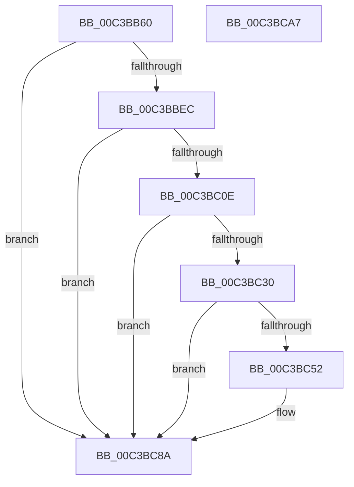

# KsepMatchInitAcpiOemInfo

- RVA: `0x00C3BB60`–`0x00C3BCA8` (길이 `328` bytes)
- VA: `0x0000000140C3BB60`
- 실행 섹션: `INIT`
- PDB 이름 있음: `예`; PDB Function 태그: `아니요`
- unwind 정보 RVA: `0x0005E6B4`
- 디코드: `75`개 명령, `328/328` bytes 표시
- 미해석 바이트: `0` (있으면 어셈블리에 `.byte`로 보존)

> 이 문서는 커널 이미지의 기계어와 PDB 기호를 분석해 생성했습니다. 4번과 5번은 함수 원형과 자료형을 바이너리 사용 방식에서 추정한 C 해석이며 원본 소스 복구 결과는 아닙니다.

## 1. Dependencies

- 직접 호출 지점: **4**; 고유 호출 대상: **2**
- 직접 호출자로 확인된 함수: **1**
- RIP 상대 이미지 참조: **17**

### Outgoing calls
- `0x00C3BBDB` → [HalpAcpiGetTable](../../text/3F/HalpAcpiGetTable_function_003F6BF8.md) (function, `0x003F6BF8`)
- `0x00C3BC03` → [KsepStringAnsiToUnicode](../../page/74/KsepStringAnsiToUnicode_function_0074AAFC.md) (function, `0x0074AAFC`)
- `0x00C3BC25` → [KsepStringAnsiToUnicode](../../page/74/KsepStringAnsiToUnicode_function_0074AAFC.md) (function, `0x0074AAFC`)
- `0x00C3BC47` → [KsepStringAnsiToUnicode](../../page/74/KsepStringAnsiToUnicode_function_0074AAFC.md) (function, `0x0074AAFC`)

### Direct callers
- [KsepMatchInitMachineInfo](KsepMatchInitMachineInfo_function_00C3BFBC.md) at `0x00C3BFCC`

### Static image references
- `0x00C3BB84` → RVA `0x00E61E90` (`.data`; read)
- `0x00C3BB8B` → RVA `0x00E61EA0` (`.data`; write)
- `0x00C3BB95` → RVA `0x00E622F0` (`.data`; read)
- `0x00C3BB9C` → RVA `0x00E61E9C` (`.data`; write)
- `0x00C3BBAD` → RVA `0x00E622FC` (`.data`; write)
- `0x00C3BBB8` → RVA `0x00E61E70` (`.data`; read)
- `0x00C3BBBF` → RVA `0x00E62300` (`.data`; write)
- `0x00C3BBC6` → RVA `0x00E61E80` (`.data`; read)
- `0x00C3BBCD` → RVA `0x00E622D0` (`.data`; read)
- `0x00C3BBD4` → RVA `0x00E622E0` (`.data`; read)
- `0x00C3BBF1` → RVA `0x00E62340` (`.data`; read)
- `0x00C3BC13` → RVA `0x00E61E58` (`.data`; read)
- `0x00C3BC35` → RVA `0x00E61E48` (`.data`; read)
- `0x00C3BC52` → RVA `0x00E61E70` (`.data`; write)
- `0x00C3BC59` → RVA `0x00E61E78` (`.data`; write)
- `0x00C3BC73` → RVA `0x00E622D0` (`.data`; write)
- `0x00C3BC7A` → RVA `0x00E622D8` (`.data`; write)

## 2. Other-region calls and transfers

- 다른 실행 섹션으로 향하는 call: **4**
  - `0x00C3BBDB` → [HalpAcpiGetTable](../../text/3F/HalpAcpiGetTable_function_003F6BF8.md) (`INIT` → `.text`)
  - `0x00C3BC03` → [KsepStringAnsiToUnicode](../../page/74/KsepStringAnsiToUnicode_function_0074AAFC.md) (`INIT` → `PAGE`)
  - `0x00C3BC25` → [KsepStringAnsiToUnicode](../../page/74/KsepStringAnsiToUnicode_function_0074AAFC.md) (`INIT` → `PAGE`)
  - `0x00C3BC47` → [KsepStringAnsiToUnicode](../../page/74/KsepStringAnsiToUnicode_function_0074AAFC.md) (`INIT` → `PAGE`)
- 별도 외부 분기/꼬리 이동을 확인하지 못했습니다.

## 3. Assembly (complete function range)

```asm
00C3BB60  48 8B C4                        mov rax, rsp
00C3BB63  48 89 58 08                     mov qword ptr [rax + 8], rbx
00C3BB67  48 89 68 10                     mov qword ptr [rax + 0x10], rbp
00C3BB6B  48 89 70 18                     mov qword ptr [rax + 0x18], rsi
00C3BB6F  48 89 78 20                     mov qword ptr [rax + 0x20], rdi
00C3BB73  41 56                           push r14
00C3BB75  48 83 EC 20                     sub rsp, 0x20
00C3BB79  0F 57 C0                        xorps xmm0, xmm0
00C3BB7C  83 CA FF                        or edx, 0xffffffff
00C3BB7F  33 C0                           xor eax, eax
00C3BB81  45 33 C9                        xor r9d, r9d
00C3BB84  0F 11 05 05 63 22 00            movups xmmword ptr [rip + 0x226305], xmm0
00C3BB8B  48 89 05 0E 63 22 00            mov qword ptr [rip + 0x22630e], rax
00C3BB92  45 33 C0                        xor r8d, r8d
00C3BB95  0F 11 05 54 67 22 00            movups xmmword ptr [rip + 0x226754], xmm0
00C3BB9C  89 15 FA 62 22 00               mov dword ptr [rip + 0x2262fa], edx
00C3BBA2  BB 25 02 00 C0                  mov ebx, 0xc0000225
00C3BBA7  89 15 F3 62 22 00               mov dword ptr [rip + 0x2262f3], edx
00C3BBAD  89 15 49 67 22 00               mov dword ptr [rip + 0x226749], edx
00C3BBB3  BA 46 41 43 50                  mov edx, 0x50434146
00C3BBB8  0F 11 05 B1 62 22 00            movups xmmword ptr [rip + 0x2262b1], xmm0
00C3BBBF  48 89 05 3A 67 22 00            mov qword ptr [rip + 0x22673a], rax
00C3BBC6  0F 11 05 B3 62 22 00            movups xmmword ptr [rip + 0x2262b3], xmm0
00C3BBCD  0F 11 05 FC 66 22 00            movups xmmword ptr [rip + 0x2266fc], xmm0
00C3BBD4  0F 11 05 05 67 22 00            movups xmmword ptr [rip + 0x226705], xmm0
00C3BBDB  E8 18 B0 7B FF                  call 0x1403f6bf8
00C3BBE0  48 8B F8                        mov rdi, rax
00C3BBE3  48 85 C0                        test rax, rax
00C3BBE6  0F 84 9E 00 00 00               je 0x140c3bc8a
00C3BBEC  BA 0E 00 00 00                  mov edx, 0xe
00C3BBF1  48 8D 35 48 67 22 00            lea rsi, [rip + 0x226748]
00C3BBF8  4C 8D 40 0A                     lea r8, [rax + 0xa]
00C3BBFC  48 8B CE                        mov rcx, rsi
00C3BBFF  44 8D 4A F8                     lea r9d, [rdx - 8]
00C3BC03  E8 F4 EE B0 FF                  call 0x14074aafc
00C3BC08  8B D8                           mov ebx, eax
00C3BC0A  85 C0                           test eax, eax
00C3BC0C  78 7C                           js 0x140c3bc8a
00C3BC0E  BA 12 00 00 00                  mov edx, 0x12
00C3BC13  48 8D 2D 3E 62 22 00            lea rbp, [rip + 0x22623e]
00C3BC1A  4C 8D 47 10                     lea r8, [rdi + 0x10]
00C3BC1E  48 8B CD                        mov rcx, rbp
00C3BC21  44 8D 4A F6                     lea r9d, [rdx - 0xa]
00C3BC25  E8 D2 EE B0 FF                  call 0x14074aafc
00C3BC2A  8B D8                           mov ebx, eax
00C3BC2C  85 C0                           test eax, eax
00C3BC2E  78 5A                           js 0x140c3bc8a
00C3BC30  BA 0A 00 00 00                  mov edx, 0xa
00C3BC35  4C 8D 35 0C 62 22 00            lea r14, [rip + 0x22620c]
00C3BC3C  4C 8D 47 1C                     lea r8, [rdi + 0x1c]
00C3BC40  49 8B CE                        mov rcx, r14
00C3BC43  44 8D 4A FA                     lea r9d, [rdx - 6]
00C3BC47  E8 B0 EE B0 FF                  call 0x14074aafc
00C3BC4C  8B D8                           mov ebx, eax
00C3BC4E  85 C0                           test eax, eax
00C3BC50  78 38                           js 0x140c3bc8a
00C3BC52  48 89 35 17 62 22 00            mov qword ptr [rip + 0x226217], rsi
00C3BC59  4C 89 35 18 62 22 00            mov qword ptr [rip + 0x226218], r14
00C3BC60  0F B6 47 08                     movzx eax, byte ptr [rdi + 8]
00C3BC64  89 05 32 62 22 00               mov dword ptr [rip + 0x226232], eax
00C3BC6A  8B 47 20                        mov eax, dword ptr [rdi + 0x20]
00C3BC6D  89 05 2D 62 22 00               mov dword ptr [rip + 0x22622d], eax
00C3BC73  48 89 35 56 66 22 00            mov qword ptr [rip + 0x226656], rsi
00C3BC7A  48 89 2D 57 66 22 00            mov qword ptr [rip + 0x226657], rbp
00C3BC81  8B 47 18                        mov eax, dword ptr [rdi + 0x18]
00C3BC84  89 05 72 66 22 00               mov dword ptr [rip + 0x226672], eax
00C3BC8A  48 8B 6C 24 38                  mov rbp, qword ptr [rsp + 0x38]
00C3BC8F  8B C3                           mov eax, ebx
00C3BC91  48 8B 5C 24 30                  mov rbx, qword ptr [rsp + 0x30]
00C3BC96  48 8B 74 24 40                  mov rsi, qword ptr [rsp + 0x40]
00C3BC9B  48 8B 7C 24 48                  mov rdi, qword ptr [rsp + 0x48]
00C3BCA0  48 83 C4 20                     add rsp, 0x20
00C3BCA4  41 5E                           pop r14
00C3BCA6  C3                              ret
00C3BCA7  CC                              int3
```

## 4. C-style interpretation (structured pseudocode)

```c
__int64 __fastcall KsepMatchInitAcpiOemInfo(__int64 a1, int a2, int a3, int a4)
{
    __int64 result;
    __int64 v_rsp;
    unsigned __int64 v_stack_p10;
    unsigned __int64 v_stack_p18;
    unsigned __int64 v_stack_p20;
    unsigned __int64 v_stack_p8;

    *(unsigned __int64 *)(v_rsp + 8) = v_rbx;
    *(unsigned __int64 *)(v_rsp + 16) = v_rbp;
    *(unsigned __int64 *)(v_rsp + 24) = v_rsi;
    *(unsigned __int64 *)(v_rsp + 32) = v_rdi;
    v_rsp = (v_rsp) - (32);
    a2 = (unsigned int)((a2) | (0xFFFFFFFFULL));
    result = 0;
    a4 = 0;
    *(unsigned __int64 *)(v_rip + 2253573) = v_xmm0;
    *(unsigned __int64 *)(v_rip + 2253582) = 0;
    a3 = 0;
    *(unsigned __int64 *)(v_rip + 2254676) = v_xmm0;
    *(unsigned int *)(v_rip + 2253562) = a2;
    *(unsigned int *)(v_rip + 2253555) = a2;
    *(unsigned int *)(v_rip + 2254665) = a2;
    *(unsigned __int64 *)(v_rip + 2253489) = v_xmm0;
    *(unsigned __int64 *)(v_rip + 2254650) = 0;
    *(unsigned __int64 *)(v_rip + 2253491) = v_xmm0;
    *(unsigned __int64 *)(v_rip + 2254588) = v_xmm0;
    *(unsigned __int64 *)(v_rip + 2254597) = v_xmm0;
    result = HalpAcpiGetTable(a1, (unsigned int)(0x50434146ULL), a3, a4);
    if (result == 0) goto loc_00C3BC8A;
    result = KsepStringAnsiToUnicode(v_rip + 2254664, 14, result + 10, 14 - 8);
    if (sign_flag) goto loc_00C3BC8A;
    result = KsepStringAnsiToUnicode(v_rip + 2253374, 18, result + 16, 18 - 10);
    if (sign_flag) goto loc_00C3BC8A;
    result = KsepStringAnsiToUnicode(v_rip + 2253324, 10, result + 28, 10 - 6);
    if (!(sign_flag)) {
        *(unsigned __int64 *)(v_rip + 2253335) = v_rip + 2254664;
        *(unsigned __int64 *)(v_rip + 2253336) = v_rip + 2253324;
        result = *(unsigned __int8 *)(result + 8);
        *(unsigned int *)(v_rip + 2253362) = (unsigned int)(result);
        result = *(unsigned int *)(result + 32);
        *(unsigned int *)(v_rip + 2253357) = (unsigned int)(result);
        *(unsigned __int64 *)(v_rip + 2254422) = v_rip + 2254664;
        *(unsigned __int64 *)(v_rip + 2254423) = v_rip + 2253374;
        result = *(unsigned int *)(result + 24);
        *(unsigned int *)(v_rip + 2254450) = (unsigned int)(result);
    }
    v_rsp = (v_rsp) + (32);
    return (unsigned int)((unsigned int)((unsigned int)((unsigned int)(result))));
}
```

## 5. (Beta) C Style

```c
int64_t KsepMatchInitAcpiOemInfo(int64_t Arg1, int32_t Arg2, int32_t Arg3, int32_t Arg4)
{
    int64_t result;
    int64_t local_rsp;
    uint64_t v_stack_p10;
    uint64_t v_stack_p18;
    uint64_t v_stack_p20;
    uint64_t v_stack_p8;

    *(uint64_t *)(local_rsp + 0x8) = local_rbx;
    *(uint64_t *)(local_rsp + 0x10) = local_rbp;
    *(uint64_t *)(local_rsp + 0x18) = local_rsi;
    *(uint64_t *)(local_rsp + 0x20) = local_rdi;
    local_rsp = (local_rsp) - (32);
    Arg2 = (uint32_t)((Arg2) | (0xFFFFFFFFULL));
    result = 0;
    Arg4 = 0;
    *(uint64_t *)(v_rip + 0x226305) = v_xmm0;
    *(uint64_t *)(v_rip + 0x22630E) = 0;
    Arg3 = 0;
    *(uint64_t *)(v_rip + 0x226754) = v_xmm0;
    *(uint32_t *)(v_rip + 0x2262FA) = Arg2;
    *(uint32_t *)(v_rip + 0x2262F3) = Arg2;
    *(uint32_t *)(v_rip + 0x226749) = Arg2;
    *(uint64_t *)(v_rip + 0x2262B1) = v_xmm0;
    *(uint64_t *)(v_rip + 0x22673A) = 0;
    *(uint64_t *)(v_rip + 0x2262B3) = v_xmm0;
    *(uint64_t *)(v_rip + 0x2266FC) = v_xmm0;
    *(uint64_t *)(v_rip + 0x226705) = v_xmm0;
    result = HalpAcpiGetTable(Arg1, (uint32_t)(0x50434146ULL), Arg3, Arg4);
    if (result == 0) goto loc_00C3BC8A;
    result = KsepStringAnsiToUnicode(v_rip + 2254664, 14, result + 10, 14 - 8);
    if (sign_flag) goto loc_00C3BC8A;
    result = KsepStringAnsiToUnicode(v_rip + 2253374, 18, result + 16, 18 - 10);
    if (sign_flag) goto loc_00C3BC8A;
    result = KsepStringAnsiToUnicode(v_rip + 2253324, 10, result + 28, 10 - 6);
    if (!(sign_flag)) {
        *(uint64_t *)(v_rip + 0x226217) = v_rip + 2254664;
        *(uint64_t *)(v_rip + 0x226218) = v_rip + 2253324;
        result = *(uint8_t *)(result + 0x8);
        *(uint32_t *)(v_rip + 0x226232) = (uint32_t)(result);
        result = *(uint32_t *)(result + 0x20);
        *(uint32_t *)(v_rip + 0x22622D) = (uint32_t)(result);
        *(uint64_t *)(v_rip + 0x226656) = v_rip + 2254664;
        *(uint64_t *)(v_rip + 0x226657) = v_rip + 2253374;
        result = *(uint32_t *)(result + 0x18);
        *(uint32_t *)(v_rip + 0x226672) = (uint32_t)(result);
    }
    local_rsp = (local_rsp) + (32);
    return (uint32_t)((uint32_t)((uint32_t)((uint32_t)(result))));
}
```

## 6. Execution-region graph

[열기: 2D/3D 그래프와 함수 탐색 컨트롤 패널](../../../control-panel.html?section=init&rva=0x00C3BB60&view=graph)

- 2D 그래프는 위에서 아래로 흐르고, 3D 그래프는 빈 공간을 드래그해 회전합니다. Shift+드래그는 이동, 휠은 확대·축소, 함수 노드 선택은 대상 보고서 이동입니다.

### Static fallback


