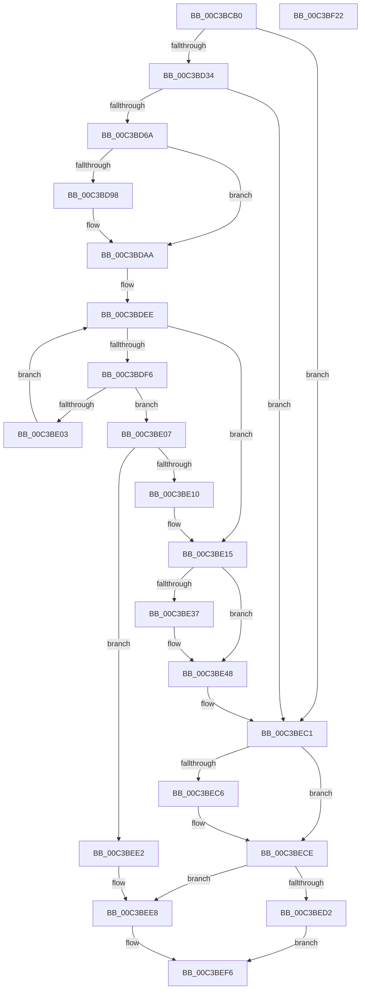

# KsepMatchInitBiosInfo

- RVA: `0x00C3BCB0`–`0x00C3BF23` (길이 `627` bytes)
- VA: `0x0000000140C3BCB0`
- 실행 섹션: `INIT`
- PDB 이름 있음: `예`; PDB Function 태그: `아니요`
- unwind 정보 RVA: `0x000CB444`
- 디코드: `155`개 명령, `627/627` bytes 표시
- 미해석 바이트: `0` (있으면 어셈블리에 `.byte`로 보존)

> 이 문서는 커널 이미지의 기계어와 PDB 기호를 분석해 생성했습니다. 4번과 5번은 함수 원형과 자료형을 바이너리 사용 방식에서 추정한 C 해석이며 원본 소스 복구 결과는 아닙니다.

## 1. Dependencies

- 직접 호출 지점: **13**; 고유 호출 대상: **9**
- 직접 호출자로 확인된 함수: **1**
- RIP 상대 이미지 참조: **18**

### Outgoing calls
- `0x00C3BD1A` → [KsepRegistryOpenKey](../../page/95/KsepRegistryOpenKey_function_0095A79C.md) (function, `0x0095A79C`)
- `0x00C3BD5B` → [KsepRegistryQuerySZ](../../page/74/KsepRegistryQuerySZ_function_0074B58C.md) (function, `0x0074B58C`)
- `0x00C3BDA5` → [KsepDebugPrint](../../text/4D/KsepDebugPrint_function_004DCFF0.md) (function, `0x004DCFF0`)
- `0x00C3BDB7` → [KsepLogInfo](../../text/49/KsepLogInfo_function_00499A68.md) (function, `0x00499A68`)
- `0x00C3BDDC` → [KsepRegistryQueryMULTISZ](../../page/74/KsepRegistryQueryMULTISZ_function_0074B55C.md) (function, `0x0074B55C`)
- `0x00C3BE43` → [KsepDebugPrint](../../text/4D/KsepDebugPrint_function_004DCFF0.md) (function, `0x004DCFF0`)
- `0x00C3BE54` → [KsepLogInfo](../../text/49/KsepLogInfo_function_00499A68.md) (function, `0x00499A68`)
- `0x00C3BE72` → [wcstoul](../../text/50/wcstoul_function_005024A0.md) (function, `0x005024A0`)
- `0x00C3BE82` → [wcstoul](../../text/50/wcstoul_function_005024A0.md) (function, `0x005024A0`)
- `0x00C3BE95` → [wcstoul](../../text/50/wcstoul_function_005024A0.md) (function, `0x005024A0`)
- `0x00C3BEC9` → [KsepRegistryCloseKey](../../page/95/KsepRegistryCloseKey_function_00959500.md) (function, `0x00959500`)
- `0x00C3BEE2` → [_report_rangecheckfailure](../../text/4F/_report_rangecheckfailure_function_004F5FDC.md) (function, `0x004F5FDC`)
- `0x00C3BEFF` → [_security_check_cookie](../../text/6A/_security_check_cookie_function_006AC640.md) (function, `0x006AC640`)

### Direct callers
- [KsepMatchInitMachineInfo](KsepMatchInitMachineInfo_function_00C3BFBC.md) at `0x00C3C07B`

### Static image references
- `0x00C3BCCF` → RVA `0x00E0A740` (`.data`; read)
- `0x00C3BCE7` → RVA `0x00C7B680` (` ?? ::PBOPGDP::`string'`; read)
- `0x00C3BCFA` → RVA `0x00E62308` (`.data`; read)
- `0x00C3BD01` → RVA `0x00E62338` (`.data`; write)
- `0x00C3BD0C` → RVA `0x00E62318` (`.data`; read)
- `0x00C3BD13` → RVA `0x00E62328` (`.data`; read)
- `0x00C3BD25` → RVA `0x00E61EB0` (`.data`; read)
- `0x00C3BD54` → RVA `0x00C79E80` (` ?? ::PBOPGDP::`string'`; read)
- `0x00C3BD71` → RVA `0x00F105E0` (`.data`; read/write)
- `0x00C3BD7B` → RVA `0x00F103E0` (`.data`; read)
- `0x00C3BD8D` → RVA `0x00E66CE8` (`.data`; read)
- `0x00C3BD9E` → RVA `0x00C7B6E0` (` ?? ::PBOPGDP::`string'`; read)
- `0x00C3BDD2` → RVA `0x00C7A620` (` ?? ::PBOPGDP::`string'`; read)
- `0x00C3BDE3` → RVA `0x00E620B6` (`.data`; write)
- `0x00C3BE3A` → RVA `0x00C7B660` (` ?? ::PBOPGDP::`string'`; read)
- `0x00C3BED2` → RVA `0x00E62308` (`.data`; write)
- `0x00C3BED9` → RVA `0x00E62330` (`.data`; write)
- `0x00C3BEE8` → RVA `0x00E62330` (`.data`; read/write)

## 2. Other-region calls and transfers

- 다른 실행 섹션으로 향하는 call: **13**
  - `0x00C3BD1A` → [KsepRegistryOpenKey](../../page/95/KsepRegistryOpenKey_function_0095A79C.md) (`INIT` → `PAGE`)
  - `0x00C3BD5B` → [KsepRegistryQuerySZ](../../page/74/KsepRegistryQuerySZ_function_0074B58C.md) (`INIT` → `PAGE`)
  - `0x00C3BDA5` → [KsepDebugPrint](../../text/4D/KsepDebugPrint_function_004DCFF0.md) (`INIT` → `.text`)
  - `0x00C3BDB7` → [KsepLogInfo](../../text/49/KsepLogInfo_function_00499A68.md) (`INIT` → `.text`)
  - `0x00C3BDDC` → [KsepRegistryQueryMULTISZ](../../page/74/KsepRegistryQueryMULTISZ_function_0074B55C.md) (`INIT` → `PAGE`)
  - `0x00C3BE43` → [KsepDebugPrint](../../text/4D/KsepDebugPrint_function_004DCFF0.md) (`INIT` → `.text`)
  - `0x00C3BE54` → [KsepLogInfo](../../text/49/KsepLogInfo_function_00499A68.md) (`INIT` → `.text`)
  - `0x00C3BE72` → [wcstoul](../../text/50/wcstoul_function_005024A0.md) (`INIT` → `.text`)
  - `0x00C3BE82` → [wcstoul](../../text/50/wcstoul_function_005024A0.md) (`INIT` → `.text`)
  - `0x00C3BE95` → [wcstoul](../../text/50/wcstoul_function_005024A0.md) (`INIT` → `.text`)
  - `0x00C3BEC9` → [KsepRegistryCloseKey](../../page/95/KsepRegistryCloseKey_function_00959500.md) (`INIT` → `PAGE`)
  - `0x00C3BEE2` → [_report_rangecheckfailure](../../text/4F/_report_rangecheckfailure_function_004F5FDC.md) (`INIT` → `.text`)
  - `0x00C3BEFF` → [_security_check_cookie](../../text/6A/_security_check_cookie_function_006AC640.md) (`INIT` → `.text`)
- 별도 외부 분기/꼬리 이동을 확인하지 못했습니다.

## 3. Assembly (complete function range)

```asm
00C3BCB0  48 8B C4                        mov rax, rsp
00C3BCB3  48 89 58 08                     mov qword ptr [rax + 8], rbx
00C3BCB7  48 89 70 10                     mov qword ptr [rax + 0x10], rsi
00C3BCBB  48 89 78 18                     mov qword ptr [rax + 0x18], rdi
00C3BCBF  4C 89 60 20                     mov qword ptr [rax + 0x20], r12
00C3BCC3  55                              push rbp
00C3BCC4  41 56                           push r14
00C3BCC6  41 57                           push r15
00C3BCC8  48 8B EC                        mov rbp, rsp
00C3BCCB  48 83 EC 60                     sub rsp, 0x60
00C3BCCF  48 8B 05 6A EA 1C 00            mov rax, qword ptr [rip + 0x1cea6a]
00C3BCD6  48 33 C4                        xor rax, rsp
00C3BCD9  48 89 45 F8                     mov qword ptr [rbp - 8], rax
00C3BCDD  0F 57 C0                        xorps xmm0, xmm0
00C3BCE0  4C 8D 45 D0                     lea r8, [rbp - 0x30]
00C3BCE4  45 33 FF                        xor r15d, r15d
00C3BCE7  48 8D 0D 92 F9 03 00            lea rcx, [rip + 0x3f992]
00C3BCEE  33 C0                           xor eax, eax
00C3BCF0  4C 89 7D D8                     mov qword ptr [rbp - 0x28], r15
00C3BCF4  33 D2                           xor edx, edx
00C3BCF6  4C 89 7D D0                     mov qword ptr [rbp - 0x30], r15
00C3BCFA  0F 11 05 07 66 22 00            movups xmmword ptr [rip + 0x226607], xmm0
00C3BD01  48 89 05 30 66 22 00            mov qword ptr [rip + 0x226630], rax
00C3BD08  41 83 CE FF                     or r14d, 0xffffffff
00C3BD0C  0F 11 05 05 66 22 00            movups xmmword ptr [rip + 0x226605], xmm0
00C3BD13  0F 11 05 0E 66 22 00            movups xmmword ptr [rip + 0x22660e], xmm0
00C3BD1A  E8 7D EA D1 FF                  call 0x14095a79c
00C3BD1F  48 8B 5D D0                     mov rbx, qword ptr [rbp - 0x30]
00C3BD23  8B F0                           mov esi, eax
00C3BD25  4C 8D 25 84 61 22 00            lea r12, [rip + 0x226184]
00C3BD2C  85 C0                           test eax, eax
00C3BD2E  0F 88 8D 01 00 00               js 0x140c3bec1
00C3BD34  48 8D 45 D8                     lea rax, [rbp - 0x28]
00C3BD38  48 8B CB                        mov rcx, rbx
00C3BD3B  48 89 44 24 28                  mov qword ptr [rsp + 0x28], rax
00C3BD40  41 8D 7F 01                     lea edi, [r15 + 1]
00C3BD44  44 8B C7                        mov r8d, edi
00C3BD47  48 C7 44 24 20 16 00 00 00      mov qword ptr [rsp + 0x20], 0x16
00C3BD50  4C 8D 4D E0                     lea r9, [rbp - 0x20]
00C3BD54  48 8D 15 25 E1 03 00            lea rdx, [rip + 0x3e125]
00C3BD5B  E8 2C F8 B0 FF                  call 0x14074b58c
00C3BD60  8B F0                           mov esi, eax
00C3BD62  85 C0                           test eax, eax
00C3BD64  0F 88 57 01 00 00               js 0x140c3bec1
00C3BD6A  66 44 89 7D F4                  mov word ptr [rbp - 0xc], r15w
00C3BD6F  8B C7                           mov eax, edi
00C3BD71  F0 0F C1 05 67 48 2D 00         lock xadd dword ptr [rip + 0x2d4867], eax
00C3BD79  03 C7                           add eax, edi
00C3BD7B  48 8D 1D 5E 46 2D 00            lea rbx, [rip + 0x2d465e]
00C3BD82  83 E0 3F                        and eax, 0x3f
00C3BD85  48 C7 04 C3 C8 01 0A 00         mov qword ptr [rbx + rax*8], 0xa01c8
00C3BD8D  8B 05 55 AF 22 00               mov eax, dword ptr [rip + 0x22af55]
00C3BD93  40 84 C7                        test dil, al
00C3BD96  74 12                           je 0x140c3bdaa
00C3BD98  4C 8D 45 E0                     lea r8, [rbp - 0x20]
00C3BD9C  33 C9                           xor ecx, ecx
00C3BD9E  48 8D 15 3B F9 03 00            lea rdx, [rip + 0x3f93b]
00C3BDA5  E8 46 12 8A FF                  call 0x1404dcff0
00C3BDAA  4C 8D 45 E0                     lea r8, [rbp - 0x20]
00C3BDAE  33 C9                           xor ecx, ecx
00C3BDB0  48 8D 15 29 F9 03 00            lea rdx, [rip + 0x3f929]
00C3BDB7  E8 AC DC 85 FF                  call 0x140499a68
00C3BDBC  48 8B 4D D0                     mov rcx, qword ptr [rbp - 0x30]
00C3BDC0  48 8D 45 D8                     lea rax, [rbp - 0x28]
00C3BDC4  41 BE 08 02 00 00               mov r14d, 0x208
00C3BDCA  48 89 44 24 20                  mov qword ptr [rsp + 0x20], rax
00C3BDCF  45 8B CE                        mov r9d, r14d
00C3BDD2  48 8D 15 47 E8 03 00            lea rdx, [rip + 0x3e847]
00C3BDD9  4D 8B C4                        mov r8, r12
00C3BDDC  E8 7B F7 B0 FF                  call 0x14074b55c
00C3BDE1  8B F0                           mov esi, eax
00C3BDE3  66 44 89 3D CB 62 22 00         mov word ptr [rip + 0x2262cb], r15w
00C3BDEB  41 8B CF                        mov ecx, r15d
00C3BDEE  81 F9 04 01 00 00               cmp ecx, 0x104
00C3BDF4  73 1F                           jae 0x140c3be15
00C3BDF6  8B C1                           mov eax, ecx
00C3BDF8  48 03 C0                        add rax, rax
00C3BDFB  66 42 83 3C 20 20               cmp word ptr [rax + r12], 0x20
00C3BE01  74 04                           je 0x140c3be07
00C3BE03  03 CF                           add ecx, edi
00C3BE05  EB E7                           jmp 0x140c3bdee
00C3BE07  49 3B C6                        cmp rax, r14
00C3BE0A  0F 83 D2 00 00 00               jae 0x140c3bee2
00C3BE10  66 46 89 3C 20                  mov word ptr [rax + r12], r15w
00C3BE15  8B C7                           mov eax, edi
00C3BE17  F0 0F C1 05 C1 47 2D 00         lock xadd dword ptr [rip + 0x2d47c1], eax
00C3BE1F  03 C7                           add eax, edi
00C3BE21  83 E0 3F                        and eax, 0x3f
00C3BE24  48 C7 04 C3 E0 01 0A 00         mov qword ptr [rbx + rax*8], 0xa01e0
00C3BE2C  8B 05 B6 AE 22 00               mov eax, dword ptr [rip + 0x22aeb6]
00C3BE32  40 84 C7                        test dil, al
00C3BE35  74 11                           je 0x140c3be48
00C3BE37  4D 8B C4                        mov r8, r12
00C3BE3A  48 8D 15 1F F8 03 00            lea rdx, [rip + 0x3f81f]
00C3BE41  33 C9                           xor ecx, ecx
00C3BE43  E8 A8 11 8A FF                  call 0x1404dcff0
00C3BE48  4D 8B C4                        mov r8, r12
00C3BE4B  48 8D 15 0E F8 03 00            lea rdx, [rip + 0x3f80e]
00C3BE52  33 C9                           xor ecx, ecx
00C3BE54  E8 0F DC 85 FF                  call 0x140499a68
00C3BE59  41 BE 10 00 00 00               mov r14d, 0x10
00C3BE5F  66 44 89 7D E4                  mov word ptr [rbp - 0x1c], r15w
00C3BE64  45 8B C6                        mov r8d, r14d
00C3BE67  66 44 89 7D EA                  mov word ptr [rbp - 0x16], r15w
00C3BE6C  33 D2                           xor edx, edx
00C3BE6E  48 8D 4D EC                     lea rcx, [rbp - 0x14]
00C3BE72  E8 29 66 8C FF                  call 0x1405024a0
00C3BE77  45 8B C6                        mov r8d, r14d
00C3BE7A  48 8D 4D E0                     lea rcx, [rbp - 0x20]
00C3BE7E  33 D2                           xor edx, edx
00C3BE80  8B F8                           mov edi, eax
00C3BE82  E8 19 66 8C FF                  call 0x1405024a0
00C3BE87  8B D8                           mov ebx, eax
00C3BE89  48 8D 4D E6                     lea rcx, [rbp - 0x1a]
00C3BE8D  45 8B C6                        mov r8d, r14d
00C3BE90  C1 E3 08                        shl ebx, 8
00C3BE93  33 D2                           xor edx, edx
00C3BE95  E8 06 66 8C FF                  call 0x1405024a0
00C3BE9A  81 FF 80 00 00 00               cmp edi, 0x80
00C3BEA0  45 1B F6                        sbb r14d, r14d
00C3BEA3  03 C3                           add eax, ebx
00C3BEA5  48 8B 5D D0                     mov rbx, qword ptr [rbp - 0x30]
00C3BEA9  41 81 E6 00 07 00 00            and r14d, 0x700
00C3BEB0  41 81 C6 00 19 00 00            add r14d, 0x1900
00C3BEB7  44 03 F7                        add r14d, edi
00C3BEBA  41 C1 E6 10                     shl r14d, 0x10
00C3BEBE  44 03 F0                        add r14d, eax
00C3BEC1  48 85 DB                        test rbx, rbx
00C3BEC4  74 08                           je 0x140c3bece
00C3BEC6  48 8B CB                        mov rcx, rbx
00C3BEC9  E8 32 D6 D1 FF                  call 0x140959500
00C3BECE  85 F6                           test esi, esi
00C3BED0  78 16                           js 0x140c3bee8
00C3BED2  4C 89 25 2F 64 22 00            mov qword ptr [rip + 0x22642f], r12
00C3BED9  44 89 35 50 64 22 00            mov dword ptr [rip + 0x226450], r14d
00C3BEE0  EB 14                           jmp 0x140c3bef6
00C3BEE2  E8 F5 A0 8B FF                  call 0x1404f5fdc
00C3BEE7  CC                              int3
00C3BEE8  83 0D 41 64 22 00 FF            or dword ptr [rip + 0x226441], 0xffffffff
00C3BEEF  4C 89 3D 12 64 22 00            mov qword ptr [rip + 0x226412], r15
00C3BEF6  8B C6                           mov eax, esi
00C3BEF8  48 8B 4D F8                     mov rcx, qword ptr [rbp - 8]
00C3BEFC  48 33 CC                        xor rcx, rsp
00C3BEFF  E8 3C 07 A7 FF                  call 0x1406ac640
00C3BF04  4C 8D 5C 24 60                  lea r11, [rsp + 0x60]
00C3BF09  49 8B 5B 20                     mov rbx, qword ptr [r11 + 0x20]
00C3BF0D  49 8B 73 28                     mov rsi, qword ptr [r11 + 0x28]
00C3BF11  49 8B 7B 30                     mov rdi, qword ptr [r11 + 0x30]
00C3BF15  4D 8B 63 38                     mov r12, qword ptr [r11 + 0x38]
00C3BF19  49 8B E3                        mov rsp, r11
00C3BF1C  41 5F                           pop r15
00C3BF1E  41 5E                           pop r14
00C3BF20  5D                              pop rbp
00C3BF21  C3                              ret
00C3BF22  CC                              int3
```

## 4. C-style interpretation (structured pseudocode)

```c
__int64 __fastcall KsepMatchInitBiosInfo(__int64 a1, int a2)
{
    __int64 result;
    __int64 v_r14;
    __int64 v_r15;
    __int64 v_rbx;
    __int64 v_rsp;
    unsigned __int64 v_stack_m18;
    unsigned __int64 v_stack_m20;
    unsigned __int16 v_stack_m24;
    unsigned __int64 v_stack_m2C;
    unsigned __int16 v_stack_m2E;
    unsigned __int64 v_stack_m32;
    unsigned __int16 v_stack_m34;
    unsigned __int64 v_stack_m38;
    unsigned __int64 v_stack_m40;
    unsigned __int64 v_stack_m48;
    unsigned __int64 v_stack_m50;
    unsigned __int64 v_stack_m58;

    *(unsigned __int64 *)(v_rsp + 8) = v_rbx;
    *(unsigned __int64 *)(v_rsp + 16) = v_rsi;
    *(unsigned __int64 *)(v_rsp + 24) = v_rdi;
    *(unsigned __int64 *)(v_rsp + 32) = v_r12;
    v_rsp = (v_rsp) - (96);
    result = (*(unsigned __int64 *)(v_rip + 1895018)) ^ (v_rsp);
    v_stack_m20 = result;
    v_r15 = 0;
    result = 0;
    v_stack_m40 = 0;
    a2 = 0;
    v_stack_m48 = 0;
    *(unsigned __int64 *)(v_rip + 2254343) = v_xmm0;
    *(unsigned __int64 *)(v_rip + 2254384) = 0;
    v_r14 = (unsigned int)((v_r14) | (0xFFFFFFFFULL));
    *(unsigned __int64 *)(v_rip + 2254341) = v_xmm0;
    *(unsigned __int64 *)(v_rip + 2254350) = v_xmm0;
    result = KsepRegistryOpenKey(v_rip + 260498, a2, v_stack_m48, a4);
    if (sign_flag) goto loc_00C3BEC1;
    v_stack_m50 = v_stack_m40;
    v_stack_m58 = 22;
    result = KsepRegistryQuerySZ(v_stack_m48, v_rip + 254245, (unsigned int)((unsigned int)(v_r15 + 1)), v_stack_m38);
    if (sign_flag) goto loc_00C3BEC1;
    v_stack_m24 = 0;
    result = (unsigned int)(((unsigned int)((unsigned int)(v_r15 + 1))) + ((unsigned int)(v_r15 + 1)));
    result = (unsigned int)((result) & (63));
    *(unsigned __int64 *)(v_rip + 2967134 + result * 8) = 0xA01C8ULL;
    result = (unsigned int)(*(unsigned int *)(v_rip + 2273109));
    if ((((unsigned __int8)(v_r15 + 1)) & ((unsigned __int8)((unsigned int)(*(unsigned int *)(v_rip + 2273109))))) != 0) {
        a3 = v_stack_m38;
        a1 = 0;
        a2 = v_rip + 260411;
        result = KsepDebugPrint(a1, a2, a3, v_stack_m38);
    }
    a1 = 0;
    result = KsepLogInfo(a1, v_rip + 260393, v_stack_m38, v_stack_m38);
    v_stack_m58 = v_stack_m40;
    result = KsepRegistryQueryMULTISZ(v_stack_m48, v_rip + 256071, v_rip + 2253188, 520);
    *(unsigned __int16 *)(v_rip + 2253515) = 0;
loc_00C3BDEE:
    if (0 >= 260) goto loc_00C3BE15;
    result = (0) + (0);
    if ((*(unsigned __int16 *)(result + v_rip + 2253188 * 1)) == 32) goto loc_00C3BE07;
    a1 = (unsigned int)((0) + ((unsigned int)(v_r15 + 1)));
    goto loc_00C3BDEE;
loc_00C3BE07:
    if (result >= 520) goto loc_00C3BEE2;
    *(unsigned __int16 *)(result + v_rip + 2253188 * 1) = 0;
loc_00C3BE15:
    result = (unsigned int)(((unsigned int)((unsigned int)(v_r15 + 1))) + ((unsigned int)(v_r15 + 1)));
    result = (unsigned int)((result) & (63));
    *(unsigned __int64 *)(v_rip + 2967134 + result * 8) = 0xA01E0ULL;
    result = (unsigned int)(*(unsigned int *)(v_rip + 2272950));
    if ((((unsigned __int8)(v_r15 + 1)) & ((unsigned __int8)((unsigned int)(*(unsigned int *)(v_rip + 2272950))))) != 0) {
        a3 = v_rip + 2253188;
        a2 = v_rip + 260127;
        a1 = 0;
        result = KsepDebugPrint(a1, a2, a3, 520);
    }
    a1 = 0;
    result = KsepLogInfo(a1, v_rip + 260110, v_rip + 2253188, 520);
    v_stack_m34 = 0;
    v_stack_m2E = 0;
    a2 = 0;
    result = wcstoul(v_stack_m2C, a2, 16, 520);
    a2 = 0;
    result = wcstoul(v_stack_m38, a2, 16, 520);
    v_rbx = (unsigned int)(((unsigned int)((unsigned int)(result))) << (8));
    a2 = 0;
    result = wcstoul(v_stack_m32, a2, 16, 520);
    result = (unsigned int)((result) + ((unsigned int)(v_rbx)));
    v_r14 = (unsigned int)((16) & (0x700ULL));
    v_r14 = (unsigned int)((v_r14) + (0x1900ULL));
    v_r14 = (unsigned int)((v_r14) + ((unsigned int)((unsigned int)((unsigned int)(result)))));
    v_r14 = (unsigned int)((v_r14) << (16));
    v_r14 = (unsigned int)((v_r14) + ((unsigned int)(result)));
loc_00C3BEC1:
    if (v_stack_m48 != 0) {
        a1 = v_stack_m48;
        result = KsepRegistryCloseKey(a1, a2, 16, 520);
    }
    if (sign_flag) goto loc_00C3BEE8;
    *(unsigned __int64 *)(v_rip + 2253871) = v_rip + 2253188;
    *(unsigned int *)(v_rip + 2253904) = (unsigned int)(v_r14);
    goto loc_00C3BEF6;
loc_00C3BEE2:
    result = _report_rangecheckfailure(a1, a2, 16, 520);
loc_00C3BEE8:
    *(unsigned __int64 *)(v_rip + 2253842) = 0;
loc_00C3BEF6:
    a1 = (v_stack_m20) ^ (v_rsp);
    result = _security_check_cookie(a1, a2, 16, 520);
    return result;
}
```

## 5. (Beta) C Style

```c
int64_t KsepMatchInitBiosInfo(int64_t Arg1, int32_t Arg2)
{
    int64_t result;
    int64_t local_r14;
    int64_t local_r15;
    int64_t local_rbx;
    int64_t local_rsp;
    uint64_t v_stack_m18;
    uint64_t v_stack_m20;
    uint16_t v_stack_m24;
    uint64_t v_stack_m2C;
    uint16_t v_stack_m2E;
    uint64_t v_stack_m32;
    uint16_t v_stack_m34;
    uint64_t v_stack_m38;
    uint64_t v_stack_m40;
    uint64_t v_stack_m48;
    uint64_t v_stack_m50;
    uint64_t v_stack_m58;

    *(uint64_t *)(local_rsp + 0x8) = local_rbx;
    *(uint64_t *)(local_rsp + 0x10) = local_rsi;
    *(uint64_t *)(local_rsp + 0x18) = local_rdi;
    *(uint64_t *)(local_rsp + 0x20) = local_r12;
    local_rsp = (local_rsp) - (96);
    result = (*(uint64_t *)(v_rip + 0x1CEA6A)) ^ (local_rsp);
    v_stack_m20 = result;
    local_r15 = 0;
    result = 0;
    v_stack_m40 = 0;
    Arg2 = 0;
    v_stack_m48 = 0;
    *(uint64_t *)(v_rip + 0x226607) = v_xmm0;
    *(uint64_t *)(v_rip + 0x226630) = 0;
    local_r14 = (uint32_t)((local_r14) | (0xFFFFFFFFULL));
    *(uint64_t *)(v_rip + 0x226605) = v_xmm0;
    *(uint64_t *)(v_rip + 0x22660E) = v_xmm0;
    result = KsepRegistryOpenKey(v_rip + 260498, Arg2, v_stack_m48, a4);
    if (sign_flag) goto loc_00C3BEC1;
    v_stack_m50 = v_stack_m40;
    v_stack_m58 = 22;
    result = KsepRegistryQuerySZ(v_stack_m48, v_rip + 254245, (uint32_t)((uint32_t)(local_r15 + 1)), v_stack_m38);
    if (sign_flag) goto loc_00C3BEC1;
    v_stack_m24 = 0;
    result = (uint32_t)(((uint32_t)((uint32_t)(local_r15 + 1))) + ((uint32_t)(local_r15 + 1)));
    result = (uint32_t)((result) & (63));
    *(uint64_t *)(v_rip + 0x2D465E + result * 8) = 0xA01C8ULL;
    result = (uint32_t)(*(uint32_t *)(v_rip + 0x22AF55));
    if ((((uint8_t)(local_r15 + 1)) & ((uint8_t)((uint32_t)(*(uint32_t *)(v_rip + 0x22AF55))))) != 0) {
        a3 = v_stack_m38;
        Arg1 = 0;
        Arg2 = v_rip + 260411;
        result = KsepDebugPrint(Arg1, Arg2, a3, v_stack_m38);
    }
    Arg1 = 0;
    result = KsepLogInfo(Arg1, v_rip + 260393, v_stack_m38, v_stack_m38);
    v_stack_m58 = v_stack_m40;
    result = KsepRegistryQueryMULTISZ(v_stack_m48, v_rip + 256071, v_rip + 2253188, 520);
    *(uint16_t *)(v_rip + 0x2262CB) = 0;
loc_00C3BDEE:
    if (0 >= 260) goto loc_00C3BE15;
    result = (0) + (0);
    if ((*(uint16_t *)(result + v_rip + 0x226184 * 1)) == 32) goto loc_00C3BE07;
    Arg1 = (uint32_t)((0) + ((uint32_t)(local_r15 + 1)));
    goto loc_00C3BDEE;
loc_00C3BE07:
    if (result >= 520) goto loc_00C3BEE2;
    *(uint16_t *)(result + v_rip + 0x226184 * 1) = 0;
loc_00C3BE15:
    result = (uint32_t)(((uint32_t)((uint32_t)(local_r15 + 1))) + ((uint32_t)(local_r15 + 1)));
    result = (uint32_t)((result) & (63));
    *(uint64_t *)(v_rip + 0x2D465E + result * 8) = 0xA01E0ULL;
    result = (uint32_t)(*(uint32_t *)(v_rip + 0x22AEB6));
    if ((((uint8_t)(local_r15 + 1)) & ((uint8_t)((uint32_t)(*(uint32_t *)(v_rip + 0x22AEB6))))) != 0) {
        a3 = v_rip + 2253188;
        Arg2 = v_rip + 260127;
        Arg1 = 0;
        result = KsepDebugPrint(Arg1, Arg2, a3, 520);
    }
    Arg1 = 0;
    result = KsepLogInfo(Arg1, v_rip + 260110, v_rip + 2253188, 520);
    v_stack_m34 = 0;
    v_stack_m2E = 0;
    Arg2 = 0;
    result = wcstoul(v_stack_m2C, Arg2, 16, 520);
    Arg2 = 0;
    result = wcstoul(v_stack_m38, Arg2, 16, 520);
    local_rbx = (uint32_t)(((uint32_t)((uint32_t)(result))) << (8));
    Arg2 = 0;
    result = wcstoul(v_stack_m32, Arg2, 16, 520);
    result = (uint32_t)((result) + ((uint32_t)(local_rbx)));
    local_r14 = (uint32_t)((16) & (0x700ULL));
    local_r14 = (uint32_t)((local_r14) + (0x1900ULL));
    local_r14 = (uint32_t)((local_r14) + ((uint32_t)((uint32_t)((uint32_t)(result)))));
    local_r14 = (uint32_t)((local_r14) << (16));
    local_r14 = (uint32_t)((local_r14) + ((uint32_t)(result)));
loc_00C3BEC1:
    if (v_stack_m48 != 0) {
        Arg1 = v_stack_m48;
        result = KsepRegistryCloseKey(Arg1, Arg2, 16, 520);
    }
    if (sign_flag) goto loc_00C3BEE8;
    *(uint64_t *)(v_rip + 0x22642F) = v_rip + 2253188;
    *(uint32_t *)(v_rip + 0x226450) = (uint32_t)(local_r14);
    goto loc_00C3BEF6;
loc_00C3BEE2:
    result = _report_rangecheckfailure(Arg1, Arg2, 16, 520);
loc_00C3BEE8:
    *(uint64_t *)(v_rip + 0x226412) = 0;
loc_00C3BEF6:
    Arg1 = (v_stack_m20) ^ (local_rsp);
    result = _security_check_cookie(Arg1, Arg2, 16, 520);
    return result;
}
```

## 6. Execution-region graph

[열기: 2D/3D 그래프와 함수 탐색 컨트롤 패널](../../../control-panel.html?section=init&rva=0x00C3BCB0&view=graph)

- 2D 그래프는 위에서 아래로 흐르고, 3D 그래프는 빈 공간을 드래그해 회전합니다. Shift+드래그는 이동, 휠은 확대·축소, 함수 노드 선택은 대상 보고서 이동입니다.

### Static fallback


