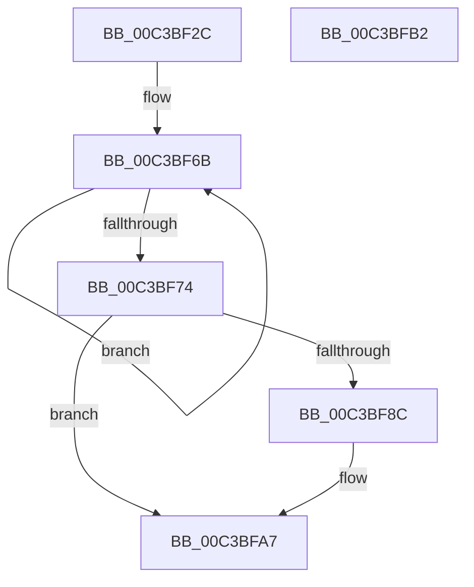

# KsepMatchInitCpuInfo

- RVA: `0x00C3BF2C`–`0x00C3BFB3` (길이 `135` bytes)
- VA: `0x0000000140C3BF2C`
- 실행 섹션: `INIT`
- PDB 이름 있음: `예`; PDB Function 태그: `아니요`
- unwind 정보 RVA: `0x0005CAAC`
- 디코드: `31`개 명령, `135/135` bytes 표시
- 미해석 바이트: `0` (있으면 어셈블리에 `.byte`로 보존)

> 이 문서는 커널 이미지의 기계어와 PDB 기호를 분석해 생성했습니다. 4번과 5번은 함수 원형과 자료형을 바이너리 사용 방식에서 추정한 C 해석이며 원본 소스 복구 결과는 아닙니다.

## 1. Dependencies

- 직접 호출 지점: **1**; 고유 호출 대상: **1**
- 직접 호출자로 확인된 함수: **1**
- RIP 상대 이미지 참조: **8**

### Outgoing calls
- `0x00C3BF83` → [KsepStringAnsiToUnicode](../../page/74/KsepStringAnsiToUnicode_function_0074AAFC.md) (function, `0x0074AAFC`)

### Direct callers
- [KsepMatchInitMachineInfo](KsepMatchInitMachineInfo_function_00C3BFBC.md) at `0x00C3C027`

### Static image references
- `0x00C3BF3B` → RVA `0x00E62350` (`.data`; read)
- `0x00C3BF42` → RVA `0x00E62380` (`.data`; write)
- `0x00C3BF4D` → RVA `0x00E62360` (`.data`; read)
- `0x00C3BF54` → RVA `0x00E62370` (`.data`; read)
- `0x00C3BF74` → RVA `0x00E620C0` (`.data`; read)
- `0x00C3BF90` → RVA `0x00E62374` (`.data`; write)
- `0x00C3BF9A` → RVA `0x00E62370` (`.data`; write)
- `0x00C3BFA0` → RVA `0x00E62350` (`.data`; write)

## 2. Other-region calls and transfers

- 다른 실행 섹션으로 향하는 call: **1**
  - `0x00C3BF83` → [KsepStringAnsiToUnicode](../../page/74/KsepStringAnsiToUnicode_function_0074AAFC.md) (`INIT` → `PAGE`)
- 별도 외부 분기/꼬리 이동을 확인하지 못했습니다.

## 3. Assembly (complete function range)

```asm
00C3BF2C  48 89 5C 24 08                  mov qword ptr [rsp + 8], rbx
00C3BF31  57                              push rdi
00C3BF32  48 83 EC 20                     sub rsp, 0x20
00C3BF36  0F 57 C0                        xorps xmm0, xmm0
00C3BF39  33 C0                           xor eax, eax
00C3BF3B  0F 11 05 0E 64 22 00            movups xmmword ptr [rip + 0x22640e], xmm0
00C3BF42  48 89 05 37 64 22 00            mov qword ptr [rip + 0x226437], rax
00C3BF49  49 83 C9 FF                     or r9, 0xffffffffffffffff
00C3BF4D  0F 11 05 0C 64 22 00            movups xmmword ptr [rip + 0x22640c], xmm0
00C3BF54  0F 11 05 15 64 22 00            movups xmmword ptr [rip + 0x226415], xmm0
00C3BF5B  65 48 8B 1C 25 20 00 00 00      mov rbx, qword ptr gs:[0x20]
00C3BF64  4C 8D 83 90 8F 00 00            lea r8, [rbx + 0x8f90]
00C3BF6B  49 FF C1                        inc r9
00C3BF6E  43 38 04 08                     cmp byte ptr [r8 + r9], al
00C3BF72  75 F7                           jne 0x140c3bf6b
00C3BF74  48 8D 3D 45 61 22 00            lea rdi, [rip + 0x226145]
00C3BF7B  BA 0A 02 00 00                  mov edx, 0x20a
00C3BF80  48 8B CF                        mov rcx, rdi
00C3BF83  E8 74 EB B0 FF                  call 0x14074aafc
00C3BF88  85 C0                           test eax, eax
00C3BF8A  78 1B                           js 0x140c3bfa7
00C3BF8C  0F BE 4B 40                     movsx ecx, byte ptr [rbx + 0x40]
00C3BF90  89 0D DE 63 22 00               mov dword ptr [rip + 0x2263de], ecx
00C3BF96  0F B6 4B 43                     movzx ecx, byte ptr [rbx + 0x43]
00C3BF9A  89 0D D0 63 22 00               mov dword ptr [rip + 0x2263d0], ecx
00C3BFA0  48 89 3D A9 63 22 00            mov qword ptr [rip + 0x2263a9], rdi
00C3BFA7  48 8B 5C 24 30                  mov rbx, qword ptr [rsp + 0x30]
00C3BFAC  48 83 C4 20                     add rsp, 0x20
00C3BFB0  5F                              pop rdi
00C3BFB1  C3                              ret
00C3BFB2  CC                              int3
```

## 4. C-style interpretation (structured pseudocode)

```c
__int64 __fastcall KsepMatchInitCpuInfo(__int64 a1, __int64 a2, __int64 a3, __int64 a4)
{
    __int64 result;
    __int64 v_rsp;
    unsigned __int64 v_stack_p8;

    v_stack_p8 = v_rbx;
    v_rsp = (v_rsp) - (32);
    result = 0;
    *(unsigned __int64 *)(v_rip + 2253838) = v_xmm0;
    *(unsigned __int64 *)(v_rip + 2253879) = 0;
    a4 = (a4) | (-1);
    *(unsigned __int64 *)(v_rip + 2253836) = v_xmm0;
    *(unsigned __int64 *)(v_rip + 2253845) = v_xmm0;
loc_00C3BF6B:
    a4 = (a4) + 1;
    if ((*(unsigned __int8 *)(*(unsigned __int64 *)(gs_base + (0 + 32)) + 36752 + a4 * 1)) != 0) goto loc_00C3BF6B;
    result = KsepStringAnsiToUnicode(v_rip + 2253125, 522, *(unsigned __int64 *)(gs_base + (0 + 32)) + 36752, a4);
    if (!(sign_flag)) {
        a1 = (__int8)(*(unsigned __int8 *)(*(unsigned __int64 *)(gs_base + (0 + 32)) + 64));
        *(unsigned int *)(v_rip + 2253790) = (unsigned int)(a1);
        a1 = *(unsigned __int8 *)(*(unsigned __int64 *)(gs_base + (0 + 32)) + 67);
        *(unsigned int *)(v_rip + 2253776) = (unsigned int)(a1);
        *(unsigned __int64 *)(v_rip + 2253737) = v_rip + 2253125;
    }
    v_rsp = (v_rsp) + (32);
    return result;
}
```

## 5. (Beta) C Style

```c
int64_t KsepMatchInitCpuInfo(int64_t Arg1, int64_t Arg2, int64_t Arg3, int64_t Arg4)
{
    int64_t result;
    int64_t local_rsp;
    uint64_t v_stack_p8;

    v_stack_p8 = local_rbx;
    local_rsp = (local_rsp) - (32);
    result = 0;
    *(uint64_t *)(v_rip + 0x22640E) = v_xmm0;
    *(uint64_t *)(v_rip + 0x226437) = 0;
    Arg4 = (Arg4) | (-1);
    *(uint64_t *)(v_rip + 0x22640C) = v_xmm0;
    *(uint64_t *)(v_rip + 0x226415) = v_xmm0;
loc_00C3BF6B:
    Arg4 = (Arg4) + 1;
    if ((*(uint8_t *)(*(uint64_t *)(gs_base + (0 + 0x20)) + 0x8F90 + Arg4 * 1)) != 0) goto loc_00C3BF6B;
    result = KsepStringAnsiToUnicode(v_rip + 2253125, 522, *(uint64_t *)(gs_base + (0 + 0x20)) + 36752, Arg4);
    if (!(sign_flag)) {
        Arg1 = (int8_t)(*(uint8_t *)(*(uint64_t *)(gs_base + (0 + 0x20)) + 0x40));
        *(uint32_t *)(v_rip + 0x2263DE) = (uint32_t)(Arg1);
        Arg1 = *(uint8_t *)(*(uint64_t *)(gs_base + (0 + 0x20)) + 0x43);
        *(uint32_t *)(v_rip + 0x2263D0) = (uint32_t)(Arg1);
        *(uint64_t *)(v_rip + 0x2263A9) = v_rip + 2253125;
    }
    local_rsp = (local_rsp) + (32);
    return result;
}
```

## 6. Execution-region graph

[열기: 2D/3D 그래프와 함수 탐색 컨트롤 패널](../../../control-panel.html?section=init&rva=0x00C3BF2C&view=graph)

- 2D 그래프는 위에서 아래로 흐르고, 3D 그래프는 빈 공간을 드래그해 회전합니다. Shift+드래그는 이동, 휠은 확대·축소, 함수 노드 선택은 대상 보고서 이동입니다.

### Static fallback


