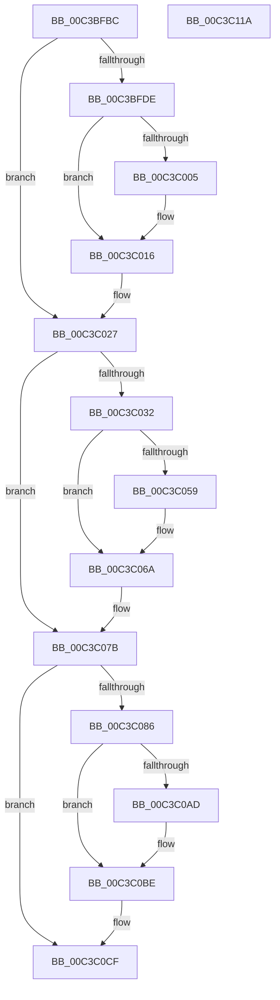

# KsepMatchInitMachineInfo

- RVA: `0x00C3BFBC`–`0x00C3C11B` (길이 `351` bytes)
- VA: `0x0000000140C3BFBC`
- 실행 섹션: `INIT`
- PDB 이름 있음: `예`; PDB Function 태그: `아니요`
- unwind 정보 RVA: `0x000C6F0C`
- 디코드: `83`개 명령, `351/351` bytes 표시
- 미해석 바이트: `0` (있으면 어셈블리에 `.byte`로 보존)

> 이 문서는 커널 이미지의 기계어와 PDB 기호를 분석해 생성했습니다. 4번과 5번은 함수 원형과 자료형을 바이너리 사용 방식에서 추정한 C 해석이며 원본 소스 복구 결과는 아닙니다.

## 1. Dependencies

- 직접 호출 지점: **9**; 고유 호출 대상: **5**
- 직접 호출자로 확인된 함수: **1**
- RIP 상대 이미지 참조: **14**

### Outgoing calls
- `0x00C3BFCC` → [KsepMatchInitAcpiOemInfo](KsepMatchInitAcpiOemInfo_function_00C3BB60.md) (function, `0x00C3BB60`)
- `0x00C3C011` → [KsepDebugPrint](../../text/4D/KsepDebugPrint_function_004DCFF0.md) (function, `0x004DCFF0`)
- `0x00C3C022` → [KsepLogError](../../text/49/KsepLogError_function_00499A98.md) (function, `0x00499A98`)
- `0x00C3C027` → [KsepMatchInitCpuInfo](KsepMatchInitCpuInfo_function_00C3BF2C.md) (function, `0x00C3BF2C`)
- `0x00C3C065` → [KsepDebugPrint](../../text/4D/KsepDebugPrint_function_004DCFF0.md) (function, `0x004DCFF0`)
- `0x00C3C076` → [KsepLogError](../../text/49/KsepLogError_function_00499A98.md) (function, `0x00499A98`)
- `0x00C3C07B` → [KsepMatchInitBiosInfo](KsepMatchInitBiosInfo_function_00C3BCB0.md) (function, `0x00C3BCB0`)
- `0x00C3C0B9` → [KsepDebugPrint](../../text/4D/KsepDebugPrint_function_004DCFF0.md) (function, `0x004DCFF0`)
- `0x00C3C0CA` → [KsepLogError](../../text/49/KsepLogError_function_00499A98.md) (function, `0x00499A98`)

### Direct callers
- [KseInitialize](KseInitialize_function_00C3B5AC.md) at `0x00C3B65D`

### Static image references
- `0x00C3BFD1` → RVA `0x00F101E0` (`.data`; read)
- `0x00C3BFE3` → RVA `0x00F101C0` (`.data`; read/write)
- `0x00C3BFF4` → RVA `0x00E66CE8` (`.data`; read)
- `0x00C3C008` → RVA `0x00C7B600` (` ?? ::PBOPGDP::`string'`; read)
- `0x00C3C05C` → RVA `0x00C7B630` (` ?? ::PBOPGDP::`string'`; read)
- `0x00C3C0B0` → RVA `0x00C7B5D0` (` ?? ::PBOPGDP::`string'`; read)
- `0x00C3C0D4` → RVA `0x00E61E70` (`.data`; read)
- `0x00C3C0E0` → RVA `0x00F10680` (`.data`; write)
- `0x00C3C0E7` → RVA `0x00E622D0` (`.data`; read)
- `0x00C3C0EE` → RVA `0x00F10688` (`.data`; write)
- `0x00C3C0F5` → RVA `0x00E62308` (`.data`; read)
- `0x00C3C0FC` → RVA `0x00F10690` (`.data`; write)
- `0x00C3C103` → RVA `0x00E62350` (`.data`; read)
- `0x00C3C10A` → RVA `0x00F10698` (`.data`; write)

## 2. Other-region calls and transfers

- 다른 실행 섹션으로 향하는 call: **6**
  - `0x00C3C011` → [KsepDebugPrint](../../text/4D/KsepDebugPrint_function_004DCFF0.md) (`INIT` → `.text`)
  - `0x00C3C022` → [KsepLogError](../../text/49/KsepLogError_function_00499A98.md) (`INIT` → `.text`)
  - `0x00C3C065` → [KsepDebugPrint](../../text/4D/KsepDebugPrint_function_004DCFF0.md) (`INIT` → `.text`)
  - `0x00C3C076` → [KsepLogError](../../text/49/KsepLogError_function_00499A98.md) (`INIT` → `.text`)
  - `0x00C3C0B9` → [KsepDebugPrint](../../text/4D/KsepDebugPrint_function_004DCFF0.md) (`INIT` → `.text`)
  - `0x00C3C0CA` → [KsepLogError](../../text/49/KsepLogError_function_00499A98.md) (`INIT` → `.text`)
- 별도 외부 분기/꼬리 이동을 확인하지 못했습니다.

## 3. Assembly (complete function range)

```asm
00C3BFBC  48 89 5C 24 08                  mov qword ptr [rsp + 8], rbx
00C3BFC1  48 89 7C 24 10                  mov qword ptr [rsp + 0x10], rdi
00C3BFC6  41 56                           push r14
00C3BFC8  48 83 EC 20                     sub rsp, 0x20
00C3BFCC  E8 8F FB FF FF                  call 0x140c3bb60
00C3BFD1  48 8D 3D 08 42 2D 00            lea rdi, [rip + 0x2d4208]
00C3BFD8  8B D8                           mov ebx, eax
00C3BFDA  85 C0                           test eax, eax
00C3BFDC  79 49                           jns 0x140c3c027
00C3BFDE  B9 01 00 00 00                  mov ecx, 1
00C3BFE3  F0 0F C1 0D D5 41 2D 00         lock xadd dword ptr [rip + 0x2d41d5], ecx
00C3BFEB  FF C1                           inc ecx
00C3BFED  83 E1 3F                        and ecx, 0x3f
00C3BFF0  89 44 CF 04                     mov dword ptr [rdi + rcx*8 + 4], eax
00C3BFF4  8B 05 EE AC 22 00               mov eax, dword ptr [rip + 0x22acee]
00C3BFFA  C7 04 CF 9C 00 0A 00            mov dword ptr [rdi + rcx*8], 0xa009c
00C3C001  A8 02                           test al, 2
00C3C003  74 11                           je 0x140c3c016
00C3C005  44 8B C3                        mov r8d, ebx
00C3C008  48 8D 15 F1 F5 03 00            lea rdx, [rip + 0x3f5f1]
00C3C00F  33 C9                           xor ecx, ecx
00C3C011  E8 DA 0F 8A FF                  call 0x1404dcff0
00C3C016  44 8B C3                        mov r8d, ebx
00C3C019  48 8D 15 E0 F5 03 00            lea rdx, [rip + 0x3f5e0]
00C3C020  33 C9                           xor ecx, ecx
00C3C022  E8 71 DA 85 FF                  call 0x140499a98
00C3C027  E8 00 FF FF FF                  call 0x140c3bf2c
00C3C02C  8B D8                           mov ebx, eax
00C3C02E  85 C0                           test eax, eax
00C3C030  79 49                           jns 0x140c3c07b
00C3C032  B9 01 00 00 00                  mov ecx, 1
00C3C037  F0 0F C1 0D 81 41 2D 00         lock xadd dword ptr [rip + 0x2d4181], ecx
00C3C03F  FF C1                           inc ecx
00C3C041  83 E1 3F                        and ecx, 0x3f
00C3C044  89 44 CF 04                     mov dword ptr [rdi + rcx*8 + 4], eax
00C3C048  8B 05 9A AC 22 00               mov eax, dword ptr [rip + 0x22ac9a]
00C3C04E  C7 04 CF A2 00 0A 00            mov dword ptr [rdi + rcx*8], 0xa00a2
00C3C055  A8 02                           test al, 2
00C3C057  74 11                           je 0x140c3c06a
00C3C059  44 8B C3                        mov r8d, ebx
00C3C05C  48 8D 15 CD F5 03 00            lea rdx, [rip + 0x3f5cd]
00C3C063  33 C9                           xor ecx, ecx
00C3C065  E8 86 0F 8A FF                  call 0x1404dcff0
00C3C06A  44 8B C3                        mov r8d, ebx
00C3C06D  48 8D 15 BC F5 03 00            lea rdx, [rip + 0x3f5bc]
00C3C074  33 C9                           xor ecx, ecx
00C3C076  E8 1D DA 85 FF                  call 0x140499a98
00C3C07B  E8 30 FC FF FF                  call 0x140c3bcb0
00C3C080  8B D8                           mov ebx, eax
00C3C082  85 C0                           test eax, eax
00C3C084  79 49                           jns 0x140c3c0cf
00C3C086  B9 01 00 00 00                  mov ecx, 1
00C3C08B  F0 0F C1 0D 2D 41 2D 00         lock xadd dword ptr [rip + 0x2d412d], ecx
00C3C093  FF C1                           inc ecx
00C3C095  83 E1 3F                        and ecx, 0x3f
00C3C098  89 44 CF 04                     mov dword ptr [rdi + rcx*8 + 4], eax
00C3C09C  8B 05 46 AC 22 00               mov eax, dword ptr [rip + 0x22ac46]
00C3C0A2  C7 04 CF A8 00 0A 00            mov dword ptr [rdi + rcx*8], 0xa00a8
00C3C0A9  A8 02                           test al, 2
00C3C0AB  74 11                           je 0x140c3c0be
00C3C0AD  44 8B C3                        mov r8d, ebx
00C3C0B0  48 8D 15 19 F5 03 00            lea rdx, [rip + 0x3f519]
00C3C0B7  33 C9                           xor ecx, ecx
00C3C0B9  E8 32 0F 8A FF                  call 0x1404dcff0
00C3C0BE  44 8B C3                        mov r8d, ebx
00C3C0C1  48 8D 15 08 F5 03 00            lea rdx, [rip + 0x3f508]
00C3C0C8  33 C9                           xor ecx, ecx
00C3C0CA  E8 C9 D9 85 FF                  call 0x140499a98
00C3C0CF  48 8B 5C 24 30                  mov rbx, qword ptr [rsp + 0x30]
00C3C0D4  48 8D 05 95 5D 22 00            lea rax, [rip + 0x225d95]
00C3C0DB  48 8B 7C 24 38                  mov rdi, qword ptr [rsp + 0x38]
00C3C0E0  48 89 05 99 45 2D 00            mov qword ptr [rip + 0x2d4599], rax
00C3C0E7  48 8D 05 E2 61 22 00            lea rax, [rip + 0x2261e2]
00C3C0EE  48 89 05 93 45 2D 00            mov qword ptr [rip + 0x2d4593], rax
00C3C0F5  48 8D 05 0C 62 22 00            lea rax, [rip + 0x22620c]
00C3C0FC  48 89 05 8D 45 2D 00            mov qword ptr [rip + 0x2d458d], rax
00C3C103  48 8D 05 46 62 22 00            lea rax, [rip + 0x226246]
00C3C10A  48 89 05 87 45 2D 00            mov qword ptr [rip + 0x2d4587], rax
00C3C111  33 C0                           xor eax, eax
00C3C113  48 83 C4 20                     add rsp, 0x20
00C3C117  41 5E                           pop r14
00C3C119  C3                              ret
00C3C11A  CC                              int3
```

## 4. C-style interpretation (structured pseudocode)

```c
__int64 __fastcall KsepMatchInitMachineInfo(void)
{
    __int64 result;
    __int64 v_rsp;
    unsigned __int64 v_stack_p10;
    unsigned __int64 v_stack_p8;

    v_stack_p8 = v_rbx;
    v_stack_p10 = v_rdi;
    v_rsp = (v_rsp) - (32);
    result = KsepMatchInitAcpiOemInfo(a1, a2, a3, a4);
    if (!sign_flag) goto loc_00C3C027;
    a1 = (unsigned int)((1) + 1);
    a1 = (unsigned int)((a1) & (63));
    *(unsigned int *)(v_rip + 2966024 + a1 * 8 + 4) = (unsigned int)(result);
    *(unsigned int *)(v_rip + 2966024 + a1 * 8) = 0xA009CULL;
    result = (unsigned int)(*(unsigned int *)(v_rip + 2272494));
    if ((((unsigned __int8)((unsigned int)(*(unsigned int *)(v_rip + 2272494)))) & (2)) != 0) {
        a3 = (unsigned int)((unsigned int)((unsigned int)(result)));
        a2 = v_rip + 259569;
        a1 = 0;
        result = KsepDebugPrint(a1, a2, a3, a4);
    }
    a1 = 0;
    result = KsepLogError(a1, v_rip + 259552, (unsigned int)((unsigned int)((unsigned int)((unsigned int)(result)))), a4);
loc_00C3C027:
    result = KsepMatchInitCpuInfo(a1, v_rip + 259552, (unsigned int)((unsigned int)((unsigned int)((unsigned int)(result)))), a4);
    if (!sign_flag) goto loc_00C3C07B;
    a1 = (unsigned int)((1) + 1);
    a1 = (unsigned int)((a1) & (63));
    *(unsigned int *)(v_rip + 2966024 + a1 * 8 + 4) = (unsigned int)(result);
    *(unsigned int *)(v_rip + 2966024 + a1 * 8) = 0xA00A2ULL;
    result = (unsigned int)(*(unsigned int *)(v_rip + 2272410));
    if ((((unsigned __int8)((unsigned int)(*(unsigned int *)(v_rip + 2272410)))) & (2)) != 0) {
        a3 = (unsigned int)((unsigned int)((unsigned int)(result)));
        a2 = v_rip + 259533;
        a1 = 0;
        result = KsepDebugPrint(a1, a2, a3, a4);
    }
    a1 = 0;
    result = KsepLogError(a1, v_rip + 259516, (unsigned int)((unsigned int)((unsigned int)((unsigned int)(result)))), a4);
loc_00C3C07B:
    result = KsepMatchInitBiosInfo(a1, v_rip + 259516, (unsigned int)((unsigned int)((unsigned int)((unsigned int)(result)))), a4);
    if (!sign_flag) goto loc_00C3C0CF;
    a1 = (unsigned int)((1) + 1);
    a1 = (unsigned int)((a1) & (63));
    *(unsigned int *)(v_rip + 2966024 + a1 * 8 + 4) = (unsigned int)(result);
    *(unsigned int *)(v_rip + 2966024 + a1 * 8) = 0xA00A8ULL;
    result = (unsigned int)(*(unsigned int *)(v_rip + 2272326));
    if ((((unsigned __int8)((unsigned int)(*(unsigned int *)(v_rip + 2272326)))) & (2)) != 0) {
        a3 = (unsigned int)((unsigned int)((unsigned int)(result)));
        a2 = v_rip + 259353;
        a1 = 0;
        result = KsepDebugPrint(a1, a2, a3, a4);
    }
    a1 = 0;
    result = KsepLogError(a1, v_rip + 259336, (unsigned int)((unsigned int)((unsigned int)((unsigned int)(result)))), a4);
loc_00C3C0CF:
    *(unsigned __int64 *)(v_rip + 2966937) = v_rip + 2252181;
    *(unsigned __int64 *)(v_rip + 2966931) = v_rip + 2253282;
    *(unsigned __int64 *)(v_rip + 2966925) = v_rip + 2253324;
    *(unsigned __int64 *)(v_rip + 2966919) = v_rip + 2253382;
    result = 0;
    v_rsp = (v_rsp) + (32);
    return result;
}
```

## 5. (Beta) C Style

```c
void KsepMatchInitMachineInfo(void)
{
    int64_t result;
    int64_t local_rsp;
    uint64_t v_stack_p10;
    uint64_t v_stack_p8;

    v_stack_p8 = local_rbx;
    v_stack_p10 = local_rdi;
    local_rsp = (local_rsp) - (32);
    result = KsepMatchInitAcpiOemInfo(a1, a2, a3, a4);
    if (!sign_flag) goto loc_00C3C027;
    a1 = (uint32_t)((1) + 1);
    a1 = (uint32_t)((a1) & (63));
    *(uint32_t *)(v_rip + 0x2D4208 + a1 * 8 + 0x4) = (uint32_t)(result);
    *(uint32_t *)(v_rip + 0x2D4208 + a1 * 8) = 0xA009CULL;
    result = (uint32_t)(*(uint32_t *)(v_rip + 0x22ACEE));
    if ((((uint8_t)((uint32_t)(*(uint32_t *)(v_rip + 0x22ACEE)))) & (2)) != 0) {
        a3 = (uint32_t)((uint32_t)((uint32_t)(result)));
        a2 = v_rip + 259569;
        a1 = 0;
        result = KsepDebugPrint(a1, a2, a3, a4);
    }
    a1 = 0;
    result = KsepLogError(a1, v_rip + 259552, (uint32_t)((uint32_t)((uint32_t)((uint32_t)(result)))), a4);
loc_00C3C027:
    result = KsepMatchInitCpuInfo(a1, v_rip + 259552, (uint32_t)((uint32_t)((uint32_t)((uint32_t)(result)))), a4);
    if (!sign_flag) goto loc_00C3C07B;
    a1 = (uint32_t)((1) + 1);
    a1 = (uint32_t)((a1) & (63));
    *(uint32_t *)(v_rip + 0x2D4208 + a1 * 8 + 0x4) = (uint32_t)(result);
    *(uint32_t *)(v_rip + 0x2D4208 + a1 * 8) = 0xA00A2ULL;
    result = (uint32_t)(*(uint32_t *)(v_rip + 0x22AC9A));
    if ((((uint8_t)((uint32_t)(*(uint32_t *)(v_rip + 0x22AC9A)))) & (2)) != 0) {
        a3 = (uint32_t)((uint32_t)((uint32_t)(result)));
        a2 = v_rip + 259533;
        a1 = 0;
        result = KsepDebugPrint(a1, a2, a3, a4);
    }
    a1 = 0;
    result = KsepLogError(a1, v_rip + 259516, (uint32_t)((uint32_t)((uint32_t)((uint32_t)(result)))), a4);
loc_00C3C07B:
    result = KsepMatchInitBiosInfo(a1, v_rip + 259516, (uint32_t)((uint32_t)((uint32_t)((uint32_t)(result)))), a4);
    if (!sign_flag) goto loc_00C3C0CF;
    a1 = (uint32_t)((1) + 1);
    a1 = (uint32_t)((a1) & (63));
    *(uint32_t *)(v_rip + 0x2D4208 + a1 * 8 + 0x4) = (uint32_t)(result);
    *(uint32_t *)(v_rip + 0x2D4208 + a1 * 8) = 0xA00A8ULL;
    result = (uint32_t)(*(uint32_t *)(v_rip + 0x22AC46));
    if ((((uint8_t)((uint32_t)(*(uint32_t *)(v_rip + 0x22AC46)))) & (2)) != 0) {
        a3 = (uint32_t)((uint32_t)((uint32_t)(result)));
        a2 = v_rip + 259353;
        a1 = 0;
        result = KsepDebugPrint(a1, a2, a3, a4);
    }
    a1 = 0;
    result = KsepLogError(a1, v_rip + 259336, (uint32_t)((uint32_t)((uint32_t)((uint32_t)(result)))), a4);
loc_00C3C0CF:
    *(uint64_t *)(v_rip + 0x2D4599) = v_rip + 2252181;
    *(uint64_t *)(v_rip + 0x2D4593) = v_rip + 2253282;
    *(uint64_t *)(v_rip + 0x2D458D) = v_rip + 2253324;
    *(uint64_t *)(v_rip + 0x2D4587) = v_rip + 2253382;
    result = 0;
    local_rsp = (local_rsp) + (32);
    return result;
}
```

## 6. Execution-region graph

[열기: 2D/3D 그래프와 함수 탐색 컨트롤 패널](../../../control-panel.html?section=init&rva=0x00C3BFBC&view=graph)

- 2D 그래프는 위에서 아래로 흐르고, 3D 그래프는 빈 공간을 드래그해 회전합니다. Shift+드래그는 이동, 휠은 확대·축소, 함수 노드 선택은 대상 보고서 이동입니다.

### Static fallback


