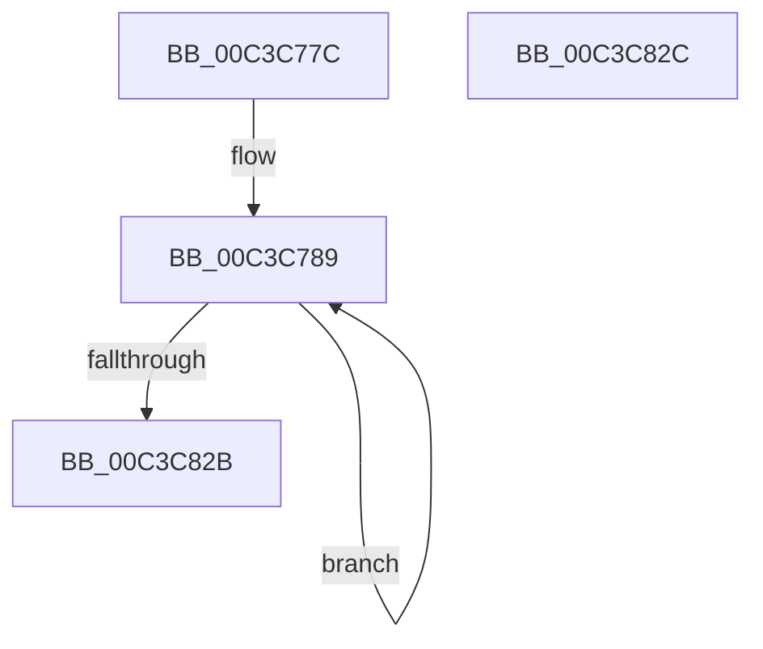

# ObpInitInfoBlockOffsets

- RVA: `0x00C3C77C`–`0x00C3C82D` (길이 `177` bytes)
- VA: `0x0000000140C3C77C`
- 실행 섹션: `INIT`
- PDB 이름 있음: `예`; PDB Function 태그: `아니요`
- unwind 정보 RVA: `0x000DB714`
- 디코드: `48`개 명령, `177/177` bytes 표시
- 미해석 바이트: `0` (있으면 어셈블리에 `.byte`로 보존)

> 이 문서는 커널 이미지의 기계어와 PDB 기호를 분석해 생성했습니다. 4번과 5번은 함수 원형과 자료형을 바이너리 사용 방식에서 추정한 C 해석이며 원본 소스 복구 결과는 아닙니다.

## 1. Dependencies

- 직접 호출 지점: **0**; 고유 호출 대상: **0**
- 직접 호출자로 확인된 함수: **1**
- RIP 상대 이미지 참조: **1**

### Outgoing calls
- 직접 디코드된 call 명령이 없습니다.

### Direct callers
- [ObInitSystem](../C7/ObInitSystem_function_00C71C7C.md) at `0x00C71E7E`

### Static image references
- `0x00C3C77F` → RVA `0x00F0FF80` (`.data`; read)

## 2. Other-region calls and transfers

- 다른 실행 섹션으로 향하는 call: **0**
- 별도 외부 분기/꼬리 이동을 확인하지 못했습니다.

## 3. Assembly (complete function range)

```asm
00C3C77C  45 33 C9                        xor r9d, r9d
00C3C77F  4C 8D 15 FA 37 2D 00            lea r10, [rip + 0x2d37fa]
00C3C786  41 B3 10                        mov r11b, 0x10
00C3C789  41 8A C1                        mov al, r9b
00C3C78C  24 01                           and al, 1
00C3C78E  C0 E0 05                        shl al, 5
00C3C791  44 0F B6 C0                     movzx r8d, al
00C3C795  41 F6 C1 02                     test r9b, 2
00C3C799  41 8D 40 20                     lea eax, [r8 + 0x20]
00C3C79D  0F B6 C8                        movzx ecx, al
00C3C7A0  41 0F 44 C8                     cmove ecx, r8d
00C3C7A4  41 F6 C1 04                     test r9b, 4
00C3C7A8  44 0F B6 C1                     movzx r8d, cl
00C3C7AC  43 8D 04 03                     lea eax, [r11 + r8]
00C3C7B0  0F B6 C8                        movzx ecx, al
00C3C7B3  41 0F 44 C8                     cmove ecx, r8d
00C3C7B7  41 F6 C1 08                     test r9b, 8
00C3C7BB  44 0F B6 C1                     movzx r8d, cl
00C3C7BF  41 8D 40 20                     lea eax, [r8 + 0x20]
00C3C7C3  0F B6 C8                        movzx ecx, al
00C3C7C6  41 0F 44 C8                     cmove ecx, r8d
00C3C7CA  45 84 CB                        test r11b, r9b
00C3C7CD  44 0F B6 C1                     movzx r8d, cl
00C3C7D1  43 8D 04 03                     lea eax, [r11 + r8]
00C3C7D5  0F B6 C8                        movzx ecx, al
00C3C7D8  41 0F 44 C8                     cmove ecx, r8d
00C3C7DC  41 F6 C1 20                     test r9b, 0x20
00C3C7E0  44 0F B6 C1                     movzx r8d, cl
00C3C7E4  43 8D 04 03                     lea eax, [r11 + r8]
00C3C7E8  0F B6 C8                        movzx ecx, al
00C3C7EB  41 0F 44 C8                     cmove ecx, r8d
00C3C7EF  41 F6 C1 40                     test r9b, 0x40
00C3C7F3  44 0F B6 C1                     movzx r8d, cl
00C3C7F7  43 8D 04 03                     lea eax, [r11 + r8]
00C3C7FB  0F B6 C8                        movzx ecx, al
00C3C7FE  41 0F 44 C8                     cmove ecx, r8d
00C3C802  41 F6 C1 80                     test r9b, 0x80
00C3C806  44 0F B6 C1                     movzx r8d, cl
00C3C80A  41 8D 40 04                     lea eax, [r8 + 4]
00C3C80E  0F B6 C8                        movzx ecx, al
00C3C811  41 0F 44 C8                     cmove ecx, r8d
00C3C815  41 FF C1                        inc r9d
00C3C818  41 88 0A                        mov byte ptr [r10], cl
00C3C81B  49 FF C2                        inc r10
00C3C81E  41 81 F9 00 01 00 00            cmp r9d, 0x100
00C3C825  0F 82 5E FF FF FF               jb 0x140c3c789
00C3C82B  C3                              ret
00C3C82C  CC                              int3
```

## 4. C-style interpretation (structured pseudocode)

```c
__int64 __fastcall ObpInitInfoBlockOffsets(__int64 a1, __int64 a2, __int64 a3, int a4)
{
    __int64 result;
    __int64 v_r10;

    a4 = 0;
loc_00C3C789:
    result = (unsigned __int8)((0) & (1));
    result = (unsigned __int8)((result) << (5));
    a1 = (unsigned __int8)((unsigned __int8)(result) + 32);
    if (((0) & (2)) == 0) { a1 = (unsigned int)((unsigned __int8)(result)); }
    a1 = (unsigned __int8)(16 + (unsigned __int8)(a1) * 1);
    if (((0) & (4)) == 0) { a1 = (unsigned int)((unsigned __int8)(a1)); }
    a1 = (unsigned __int8)((unsigned __int8)(a1) + 32);
    if (((0) & (8)) == 0) { a1 = (unsigned int)((unsigned __int8)(a1)); }
    a1 = (unsigned __int8)(16 + (unsigned __int8)(a1) * 1);
    if (((16) & (0)) == 0) { a1 = (unsigned int)((unsigned __int8)(a1)); }
    a1 = (unsigned __int8)(16 + (unsigned __int8)(a1) * 1);
    if (((0) & (32)) == 0) { a1 = (unsigned int)((unsigned __int8)(a1)); }
    a1 = (unsigned __int8)(16 + (unsigned __int8)(a1) * 1);
    if (((0) & (64)) == 0) { a1 = (unsigned int)((unsigned __int8)(a1)); }
    a1 = (unsigned __int8)((unsigned __int8)(a1) + 4);
    if (((0) & (128)) == 0) { a1 = (unsigned int)((unsigned __int8)(a1)); }
    a4 = (unsigned int)((a4) + 1);
    *(unsigned __int8 *)(v_rip + 2963450) = (unsigned __int8)(a1);
    v_r10 = (v_rip + 2963450) + 1;
    if (a4 < 256) goto loc_00C3C789;
    return (unsigned __int8)(a1) + 4;
}
```

## 5. (Beta) C Style

```c
int64_t ObpInitInfoBlockOffsets(int64_t Arg1, int64_t Arg2, int64_t Arg3, int32_t Arg4)
{
    int64_t result;
    int64_t local_r10;

    Arg4 = 0;
loc_00C3C789:
    result = (uint8_t)((0) & (1));
    result = (uint8_t)((result) << (5));
    Arg1 = (uint8_t)((uint8_t)(result) + 32);
    if (((0) & (2)) == 0) { Arg1 = (uint32_t)((uint8_t)(result)); }
    Arg1 = (uint8_t)(16 + (uint8_t)(Arg1) * 1);
    if (((0) & (4)) == 0) { Arg1 = (uint32_t)((uint8_t)(Arg1)); }
    Arg1 = (uint8_t)((uint8_t)(Arg1) + 32);
    if (((0) & (8)) == 0) { Arg1 = (uint32_t)((uint8_t)(Arg1)); }
    Arg1 = (uint8_t)(16 + (uint8_t)(Arg1) * 1);
    if (((16) & (0)) == 0) { Arg1 = (uint32_t)((uint8_t)(Arg1)); }
    Arg1 = (uint8_t)(16 + (uint8_t)(Arg1) * 1);
    if (((0) & (32)) == 0) { Arg1 = (uint32_t)((uint8_t)(Arg1)); }
    Arg1 = (uint8_t)(16 + (uint8_t)(Arg1) * 1);
    if (((0) & (64)) == 0) { Arg1 = (uint32_t)((uint8_t)(Arg1)); }
    Arg1 = (uint8_t)((uint8_t)(Arg1) + 4);
    if (((0) & (128)) == 0) { Arg1 = (uint32_t)((uint8_t)(Arg1)); }
    Arg4 = (uint32_t)((Arg4) + 1);
    *(uint8_t *)(v_rip + 0x2D37FA) = (uint8_t)(Arg1);
    local_r10 = (v_rip + 2963450) + 1;
    if (Arg4 < 256) goto loc_00C3C789;
    return (uint8_t)(Arg1) + 4;
}
```

## 6. Execution-region graph

[열기: 2D/3D 그래프와 함수 탐색 컨트롤 패널](../../../control-panel.html?section=init&rva=0x00C3C77C&view=graph)

- 2D 그래프는 위에서 아래로 흐르고, 3D 그래프는 빈 공간을 드래그해 회전합니다. Shift+드래그는 이동, 휠은 확대·축소, 함수 노드 선택은 대상 보고서 이동입니다.

### Static fallback


