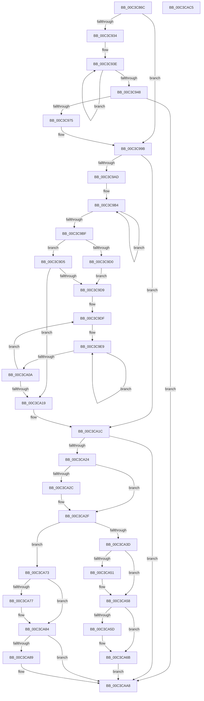

# ObpInitStackTrace

- RVA: `0x00C3C86C`–`0x00C3CAC6` (길이 `602` bytes)
- VA: `0x0000000140C3C86C`
- 실행 섹션: `INIT`
- PDB 이름 있음: `예`; PDB Function 태그: `아니요`
- unwind 정보 RVA: `0x0005D79C`
- 디코드: `152`개 명령, `602/602` bytes 표시
- 미해석 바이트: `0` (있으면 어셈블리에 `.byte`로 보존)

> 이 문서는 커널 이미지의 기계어와 PDB 기호를 분석해 생성했습니다. 4번과 5번은 함수 원형과 자료형을 바이너리 사용 방식에서 추정한 C 해석이며 원본 소스 복구 결과는 아닙니다.

## 1. Dependencies

- 직접 호출 지점: **8**; 고유 호출 대상: **6**
- 직접 호출자로 확인된 함수: **1**
- RIP 상대 이미지 참조: **28**

### Outgoing calls
- `0x00C3C905` → [memset](../../text/6C/memset_function_006C6C40.md) (function, `0x006C6C40`)
- `0x00C3C916` → [memset](../../text/6C/memset_function_006C6C40.md) (function, `0x006C6C40`)
- `0x00C3C960` → [ExAllocatePool2](../../poolcode/B8/ExAllocatePool2_function_00B820F0.md) (function, `0x00B820F0`)
- `0x00C3C992` → [memcpy](../../text/6C/memcpy_function_006C6840.md) (function, `0x006C6840`)
- `0x00C3CA34` → [ObpInitStackAndObjectTables](../../page/74/ObpInitStackAndObjectTables_function_0074FCF4.md) (function, `0x0074FCF4`)
- `0x00C3CA7F` → [memset](../../text/6C/memset_function_006C6C40.md) (function, `0x006C6C40`)
- `0x00C3CA95` → [ExFreePoolWithTag](../../poolcode/B8/ExFreePoolWithTag_function_00B82870.md) (function, `0x00B82870`)
- `0x00C3CAA3` → [RtlInitUnicodeStringEx](../../text/46/RtlInitUnicodeStringEx_function_00463960.md) (function, `0x00463960`)

### Direct callers
- [ObInitSystem](../C7/ObInitSystem_function_00C71C7C.md) at `0x00C71FF9`

### Static image references
- `0x00C3C88A` → RVA `0x00E0B3A8` (`.data`; read)
- `0x00C3C896` → RVA `0x00F0F400` (`.data`; read)
- `0x00C3C89D` → RVA `0x00E0B3A4` (`.data`; read)
- `0x00C3C8A4` → RVA `0x00F0F580` (`.data`; write)
- `0x00C3C8B2` → RVA `0x00E0B390` (`.data`; read)
- `0x00C3C8B9` → RVA `0x00F0F578` (`.data`; write)
- `0x00C3C8C9` → RVA `0x00E0B39C` (`.data`; read)
- `0x00C3C8D0` → RVA `0x00F0F560` (`.data`; write)
- `0x00C3C8DF` → RVA `0x00E0B3A0` (`.data`; read)
- `0x00C3C8E6` → RVA `0x00F0F540` (`.data`; write)
- `0x00C3C8F5` → RVA `0x007500B0` (`ObpPushStackInfoQueue`; read)
- `0x00C3C8FE` → RVA `0x00F0F570` (`.data`; write)
- `0x00C3C90D` → RVA `0x00F0F280` (`.data`; read)
- `0x00C3C91F` → RVA `0x00F0F554` (`.data`; write)
- `0x00C3C925` → RVA `0x00F0F440` (`.data`; read)
- `0x00C3C92C` → RVA `0x00F0F550` (`.data`; write)
- `0x00C3C965` → RVA `0x00F0F258` (`.data`; write)
- `0x00C3C975` → RVA `0x00F0F250` (`.data`; write)
- `0x00C3C98A` → RVA `0x00F0F252` (`.data`; write)
- `0x00C3C99B` → RVA `0x00F0F2E0` (`.data`; read)
- `0x00C3CA24` → RVA `0x00F0F3E0` (`.data`; read)
- `0x00C3CA41` → RVA `0x00F0F2C4` (`.data`; write)
- `0x00C3CA47` → RVA `0x00FC5010` (`ALMOSTRO`; write)
- `0x00C3CA51` → RVA `0x00F0F260` (`.data`; write)
- `0x00C3CA5D` → RVA `0x00F0F250` (`.data`; read)
- `0x00C3CA64` → RVA `0x00F0F2C8` (`.data`; write)
- `0x00C3CA6B` → RVA `0x00FC6E9C` (`ALMOSTRO`; write)
- `0x00C3CA89` → RVA `0x00F0F258` (`.data`; read)

## 2. Other-region calls and transfers

- 다른 실행 섹션으로 향하는 call: **8**
  - `0x00C3C905` → [memset](../../text/6C/memset_function_006C6C40.md) (`INIT` → `.text`)
  - `0x00C3C916` → [memset](../../text/6C/memset_function_006C6C40.md) (`INIT` → `.text`)
  - `0x00C3C960` → [ExAllocatePool2](../../poolcode/B8/ExAllocatePool2_function_00B820F0.md) (`INIT` → `POOLCODE`)
  - `0x00C3C992` → [memcpy](../../text/6C/memcpy_function_006C6840.md) (`INIT` → `.text`)
  - `0x00C3CA34` → [ObpInitStackAndObjectTables](../../page/74/ObpInitStackAndObjectTables_function_0074FCF4.md) (`INIT` → `PAGE`)
  - `0x00C3CA7F` → [memset](../../text/6C/memset_function_006C6C40.md) (`INIT` → `.text`)
  - `0x00C3CA95` → [ExFreePoolWithTag](../../poolcode/B8/ExFreePoolWithTag_function_00B82870.md) (`INIT` → `POOLCODE`)
  - `0x00C3CAA3` → [RtlInitUnicodeStringEx](../../text/46/RtlInitUnicodeStringEx_function_00463960.md) (`INIT` → `.text`)
- 별도 외부 분기/꼬리 이동을 확인하지 못했습니다.

## 3. Assembly (complete function range)

```asm
00C3C86C  48 89 5C 24 10                  mov qword ptr [rsp + 0x10], rbx
00C3C871  48 89 6C 24 18                  mov qword ptr [rsp + 0x18], rbp
00C3C876  48 89 74 24 20                  mov qword ptr [rsp + 0x20], rsi
00C3C87B  57                              push rdi
00C3C87C  41 54                           push r12
00C3C87E  41 55                           push r13
00C3C880  41 56                           push r14
00C3C882  41 57                           push r15
00C3C884  48 83 EC 20                     sub rsp, 0x20
00C3C888  33 F6                           xor esi, esi
00C3C88A  48 8D 05 17 EB 1C 00            lea rax, [rip + 0x1ceb17]
00C3C891  48 89 44 24 50                  mov qword ptr [rsp + 0x50], rax
00C3C896  4C 8D 25 63 2B 2D 00            lea r12, [rip + 0x2d2b63]
00C3C89D  48 8D 05 00 EB 1C 00            lea rax, [rip + 0x1ceb00]
00C3C8A4  48 89 35 D5 2C 2D 00            mov qword ptr [rip + 0x2d2cd5], rsi
00C3C8AB  48 89 44 24 50                  mov qword ptr [rsp + 0x50], rax
00C3C8B0  33 D2                           xor edx, edx
00C3C8B2  48 8D 05 D7 EA 1C 00            lea rax, [rip + 0x1cead7]
00C3C8B9  48 89 35 B8 2C 2D 00            mov qword ptr [rip + 0x2d2cb8], rsi
00C3C8C0  48 89 44 24 50                  mov qword ptr [rsp + 0x50], rax
00C3C8C5  44 8D 7E 40                     lea r15d, [rsi + 0x40]
00C3C8C9  48 8D 05 CC EA 1C 00            lea rax, [rip + 0x1ceacc]
00C3C8D0  48 89 35 89 2C 2D 00            mov qword ptr [rip + 0x2d2c89], rsi
00C3C8D7  48 89 44 24 50                  mov qword ptr [rsp + 0x50], rax
00C3C8DC  45 8B C7                        mov r8d, r15d
00C3C8DF  48 8D 05 BA EA 1C 00            lea rax, [rip + 0x1ceaba]
00C3C8E6  48 89 35 53 2C 2D 00            mov qword ptr [rip + 0x2d2c53], rsi
00C3C8ED  48 89 44 24 50                  mov qword ptr [rsp + 0x50], rax
00C3C8F2  49 8B CC                        mov rcx, r12
00C3C8F5  48 8D 05 B4 37 B1 FF            lea rax, [rip - 0x4ec84c]
00C3C8FC  8B DE                           mov ebx, esi
00C3C8FE  48 89 05 6B 2C 2D 00            mov qword ptr [rip + 0x2d2c6b], rax
00C3C905  E8 36 A3 A8 FF                  call 0x1406c6c40
00C3C90A  45 8B C7                        mov r8d, r15d
00C3C90D  48 8D 0D 6C 29 2D 00            lea rcx, [rip + 0x2d296c]
00C3C914  33 D2                           xor edx, edx
00C3C916  E8 25 A3 A8 FF                  call 0x1406c6c40
00C3C91B  48 83 CF FF                     or rdi, 0xffffffffffffffff
00C3C91F  89 35 2F 2C 2D 00               mov dword ptr [rip + 0x2d2c2f], esi
00C3C925  66 39 35 14 2B 2D 00            cmp word ptr [rip + 0x2d2b14], si
00C3C92C  89 35 1E 2C 2D 00               mov dword ptr [rip + 0x2d2c1e], esi
00C3C932  74 67                           je 0x140c3c99b
00C3C934  48 8D 2D 05 2B 2D 00            lea rbp, [rip + 0x2d2b05]
00C3C93B  48 8B DF                        mov rbx, rdi
00C3C93E  48 FF C3                        inc rbx
00C3C941  66 39 74 5D 00                  cmp word ptr [rbp + rbx*2], si
00C3C946  75 F6                           jne 0x140c3c93e
00C3C948  66 03 DB                        add bx, bx
00C3C94B  41 BE 02 00 00 00               mov r14d, 2
00C3C951  0F B7 D3                        movzx edx, bx
00C3C954  41 B8 4F 62 52 74               mov r8d, 0x7452624f
00C3C95A  49 03 D6                        add rdx, r14
00C3C95D  49 8B CF                        mov rcx, r15
00C3C960  E8 8B 57 F4 FF                  call 0x140b820f0
00C3C965  48 89 05 EC 28 2D 00            mov qword ptr [rip + 0x2d28ec], rax
00C3C96C  48 85 C0                        test rax, rax
00C3C96F  0F 84 33 01 00 00               je 0x140c3caa8
00C3C975  66 89 1D D4 28 2D 00            mov word ptr [rip + 0x2d28d4], bx
00C3C97C  48 8B D5                        mov rdx, rbp
00C3C97F  66 41 03 DE                     add bx, r14w
00C3C983  48 8B C8                        mov rcx, rax
00C3C986  44 0F B7 C3                     movzx r8d, bx
00C3C98A  66 44 89 05 C0 28 2D 00         mov word ptr [rip + 0x2d28c0], r8w
00C3C992  E8 A9 9E A8 FF                  call 0x1406c6840
00C3C997  41 8D 5E 1E                     lea ebx, [r14 + 0x1e]
00C3C99B  66 39 35 3E 29 2D 00            cmp word ptr [rip + 0x2d293e], si
00C3C9A2  BD 01 00 00 00                  mov ebp, 1
00C3C9A7  44 8D 75 0F                     lea r14d, [rbp + 0xf]
00C3C9AB  74 6F                           je 0x140c3ca1c
00C3C9AD  4C 8D 2D 2C 29 2D 00            lea r13, [rip + 0x2d292c]
00C3C9B4  48 FF C7                        inc rdi
00C3C9B7  66 41 39 74 7D 00               cmp word ptr [r13 + rdi*2], si
00C3C9BD  75 F5                           jne 0x140c3c9b4
00C3C9BF  03 FD                           add edi, ebp
00C3C9C1  B8 CD CC CC CC                  mov eax, 0xcccccccd
00C3C9C6  F7 E7                           mul edi
00C3C9C8  C1 EA 02                        shr edx, 2
00C3C9CB  41 3B D6                        cmp edx, r14d
00C3C9CE  76 05                           jbe 0x140c3c9d5
00C3C9D0  41 8B D6                        mov edx, r14d
00C3C9D3  EB 04                           jmp 0x140c3c9d9
00C3C9D5  85 D2                           test edx, edx
00C3C9D7  74 40                           je 0x140c3ca19
00C3C9D9  4D 8B CC                        mov r9, r12
00C3C9DC  44 8B C6                        mov r8d, esi
00C3C9DF  45 8B 11                        mov r10d, dword ptr [r9]
00C3C9E2  43 8D 3C 80                     lea edi, [r8 + r8*4]
00C3C9E6  44 8B DE                        mov r11d, esi
00C3C9E9  41 C1 E2 08                     shl r10d, 8
00C3C9ED  8B C7                           mov eax, edi
00C3C9EF  41 2B C3                        sub eax, r11d
00C3C9F2  44 03 DD                        add r11d, ebp
00C3C9F5  83 C0 03                        add eax, 3
00C3C9F8  41 0F B7 4C 45 00               movzx ecx, word ptr [r13 + rax*2]
00C3C9FE  41 0B CA                        or ecx, r10d
00C3CA01  44 8B D1                        mov r10d, ecx
00C3CA04  41 83 FB 04                     cmp r11d, 4
00C3CA08  72 DF                           jb 0x140c3c9e9
00C3CA0A  41 89 09                        mov dword ptr [r9], ecx
00C3CA0D  44 03 C5                        add r8d, ebp
00C3CA10  49 83 C1 04                     add r9, 4
00C3CA14  44 3B C2                        cmp r8d, edx
00C3CA17  72 C6                           jb 0x140c3c9df
00C3CA19  41 0B DE                        or ebx, r14d
00C3CA1C  85 DB                           test ebx, ebx
00C3CA1E  0F 84 84 00 00 00               je 0x140c3caa8
00C3CA24  39 35 B6 29 2D 00               cmp dword ptr [rip + 0x2d29b6], esi
00C3CA2A  74 03                           je 0x140c3ca2f
00C3CA2C  41 0B DF                        or ebx, r15d
00C3CA2F  8B FB                           mov edi, ebx
00C3CA31  41 23 FE                        and edi, r14d
00C3CA34  E8 BB 32 B1 FF                  call 0x14074fcf4
00C3CA39  85 C0                           test eax, eax
00C3CA3B  78 36                           js 0x140c3ca73
00C3CA3D  8B C3                           mov eax, ebx
00C3CA3F  0B C5                           or eax, ebp
00C3CA41  89 05 7D 28 2D 00               mov dword ptr [rip + 0x2d287d], eax
00C3CA47  89 05 C3 85 38 00               mov dword ptr [rip + 0x3885c3], eax
00C3CA4D  85 FF                           test edi, edi
00C3CA4F  74 07                           je 0x140c3ca58
00C3CA51  4C 89 25 08 28 2D 00            mov qword ptr [rip + 0x2d2808], r12
00C3CA58  F6 C3 20                        test bl, 0x20
00C3CA5B  74 0E                           je 0x140c3ca6b
00C3CA5D  48 8D 0D EC 27 2D 00            lea rcx, [rip + 0x2d27ec]
00C3CA64  48 89 0D 5D 28 2D 00            mov qword ptr [rip + 0x2d285d], rcx
00C3CA6B  89 2D 2B A4 38 00               mov dword ptr [rip + 0x38a42b], ebp
00C3CA71  EB 35                           jmp 0x140c3caa8
00C3CA73  85 FF                           test edi, edi
00C3CA75  74 0D                           je 0x140c3ca84
00C3CA77  4D 8B C7                        mov r8, r15
00C3CA7A  33 D2                           xor edx, edx
00C3CA7C  49 8B CC                        mov rcx, r12
00C3CA7F  E8 BC A1 A8 FF                  call 0x1406c6c40
00C3CA84  F6 C3 20                        test bl, 0x20
00C3CA87  74 1F                           je 0x140c3caa8
00C3CA89  48 8B 0D C8 27 2D 00            mov rcx, qword ptr [rip + 0x2d27c8]
00C3CA90  BA 4F 62 52 74                  mov edx, 0x7452624f
00C3CA95  E8 D6 5D F4 FF                  call 0x140b82870
00C3CA9A  33 D2                           xor edx, edx
00C3CA9C  48 8D 0D AD 27 2D 00            lea rcx, [rip + 0x2d27ad]
00C3CAA3  E8 B8 6E 82 FF                  call 0x140463960
00C3CAA8  48 8B 5C 24 58                  mov rbx, qword ptr [rsp + 0x58]
00C3CAAD  48 8B 6C 24 60                  mov rbp, qword ptr [rsp + 0x60]
00C3CAB2  48 8B 74 24 68                  mov rsi, qword ptr [rsp + 0x68]
00C3CAB7  48 83 C4 20                     add rsp, 0x20
00C3CABB  41 5F                           pop r15
00C3CABD  41 5E                           pop r14
00C3CABF  41 5D                           pop r13
00C3CAC1  41 5C                           pop r12
00C3CAC3  5F                              pop rdi
00C3CAC4  C3                              ret
00C3CAC5  CC                              int3
```

## 4. C-style interpretation (structured pseudocode)

```c
__int64 __fastcall ObpInitStackTrace(__int64 a1, int a2)
{
    __int64 result;
    __int64 v_r10;
    __int64 v_r11;
    __int64 v_rbx;
    __int64 v_rdi;
    __int64 v_rsi;
    __int64 v_rsp;
    unsigned __int64 v_stack_p10;
    unsigned __int64 v_stack_p18;
    unsigned __int64 v_stack_p20;
    unsigned __int64 v_stack_p8;

    v_stack_p10 = v_rbx;
    v_stack_p18 = v_rbp;
    v_stack_p20 = v_rsi;
    v_rsp = (v_rsp) - (32);
    v_rsi = 0;
    v_stack_p8 = v_rip + 1895191;
    *(unsigned __int64 *)(v_rip + 2960597) = 0;
    v_stack_p8 = v_rip + 1895168;
    a2 = 0;
    *(unsigned __int64 *)(v_rip + 2960568) = 0;
    v_stack_p8 = v_rip + 1895127;
    *(unsigned __int64 *)(v_rip + 2960521) = 0;
    v_stack_p8 = v_rip + 1895116;
    *(unsigned __int64 *)(v_rip + 2960467) = 0;
    v_stack_p8 = v_rip + 1895098;
    *(unsigned __int64 *)(v_rip + 2960491) = v_rip - 5163084;
    result = memset(v_rip + 2960227, a2, (unsigned int)((unsigned int)(v_rsi + 64)), a4);
    a2 = 0;
    result = memset(v_rip + 2959724, a2, (unsigned int)((unsigned int)(v_rsi + 64)), a4);
    v_rdi = (v_rdi) | (-1);
    *(unsigned int *)(v_rip + 2960431) = 0;
    *(unsigned int *)(v_rip + 2960414) = 0;
    if ((*(unsigned __int16 *)(v_rip + 2960148)) == 0) goto loc_00C3C99B;
loc_00C3C93E:
    v_rbx = (v_rdi) + 1;
    if ((*(unsigned __int16 *)(v_rip + 2960133 + v_rbx * 2)) != 0) goto loc_00C3C93E;
    v_rbx = (unsigned __int16)((v_rbx) + ((unsigned __int16)(v_rbx)));
    a2 = ((unsigned __int16)(v_rbx)) + (2);
    result = ExAllocatePool2(v_rsi + 64, a2, (unsigned int)(0x7452624FULL), a4);
    *(unsigned __int64 *)(v_rip + 2959596) = result;
    if (result == 0) goto loc_00C3CAA8;
    *(unsigned __int16 *)(v_rip + 2959572) = (unsigned __int16)(v_rbx);
    v_rbx = (unsigned __int16)((v_rbx) + (2));
    *(unsigned __int16 *)(v_rip + 2959552) = (unsigned __int16)((unsigned __int16)(v_rbx));
    result = memcpy(result, v_rip + 2960133, (unsigned __int16)(v_rbx), a4);
loc_00C3C99B:
    if ((*(unsigned __int16 *)(v_rip + 2959678)) == 0) goto loc_00C3CA1C;
loc_00C3C9B4:
    v_rdi = (v_rdi) + 1;
    if ((*(unsigned __int16 *)(v_rip + 2959660 + v_rdi * 2)) != 0) goto loc_00C3C9B4;
    v_rdi = (unsigned int)((v_rdi) + (1));
    a2 = (unsigned int)((v_rip + 2960133) >> (2));
    if (a2 <= ((unsigned int)(1 + 15))) goto loc_00C3C9D5;
    goto loc_00C3C9D9;
loc_00C3C9D5:
    if ((unsigned int)((unsigned int)((unsigned int)(1 + 15))) == 0) goto loc_00C3CA19;
loc_00C3C9D9:
loc_00C3C9DF:
loc_00C3C9E9:
    v_r10 = (unsigned int)(((unsigned int)(*(unsigned int *)(v_rip + 2960227))) << (8));
    result = (unsigned int)(((unsigned int)((unsigned int)(0 + 0 * 4))) - (0));
    v_r11 = (unsigned int)((0) + (1));
    result = (unsigned int)((result) + (3));
    a1 = (unsigned int)((*(unsigned __int16 *)(v_rip + 2959660 + result * 2)) | ((unsigned int)(v_r10)));
    if (((unsigned int)(v_r11)) < 4) goto loc_00C3C9E9;
    *(unsigned int *)(v_rip + 2960227) = (unsigned int)(a1);
    a3 = (unsigned int)((0) + (1));
    a4 = (v_rip + 2960227) + (4);
    if (((unsigned int)(a3)) < ((unsigned int)((unsigned int)((unsigned int)(1 + 15))))) goto loc_00C3C9DF;
loc_00C3CA19:
    v_rbx = (unsigned int)((2 + 30) | ((unsigned int)(1 + 15)));
loc_00C3CA1C:
    if ((unsigned int)(v_rbx) == 0) goto loc_00C3CAA8;
    if ((*(unsigned int *)(v_rip + 2959798)) != 0) {
        v_rbx = (unsigned int)((v_rbx) | ((unsigned int)(v_rsi + 64)));
    }
    v_rdi = (unsigned int)(((unsigned int)((unsigned int)(v_rbx))) & ((unsigned int)(1 + 15)));
    result = ObpInitStackAndObjectTables(a1, (unsigned int)((unsigned int)(1 + 15)), a3, a4);
    if (sign_flag) goto loc_00C3CA73;
    result = (unsigned int)(((unsigned int)((unsigned int)(v_rbx))) | (1));
    *(unsigned int *)(v_rip + 2959485) = (unsigned int)(result);
    *(unsigned int *)(v_rip + 3704259) = (unsigned int)(result);
    if ((unsigned int)(v_rdi) != 0) {
        *(unsigned __int64 *)(v_rip + 2959368) = v_rip + 2960227;
    }
    if ((((unsigned __int8)(v_rbx)) & (32)) != 0) {
        a1 = v_rip + 2959340;
        *(unsigned __int64 *)(v_rip + 2959453) = a1;
    }
    *(unsigned int *)(v_rip + 3712043) = 1;
    goto loc_00C3CAA8;
loc_00C3CA73:
    if ((unsigned int)(v_rdi) != 0) {
        a3 = v_rsi + 64;
        a2 = 0;
        a1 = v_rip + 2960227;
        result = memset(a1, a2, a3, a4);
    }
    if ((((unsigned __int8)(v_rbx)) & (32)) != 0) {
        a1 = *(unsigned __int64 *)(v_rip + 2959304);
        a2 = 0x7452624FULL;
        result = ExFreePoolWithTag(a1, a2, a3, a4);
        a2 = 0;
        a1 = v_rip + 2959277;
        result = RtlInitUnicodeStringEx(a1, a2, a3, a4);
    }
    v_rsp = (v_rsp) + (32);
    return result;
}
```

## 5. (Beta) C Style

```c
int64_t ObpInitStackTrace(int64_t Arg1, int32_t Arg2)
{
    int64_t result;
    int64_t local_r10;
    int64_t local_r11;
    int64_t local_rbx;
    int64_t local_rdi;
    int64_t local_rsi;
    int64_t local_rsp;
    uint64_t v_stack_p10;
    uint64_t v_stack_p18;
    uint64_t v_stack_p20;
    uint64_t v_stack_p8;

    v_stack_p10 = local_rbx;
    v_stack_p18 = local_rbp;
    v_stack_p20 = local_rsi;
    local_rsp = (local_rsp) - (32);
    local_rsi = 0;
    v_stack_p8 = v_rip + 1895191;
    *(uint64_t *)(v_rip + 0x2D2CD5) = 0;
    v_stack_p8 = v_rip + 1895168;
    Arg2 = 0;
    *(uint64_t *)(v_rip + 0x2D2CB8) = 0;
    v_stack_p8 = v_rip + 1895127;
    *(uint64_t *)(v_rip + 0x2D2C89) = 0;
    v_stack_p8 = v_rip + 1895116;
    *(uint64_t *)(v_rip + 0x2D2C53) = 0;
    v_stack_p8 = v_rip + 1895098;
    *(uint64_t *)(v_rip + 0x2D2C6B) = v_rip - 5163084;
    result = memset(v_rip + 2960227, Arg2, (uint32_t)((uint32_t)(local_rsi + 64)), a4);
    Arg2 = 0;
    result = memset(v_rip + 2959724, Arg2, (uint32_t)((uint32_t)(local_rsi + 64)), a4);
    local_rdi = (local_rdi) | (-1);
    *(uint32_t *)(v_rip + 0x2D2C2F) = 0;
    *(uint32_t *)(v_rip + 0x2D2C1E) = 0;
    if ((*(uint16_t *)(v_rip + 0x2D2B14)) == 0) goto loc_00C3C99B;
loc_00C3C93E:
    local_rbx = (local_rdi) + 1;
    if ((*(uint16_t *)(v_rip + 0x2D2B05 + local_rbx * 2)) != 0) goto loc_00C3C93E;
    local_rbx = (uint16_t)((local_rbx) + ((uint16_t)(local_rbx)));
    Arg2 = ((uint16_t)(local_rbx)) + (2);
    result = ExAllocatePool2(local_rsi + 64, Arg2, (uint32_t)(0x7452624FULL), a4);
    *(uint64_t *)(v_rip + 0x2D28EC) = result;
    if (result == 0) goto loc_00C3CAA8;
    *(uint16_t *)(v_rip + 0x2D28D4) = (uint16_t)(local_rbx);
    local_rbx = (uint16_t)((local_rbx) + (2));
    *(uint16_t *)(v_rip + 0x2D28C0) = (uint16_t)((uint16_t)(local_rbx));
    result = memcpy(result, v_rip + 2960133, (uint16_t)(local_rbx), a4);
loc_00C3C99B:
    if ((*(uint16_t *)(v_rip + 0x2D293E)) == 0) goto loc_00C3CA1C;
loc_00C3C9B4:
    local_rdi = (local_rdi) + 1;
    if ((*(uint16_t *)(v_rip + 0x2D292C + local_rdi * 2)) != 0) goto loc_00C3C9B4;
    local_rdi = (uint32_t)((local_rdi) + (1));
    Arg2 = (uint32_t)((v_rip + 2960133) >> (2));
    if (Arg2 <= ((uint32_t)(1 + 15))) goto loc_00C3C9D5;
    goto loc_00C3C9D9;
loc_00C3C9D5:
    if ((uint32_t)((uint32_t)((uint32_t)(1 + 15))) == 0) goto loc_00C3CA19;
loc_00C3C9D9:
loc_00C3C9DF:
loc_00C3C9E9:
    local_r10 = (uint32_t)(((uint32_t)(*(uint32_t *)(v_rip + 0x2D2B63))) << (8));
    result = (uint32_t)(((uint32_t)((uint32_t)(0 + 0 * 4))) - (0));
    local_r11 = (uint32_t)((0) + (1));
    result = (uint32_t)((result) + (3));
    Arg1 = (uint32_t)((*(uint16_t *)(v_rip + 0x2D292C + result * 2)) | ((uint32_t)(local_r10)));
    if (((uint32_t)(local_r11)) < 4) goto loc_00C3C9E9;
    *(uint32_t *)(v_rip + 0x2D2B63) = (uint32_t)(Arg1);
    a3 = (uint32_t)((0) + (1));
    a4 = (v_rip + 2960227) + (4);
    if (((uint32_t)(a3)) < ((uint32_t)((uint32_t)((uint32_t)(1 + 15))))) goto loc_00C3C9DF;
loc_00C3CA19:
    local_rbx = (uint32_t)((2 + 30) | ((uint32_t)(1 + 15)));
loc_00C3CA1C:
    if ((uint32_t)(local_rbx) == 0) goto loc_00C3CAA8;
    if ((*(uint32_t *)(v_rip + 0x2D29B6)) != 0) {
        local_rbx = (uint32_t)((local_rbx) | ((uint32_t)(local_rsi + 64)));
    }
    local_rdi = (uint32_t)(((uint32_t)((uint32_t)(local_rbx))) & ((uint32_t)(1 + 15)));
    result = ObpInitStackAndObjectTables(Arg1, (uint32_t)((uint32_t)(1 + 15)), a3, a4);
    if (sign_flag) goto loc_00C3CA73;
    result = (uint32_t)(((uint32_t)((uint32_t)(local_rbx))) | (1));
    *(uint32_t *)(v_rip + 0x2D287D) = (uint32_t)(result);
    *(uint32_t *)(v_rip + 0x3885C3) = (uint32_t)(result);
    if ((uint32_t)(local_rdi) != 0) {
        *(uint64_t *)(v_rip + 0x2D2808) = v_rip + 2960227;
    }
    if ((((uint8_t)(local_rbx)) & (32)) != 0) {
        Arg1 = v_rip + 2959340;
        *(uint64_t *)(v_rip + 0x2D285D) = Arg1;
    }
    *(uint32_t *)(v_rip + 0x38A42B) = 1;
    goto loc_00C3CAA8;
loc_00C3CA73:
    if ((uint32_t)(local_rdi) != 0) {
        a3 = local_rsi + 64;
        Arg2 = 0;
        Arg1 = v_rip + 2960227;
        result = memset(Arg1, Arg2, a3, a4);
    }
    if ((((uint8_t)(local_rbx)) & (32)) != 0) {
        Arg1 = *(uint64_t *)(v_rip + 0x2D27C8);
        Arg2 = 0x7452624FULL;
        result = ExFreePoolWithTag(Arg1, Arg2, a3, a4);
        Arg2 = 0;
        Arg1 = v_rip + 2959277;
        result = RtlInitUnicodeStringEx(Arg1, Arg2, a3, a4);
    }
    local_rsp = (local_rsp) + (32);
    return result;
}
```

## 6. Execution-region graph

[열기: 2D/3D 그래프와 함수 탐색 컨트롤 패널](../../../control-panel.html?section=init&rva=0x00C3C86C&view=graph)

- 2D 그래프는 위에서 아래로 흐르고, 3D 그래프는 빈 공간을 드래그해 회전합니다. Shift+드래그는 이동, 휠은 확대·축소, 함수 노드 선택은 대상 보고서 이동입니다.

### Static fallback


