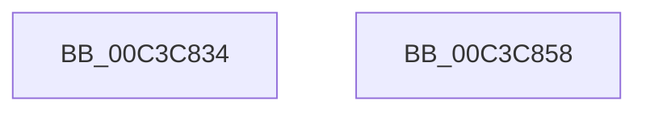

# ObpShutdownTraceLoggingProvider

- RVA: `0x00C3C834`–`0x00C3C859` (길이 `37` bytes)
- VA: `0x0000000140C3C834`
- 실행 섹션: `INIT`
- PDB 이름 있음: `예`; PDB Function 태그: `아니요`
- unwind 정보 RVA: `0x0005C788`
- 디코드: `8`개 명령, `37/37` bytes 표시
- 미해석 바이트: `0` (있으면 어셈블리에 `.byte`로 보존)

> 이 문서는 커널 이미지의 기계어와 PDB 기호를 분석해 생성했습니다. 4번과 5번은 함수 원형과 자료형을 바이너리 사용 방식에서 추정한 C 해석이며 원본 소스 복구 결과는 아닙니다.

## 1. Dependencies

- 직접 호출 지점: **1**; 고유 호출 대상: **1**
- 직접 호출자로 확인된 함수: **1**
- RIP 상대 이미지 참조: **3**

### Outgoing calls
- `0x00C3C84E` → [EtwUnregister](../../page/A7/EtwUnregister_function_00A723D0.md) (function, `0x00A723D0`)

### Direct callers
- [ObShutdownSystem](../../page/74/ObShutdownSystem_function_0074DBB0.md) at `0x0074E01C`

### Static image references
- `0x00C3C838` → RVA `0x00E074C0` (`.data`; read)
- `0x00C3C83F` → RVA `0x00E074C0` (`.data`; read/write)
- `0x00C3C847` → RVA `0x00E074A0` (`.data`; read/write)

## 2. Other-region calls and transfers

- 다른 실행 섹션으로 향하는 call: **1**
  - `0x00C3C84E` → [EtwUnregister](../../page/A7/EtwUnregister_function_00A723D0.md) (`INIT` → `PAGE`)
- 별도 외부 분기/꼬리 이동을 확인하지 못했습니다.

## 3. Assembly (complete function range)

```asm
00C3C834  48 83 EC 28                     sub rsp, 0x28
00C3C838  48 8B 0D 81 AC 1C 00            mov rcx, qword ptr [rip + 0x1cac81]
00C3C83F  48 83 25 79 AC 1C 00 00         and qword ptr [rip + 0x1cac79], 0
00C3C847  83 25 52 AC 1C 00 00            and dword ptr [rip + 0x1cac52], 0
00C3C84E  E8 7D 5B E3 FF                  call 0x140a723d0
00C3C853  48 83 C4 28                     add rsp, 0x28
00C3C857  C3                              ret
00C3C858  CC                              int3
```

## 4. C-style interpretation (structured pseudocode)

```c
__int64 __fastcall ObpShutdownTraceLoggingProvider(void)
{
    __int64 result;
    __int64 v_rsp;

    v_rsp = (v_rsp) - (40);
    result = EtwUnregister(*(unsigned __int64 *)(v_rip + 1879169), a2, a3, a4);
    v_rsp = (v_rsp) + (40);
    return result;
}
```

## 5. (Beta) C Style

```c
void ObpShutdownTraceLoggingProvider(void)
{
    int64_t result;
    int64_t local_rsp;

    local_rsp = (local_rsp) - (40);
    result = EtwUnregister(*(uint64_t *)(v_rip + 0x1CAC81), a2, a3, a4);
    local_rsp = (local_rsp) + (40);
    return result;
}
```

## 6. Execution-region graph

[열기: 2D/3D 그래프와 함수 탐색 컨트롤 패널](../../../control-panel.html?section=init&rva=0x00C3C834&view=graph)

- 2D 그래프는 위에서 아래로 흐르고, 3D 그래프는 빈 공간을 드래그해 회전합니다. Shift+드래그는 이동, 휠은 확대·축소, 함수 노드 선택은 대상 보고서 이동입니다.

### Static fallback


