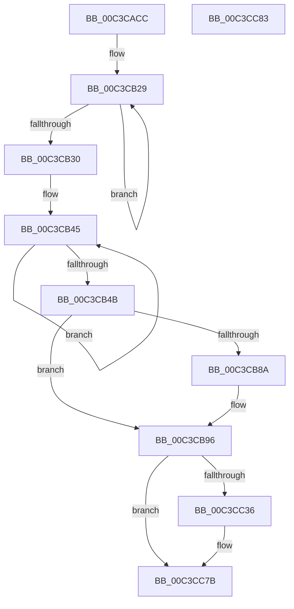

# PfInitializeSuperfetch

- RVA: `0x00C3CACC`–`0x00C3CC84` (길이 `440` bytes)
- VA: `0x0000000140C3CACC`
- 실행 섹션: `INIT`
- PDB 이름 있음: `예`; PDB Function 태그: `아니요`
- unwind 정보 RVA: `0x00071A74`
- 디코드: `86`개 명령, `440/440` bytes 표시
- 미해석 바이트: `0` (있으면 어셈블리에 `.byte`로 보존)

> 이 문서는 커널 이미지의 기계어와 PDB 기호를 분석해 생성했습니다. 4번과 5번은 함수 원형과 자료형을 바이너리 사용 방식에서 추정한 C 해석이며 원본 소스 복구 결과는 아닙니다.

## 1. Dependencies

- 직접 호출 지점: **10**; 고유 호출 대상: **9**
- 직접 호출자로 확인된 함수: **1**
- RIP 상대 이미지 참조: **37**

### Outgoing calls
- `0x00C3CAD9` → [PfpParametersInitialize](PfpParametersInitialize_function_00C3CEF0.md) (function, `0x00C3CEF0`)
- `0x00C3CAED` → [memset](../../text/6C/memset_function_006C6C40.md) (function, `0x006C6C40`)
- `0x00C3CB7B` → [ExWaitForRundownProtectionRelease](../../text/2A/ExWaitForRundownProtectionRelease_function_002A4CB0.md) (function, `0x002A4CB0`)
- `0x00C3CB91` → [PfpRpStart](../../page/75/PfpRpStart_function_00751E48.md) (function, `0x00751E48`)
- `0x00C3CB9D` → [PfpScenCtxInitialize](../../page/75/PfpScenCtxInitialize_function_00750FA0.md) (function, `0x00750FA0`)
- `0x00C3CBA9` → [PfpScenCtxStart](../../page/75/PfpScenCtxStart_function_00750FD4.md) (function, `0x00750FD4`)
- `0x00C3CBBC` → [ExWaitForRundownProtectionRelease](../../text/2A/ExWaitForRundownProtectionRelease_function_002A4CB0.md) (function, `0x002A4CB0`)
- `0x00C3CBF7` → [PfSnInitializePrefetcher](PfSnInitializePrefetcher_function_00C3CC8C.md) (function, `0x00C3CC8C`)
- `0x00C3CC03` → [PfpPartitionGlobalContextInitialize](../../page/75/PfpPartitionGlobalContextInitialize_function_00752200.md) (function, `0x00752200`)
- `0x00C3CC76` → [ZwNotifyChangeKey](../../text/6A/ZwNotifyChangeKey_function_006AF550.md) (function, `0x006AF550`)

### Direct callers
- [Phase1InitializationDiscard](../C1/Phase1InitializationDiscard_function_00C1C728.md) at `0x00C1D5CF`

### Static image references
- `0x00C3CAD2` → RVA `0x00E66EB0` (`.data`; read)
- `0x00C3CAE0` → RVA `0x00E67148` (`.data`; read)
- `0x00C3CAF7` → RVA `0x00E67178` (`.data`; write)
- `0x00C3CAFE` → RVA `0x00E671A0` (`.data`; write)
- `0x00C3CB08` → RVA `0x00E671C0` (`.data`; write)
- `0x00C3CB12` → RVA `0x00E671C8` (`.data`; write)
- `0x00C3CB1B` → RVA `0x00E67148` (`.data`; write)
- `0x00C3CB22` → RVA `0x00E67150` (`.data`; write)
- `0x00C3CB30` → RVA `0x00E6718C` (`.data`; write)
- `0x00C3CB37` → RVA `0x00E67188` (`.data`; write)
- `0x00C3CB3E` → RVA `0x00E67180` (`.data`; write)
- `0x00C3CB4B` → RVA `0x00E67160` (`.data`; read)
- `0x00C3CB52` → RVA `0x00E671B4` (`.data`; write)
- `0x00C3CB59` → RVA `0x00E671D0` (`.data`; read)
- `0x00C3CB60` → RVA `0x00E67158` (`.data`; write)
- `0x00C3CB67` → RVA `0x00E671B0` (`.data`; write)
- `0x00C3CB6D` → RVA `0x00E671A8` (`.data`; write)
- `0x00C3CB74` → RVA `0x00E671D0` (`.data`; write)
- `0x00C3CB80` → RVA `0x00E66EF4` (`.data`; read)
- `0x00C3CB96` → RVA `0x00E670D0` (`.data`; read)
- `0x00C3CBAE` → RVA `0x00E671F0` (`.data`; read)
- `0x00C3CBB5` → RVA `0x00E671F0` (`.data`; write)
- `0x00C3CBC6` → RVA `0x00E671F0` (`.data`; read/write)
- `0x00C3CBCD` → RVA `0x00E67218` (`.data`; read/write)
- `0x00C3CBD4` → RVA `0x00E67208` (`.data`; read)
- `0x00C3CBDB` → RVA `0x00E67210` (`.data`; write)
- `0x00C3CBE2` → RVA `0x00E67208` (`.data`; write)
- `0x00C3CBE9` → RVA `0x00E671F8` (`.data`; write)
- `0x00C3CBF0` → RVA `0x00E67200` (`.data`; write)
- `0x00C3CBFC` → RVA `0x00E67228` (`.data`; read)
- `0x00C3CC08` → RVA `0x00FC6AA0` (`ALMOSTRO`; read)
- `0x00C3CC1B` → RVA `0x00E66EB8` (`.data`; read)
- `0x00C3CC22` → RVA `0x00F0F220` (`.data`; write)
- `0x00C3CC29` → RVA `0x00F0F228` (`.data`; write)
- `0x00C3CC3B` → RVA `0x00E66EF0` (`.data`; read)
- `0x00C3CC4A` → RVA `0x00E66ED0` (`.data`; read)
- `0x00C3CC60` → RVA `0x00E66EC0` (`.data`; read)

## 2. Other-region calls and transfers

- 다른 실행 섹션으로 향하는 call: **8**
  - `0x00C3CAED` → [memset](../../text/6C/memset_function_006C6C40.md) (`INIT` → `.text`)
  - `0x00C3CB7B` → [ExWaitForRundownProtectionRelease](../../text/2A/ExWaitForRundownProtectionRelease_function_002A4CB0.md) (`INIT` → `.text`)
  - `0x00C3CB91` → [PfpRpStart](../../page/75/PfpRpStart_function_00751E48.md) (`INIT` → `PAGE`)
  - `0x00C3CB9D` → [PfpScenCtxInitialize](../../page/75/PfpScenCtxInitialize_function_00750FA0.md) (`INIT` → `PAGE`)
  - `0x00C3CBA9` → [PfpScenCtxStart](../../page/75/PfpScenCtxStart_function_00750FD4.md) (`INIT` → `PAGE`)
  - `0x00C3CBBC` → [ExWaitForRundownProtectionRelease](../../text/2A/ExWaitForRundownProtectionRelease_function_002A4CB0.md) (`INIT` → `.text`)
  - `0x00C3CC03` → [PfpPartitionGlobalContextInitialize](../../page/75/PfpPartitionGlobalContextInitialize_function_00752200.md) (`INIT` → `PAGE`)
  - `0x00C3CC76` → [ZwNotifyChangeKey](../../text/6A/ZwNotifyChangeKey_function_006AF550.md) (`INIT` → `.text`)
- 별도 외부 분기/꼬리 이동을 확인하지 못했습니다.

## 3. Assembly (complete function range)

```asm
00C3CACC  40 53                           push rbx
00C3CACE  48 83 EC 50                     sub rsp, 0x50
00C3CAD2  48 8D 0D D7 A3 22 00            lea rcx, [rip + 0x22a3d7]
00C3CAD9  E8 12 04 00 00                  call 0x140c3cef0
00C3CADE  33 D2                           xor edx, edx
00C3CAE0  48 8D 0D 61 A6 22 00            lea rcx, [rip + 0x22a661]
00C3CAE7  41 B8 A0 00 00 00               mov r8d, 0xa0
00C3CAED  E8 4E A1 A8 FF                  call 0x1406c6c40
00C3CAF2  33 DB                           xor ebx, ebx
00C3CAF4  83 CA FF                        or edx, 0xffffffff
00C3CAF7  48 89 1D 7A A6 22 00            mov qword ptr [rip + 0x22a67a], rbx
00C3CAFE  48 89 1D 9B A6 22 00            mov qword ptr [rip + 0x22a69b], rbx
00C3CB05  44 8B C2                        mov r8d, edx
00C3CB08  48 89 1D B1 A6 22 00            mov qword ptr [rip + 0x22a6b1], rbx
00C3CB0F  8D 43 08                        lea eax, [rbx + 8]
00C3CB12  48 89 1D AF A6 22 00            mov qword ptr [rip + 0x22a6af], rbx
00C3CB19  8B C8                           mov ecx, eax
00C3CB1B  48 89 1D 26 A6 22 00            mov qword ptr [rip + 0x22a626], rbx
00C3CB22  48 89 1D 27 A6 22 00            mov qword ptr [rip + 0x22a627], rbx
00C3CB29  41 FF C0                        inc r8d
00C3CB2C  D1 E9                           shr ecx, 1
00C3CB2E  75 F9                           jne 0x140c3cb29
00C3CB30  48 89 1D 55 A6 22 00            mov qword ptr [rip + 0x22a655], rbx
00C3CB37  44 89 05 4A A6 22 00            mov dword ptr [rip + 0x22a64a], r8d
00C3CB3E  48 89 1D 3B A6 22 00            mov qword ptr [rip + 0x22a63b], rbx
00C3CB45  FF C2                           inc edx
00C3CB47  D1 E8                           shr eax, 1
00C3CB49  75 FA                           jne 0x140c3cb45
00C3CB4B  48 8D 05 0E A6 22 00            lea rax, [rip + 0x22a60e]
00C3CB52  48 89 1D 5B A6 22 00            mov qword ptr [rip + 0x22a65b], rbx
00C3CB59  48 8D 0D 70 A6 22 00            lea rcx, [rip + 0x22a670]
00C3CB60  48 89 05 F1 A5 22 00            mov qword ptr [rip + 0x22a5f1], rax
00C3CB67  89 15 43 A6 22 00               mov dword ptr [rip + 0x22a643], edx
00C3CB6D  48 89 1D 34 A6 22 00            mov qword ptr [rip + 0x22a634], rbx
00C3CB74  48 89 1D 55 A6 22 00            mov qword ptr [rip + 0x22a655], rbx
00C3CB7B  E8 30 81 66 FF                  call 0x1402a4cb0
00C3CB80  8B 05 6E A3 22 00               mov eax, dword ptr [rip + 0x22a36e]
00C3CB86  A8 02                           test al, 2
00C3CB88  74 0C                           je 0x140c3cb96
00C3CB8A  48 8D 0D B7 A5 22 00            lea rcx, [rip + 0x22a5b7]
00C3CB91  E8 B2 52 B1 FF                  call 0x140751e48
00C3CB96  48 8D 0D 33 A5 22 00            lea rcx, [rip + 0x22a533]
00C3CB9D  E8 FE 43 B1 FF                  call 0x140750fa0
00C3CBA2  48 8D 0D 27 A5 22 00            lea rcx, [rip + 0x22a527]
00C3CBA9  E8 26 44 B1 FF                  call 0x140750fd4
00C3CBAE  48 8D 0D 3B A6 22 00            lea rcx, [rip + 0x22a63b]
00C3CBB5  48 89 1D 34 A6 22 00            mov qword ptr [rip + 0x22a634], rbx
00C3CBBC  E8 EF 80 66 FF                  call 0x1402a4cb0
00C3CBC1  B8 01 00 00 00                  mov eax, 1
00C3CBC6  48 87 05 23 A6 22 00            xchg qword ptr [rip + 0x22a623], rax
00C3CBCD  83 0D 44 A6 22 00 01            or dword ptr [rip + 0x22a644], 1
00C3CBD4  48 8D 05 2D A6 22 00            lea rax, [rip + 0x22a62d]
00C3CBDB  48 89 05 2E A6 22 00            mov qword ptr [rip + 0x22a62e], rax
00C3CBE2  48 89 05 1F A6 22 00            mov qword ptr [rip + 0x22a61f], rax
00C3CBE9  48 89 1D 08 A6 22 00            mov qword ptr [rip + 0x22a608], rbx
00C3CBF0  48 89 1D 09 A6 22 00            mov qword ptr [rip + 0x22a609], rbx
00C3CBF7  E8 90 00 00 00                  call 0x140c3cc8c
00C3CBFC  48 8D 0D 25 A6 22 00            lea rcx, [rip + 0x22a625]
00C3CC03  E8 F8 55 B1 FF                  call 0x140752200
00C3CC08  8B 0D 92 9E 38 00               mov ecx, dword ptr [rip + 0x389e92]
00C3CC0E  33 D2                           xor edx, edx
00C3CC10  B8 00 46 C3 23                  mov eax, 0x23c34600
00C3CC15  0F 57 C0                        xorps xmm0, xmm0
00C3CC18  48 F7 F1                        div rcx
00C3CC1B  48 8B 0D 96 A2 22 00            mov rcx, qword ptr [rip + 0x22a296]
00C3CC22  48 89 05 F7 25 2D 00            mov qword ptr [rip + 0x2d25f7], rax
00C3CC29  F3 0F 7F 05 F7 25 2D 00         movdqu xmmword ptr [rip + 0x2d25f7], xmm0
00C3CC31  48 85 C9                        test rcx, rcx
00C3CC34  74 45                           je 0x140c3cc7b
00C3CC36  C6 44 24 48 01                  mov byte ptr [rsp + 0x48], 1
00C3CC3B  48 8D 05 AE A2 22 00            lea rax, [rip + 0x22a2ae]
00C3CC42  C7 44 24 40 04 00 00 00         mov dword ptr [rsp + 0x40], 4
00C3CC4A  4C 8D 05 7F A2 22 00            lea r8, [rip + 0x22a27f]
00C3CC51  48 89 44 24 38                  mov qword ptr [rsp + 0x38], rax
00C3CC56  41 B9 01 00 00 00               mov r9d, 1
00C3CC5C  88 5C 24 30                     mov byte ptr [rsp + 0x30], bl
00C3CC60  48 8D 05 59 A2 22 00            lea rax, [rip + 0x22a259]
00C3CC67  C7 44 24 28 0F 00 00 10         mov dword ptr [rsp + 0x28], 0x1000000f
00C3CC6F  33 D2                           xor edx, edx
00C3CC71  48 89 44 24 20                  mov qword ptr [rsp + 0x20], rax
00C3CC76  E8 D5 28 A7 FF                  call 0x1406af550
00C3CC7B  33 C0                           xor eax, eax
00C3CC7D  48 83 C4 50                     add rsp, 0x50
00C3CC81  5B                              pop rbx
00C3CC82  C3                              ret
00C3CC83  CC                              int3
```

## 4. C-style interpretation (structured pseudocode)

```c
__int64 __fastcall PfInitializeSuperfetch(__int64 a1, int a2)
{
    __int64 result;
    __int64 v_rbx;
    __int64 v_rsp;
    unsigned __int8 v_stack_m10;
    unsigned int v_stack_m18;
    unsigned __int64 v_stack_m20;
    unsigned __int8 v_stack_m28;
    unsigned int v_stack_m30;
    unsigned __int64 v_stack_m38;

    v_rsp = (v_rsp) - (80);
    result = PfpParametersInitialize(v_rip + 2270167, a2, a3, a4);
    a2 = 0;
    result = memset(v_rip + 2270817, a2, 160, a4);
    v_rbx = 0;
    a2 = (unsigned int)((a2) | (0xFFFFFFFFULL));
    *(unsigned __int64 *)(v_rip + 2270842) = 0;
    *(unsigned __int64 *)(v_rip + 2270875) = 0;
    *(unsigned __int64 *)(v_rip + 2270897) = 0;
    *(unsigned __int64 *)(v_rip + 2270895) = 0;
    *(unsigned __int64 *)(v_rip + 2270758) = 0;
    *(unsigned __int64 *)(v_rip + 2270759) = 0;
loc_00C3CB29:
    a3 = (unsigned int)(((unsigned int)(a2)) + 1);
    a1 = (unsigned int)(((unsigned int)((unsigned int)(v_rbx + 8))) >> (1));
    if (condition_is_not_equal) goto loc_00C3CB29;
    *(unsigned __int64 *)(v_rip + 2270805) = 0;
    *(unsigned int *)(v_rip + 2270794) = (unsigned int)(a3);
    *(unsigned __int64 *)(v_rip + 2270779) = 0;
loc_00C3CB45:
    a2 = (unsigned int)((a2) + 1);
    result = (unsigned int)((v_rbx + 8) >> (1));
    if (condition_is_not_equal) goto loc_00C3CB45;
    *(unsigned __int64 *)(v_rip + 2270811) = 0;
    *(unsigned __int64 *)(v_rip + 2270705) = v_rip + 2270734;
    *(unsigned int *)(v_rip + 2270787) = a2;
    *(unsigned __int64 *)(v_rip + 2270772) = 0;
    *(unsigned __int64 *)(v_rip + 2270805) = 0;
    result = ExWaitForRundownProtectionRelease(v_rip + 2270832, a2, a3, a4);
    result = (unsigned int)(*(unsigned int *)(v_rip + 2270062));
    if ((((unsigned __int8)((unsigned int)(*(unsigned int *)(v_rip + 2270062)))) & (2)) != 0) {
        a1 = v_rip + 2270647;
        result = PfpRpStart(a1, a2, a3, a4);
    }
    result = PfpScenCtxInitialize(v_rip + 2270515, a2, a3, a4);
    result = PfpScenCtxStart(v_rip + 2270503, a2, a3, a4);
    *(unsigned __int64 *)(v_rip + 2270772) = 0;
    result = ExWaitForRundownProtectionRelease(v_rip + 2270779, a2, a3, a4);
    *(unsigned __int64 *)(v_rip + 2270766) = v_rip + 2270765;
    *(unsigned __int64 *)(v_rip + 2270751) = v_rip + 2270765;
    *(unsigned __int64 *)(v_rip + 2270728) = 0;
    *(unsigned __int64 *)(v_rip + 2270729) = 0;
    result = PfSnInitializePrefetcher(v_rip + 2270779, a2, a3, a4);
    result = PfpPartitionGlobalContextInitialize(v_rip + 2270757, a2, a3, a4);
    a2 = 0;
    *(unsigned __int64 *)(v_rip + 2958839) = (unsigned int)(0x23C34600ULL);
    *(unsigned __int64 *)(v_rip + 2958839) = v_xmm0;
    result = (unsigned int)(0x23C34600ULL);
    if (*(unsigned __int64 *)(v_rip + 2269846) != 0) {
        v_stack_m10 = 1;
        result = v_rip + 2269870;
        v_stack_m18 = 4;
        a3 = v_rip + 2269823;
        v_stack_m20 = result;
        a4 = 1;
        v_stack_m28 = 0;
        result = v_rip + 2269785;
        v_stack_m30 = 0x1000000FULL;
        a2 = 0;
        v_stack_m38 = result;
        result = ZwNotifyChangeKey(*(unsigned __int64 *)(v_rip + 2269846), a2, a3, a4);
    }
    result = 0;
    v_rsp = (v_rsp) + (80);
    return result;
}
```

## 5. (Beta) C Style

```c
int64_t PfInitializeSuperfetch(int64_t Arg1, int32_t Arg2)
{
    int64_t result;
    int64_t local_rbx;
    int64_t local_rsp;
    uint8_t v_stack_m10;
    uint32_t v_stack_m18;
    uint64_t v_stack_m20;
    uint8_t v_stack_m28;
    uint32_t v_stack_m30;
    uint64_t v_stack_m38;

    local_rsp = (local_rsp) - (80);
    result = PfpParametersInitialize(v_rip + 2270167, Arg2, a3, a4);
    Arg2 = 0;
    result = memset(v_rip + 2270817, Arg2, 160, a4);
    local_rbx = 0;
    Arg2 = (uint32_t)((Arg2) | (0xFFFFFFFFULL));
    *(uint64_t *)(v_rip + 0x22A67A) = 0;
    *(uint64_t *)(v_rip + 0x22A69B) = 0;
    *(uint64_t *)(v_rip + 0x22A6B1) = 0;
    *(uint64_t *)(v_rip + 0x22A6AF) = 0;
    *(uint64_t *)(v_rip + 0x22A626) = 0;
    *(uint64_t *)(v_rip + 0x22A627) = 0;
loc_00C3CB29:
    a3 = (uint32_t)(((uint32_t)(Arg2)) + 1);
    Arg1 = (uint32_t)(((uint32_t)((uint32_t)(local_rbx + 8))) >> (1));
    if (condition_is_not_equal) goto loc_00C3CB29;
    *(uint64_t *)(v_rip + 0x22A655) = 0;
    *(uint32_t *)(v_rip + 0x22A64A) = (uint32_t)(a3);
    *(uint64_t *)(v_rip + 0x22A63B) = 0;
loc_00C3CB45:
    Arg2 = (uint32_t)((Arg2) + 1);
    result = (uint32_t)((local_rbx + 8) >> (1));
    if (condition_is_not_equal) goto loc_00C3CB45;
    *(uint64_t *)(v_rip + 0x22A65B) = 0;
    *(uint64_t *)(v_rip + 0x22A5F1) = v_rip + 2270734;
    *(uint32_t *)(v_rip + 0x22A643) = Arg2;
    *(uint64_t *)(v_rip + 0x22A634) = 0;
    *(uint64_t *)(v_rip + 0x22A655) = 0;
    result = ExWaitForRundownProtectionRelease(v_rip + 2270832, Arg2, a3, a4);
    result = (uint32_t)(*(uint32_t *)(v_rip + 0x22A36E));
    if ((((uint8_t)((uint32_t)(*(uint32_t *)(v_rip + 0x22A36E)))) & (2)) != 0) {
        Arg1 = v_rip + 2270647;
        result = PfpRpStart(Arg1, Arg2, a3, a4);
    }
    result = PfpScenCtxInitialize(v_rip + 2270515, Arg2, a3, a4);
    result = PfpScenCtxStart(v_rip + 2270503, Arg2, a3, a4);
    *(uint64_t *)(v_rip + 0x22A634) = 0;
    result = ExWaitForRundownProtectionRelease(v_rip + 2270779, Arg2, a3, a4);
    *(uint64_t *)(v_rip + 0x22A62E) = v_rip + 2270765;
    *(uint64_t *)(v_rip + 0x22A61F) = v_rip + 2270765;
    *(uint64_t *)(v_rip + 0x22A608) = 0;
    *(uint64_t *)(v_rip + 0x22A609) = 0;
    result = PfSnInitializePrefetcher(v_rip + 2270779, Arg2, a3, a4);
    result = PfpPartitionGlobalContextInitialize(v_rip + 2270757, Arg2, a3, a4);
    Arg2 = 0;
    *(uint64_t *)(v_rip + 0x2D25F7) = (uint32_t)(0x23C34600ULL);
    *(uint64_t *)(v_rip + 0x2D25F7) = v_xmm0;
    result = (uint32_t)(0x23C34600ULL);
    if (*(uint64_t *)(v_rip + 0x22A296) != 0) {
        v_stack_m10 = 1;
        result = v_rip + 2269870;
        v_stack_m18 = 4;
        a3 = v_rip + 2269823;
        v_stack_m20 = result;
        a4 = 1;
        v_stack_m28 = 0;
        result = v_rip + 2269785;
        v_stack_m30 = 0x1000000FULL;
        Arg2 = 0;
        v_stack_m38 = result;
        result = ZwNotifyChangeKey(*(uint64_t *)(v_rip + 0x22A296), Arg2, a3, a4);
    }
    result = 0;
    local_rsp = (local_rsp) + (80);
    return result;
}
```

## 6. Execution-region graph

[열기: 2D/3D 그래프와 함수 탐색 컨트롤 패널](../../../control-panel.html?section=init&rva=0x00C3CACC&view=graph)

- 2D 그래프는 위에서 아래로 흐르고, 3D 그래프는 빈 공간을 드래그해 회전합니다. Shift+드래그는 이동, 휠은 확대·축소, 함수 노드 선택은 대상 보고서 이동입니다.

### Static fallback


