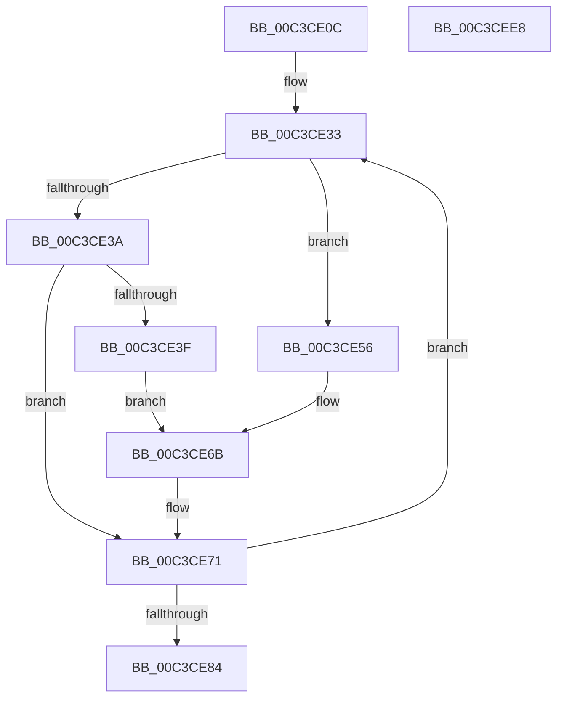

# PfSnParametersSetDefaults

- RVA: `0x00C3CE0C`–`0x00C3CEE9` (길이 `221` bytes)
- VA: `0x0000000140C3CE0C`
- 실행 섹션: `INIT`
- PDB 이름 있음: `예`; PDB Function 태그: `아니요`
- unwind 정보 RVA: `0x0005CAAC`
- 디코드: `49`개 명령, `221/221` bytes 표시
- 미해석 바이트: `0` (있으면 어셈블리에 `.byte`로 보존)

> 이 문서는 커널 이미지의 기계어와 PDB 기호를 분석해 생성했습니다. 4번과 5번은 함수 원형과 자료형을 바이너리 사용 방식에서 추정한 C 해석이며 원본 소스 복구 결과는 아닙니다.

## 1. Dependencies

- 직접 호출 지점: **2**; 고유 호출 대상: **1**
- 직접 호출자로 확인된 함수: **1**
- RIP 상대 이미지 참조: **4**

### Outgoing calls
- `0x00C3CEA8` → [RtlStringCbCopyW](../../text/43/RtlStringCbCopyW_function_0043B910.md) (function, `0x0043B910`)
- `0x00C3CEC7` → [RtlStringCbCopyW](../../text/43/RtlStringCbCopyW_function_0043B910.md) (function, `0x0043B910`)

### Direct callers
- [PfpParametersInitialize](PfpParametersInitialize_function_00C3CEF0.md) at `0x00C3CF7C`

### Static image references
- `0x00C3CE46` → RVA `0x00B54000` (` ?? ::LBKOJDO::`string'`; read)
- `0x00C3CE5D` → RVA `0x00B53FE8` (` ?? ::LBKOJDO::`string'`; read)
- `0x00C3CE8E` → RVA `0x00C7BF80` (` ?? ::PBOPGDP::`string'`; read)
- `0x00C3CEBB` → RVA `0x00C7BF00` (` ?? ::PBOPGDP::`string'`; read)

## 2. Other-region calls and transfers

- 다른 실행 섹션으로 향하는 call: **2**
  - `0x00C3CEA8` → [RtlStringCbCopyW](../../text/43/RtlStringCbCopyW_function_0043B910.md) (`INIT` → `.text`)
  - `0x00C3CEC7` → [RtlStringCbCopyW](../../text/43/RtlStringCbCopyW_function_0043B910.md) (`INIT` → `.text`)
- 별도 외부 분기/꼬리 이동을 확인하지 못했습니다.

## 3. Assembly (complete function range)

```asm
00C3CE0C  48 89 5C 24 08                  mov qword ptr [rsp + 8], rbx
00C3CE11  57                              push rdi
00C3CE12  48 83 EC 20                     sub rsp, 0x20
00C3CE16  48 8D 59 60                     lea rbx, [rcx + 0x60]
00C3CE1A  33 FF                           xor edi, edi
00C3CE1C  4C 8D 81 08 02 00 00            lea r8, [rcx + 0x208]
00C3CE23  8B D7                           mov edx, edi
00C3CE25  4C 8B D3                        mov r10, rbx
00C3CE28  48 8D 4B 10                     lea rcx, [rbx + 0x10]
00C3CE2C  49 C7 C3 80 69 67 FF            mov r11, 0xffffffffff676980
00C3CE33  41 89 3A                        mov dword ptr [r10], edi
00C3CE36  85 D2                           test edx, edx
00C3CE38  74 1C                           je 0x140c3ce56
00C3CE3A  83 FA 01                        cmp edx, 1
00C3CE3D  75 32                           jne 0x140c3ce71
00C3CE3F  C7 41 F8 20 4E 00 00            mov dword ptr [rcx - 8], 0x4e20
00C3CE46  48 8D 05 B3 71 F1 FF            lea rax, [rip - 0xe8e4d]
00C3CE4D  C7 41 FC F4 01 00 00            mov dword ptr [rcx - 4], 0x1f4
00C3CE54  EB 15                           jmp 0x140c3ce6b
00C3CE56  C7 41 F8 00 7D 00 00            mov dword ptr [rcx - 8], 0x7d00
00C3CE5D  48 8D 05 84 71 F1 FF            lea rax, [rip - 0xe8e7c]
00C3CE64  C7 41 FC 54 01 00 00            mov dword ptr [rcx - 4], 0x154
00C3CE6B  4C 89 19                        mov qword ptr [rcx], r11
00C3CE6E  49 89 00                        mov qword ptr [r8], rax
00C3CE71  FF C2                           inc edx
00C3CE73  49 83 C0 08                     add r8, 8
00C3CE77  49 83 C2 04                     add r10, 4
00C3CE7B  48 83 C1 10                     add rcx, 0x10
00C3CE7F  83 FA 02                        cmp edx, 2
00C3CE82  7C AF                           jl 0x140c3ce33
00C3CE84  48 8D 4B 30                     lea rcx, [rbx + 0x30]
00C3CE88  89 BB 90 01 00 00               mov dword ptr [rbx + 0x190], edi
00C3CE8E  4C 8D 05 EB F0 03 00            lea r8, [rip + 0x3f0eb]
00C3CE95  C7 43 28 08 00 00 00            mov dword ptr [rbx + 0x28], 8
00C3CE9C  BA 60 00 00 00                  mov edx, 0x60
00C3CEA1  C7 43 2C 10 00 00 00            mov dword ptr [rbx + 0x2c], 0x10
00C3CEA8  E8 63 EA 7F FF                  call 0x14043b910
00C3CEAD  48 8D 8B 90 00 00 00            lea rcx, [rbx + 0x90]
00C3CEB4  66 89 BB 8E 00 00 00            mov word ptr [rbx + 0x8e], di
00C3CEBB  4C 8D 05 3E F0 03 00            lea r8, [rip + 0x3f03e]
00C3CEC2  BA 00 01 00 00                  mov edx, 0x100
00C3CEC7  E8 44 EA 7F FF                  call 0x14043b910
00C3CECC  66 89 BB 8E 01 00 00            mov word ptr [rbx + 0x18e], di
00C3CED3  C7 83 94 01 00 00 0A 00 00 00   mov dword ptr [rbx + 0x194], 0xa
00C3CEDD  48 8B 5C 24 30                  mov rbx, qword ptr [rsp + 0x30]
00C3CEE2  48 83 C4 20                     add rsp, 0x20
00C3CEE6  5F                              pop rdi
00C3CEE7  C3                              ret
00C3CEE8  CC                              int3
```

## 4. C-style interpretation (structured pseudocode)

```c
__int64 __fastcall PfSnParametersSetDefaults(__int64 a1)
{
    __int64 result;
    __int64 v_r10;
    __int64 v_rdi;
    __int64 v_rsp;
    unsigned __int64 v_stack_p8;

    v_stack_p8 = v_rbx;
    v_rsp = (v_rsp) - (32);
    v_rdi = 0;
loc_00C3CE33:
    *(unsigned int *)(a1 + 96) = 0;
    if (0 == 0) goto loc_00C3CE56;
    if (0 != 1) goto loc_00C3CE71;
    *(unsigned int *)(a1 + 96 + 16 - 8) = 0x4E20ULL;
    *(unsigned int *)(a1 + 96 + 16 - 4) = 500;
    goto loc_00C3CE6B;
loc_00C3CE56:
    *(unsigned int *)(a1 + 96 + 16 - 8) = 0x7D00ULL;
    *(unsigned int *)(a1 + 96 + 16 - 4) = 340;
loc_00C3CE6B:
    *(unsigned __int64 *)(a1 + 96 + 16) = 0xFFFFFFFFFF676980ULL;
    *(unsigned __int64 *)(a1 + 520) = v_rip - 953980;
loc_00C3CE71:
    a2 = (unsigned int)((0) + 1);
    a3 = (a1 + 520) + (8);
    v_r10 = (a1 + 96) + (4);
    a1 = (a1 + 96 + 16) + (16);
    if (((unsigned int)(a2)) < 2) goto loc_00C3CE33;
    *(unsigned int *)(a1 + 96 + 400) = 0;
    *(unsigned int *)(a1 + 96 + 40) = 8;
    *(unsigned int *)(a1 + 96 + 44) = 16;
    result = RtlStringCbCopyW(a1 + 96 + 48, 96, v_rip + 258283, a4);
    *(unsigned __int16 *)(a1 + 96 + 142) = 0;
    result = RtlStringCbCopyW(a1 + 96 + 144, 256, v_rip + 258110, a4);
    *(unsigned __int16 *)(a1 + 96 + 398) = 0;
    *(unsigned int *)(a1 + 96 + 404) = 10;
    v_rsp = (v_rsp) + (32);
    return result;
}
```

## 5. (Beta) C Style

```c
int64_t PfSnParametersSetDefaults(void *Arg1)
{
    uint8_t *arg1 = (uint8_t *)Arg1;

    int64_t result;
    int64_t local_r10;
    int64_t local_rdi;
    int64_t local_rsp;
    uint64_t v_stack_p8;

    v_stack_p8 = local_rbx;
    local_rsp = (local_rsp) - (32);
    local_rdi = 0;
loc_00C3CE33:
    *(uint32_t *)(arg1 + 0x60) = 0;
    if (0 == 0) goto loc_00C3CE56;
    if (0 != 1) goto loc_00C3CE71;
    *(uint32_t *)(arg1 + 0x60 + 0x10 - 0x8) = 0x4E20ULL;
    *(uint32_t *)(arg1 + 0x60 + 0x10 - 0x4) = 500;
    goto loc_00C3CE6B;
loc_00C3CE56:
    *(uint32_t *)(arg1 + 0x60 + 0x10 - 0x8) = 0x7D00ULL;
    *(uint32_t *)(arg1 + 0x60 + 0x10 - 0x4) = 340;
loc_00C3CE6B:
    *(uint64_t *)(arg1 + 0x60 + 0x10) = 0xFFFFFFFFFF676980ULL;
    *(uint64_t *)(arg1 + 0x208) = v_rip - 953980;
loc_00C3CE71:
    a2 = (uint32_t)((0) + 1);
    a3 = (Arg1 + 520) + (8);
    local_r10 = (Arg1 + 96) + (4);
    Arg1 = (Arg1 + 96 + 16) + (16);
    if (((uint32_t)(a2)) < 2) goto loc_00C3CE33;
    *(uint32_t *)(arg1 + 0x60 + 0x190) = 0;
    *(uint32_t *)(arg1 + 0x60 + 0x28) = 8;
    *(uint32_t *)(arg1 + 0x60 + 0x2C) = 16;
    result = RtlStringCbCopyW(Arg1 + 96 + 48, 96, v_rip + 258283, a4);
    *(uint16_t *)(arg1 + 0x60 + 0x8E) = 0;
    result = RtlStringCbCopyW(Arg1 + 96 + 144, 256, v_rip + 258110, a4);
    *(uint16_t *)(arg1 + 0x60 + 0x18E) = 0;
    *(uint32_t *)(arg1 + 0x60 + 0x194) = 10;
    local_rsp = (local_rsp) + (32);
    return result;
}
```

### 관측된 메모리 오프셋

구조체 형식이 확인되지 않은 접근은 인자 기준의 오프셋으로만 기록했습니다.

| 기준 인자 | 오프셋 표현 | 폭 (bit) | 접근 |
|---|---:|---:|---|
| `Arg1` | `- 0x8` | `32` | `W` |
| `Arg1` | `- 0x4` | `32` | `W` |
| `Arg1` | `+ 0x0` | `32` | `W` |
| `Arg1` | `+ 0x0` | `64` | `W` |
| `Arg1` | `+ 0x10` | `64` | `R` |
| `Arg1` | `+ 0x28` | `32` | `W` |
| `Arg1` | `+ 0x2C` | `32` | `W` |
| `Arg1` | `+ 0x30` | `64` | `R` |
| `Arg1` | `+ 0x60` | `64` | `R` |
| `Arg1` | `+ 0x8E` | `16` | `W` |
| `Arg1` | `+ 0x90` | `64` | `R` |
| `Arg1` | `+ 0x18E` | `16` | `W` |
| `Arg1` | `+ 0x190` | `32` | `W` |
| `Arg1` | `+ 0x194` | `32` | `W` |
| `Arg1` | `+ 0x208` | `64` | `R` |

## 6. Execution-region graph

[열기: 2D/3D 그래프와 함수 탐색 컨트롤 패널](../../../control-panel.html?section=init&rva=0x00C3CE0C&view=graph)

- 2D 그래프는 위에서 아래로 흐르고, 3D 그래프는 빈 공간을 드래그해 회전합니다. Shift+드래그는 이동, 휠은 확대·축소, 함수 노드 선택은 대상 보고서 이동입니다.

### Static fallback


