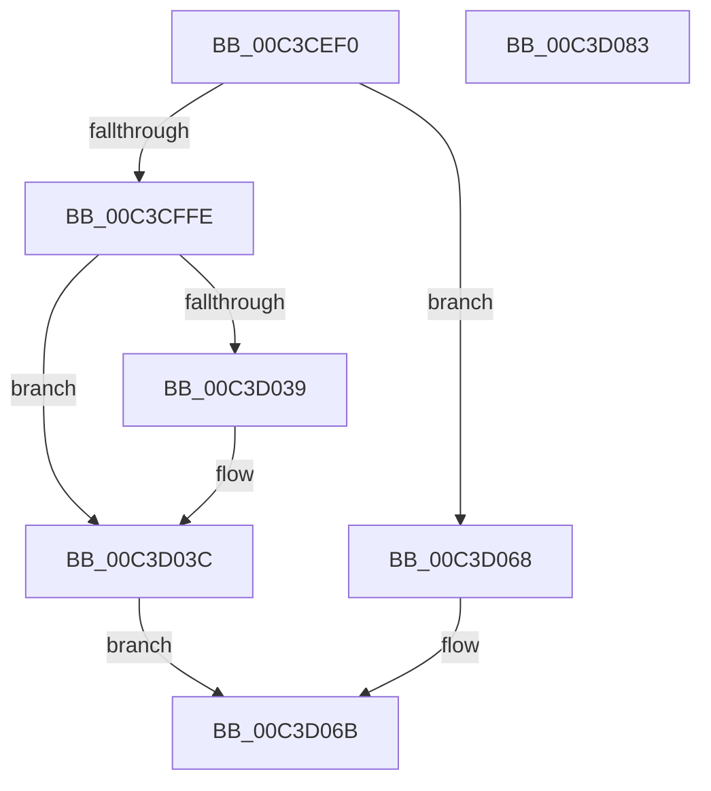

# PfpParametersInitialize

- RVA: `0x00C3CEF0`–`0x00C3D084` (길이 `404` bytes)
- VA: `0x0000000140C3CEF0`
- 실행 섹션: `INIT`
- PDB 이름 있음: `예`; PDB Function 태그: `아니요`
- unwind 정보 RVA: `0x000CBC98`
- 디코드: `99`개 명령, `404/404` bytes 표시
- 미해석 바이트: `0` (있으면 어셈블리에 `.byte`로 보존)

> 이 문서는 커널 이미지의 기계어와 PDB 기호를 분석해 생성했습니다. 4번과 5번은 함수 원형과 자료형을 바이너리 사용 방식에서 추정한 C 해석이며 원본 소스 복구 결과는 아닙니다.

## 1. Dependencies

- 직접 호출 지점: **11**; 고유 호출 대상: **10**
- 직접 호출자로 확인된 함수: **1**
- RIP 상대 이미지 참조: **4**

### Outgoing calls
- `0x00C3CF2E` → [memset](../../text/6C/memset_function_006C6C40.md) (function, `0x006C6C40`)
- `0x00C3CF7C` → [PfSnParametersSetDefaults](PfSnParametersSetDefaults_function_00C3CE0C.md) (function, `0x00C3CE0C`)
- `0x00C3CF8C` → [RtlInitUnicodeString](../../text/42/RtlInitUnicodeString_function_0042A780.md) (function, `0x0042A780`)
- `0x00C3CF9C` → [PfpCreateEvent](../../page/75/PfpCreateEvent_function_00753460.md) (function, `0x00753460`)
- `0x00C3CFAC` → [RtlInitUnicodeString](../../text/42/RtlInitUnicodeString_function_0042A780.md) (function, `0x0042A780`)
- `0x00C3CFF5` → [ZwCreateKey](../../text/6A/ZwCreateKey_function_006AD470.md) (function, `0x006AD470`)
- `0x00C3D001` → [PfpParametersRead](../../page/75/PfpParametersRead_function_00752F70.md) (function, `0x00752F70`)
- `0x00C3D009` → [PfSnParametersRead](../../page/75/PfSnParametersRead_function_00752970.md) (function, `0x00752970`)
- `0x00C3D030` → [PfpGetParameter](../../page/75/PfpGetParameter_function_00752E80.md) (function, `0x00752E80`)
- `0x00C3D052` → [PfpSetParameter](../../page/75/PfpSetParameter_function_007533FC.md) (function, `0x007533FC`)
- `0x00C3D061` → [PfpSetBaseTime](../../page/75/PfpSetBaseTime_function_0075333C.md) (function, `0x0075333C`)

### Direct callers
- [PfInitializeSuperfetch](PfInitializeSuperfetch_function_00C3CACC.md) at `0x00C3CAD9`

### Static image references
- `0x00C3CF37` → RVA `0x00753140` (`PfpParametersWatcher`; read)
- `0x00C3CF81` → RVA `0x00C7BEA0` (` ?? ::PBOPGDP::`string'`; read)
- `0x00C3CFA1` → RVA `0x00C7BDD0` (` ?? ::PBOPGDP::`string'`; read)
- `0x00C3D029` → RVA `0x00C7BDC0` (` ?? ::PBOPGDP::`string'`; read)

## 2. Other-region calls and transfers

- 다른 실행 섹션으로 향하는 call: **10**
  - `0x00C3CF2E` → [memset](../../text/6C/memset_function_006C6C40.md) (`INIT` → `.text`)
  - `0x00C3CF8C` → [RtlInitUnicodeString](../../text/42/RtlInitUnicodeString_function_0042A780.md) (`INIT` → `.text`)
  - `0x00C3CF9C` → [PfpCreateEvent](../../page/75/PfpCreateEvent_function_00753460.md) (`INIT` → `PAGE`)
  - `0x00C3CFAC` → [RtlInitUnicodeString](../../text/42/RtlInitUnicodeString_function_0042A780.md) (`INIT` → `.text`)
  - `0x00C3CFF5` → [ZwCreateKey](../../text/6A/ZwCreateKey_function_006AD470.md) (`INIT` → `.text`)
  - `0x00C3D001` → [PfpParametersRead](../../page/75/PfpParametersRead_function_00752F70.md) (`INIT` → `PAGE`)
  - `0x00C3D009` → [PfSnParametersRead](../../page/75/PfSnParametersRead_function_00752970.md) (`INIT` → `PAGE`)
  - `0x00C3D030` → [PfpGetParameter](../../page/75/PfpGetParameter_function_00752E80.md) (`INIT` → `PAGE`)
  - `0x00C3D052` → [PfpSetParameter](../../page/75/PfpSetParameter_function_007533FC.md) (`INIT` → `PAGE`)
  - `0x00C3D061` → [PfpSetBaseTime](../../page/75/PfpSetBaseTime_function_0075333C.md) (`INIT` → `PAGE`)
- 별도 외부 분기/꼬리 이동을 확인하지 못했습니다.

## 3. Assembly (complete function range)

```asm
00C3CEF0  48 89 5C 24 10                  mov qword ptr [rsp + 0x10], rbx
00C3CEF5  48 89 74 24 18                  mov qword ptr [rsp + 0x18], rsi
00C3CEFA  55                              push rbp
00C3CEFB  57                              push rdi
00C3CEFC  41 56                           push r14
00C3CEFE  48 8D 6C 24 B9                  lea rbp, [rsp - 0x47]
00C3CF03  48 81 EC 90 00 00 00            sub rsp, 0x90
00C3CF0A  45 33 F6                        xor r14d, r14d
00C3CF0D  0F 57 C0                        xorps xmm0, xmm0
00C3CF10  0F 57 C9                        xorps xmm1, xmm1
00C3CF13  44 89 75 1B                     mov dword ptr [rbp + 0x1b], r14d
00C3CF17  33 D2                           xor edx, edx
00C3CF19  44 89 75 33                     mov dword ptr [rbp + 0x33], r14d
00C3CF1D  41 B8 20 02 00 00               mov r8d, 0x220
00C3CF23  48 8B D9                        mov rbx, rcx
00C3CF26  0F 11 45 07                     movups xmmword ptr [rbp + 7], xmm0
00C3CF2A  0F 11 4D F7                     movups xmmword ptr [rbp - 9], xmm1
00C3CF2E  E8 0D 9D A8 FF                  call 0x1406c6c40
00C3CF33  48 89 5B 38                     mov qword ptr [rbx + 0x38], rbx
00C3CF37  48 8D 05 02 62 B1 FF            lea rax, [rip - 0x4e9dfe]
00C3CF3E  48 89 43 30                     mov qword ptr [rbx + 0x30], rax
00C3CF42  48 8B CB                        mov rcx, rbx
00C3CF45  4C 89 73 20                     mov qword ptr [rbx + 0x20], r14
00C3CF49  B8 10 27 00 00                  mov eax, 0x2710
00C3CF4E  4C 89 73 48                     mov qword ptr [rbx + 0x48], r14
00C3CF52  4C 89 73 50                     mov qword ptr [rbx + 0x50], r14
00C3CF56  4C 89 73 58                     mov qword ptr [rbx + 0x58], r14
00C3CF5A  C7 43 44 00 00 00 80            mov dword ptr [rbx + 0x44], 0x80000000
00C3CF61  C7 43 50 10 00 00 00            mov dword ptr [rbx + 0x50], 0x10
00C3CF68  C7 43 4C 40 00 00 00            mov dword ptr [rbx + 0x4c], 0x40
00C3CF6F  C7 43 54 88 13 00 00            mov dword ptr [rbx + 0x54], 0x1388
00C3CF76  89 43 58                        mov dword ptr [rbx + 0x58], eax
00C3CF79  89 43 5C                        mov dword ptr [rbx + 0x5c], eax
00C3CF7C  E8 8B FE FF FF                  call 0x140c3ce0c
00C3CF81  48 8D 15 18 EF 03 00            lea rdx, [rip + 0x3ef18]
00C3CF88  48 8D 4D F7                     lea rcx, [rbp - 9]
00C3CF8C  E8 EF D7 7E FF                  call 0x14042a780
00C3CF91  4C 8B C3                        mov r8, rbx
00C3CF94  41 8D 56 01                     lea edx, [r14 + 1]
00C3CF98  48 8D 4D F7                     lea rcx, [rbp - 9]
00C3CF9C  E8 BF 64 B1 FF                  call 0x140753460
00C3CFA1  48 8D 15 28 EE 03 00            lea rdx, [rip + 0x3ee28]
00C3CFA8  48 8D 4D 07                     lea rcx, [rbp + 7]
00C3CFAC  E8 CF D7 7E FF                  call 0x14042a780
00C3CFB1  48 8D 45 07                     lea rax, [rbp + 7]
00C3CFB5  4C 89 74 24 30                  mov qword ptr [rsp + 0x30], r14
00C3CFBA  0F 57 C0                        xorps xmm0, xmm0
00C3CFBD  44 89 74 24 28                  mov dword ptr [rsp + 0x28], r14d
00C3CFC2  48 8D 73 08                     lea rsi, [rbx + 8]
00C3CFC6  48 89 45 27                     mov qword ptr [rbp + 0x27], rax
00C3CFCA  48 8B CE                        mov rcx, rsi
00C3CFCD  C7 45 17 30 00 00 00            mov dword ptr [rbp + 0x17], 0x30
00C3CFD4  45 33 C9                        xor r9d, r9d
00C3CFD7  4C 89 75 1F                     mov qword ptr [rbp + 0x1f], r14
00C3CFDB  4C 8D 45 17                     lea r8, [rbp + 0x17]
00C3CFDF  C7 45 2F 40 02 00 00            mov dword ptr [rbp + 0x2f], 0x240
00C3CFE6  BA 3F 00 0F 00                  mov edx, 0xf003f
00C3CFEB  4C 89 74 24 20                  mov qword ptr [rsp + 0x20], r14
00C3CFF0  F3 0F 7F 45 37                  movdqu xmmword ptr [rbp + 0x37], xmm0
00C3CFF5  E8 76 04 A7 FF                  call 0x1406ad470
00C3CFFA  85 C0                           test eax, eax
00C3CFFC  78 6A                           js 0x140c3d068
00C3CFFE  48 8B CB                        mov rcx, rbx
00C3D001  E8 6A 5F B1 FF                  call 0x140752f70
00C3D006  48 8B CB                        mov rcx, rbx
00C3D009  E8 62 59 B1 FF                  call 0x140752970
00C3D00E  48 8B 0E                        mov rcx, qword ptr [rsi]
00C3D011  45 8D 46 04                     lea r8d, [r14 + 4]
00C3D015  48 8D 45 67                     lea rax, [rbp + 0x67]
00C3D019  44 89 45 67                     mov dword ptr [rbp + 0x67], r8d
00C3D01D  48 8D 7B 48                     lea rdi, [rbx + 0x48]
00C3D021  48 89 44 24 20                  mov qword ptr [rsp + 0x20], rax
00C3D026  4C 8B CF                        mov r9, rdi
00C3D029  48 8D 15 90 ED 03 00            lea rdx, [rip + 0x3ed90]
00C3D030  E8 4B 5E B1 FF                  call 0x140752e80
00C3D035  85 C0                           test eax, eax
00C3D037  79 03                           jns 0x140c3d03c
00C3D039  44 89 37                        mov dword ptr [rdi], r14d
00C3D03C  8B 45 67                        mov eax, dword ptr [rbp + 0x67]
00C3D03F  48 8D 15 7A ED 03 00            lea rdx, [rip + 0x3ed7a]
00C3D046  48 8B 0E                        mov rcx, qword ptr [rsi]
00C3D049  4C 8B CF                        mov r9, rdi
00C3D04C  FF 07                           inc dword ptr [rdi]
00C3D04E  89 44 24 20                     mov dword ptr [rsp + 0x20], eax
00C3D052  E8 A5 63 B1 FF                  call 0x1407533fc
00C3D057  48 8B 0E                        mov rcx, qword ptr [rsi]
00C3D05A  48 8D 93 1C 02 00 00            lea rdx, [rbx + 0x21c]
00C3D061  E8 D6 62 B1 FF                  call 0x14075333c
00C3D066  EB 03                           jmp 0x140c3d06b
00C3D068  4C 89 36                        mov qword ptr [rsi], r14
00C3D06B  4C 8D 9C 24 90 00 00 00         lea r11, [rsp + 0x90]
00C3D073  49 8B 5B 28                     mov rbx, qword ptr [r11 + 0x28]
00C3D077  49 8B 73 30                     mov rsi, qword ptr [r11 + 0x30]
00C3D07B  49 8B E3                        mov rsp, r11
00C3D07E  41 5E                           pop r14
00C3D080  5F                              pop rdi
00C3D081  5D                              pop rbp
00C3D082  C3                              ret
00C3D083  CC                              int3
```

## 4. C-style interpretation (structured pseudocode)

```c
__int64 __fastcall PfpParametersInitialize(__int64 a1, int a2, __int64 a3, int a4)
{
    __int64 result;
    __int64 v_r14;
    __int64 v_rsp;
    unsigned __int64 v_stack_m18;
    unsigned __int64 v_stack_m28;
    unsigned int v_stack_m2C;
    unsigned int v_stack_m30;
    unsigned __int64 v_stack_m38;
    unsigned __int64 v_stack_m40;
    unsigned int v_stack_m44;
    unsigned int v_stack_m48;
    unsigned __int64 v_stack_m58;
    unsigned __int64 v_stack_m5F;
    unsigned __int64 v_stack_m68;
    unsigned __int64 v_stack_m78;
    unsigned int v_stack_m80;
    unsigned __int64 v_stack_m88;
    unsigned __int64 v_stack_p10;
    unsigned __int64 v_stack_p18;
    unsigned __int64 v_stack_p8;

    v_stack_p10 = v_rbx;
    v_stack_p18 = v_rsi;
    v_rsp = (v_rsp) - (144);
    v_r14 = 0;
    v_stack_m44 = 0;
    a2 = 0;
    v_stack_m2C = 0;
    v_stack_m58 = v_xmm0;
    v_stack_m68 = v_xmm1;
    result = memset(a1, a2, 544, a4);
    *(unsigned __int64 *)(a1 + 56) = a1;
    *(unsigned __int64 *)(a1 + 48) = v_rip - 5152254;
    *(unsigned __int64 *)(a1 + 32) = 0;
    *(unsigned __int64 *)(a1 + 72) = 0;
    *(unsigned __int64 *)(a1 + 80) = 0;
    *(unsigned __int64 *)(a1 + 88) = 0;
    *(unsigned int *)(a1 + 68) = 0x80000000ULL;
    *(unsigned int *)(a1 + 80) = 16;
    *(unsigned int *)(a1 + 76) = 64;
    *(unsigned int *)(a1 + 84) = 0x1388ULL;
    *(unsigned int *)(a1 + 88) = (unsigned int)((unsigned int)(0x2710ULL));
    *(unsigned int *)(a1 + 92) = (unsigned int)((unsigned int)(0x2710ULL));
    result = PfSnParametersSetDefaults(a1, a2, 544, a4);
    result = RtlInitUnicodeString(v_stack_m68, v_rip + 257816, 544, a4);
    result = PfpCreateEvent(v_stack_m68, v_r14 + 1, a1, a4);
    result = RtlInitUnicodeString(v_stack_m58, v_rip + 257576, a1, a4);
    v_stack_m78 = 0;
    v_stack_m80 = 0;
    v_stack_m38 = v_stack_m58;
    v_stack_m48 = 48;
    a4 = 0;
    v_stack_m40 = 0;
    v_stack_m30 = 576;
    v_stack_m88 = 0;
    v_stack_m28 = v_xmm0;
    result = ZwCreateKey(a1 + 8, (unsigned int)(0xF003FULL), v_stack_m48, a4);
    if (sign_flag) goto loc_00C3D068;
    result = PfpParametersRead(a1, (unsigned int)(0xF003FULL), v_stack_m48, a4);
    result = PfSnParametersRead(a1, (unsigned int)(0xF003FULL), v_stack_m48, a4);
    v_stack_p8 = (unsigned int)(v_r14 + 4);
    v_stack_m88 = v_stack_p8;
    result = PfpGetParameter(*(unsigned __int64 *)(a1 + 8), v_rip + 257424, v_r14 + 4, a1 + 72);
    if (sign_flag) {
        *(unsigned int *)(a1 + 72) = 0;
    }
    v_stack_m88 = (unsigned int)((unsigned int)(v_stack_p8));
    result = PfpSetParameter(*(unsigned __int64 *)(a1 + 8), v_rip + 257402, v_r14 + 4, a1 + 72);
    result = PfpSetBaseTime(*(unsigned __int64 *)(a1 + 8), a1 + 540, v_r14 + 4, a1 + 72);
    goto loc_00C3D06B;
loc_00C3D068:
    *(unsigned __int64 *)(a1 + 8) = 0;
loc_00C3D06B:
    return result;
}
```

## 5. (Beta) C Style

```c
int64_t PfpParametersInitialize(void *Arg1, int32_t Arg2, int64_t Arg3, int32_t Arg4)
{
    uint8_t *arg1 = (uint8_t *)Arg1;

    int64_t result;
    int64_t local_r14;
    int64_t local_rsp;
    uint64_t v_stack_m18;
    uint64_t v_stack_m28;
    uint32_t v_stack_m2C;
    uint32_t v_stack_m30;
    uint64_t v_stack_m38;
    uint64_t v_stack_m40;
    uint32_t v_stack_m44;
    uint32_t v_stack_m48;
    uint64_t v_stack_m58;
    uint64_t v_stack_m5F;
    uint64_t v_stack_m68;
    uint64_t v_stack_m78;
    uint32_t v_stack_m80;
    uint64_t v_stack_m88;
    uint64_t v_stack_p10;
    uint64_t v_stack_p18;
    uint64_t v_stack_p8;

    v_stack_p10 = local_rbx;
    v_stack_p18 = local_rsi;
    local_rsp = (local_rsp) - (144);
    local_r14 = 0;
    v_stack_m44 = 0;
    Arg2 = 0;
    v_stack_m2C = 0;
    v_stack_m58 = v_xmm0;
    v_stack_m68 = v_xmm1;
    result = memset(Arg1, Arg2, 544, Arg4);
    *(void **)(arg1 + 0x38) = Arg1;
    *(uint64_t *)(arg1 + 0x30) = v_rip - 5152254;
    *(uint64_t *)(arg1 + 0x20) = 0;
    *(uint64_t *)(arg1 + 0x48) = 0;
    *(uint64_t *)(arg1 + 0x50) = 0;
    *(uint64_t *)(arg1 + 0x58) = 0;
    *(uint32_t *)(arg1 + 0x44) = 0x80000000ULL;
    *(uint32_t *)(arg1 + 0x50) = 16;
    *(uint32_t *)(arg1 + 0x4C) = 64;
    *(uint32_t *)(arg1 + 0x54) = 0x1388ULL;
    *(uint32_t *)(arg1 + 0x58) = (uint32_t)((uint32_t)(0x2710ULL));
    *(uint32_t *)(arg1 + 0x5C) = (uint32_t)((uint32_t)(0x2710ULL));
    result = PfSnParametersSetDefaults(Arg1, Arg2, 544, Arg4);
    result = RtlInitUnicodeString(v_stack_m68, v_rip + 257816, 544, Arg4);
    result = PfpCreateEvent(v_stack_m68, local_r14 + 1, Arg1, Arg4);
    result = RtlInitUnicodeString(v_stack_m58, v_rip + 257576, Arg1, Arg4);
    v_stack_m78 = 0;
    v_stack_m80 = 0;
    v_stack_m38 = v_stack_m58;
    v_stack_m48 = 48;
    Arg4 = 0;
    v_stack_m40 = 0;
    v_stack_m30 = 576;
    v_stack_m88 = 0;
    v_stack_m28 = v_xmm0;
    result = ZwCreateKey(Arg1 + 8, (uint32_t)(0xF003FULL), v_stack_m48, Arg4);
    if (sign_flag) goto loc_00C3D068;
    result = PfpParametersRead(Arg1, (uint32_t)(0xF003FULL), v_stack_m48, Arg4);
    result = PfSnParametersRead(Arg1, (uint32_t)(0xF003FULL), v_stack_m48, Arg4);
    v_stack_p8 = (uint32_t)(local_r14 + 4);
    v_stack_m88 = v_stack_p8;
    result = PfpGetParameter(*(uint64_t *)(arg1 + 0x8), v_rip + 257424, local_r14 + 4, Arg1 + 72);
    if (sign_flag) {
        *(uint32_t *)(arg1 + 0x48) = 0;
    }
    v_stack_m88 = (uint32_t)((uint32_t)(v_stack_p8));
    result = PfpSetParameter(*(uint64_t *)(arg1 + 0x8), v_rip + 257402, local_r14 + 4, Arg1 + 72);
    result = PfpSetBaseTime(*(uint64_t *)(arg1 + 0x8), Arg1 + 540, local_r14 + 4, Arg1 + 72);
    goto loc_00C3D06B;
loc_00C3D068:
    *(uint64_t *)(arg1 + 0x8) = 0;
loc_00C3D06B:
    return result;
}
```

### 관측된 메모리 오프셋

구조체 형식이 확인되지 않은 접근은 인자 기준의 오프셋으로만 기록했습니다.

| 기준 인자 | 오프셋 표현 | 폭 (bit) | 접근 |
|---|---:|---:|---|
| `Arg1` | `+ 0x0` | `32` | `R/W` |
| `Arg1` | `+ 0x0` | `32` | `W` |
| `Arg1` | `+ 0x0` | `64` | `R` |
| `Arg1` | `+ 0x0` | `64` | `W` |
| `Arg1` | `+ 0x8` | `64` | `R` |
| `Arg1` | `+ 0x20` | `64` | `W` |
| `Arg1` | `+ 0x30` | `64` | `W` |
| `Arg1` | `+ 0x38` | `64` | `W` |
| `Arg1` | `+ 0x44` | `32` | `W` |
| `Arg1` | `+ 0x48` | `64` | `R` |
| `Arg1` | `+ 0x48` | `64` | `W` |
| `Arg1` | `+ 0x4C` | `32` | `W` |
| `Arg1` | `+ 0x50` | `32` | `W` |
| `Arg1` | `+ 0x50` | `64` | `W` |
| `Arg1` | `+ 0x54` | `32` | `W` |
| `Arg1` | `+ 0x58` | `32` | `W` |
| `Arg1` | `+ 0x58` | `64` | `W` |
| `Arg1` | `+ 0x5C` | `32` | `W` |
| `Arg1` | `+ 0x21C` | `64` | `R` |

## 6. Execution-region graph

[열기: 2D/3D 그래프와 함수 탐색 컨트롤 패널](../../../control-panel.html?section=init&rva=0x00C3CEF0&view=graph)

- 2D 그래프는 위에서 아래로 흐르고, 3D 그래프는 빈 공간을 드래그해 회전합니다. Shift+드래그는 이동, 휠은 확대·축소, 함수 노드 선택은 대상 보고서 이동입니다.

### Static fallback


