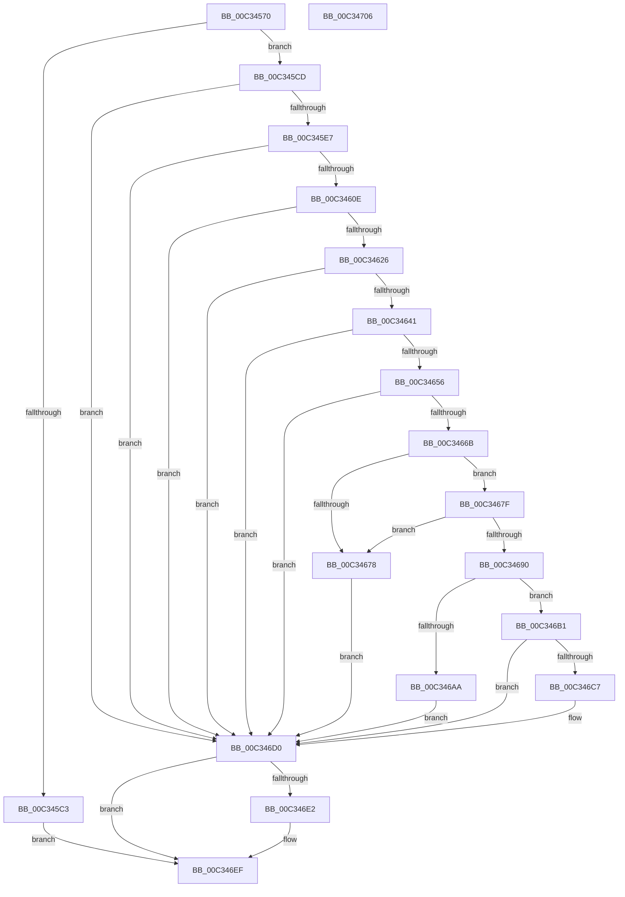

# PiAuCreateLocalSystemSecurityObject

- RVA: `0x00C34570`–`0x00C34707` (길이 `407` bytes)
- VA: `0x0000000140C34570`
- 실행 섹션: `INIT`
- PDB 이름 있음: `예`; PDB Function 태그: `아니요`
- unwind 정보 RVA: `0x000C89F4`
- 디코드: `118`개 명령, `407/407` bytes 표시
- 미해석 바이트: `0` (있으면 어셈블리에 `.byte`로 보존)

> 이 문서는 커널 이미지의 기계어와 PDB 기호를 분석해 생성했습니다. 4번과 5번은 함수 원형과 자료형을 바이너리 사용 방식에서 추정한 C 해석이며 원본 소스 복구 결과는 아닙니다.

## 1. Dependencies

- 직접 호출 지점: **13**; 고유 호출 대상: **11**
- 직접 호출자로 확인된 함수: **1**
- RIP 상대 이미지 참조: **1**

### Outgoing calls
- `0x00C345B6` → [ExAllocatePool2](../../poolcode/B8/ExAllocatePool2_function_00B820F0.md) (function, `0x00B820F0`)
- `0x00C345D8` → [RtlCreateAcl](../../page/91/RtlCreateAcl_function_00916F00.md) (function, `0x00916F00`)
- `0x00C345FF` → [RtlAddAccessAllowedAceEx](../../page/92/RtlAddAccessAllowedAceEx_function_009279D0.md) (function, `0x009279D0`)
- `0x00C34617` → [RtlCreateSecurityDescriptor](../../page/9F/RtlCreateSecurityDescriptor_function_009F1DF0.md) (function, `0x009F1DF0`)
- `0x00C34632` → [RtlSetDaclSecurityDescriptor](../../page/9E/RtlSetDaclSecurityDescriptor_function_009EC210.md) (function, `0x009EC210`)
- `0x00C3464B` → [RtlSetOwnerSecurityDescriptor](../../page/91/RtlSetOwnerSecurityDescriptor_function_00916F90.md) (function, `0x00916F90`)
- `0x00C34660` → [RtlSetGroupSecurityDescriptor](../../page/A2/RtlSetGroupSecurityDescriptor_function_00A2EB10.md) (function, `0x00A2EB10`)
- `0x00C3466F` → [RtlValidSecurityDescriptor](../../page/8B/RtlValidSecurityDescriptor_function_008BD3F0.md) (function, `0x008BD3F0`)
- `0x00C34683` → [RtlLengthSecurityDescriptor](../../page/8B/RtlLengthSecurityDescriptor_function_008BC870.md) (function, `0x008BC870`)
- `0x00C3469D` → [ExAllocatePool2](../../poolcode/B8/ExAllocatePool2_function_00B820F0.md) (function, `0x00B820F0`)
- `0x00C346BC` → [RtlAbsoluteToSelfRelativeSD](../../page/A1/RtlAbsoluteToSelfRelativeSD_function_00A119B0.md) (function, `0x00A119B0`)
- `0x00C346D8` → [ExFreePoolWithTag](../../poolcode/B8/ExFreePoolWithTag_function_00B82870.md) (function, `0x00B82870`)
- `0x00C346EA` → [ExFreePoolWithTag](../../poolcode/B8/ExFreePoolWithTag_function_00B82870.md) (function, `0x00B82870`)

### Direct callers
- [IopInitializePlugPlayServices](../C2/IopInitializePlugPlayServices_function_00C2F298.md) at `0x00C2F92C`

### Static image references
- `0x00C346C7` → RVA `0x00E663A0` (`.data`; write)

## 2. Other-region calls and transfers

- 다른 실행 섹션으로 향하는 call: **13**
  - `0x00C345B6` → [ExAllocatePool2](../../poolcode/B8/ExAllocatePool2_function_00B820F0.md) (`INIT` → `POOLCODE`)
  - `0x00C345D8` → [RtlCreateAcl](../../page/91/RtlCreateAcl_function_00916F00.md) (`INIT` → `PAGE`)
  - `0x00C345FF` → [RtlAddAccessAllowedAceEx](../../page/92/RtlAddAccessAllowedAceEx_function_009279D0.md) (`INIT` → `PAGE`)
  - `0x00C34617` → [RtlCreateSecurityDescriptor](../../page/9F/RtlCreateSecurityDescriptor_function_009F1DF0.md) (`INIT` → `PAGE`)
  - `0x00C34632` → [RtlSetDaclSecurityDescriptor](../../page/9E/RtlSetDaclSecurityDescriptor_function_009EC210.md) (`INIT` → `PAGE`)
  - `0x00C3464B` → [RtlSetOwnerSecurityDescriptor](../../page/91/RtlSetOwnerSecurityDescriptor_function_00916F90.md) (`INIT` → `PAGE`)
  - `0x00C34660` → [RtlSetGroupSecurityDescriptor](../../page/A2/RtlSetGroupSecurityDescriptor_function_00A2EB10.md) (`INIT` → `PAGE`)
  - `0x00C3466F` → [RtlValidSecurityDescriptor](../../page/8B/RtlValidSecurityDescriptor_function_008BD3F0.md) (`INIT` → `PAGE`)
  - `0x00C34683` → [RtlLengthSecurityDescriptor](../../page/8B/RtlLengthSecurityDescriptor_function_008BC870.md) (`INIT` → `PAGE`)
  - `0x00C3469D` → [ExAllocatePool2](../../poolcode/B8/ExAllocatePool2_function_00B820F0.md) (`INIT` → `POOLCODE`)
  - `0x00C346BC` → [RtlAbsoluteToSelfRelativeSD](../../page/A1/RtlAbsoluteToSelfRelativeSD_function_00A119B0.md) (`INIT` → `PAGE`)
  - `0x00C346D8` → [ExFreePoolWithTag](../../poolcode/B8/ExFreePoolWithTag_function_00B82870.md) (`INIT` → `POOLCODE`)
  - `0x00C346EA` → [ExFreePoolWithTag](../../poolcode/B8/ExFreePoolWithTag_function_00B82870.md) (`INIT` → `POOLCODE`)
- 별도 외부 분기/꼬리 이동을 확인하지 못했습니다.

## 3. Assembly (complete function range)

```asm
00C34570  48 89 5C 24 10                  mov qword ptr [rsp + 0x10], rbx
00C34575  48 89 74 24 18                  mov qword ptr [rsp + 0x18], rsi
00C3457A  55                              push rbp
00C3457B  57                              push rdi
00C3457C  41 56                           push r14
00C3457E  48 8B EC                        mov rbp, rsp
00C34581  48 83 EC 60                     sub rsp, 0x60
00C34585  33 C0                           xor eax, eax
00C34587  0F 57 C0                        xorps xmm0, xmm0
00C3458A  48 89 45 F0                     mov qword ptr [rbp - 0x10], rax
00C3458E  4C 8B F1                        mov r14, rcx
00C34591  48 8B 01                        mov rax, qword ptr [rcx]
00C34594  41 B8 50 6E 70 47               mov r8d, 0x47706e50
00C3459A  B9 00 01 00 00                  mov ecx, 0x100
00C3459F  33 FF                           xor edi, edi
00C345A1  0F 11 45 D0                     movups xmmword ptr [rbp - 0x30], xmm0
00C345A5  0F B6 50 01                     movzx edx, byte ptr [rax + 1]
00C345A9  0F 11 45 E0                     movups xmmword ptr [rbp - 0x20], xmm0
00C345AD  8D 1C 95 18 00 00 00            lea ebx, [rdx*4 + 0x18]
00C345B4  8B D3                           mov edx, ebx
00C345B6  E8 35 DB F4 FF                  call 0x140b820f0
00C345BB  48 8B F0                        mov rsi, rax
00C345BE  48 85 C0                        test rax, rax
00C345C1  75 0A                           jne 0x140c345cd
00C345C3  BB 9A 00 00 C0                  mov ebx, 0xc000009a
00C345C8  E9 22 01 00 00                  jmp 0x140c346ef
00C345CD  41 B8 02 00 00 00               mov r8d, 2
00C345D3  8B D3                           mov edx, ebx
00C345D5  48 8B CE                        mov rcx, rsi
00C345D8  E8 23 29 CE FF                  call 0x140916f00
00C345DD  8B D8                           mov ebx, eax
00C345DF  85 C0                           test eax, eax
00C345E1  0F 88 E9 00 00 00               js 0x140c346d0
00C345E7  49 8B 06                        mov rax, qword ptr [r14]
00C345EA  45 33 C0                        xor r8d, r8d
00C345ED  41 B9 00 00 0F 00               mov r9d, 0xf0000
00C345F3  48 89 44 24 20                  mov qword ptr [rsp + 0x20], rax
00C345F8  48 8B CE                        mov rcx, rsi
00C345FB  41 8D 50 02                     lea edx, [r8 + 2]
00C345FF  E8 CC 33 CF FF                  call 0x1409279d0
00C34604  8B D8                           mov ebx, eax
00C34606  85 C0                           test eax, eax
00C34608  0F 88 C2 00 00 00               js 0x140c346d0
00C3460E  BA 01 00 00 00                  mov edx, 1
00C34613  48 8D 4D D0                     lea rcx, [rbp - 0x30]
00C34617  E8 D4 D7 DB FF                  call 0x1409f1df0
00C3461C  8B D8                           mov ebx, eax
00C3461E  85 C0                           test eax, eax
00C34620  0F 88 AA 00 00 00               js 0x140c346d0
00C34626  45 33 C9                        xor r9d, r9d
00C34629  48 8D 4D D0                     lea rcx, [rbp - 0x30]
00C3462D  4C 8B C6                        mov r8, rsi
00C34630  B2 01                           mov dl, 1
00C34632  E8 D9 7B DB FF                  call 0x1409ec210
00C34637  8B D8                           mov ebx, eax
00C34639  85 C0                           test eax, eax
00C3463B  0F 88 8F 00 00 00               js 0x140c346d0
00C34641  49 8B 16                        mov rdx, qword ptr [r14]
00C34644  48 8D 4D D0                     lea rcx, [rbp - 0x30]
00C34648  45 33 C0                        xor r8d, r8d
00C3464B  E8 40 29 CE FF                  call 0x140916f90
00C34650  8B D8                           mov ebx, eax
00C34652  85 C0                           test eax, eax
00C34654  78 7A                           js 0x140c346d0
00C34656  49 8B 16                        mov rdx, qword ptr [r14]
00C34659  48 8D 4D D0                     lea rcx, [rbp - 0x30]
00C3465D  45 33 C0                        xor r8d, r8d
00C34660  E8 AB A4 DF FF                  call 0x140a2eb10
00C34665  8B D8                           mov ebx, eax
00C34667  85 C0                           test eax, eax
00C34669  78 65                           js 0x140c346d0
00C3466B  48 8D 4D D0                     lea rcx, [rbp - 0x30]
00C3466F  E8 7C 8D C8 FF                  call 0x1408bd3f0
00C34674  84 C0                           test al, al
00C34676  75 07                           jne 0x140c3467f
00C34678  BB E5 00 00 C0                  mov ebx, 0xc00000e5
00C3467D  EB 51                           jmp 0x140c346d0
00C3467F  48 8D 4D D0                     lea rcx, [rbp - 0x30]
00C34683  E8 E8 81 C8 FF                  call 0x1408bc870
00C34688  89 45 20                        mov dword ptr [rbp + 0x20], eax
00C3468B  83 F8 28                        cmp eax, 0x28
00C3468E  72 E8                           jb 0x140c34678
00C34690  8B D0                           mov edx, eax
00C34692  B9 00 01 00 00                  mov ecx, 0x100
00C34697  41 B8 50 6E 70 47               mov r8d, 0x47706e50
00C3469D  E8 4E DA F4 FF                  call 0x140b820f0
00C346A2  48 8B F8                        mov rdi, rax
00C346A5  48 85 C0                        test rax, rax
00C346A8  75 07                           jne 0x140c346b1
00C346AA  BB 9A 00 00 C0                  mov ebx, 0xc000009a
00C346AF  EB 1F                           jmp 0x140c346d0
00C346B1  4C 8D 45 20                     lea r8, [rbp + 0x20]
00C346B5  48 8B D7                        mov rdx, rdi
00C346B8  48 8D 4D D0                     lea rcx, [rbp - 0x30]
00C346BC  E8 EF D2 DD FF                  call 0x140a119b0
00C346C1  8B D8                           mov ebx, eax
00C346C3  85 C0                           test eax, eax
00C346C5  78 09                           js 0x140c346d0
00C346C7  48 89 3D D2 1C 23 00            mov qword ptr [rip + 0x231cd2], rdi
00C346CE  33 FF                           xor edi, edi
00C346D0  BA 50 6E 70 47                  mov edx, 0x47706e50
00C346D5  48 8B CE                        mov rcx, rsi
00C346D8  E8 93 E1 F4 FF                  call 0x140b82870
00C346DD  48 85 FF                        test rdi, rdi
00C346E0  74 0D                           je 0x140c346ef
00C346E2  BA 50 6E 70 47                  mov edx, 0x47706e50
00C346E7  48 8B CF                        mov rcx, rdi
00C346EA  E8 81 E1 F4 FF                  call 0x140b82870
00C346EF  4C 8D 5C 24 60                  lea r11, [rsp + 0x60]
00C346F4  8B C3                           mov eax, ebx
00C346F6  49 8B 5B 28                     mov rbx, qword ptr [r11 + 0x28]
00C346FA  49 8B 73 30                     mov rsi, qword ptr [r11 + 0x30]
00C346FE  49 8B E3                        mov rsp, r11
00C34701  41 5E                           pop r14
00C34703  5F                              pop rdi
00C34704  5D                              pop rbp
00C34705  C3                              ret
00C34706  CC                              int3
```

## 4. C-style interpretation (structured pseudocode)

```c
__int64 __fastcall PiAuCreateLocalSystemSecurityObject(__int64 a1)
{
    __int64 result;
    __int64 v_rdi;
    __int64 v_rsp;
    unsigned __int64 v_stack_m18;
    unsigned __int64 v_stack_m28;
    unsigned __int64 v_stack_m38;
    unsigned __int64 v_stack_m48;
    unsigned __int64 v_stack_m58;
    unsigned __int64 v_stack_p10;
    unsigned __int64 v_stack_p18;
    unsigned int v_stack_p8;

    v_stack_p10 = v_rbx;
    v_stack_p18 = v_rsi;
    v_rsp = (v_rsp) - (96);
    result = 0;
    v_stack_m28 = 0;
    v_rdi = 0;
    v_stack_m48 = v_xmm0;
    v_stack_m38 = v_xmm0;
    result = ExAllocatePool2(256, (unsigned int)((unsigned int)(*(unsigned __int8 *)(*(unsigned __int64 *)(a1) + 1) * 4 + 24)), (unsigned int)(0x47706E50ULL), a4);
    if (result != 0) goto loc_00C345CD;
    goto loc_00C346EF;
loc_00C345CD:
    result = RtlCreateAcl(result, (unsigned int)((unsigned int)((unsigned int)(0xC000009AULL))), 2, a4);
    if (sign_flag) goto loc_00C346D0;
    a3 = 0;
    v_stack_m58 = *(unsigned __int64 *)(a1);
    result = RtlAddAccessAllowedAceEx(result, a3 + 2, a3, (unsigned int)(0xF0000ULL));
    if (sign_flag) goto loc_00C346D0;
    result = RtlCreateSecurityDescriptor(v_stack_m48, 1, a3, (unsigned int)(0xF0000ULL));
    if (sign_flag) goto loc_00C346D0;
    a4 = 0;
    result = RtlSetDaclSecurityDescriptor(v_stack_m48, 1, result, a4);
    if (sign_flag) goto loc_00C346D0;
    a3 = 0;
    result = RtlSetOwnerSecurityDescriptor(v_stack_m48, *(unsigned __int64 *)(a1), a3, a4);
    if (sign_flag) goto loc_00C346D0;
    a3 = 0;
    result = RtlSetGroupSecurityDescriptor(v_stack_m48, *(unsigned __int64 *)(a1), a3, a4);
    if (sign_flag) goto loc_00C346D0;
    result = RtlValidSecurityDescriptor(v_stack_m48, *(unsigned __int64 *)(a1), a3, a4);
    if ((unsigned __int8)(result) != 0) goto loc_00C3467F;
loc_00C34678:
    goto loc_00C346D0;
loc_00C3467F:
    result = RtlLengthSecurityDescriptor(v_stack_m48, *(unsigned __int64 *)(a1), a3, a4);
    v_stack_p8 = (unsigned int)(result);
    if (((unsigned int)(result)) < 40) goto loc_00C34678;
    result = ExAllocatePool2(256, (unsigned int)((unsigned int)(result)), (unsigned int)(0x47706E50ULL), a4);
    if (result != 0) goto loc_00C346B1;
    goto loc_00C346D0;
loc_00C346B1:
    result = RtlAbsoluteToSelfRelativeSD(v_stack_m48, result, v_stack_p8, a4);
    v_rdi = result;
    if (!(sign_flag)) {
        *(unsigned __int64 *)(v_rip + 2301138) = result;
        v_rdi = 0;
    }
    result = ExFreePoolWithTag(result, (unsigned int)(0x47706E50ULL), v_stack_p8, a4);
    if (0 != 0) {
        a2 = 0x47706E50ULL;
        a1 = 0;
        result = ExFreePoolWithTag(a1, a2, v_stack_p8, a4);
    }
    return (unsigned int)((unsigned int)((unsigned int)((unsigned int)(result))));
}
```

## 5. (Beta) C Style

```c
int64_t PiAuCreateLocalSystemSecurityObject(void *Arg1)
{
    uint8_t *arg1 = (uint8_t *)Arg1;

    int64_t result;
    int64_t local_rdi;
    int64_t local_rsp;
    uint64_t v_stack_m18;
    uint64_t v_stack_m28;
    uint64_t v_stack_m38;
    uint64_t v_stack_m48;
    uint64_t v_stack_m58;
    uint64_t v_stack_p10;
    uint64_t v_stack_p18;
    uint32_t v_stack_p8;

    v_stack_p10 = local_rbx;
    v_stack_p18 = local_rsi;
    local_rsp = (local_rsp) - (96);
    result = 0;
    v_stack_m28 = 0;
    local_rdi = 0;
    v_stack_m48 = v_xmm0;
    v_stack_m38 = v_xmm0;
    result = ExAllocatePool2(256, (uint32_t)((uint32_t)(*(uint8_t *)(*(uint64_t *)(arg1) + 0x1) * 4 + 24)), (uint32_t)(0x47706E50ULL), a4);
    if (result != 0) goto loc_00C345CD;
    goto loc_00C346EF;
loc_00C345CD:
    result = RtlCreateAcl(result, (uint32_t)((uint32_t)((uint32_t)(0xC000009AULL))), 2, a4);
    if (sign_flag) goto loc_00C346D0;
    a3 = 0;
    v_stack_m58 = *(uint64_t *)(arg1);
    result = RtlAddAccessAllowedAceEx(result, a3 + 2, a3, (uint32_t)(0xF0000ULL));
    if (sign_flag) goto loc_00C346D0;
    result = RtlCreateSecurityDescriptor(v_stack_m48, 1, a3, (uint32_t)(0xF0000ULL));
    if (sign_flag) goto loc_00C346D0;
    a4 = 0;
    result = RtlSetDaclSecurityDescriptor(v_stack_m48, 1, result, a4);
    if (sign_flag) goto loc_00C346D0;
    a3 = 0;
    result = RtlSetOwnerSecurityDescriptor(v_stack_m48, *(uint64_t *)(arg1), a3, a4);
    if (sign_flag) goto loc_00C346D0;
    a3 = 0;
    result = RtlSetGroupSecurityDescriptor(v_stack_m48, *(uint64_t *)(arg1), a3, a4);
    if (sign_flag) goto loc_00C346D0;
    result = RtlValidSecurityDescriptor(v_stack_m48, *(uint64_t *)(arg1), a3, a4);
    if ((uint8_t)(result) != 0) goto loc_00C3467F;
loc_00C34678:
    goto loc_00C346D0;
loc_00C3467F:
    result = RtlLengthSecurityDescriptor(v_stack_m48, *(uint64_t *)(arg1), a3, a4);
    v_stack_p8 = (uint32_t)(result);
    if (((uint32_t)(result)) < 40) goto loc_00C34678;
    result = ExAllocatePool2(256, (uint32_t)((uint32_t)(result)), (uint32_t)(0x47706E50ULL), a4);
    if (result != 0) goto loc_00C346B1;
    goto loc_00C346D0;
loc_00C346B1:
    result = RtlAbsoluteToSelfRelativeSD(v_stack_m48, result, v_stack_p8, a4);
    local_rdi = result;
    if (!(sign_flag)) {
        *(uint64_t *)(v_rip + 0x231CD2) = result;
        local_rdi = 0;
    }
    result = ExFreePoolWithTag(result, (uint32_t)(0x47706E50ULL), v_stack_p8, a4);
    if (0 != 0) {
        a2 = 0x47706E50ULL;
        Arg1 = 0;
        result = ExFreePoolWithTag(Arg1, a2, v_stack_p8, a4);
    }
    return (uint32_t)((uint32_t)((uint32_t)((uint32_t)(result))));
}
```

### 관측된 메모리 오프셋

구조체 형식이 확인되지 않은 접근은 인자 기준의 오프셋으로만 기록했습니다.

| 기준 인자 | 오프셋 표현 | 폭 (bit) | 접근 |
|---|---:|---:|---|
| `Arg1` | `+ 0x0` | `64` | `R` |

## 6. Execution-region graph

[열기: 2D/3D 그래프와 함수 탐색 컨트롤 패널](../../../control-panel.html?section=init&rva=0x00C34570&view=graph)

- 2D 그래프는 위에서 아래로 흐르고, 3D 그래프는 빈 공간을 드래그해 회전합니다. Shift+드래그는 이동, 휠은 확대·축소, 함수 노드 선택은 대상 보고서 이동입니다.

### Static fallback


