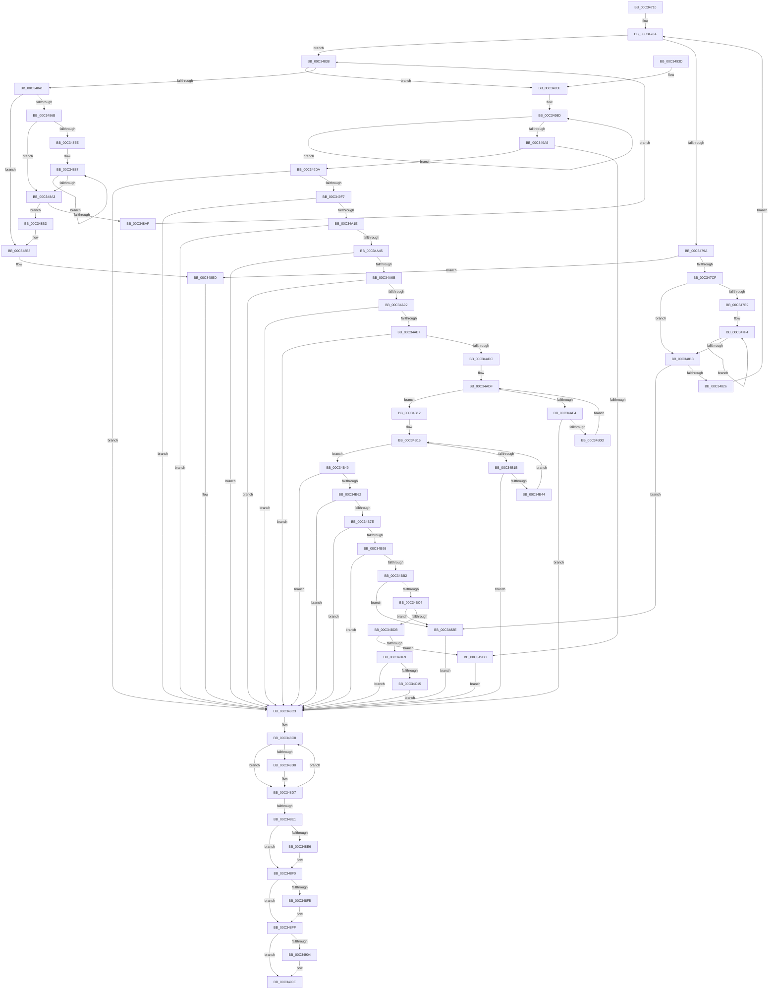

# PiAuCreateStandardSecurityObject

- RVA: `0x00C34710`–`0x00C34C24` (길이 `1,300` bytes)
- VA: `0x0000000140C34710`
- 실행 섹션: `INIT`
- PDB 이름 있음: `예`; PDB Function 태그: `아니요`
- unwind 정보 RVA: `0x000C8A0C`
- 디코드: `341`개 명령, `1,300/1,300` bytes 표시
- 미해석 바이트: `0` (있으면 어셈블리에 `.byte`로 보존)

> 이 문서는 커널 이미지의 기계어와 PDB 기호를 분석해 생성했습니다. 4번과 5번은 함수 원형과 자료형을 바이너리 사용 방식에서 추정한 C 해석이며 원본 소스 복구 결과는 아닙니다.

## 1. Dependencies

- 직접 호출 지점: **28**; 고유 호출 대상: **16**
- 직접 호출자로 확인된 함수: **1**
- RIP 상대 이미지 참조: **3**

### Outgoing calls
- `0x00C34777` → [memset](../../text/6C/memset_function_006C6C40.md) (function, `0x006C6C40`)
- `0x00C347C0` → [PiAuAllocateAndInitializeSid](../../page/73/PiAuAllocateAndInitializeSid_function_00731200.md) (function, `0x00731200`)
- `0x00C34817` → [RtlValidSid](../../page/92/RtlValidSid_function_00929710.md) (function, `0x00929710`)
- `0x00C34860` → [PiAuAllocateAndInitializeSid](../../page/73/PiAuAllocateAndInitializeSid_function_00731200.md) (function, `0x00731200`)
- `0x00C348A6` → [RtlValidSid](../../page/92/RtlValidSid_function_00929710.md) (function, `0x00929710`)
- `0x00C348D2` → [ExFreePoolWithTag](../../poolcode/B8/ExFreePoolWithTag_function_00B82870.md) (function, `0x00B82870`)
- `0x00C348EB` → [ExFreePoolWithTag](../../poolcode/B8/ExFreePoolWithTag_function_00B82870.md) (function, `0x00B82870`)
- `0x00C348FA` → [ExFreePoolWithTag](../../poolcode/B8/ExFreePoolWithTag_function_00B82870.md) (function, `0x00B82870`)
- `0x00C34909` → [ExFreePoolWithTag](../../poolcode/B8/ExFreePoolWithTag_function_00B82870.md) (function, `0x00B82870`)
- `0x00C34917` → [_security_check_cookie](../../text/6A/_security_check_cookie_function_006AC640.md) (function, `0x006AC640`)
- `0x00C349C3` → [ExAllocatePool2](../../poolcode/B8/ExAllocatePool2_function_00B820F0.md) (function, `0x00B820F0`)
- `0x00C349E8` → [RtlCreateAcl](../../page/91/RtlCreateAcl_function_00916F00.md) (function, `0x00916F00`)
- `0x00C34A0F` → [RtlAddAccessAllowedAceEx](../../page/92/RtlAddAccessAllowedAceEx_function_009279D0.md) (function, `0x009279D0`)
- `0x00C34A36` → [RtlAddAccessDeniedAceEx](../../page/78/RtlAddAccessDeniedAceEx_function_0078D180.md) (function, `0x0078D180`)
- `0x00C34A5C` → [RtlAddAccessAllowedAceEx](../../page/92/RtlAddAccessAllowedAceEx_function_009279D0.md) (function, `0x009279D0`)
- `0x00C34A83` → [RtlAddAccessAllowedAceEx](../../page/92/RtlAddAccessAllowedAceEx_function_009279D0.md) (function, `0x009279D0`)
- `0x00C34AA8` → [RtlAddAccessAllowedAceEx](../../page/92/RtlAddAccessAllowedAceEx_function_009279D0.md) (function, `0x009279D0`)
- `0x00C34ACD` → [RtlAddAccessAllowedAceEx](../../page/92/RtlAddAccessAllowedAceEx_function_009279D0.md) (function, `0x009279D0`)
- `0x00C34AFE` → [RtlAddAccessAllowedAceEx](../../page/92/RtlAddAccessAllowedAceEx_function_009279D0.md) (function, `0x009279D0`)
- `0x00C34B35` → [RtlAddAccessAllowedAceEx](../../page/92/RtlAddAccessAllowedAceEx_function_009279D0.md) (function, `0x009279D0`)
- `0x00C34B53` → [RtlCreateSecurityDescriptor](../../page/9F/RtlCreateSecurityDescriptor_function_009F1DF0.md) (function, `0x009F1DF0`)
- `0x00C34B6F` → [RtlSetDaclSecurityDescriptor](../../page/9E/RtlSetDaclSecurityDescriptor_function_009EC210.md) (function, `0x009EC210`)
- `0x00C34B89` → [RtlSetOwnerSecurityDescriptor](../../page/91/RtlSetOwnerSecurityDescriptor_function_00916F90.md) (function, `0x00916F90`)
- `0x00C34BA3` → [RtlSetGroupSecurityDescriptor](../../page/A2/RtlSetGroupSecurityDescriptor_function_00A2EB10.md) (function, `0x00A2EB10`)
- `0x00C34BB7` → [RtlValidSecurityDescriptor](../../page/8B/RtlValidSecurityDescriptor_function_008BD3F0.md) (function, `0x008BD3F0`)
- `0x00C34BC9` → [RtlLengthSecurityDescriptor](../../page/8B/RtlLengthSecurityDescriptor_function_008BC870.md) (function, `0x008BC870`)
- `0x00C34BE8` → [ExAllocatePool2](../../poolcode/B8/ExAllocatePool2_function_00B820F0.md) (function, `0x00B820F0`)
- `0x00C34C06` → [RtlAbsoluteToSelfRelativeSD](../../page/A1/RtlAbsoluteToSelfRelativeSD_function_00A119B0.md) (function, `0x00A119B0`)

### Direct callers
- [IopInitializePlugPlayServices](../C2/IopInitializePlugPlayServices_function_00C2F298.md) at `0x00C2F91D`

### Static image references
- `0x00C34733` → RVA `0x00E0A740` (`.data`; read)
- `0x00C3478A` → RVA `0x00000000` (`image boundary/outside`; read)
- `0x00C34C15` → RVA `0x00E663A8` (`.data`; write)

## 2. Other-region calls and transfers

- 다른 실행 섹션으로 향하는 call: **28**
  - `0x00C34777` → [memset](../../text/6C/memset_function_006C6C40.md) (`INIT` → `.text`)
  - `0x00C347C0` → [PiAuAllocateAndInitializeSid](../../page/73/PiAuAllocateAndInitializeSid_function_00731200.md) (`INIT` → `PAGE`)
  - `0x00C34817` → [RtlValidSid](../../page/92/RtlValidSid_function_00929710.md) (`INIT` → `PAGE`)
  - `0x00C34860` → [PiAuAllocateAndInitializeSid](../../page/73/PiAuAllocateAndInitializeSid_function_00731200.md) (`INIT` → `PAGE`)
  - `0x00C348A6` → [RtlValidSid](../../page/92/RtlValidSid_function_00929710.md) (`INIT` → `PAGE`)
  - `0x00C348D2` → [ExFreePoolWithTag](../../poolcode/B8/ExFreePoolWithTag_function_00B82870.md) (`INIT` → `POOLCODE`)
  - `0x00C348EB` → [ExFreePoolWithTag](../../poolcode/B8/ExFreePoolWithTag_function_00B82870.md) (`INIT` → `POOLCODE`)
  - `0x00C348FA` → [ExFreePoolWithTag](../../poolcode/B8/ExFreePoolWithTag_function_00B82870.md) (`INIT` → `POOLCODE`)
  - `0x00C34909` → [ExFreePoolWithTag](../../poolcode/B8/ExFreePoolWithTag_function_00B82870.md) (`INIT` → `POOLCODE`)
  - `0x00C34917` → [_security_check_cookie](../../text/6A/_security_check_cookie_function_006AC640.md) (`INIT` → `.text`)
  - `0x00C349C3` → [ExAllocatePool2](../../poolcode/B8/ExAllocatePool2_function_00B820F0.md) (`INIT` → `POOLCODE`)
  - `0x00C349E8` → [RtlCreateAcl](../../page/91/RtlCreateAcl_function_00916F00.md) (`INIT` → `PAGE`)
  - `0x00C34A0F` → [RtlAddAccessAllowedAceEx](../../page/92/RtlAddAccessAllowedAceEx_function_009279D0.md) (`INIT` → `PAGE`)
  - `0x00C34A36` → [RtlAddAccessDeniedAceEx](../../page/78/RtlAddAccessDeniedAceEx_function_0078D180.md) (`INIT` → `PAGE`)
  - `0x00C34A5C` → [RtlAddAccessAllowedAceEx](../../page/92/RtlAddAccessAllowedAceEx_function_009279D0.md) (`INIT` → `PAGE`)
  - `0x00C34A83` → [RtlAddAccessAllowedAceEx](../../page/92/RtlAddAccessAllowedAceEx_function_009279D0.md) (`INIT` → `PAGE`)
  - `0x00C34AA8` → [RtlAddAccessAllowedAceEx](../../page/92/RtlAddAccessAllowedAceEx_function_009279D0.md) (`INIT` → `PAGE`)
  - `0x00C34ACD` → [RtlAddAccessAllowedAceEx](../../page/92/RtlAddAccessAllowedAceEx_function_009279D0.md) (`INIT` → `PAGE`)
  - `0x00C34AFE` → [RtlAddAccessAllowedAceEx](../../page/92/RtlAddAccessAllowedAceEx_function_009279D0.md) (`INIT` → `PAGE`)
  - `0x00C34B35` → [RtlAddAccessAllowedAceEx](../../page/92/RtlAddAccessAllowedAceEx_function_009279D0.md) (`INIT` → `PAGE`)
  - `0x00C34B53` → [RtlCreateSecurityDescriptor](../../page/9F/RtlCreateSecurityDescriptor_function_009F1DF0.md) (`INIT` → `PAGE`)
  - `0x00C34B6F` → [RtlSetDaclSecurityDescriptor](../../page/9E/RtlSetDaclSecurityDescriptor_function_009EC210.md) (`INIT` → `PAGE`)
  - `0x00C34B89` → [RtlSetOwnerSecurityDescriptor](../../page/91/RtlSetOwnerSecurityDescriptor_function_00916F90.md) (`INIT` → `PAGE`)
  - `0x00C34BA3` → [RtlSetGroupSecurityDescriptor](../../page/A2/RtlSetGroupSecurityDescriptor_function_00A2EB10.md) (`INIT` → `PAGE`)
  - `0x00C34BB7` → [RtlValidSecurityDescriptor](../../page/8B/RtlValidSecurityDescriptor_function_008BD3F0.md) (`INIT` → `PAGE`)
  - `0x00C34BC9` → [RtlLengthSecurityDescriptor](../../page/8B/RtlLengthSecurityDescriptor_function_008BC870.md) (`INIT` → `PAGE`)
  - `0x00C34BE8` → [ExAllocatePool2](../../poolcode/B8/ExAllocatePool2_function_00B820F0.md) (`INIT` → `POOLCODE`)
  - `0x00C34C06` → [RtlAbsoluteToSelfRelativeSD](../../page/A1/RtlAbsoluteToSelfRelativeSD_function_00A119B0.md) (`INIT` → `PAGE`)
- 별도 외부 분기/꼬리 이동을 확인하지 못했습니다.

## 3. Assembly (complete function range)

```asm
00C34710  48 8B C4                        mov rax, rsp
00C34713  48 89 58 10                     mov qword ptr [rax + 0x10], rbx
00C34717  48 89 70 18                     mov qword ptr [rax + 0x18], rsi
00C3471B  48 89 78 20                     mov qword ptr [rax + 0x20], rdi
00C3471F  55                              push rbp
00C34720  41 54                           push r12
00C34722  41 55                           push r13
00C34724  41 56                           push r14
00C34726  41 57                           push r15
00C34728  48 8D 68 88                     lea rbp, [rax - 0x78]
00C3472C  48 81 EC 50 01 00 00            sub rsp, 0x150
00C34733  48 8B 05 06 60 1D 00            mov rax, qword ptr [rip + 0x1d6006]
00C3473A  48 33 C4                        xor rax, rsp
00C3473D  48 89 45 40                     mov qword ptr [rbp + 0x40], rax
00C34741  33 FF                           xor edi, edi
00C34743  66 C7 44 24 34 00 05            mov word ptr [rsp + 0x34], 0x500
00C3474A  0F 57 C0                        xorps xmm0, xmm0
00C3474D  89 7C 24 30                     mov dword ptr [rsp + 0x30], edi
00C34751  4C 8B F1                        mov r14, rcx
00C34754  33 C0                           xor eax, eax
00C34756  48 8D 4C 24 70                  lea rcx, [rsp + 0x70]
00C3475B  48 89 44 24 68                  mov qword ptr [rsp + 0x68], rax
00C34760  33 D2                           xor edx, edx
00C34762  41 B8 C8 00 00 00               mov r8d, 0xc8
00C34768  8B F7                           mov esi, edi
00C3476A  44 8B E7                        mov r12d, edi
00C3476D  0F 11 44 24 48                  movups xmmword ptr [rsp + 0x48], xmm0
00C34772  0F 11 44 24 58                  movups xmmword ptr [rsp + 0x58], xmm0
00C34777  E8 C4 24 A9 FF                  call 0x1406c6c40
00C3477C  8B DF                           mov ebx, edi
00C3477E  44 8D 6F 19                     lea r13d, [rdi + 0x19]
00C34782  48 89 5C 24 38                  mov qword ptr [rsp + 0x38], rbx
00C34787  44 8B FF                        mov r15d, edi
00C3478A  48 8D 3D 6F B8 3C FF            lea rdi, [rip - 0xc34791]
00C34791  45 3B FD                        cmp r15d, r13d
00C34794  0F 83 9E 00 00 00               jae 0x140c34838
00C3479A  41 8B CF                        mov ecx, r15d
00C3479D  4C 8D 6C 24 70                  lea r13, [rsp + 0x70]
00C347A2  48 6B C1 1C                     imul rax, rcx, 0x1c
00C347A6  4D 8D 6C CD 00                  lea r13, [r13 + rcx*8]
00C347AB  48 8D 54 24 30                  lea rdx, [rsp + 0x30]
00C347B0  48 89 44 24 40                  mov qword ptr [rsp + 0x40], rax
00C347B5  49 8B CD                        mov rcx, r13
00C347B8  44 8B 84 38 50 81 02 00         mov r8d, dword ptr [rax + rdi + 0x28150]
00C347C0  E8 3B CA AF FF                  call 0x140731200
00C347C5  8B F8                           mov edi, eax
00C347C7  85 C0                           test eax, eax
00C347C9  0F 88 EE 00 00 00               js 0x140c348bd
00C347CF  4C 8B 44 24 40                  mov r8, qword ptr [rsp + 0x40]
00C347D4  4C 8D 1D 25 B8 3C FF            lea r11, [rip - 0xc347db]
00C347DB  33 FF                           xor edi, edi
00C347DD  8B D7                           mov edx, edi
00C347DF  43 39 BC 18 50 81 02 00         cmp dword ptr [r8 + r11 + 0x28150], edi
00C347E7  76 2A                           jbe 0x140c34813
00C347E9  4D 8B 4D 00                     mov r9, qword ptr [r13]
00C347ED  41 8B C7                        mov eax, r15d
00C347F0  4C 6B D0 07                     imul r10, rax, 7
00C347F4  8B CA                           mov ecx, edx
00C347F6  FF C2                           inc edx
00C347F8  49 8D 04 0A                     lea rax, [r10 + rcx]
00C347FC  41 8B 84 83 54 81 02 00         mov eax, dword ptr [r11 + rax*4 + 0x28154]
00C34804  41 89 44 89 08                  mov dword ptr [r9 + rcx*4 + 8], eax
00C34809  43 3B 94 18 50 81 02 00         cmp edx, dword ptr [r8 + r11 + 0x28150]
00C34811  72 E1                           jb 0x140c347f4
00C34813  49 8B 4D 00                     mov rcx, qword ptr [r13]
00C34817  E8 F4 4E CF FF                  call 0x140929710
00C3481C  41 BD 19 00 00 00               mov r13d, 0x19
00C34822  84 C0                           test al, al
00C34824  74 08                           je 0x140c3482e
00C34826  41 FF C7                        inc r15d
00C34829  E9 5C FF FF FF                  jmp 0x140c3478a
00C3482E  BF E5 00 00 C0                  mov edi, 0xc00000e5
00C34833  E9 8B 00 00 00                  jmp 0x140c348c3
00C34838  83 FB 01                        cmp ebx, 1
00C3483B  0F 83 FD 00 00 00               jae 0x140c3493e
00C34841  8B C3                           mov eax, ebx
00C34843  4C 8D 7C 24 38                  lea r15, [rsp + 0x38]
00C34848  4C 6B E8 1C                     imul r13, rax, 0x1c
00C3484C  4D 8D 3C DF                     lea r15, [r15 + rbx*8]
00C34850  48 8D 54 24 30                  lea rdx, [rsp + 0x30]
00C34855  49 8B CF                        mov rcx, r15
00C34858  46 8B 84 2F 10 84 02 00         mov r8d, dword ptr [rdi + r13 + 0x28410]
00C34860  E8 9B C9 AF FF                  call 0x140731200
00C34865  8B F8                           mov edi, eax
00C34867  85 C0                           test eax, eax
00C34869  78 4D                           js 0x140c348b8
00C3486B  33 D2                           xor edx, edx
00C3486D  48 8D 3D 8C B7 3C FF            lea rdi, [rip - 0xc34874]
00C34874  42 39 94 2F 10 84 02 00         cmp dword ptr [rdi + r13 + 0x28410], edx
00C3487C  76 25                           jbe 0x140c348a3
00C3487E  4D 8B 07                        mov r8, qword ptr [r15]
00C34881  8B C3                           mov eax, ebx
00C34883  4C 6B C8 07                     imul r9, rax, 7
00C34887  49 8D 04 11                     lea rax, [r9 + rdx]
00C3488B  8B 84 87 14 84 02 00            mov eax, dword ptr [rdi + rax*4 + 0x28414]
00C34892  41 89 44 90 08                  mov dword ptr [r8 + rdx*4 + 8], eax
00C34897  FF C2                           inc edx
00C34899  42 3B 94 2F 10 84 02 00         cmp edx, dword ptr [rdi + r13 + 0x28410]
00C348A1  72 E4                           jb 0x140c34887
00C348A3  49 8B 0F                        mov rcx, qword ptr [r15]
00C348A6  E8 65 4E CF FF                  call 0x140929710
00C348AB  84 C0                           test al, al
00C348AD  74 04                           je 0x140c348b3
00C348AF  FF C3                           inc ebx
00C348B1  EB 85                           jmp 0x140c34838
00C348B3  BF E5 00 00 C0                  mov edi, 0xc00000e5
00C348B8  48 8B 5C 24 38                  mov rbx, qword ptr [rsp + 0x38]
00C348BD  41 BD 19 00 00 00               mov r13d, 0x19
00C348C3  4C 8D 74 24 70                  lea r14, [rsp + 0x70]
00C348C8  49 8B 0E                        mov rcx, qword ptr [r14]
00C348CB  48 85 C9                        test rcx, rcx
00C348CE  74 07                           je 0x140c348d7
00C348D0  33 D2                           xor edx, edx
00C348D2  E8 99 DF F4 FF                  call 0x140b82870
00C348D7  49 83 C6 08                     add r14, 8
00C348DB  49 83 ED 01                     sub r13, 1
00C348DF  75 E7                           jne 0x140c348c8
00C348E1  48 85 DB                        test rbx, rbx
00C348E4  74 0A                           je 0x140c348f0
00C348E6  33 D2                           xor edx, edx
00C348E8  48 8B CB                        mov rcx, rbx
00C348EB  E8 80 DF F4 FF                  call 0x140b82870
00C348F0  48 85 F6                        test rsi, rsi
00C348F3  74 0A                           je 0x140c348ff
00C348F5  33 D2                           xor edx, edx
00C348F7  48 8B CE                        mov rcx, rsi
00C348FA  E8 71 DF F4 FF                  call 0x140b82870
00C348FF  4D 85 E4                        test r12, r12
00C34902  74 0A                           je 0x140c3490e
00C34904  33 D2                           xor edx, edx
00C34906  49 8B CC                        mov rcx, r12
00C34909  E8 62 DF F4 FF                  call 0x140b82870
00C3490E  8B C7                           mov eax, edi
00C34910  48 8B 4D 40                     mov rcx, qword ptr [rbp + 0x40]
00C34914  48 33 CC                        xor rcx, rsp
00C34917  E8 24 7D A7 FF                  call 0x1406ac640
00C3491C  4C 8D 9C 24 50 01 00 00         lea r11, [rsp + 0x150]
00C34924  49 8B 5B 38                     mov rbx, qword ptr [r11 + 0x38]
00C34928  49 8B 73 40                     mov rsi, qword ptr [r11 + 0x40]
00C3492C  49 8B 7B 48                     mov rdi, qword ptr [r11 + 0x48]
00C34930  49 8B E3                        mov rsp, r11
00C34933  41 5F                           pop r15
00C34935  41 5E                           pop r14
00C34937  41 5D                           pop r13
00C34939  41 5C                           pop r12
00C3493B  5D                              pop rbp
00C3493C  C3                              ret
00C3493D  CC                              int3
00C3493E  49 8B 46 30                     mov rax, qword ptr [r14 + 0x30]
00C34942  41 BD 19 00 00 00               mov r13d, 0x19
00C34948  45 8B CD                        mov r9d, r13d
00C3494B  0F B6 50 01                     movzx edx, byte ptr [rax + 1]
00C3494F  49 8B 06                        mov rax, qword ptr [r14]
00C34952  0F B6 48 01                     movzx ecx, byte ptr [rax + 1]
00C34956  49 8B 46 10                     mov rax, qword ptr [r14 + 0x10]
00C3495A  03 D1                           add edx, ecx
00C3495C  0F B6 48 01                     movzx ecx, byte ptr [rax + 1]
00C34960  49 8B 46 18                     mov rax, qword ptr [r14 + 0x18]
00C34964  03 D1                           add edx, ecx
00C34966  0F B6 48 01                     movzx ecx, byte ptr [rax + 1]
00C3496A  49 8B 46 20                     mov rax, qword ptr [r14 + 0x20]
00C3496E  03 D1                           add edx, ecx
00C34970  0F B6 48 01                     movzx ecx, byte ptr [rax + 1]
00C34974  49 8B 46 28                     mov rax, qword ptr [r14 + 0x28]
00C34978  03 D1                           add edx, ecx
00C3497A  0F B6 48 01                     movzx ecx, byte ptr [rax + 1]
00C3497E  03 D1                           add edx, ecx
00C34980  44 8D 04 95 68 00 00 00         lea r8d, [rdx*4 + 0x68]
00C34988  48 8D 54 24 70                  lea rdx, [rsp + 0x70]
00C3498D  48 8B 02                        mov rax, qword ptr [rdx]
00C34990  48 8D 52 08                     lea rdx, [rdx + 8]
00C34994  0F B6 48 01                     movzx ecx, byte ptr [rax + 1]
00C34998  45 8D 04 88                     lea r8d, [r8 + rcx*4]
00C3499C  45 8D 40 10                     lea r8d, [r8 + 0x10]
00C349A0  49 83 E9 01                     sub r9, 1
00C349A4  75 E7                           jne 0x140c3498d
00C349A6  48 8B 5C 24 38                  mov rbx, qword ptr [rsp + 0x38]
00C349AB  B9 00 01 00 00                  mov ecx, 0x100
00C349B0  0F B6 43 01                     movzx eax, byte ptr [rbx + 1]
00C349B4  83 C0 04                        add eax, 4
00C349B7  41 8D 3C 80                     lea edi, [r8 + rax*4]
00C349BB  41 B8 50 70 20 20               mov r8d, 0x20207050
00C349C1  8B D7                           mov edx, edi
00C349C3  E8 28 D7 F4 FF                  call 0x140b820f0
00C349C8  48 8B F0                        mov rsi, rax
00C349CB  48 85 C0                        test rax, rax
00C349CE  75 0A                           jne 0x140c349da
00C349D0  BF 9A 00 00 C0                  mov edi, 0xc000009a
00C349D5  E9 E9 FE FF FF                  jmp 0x140c348c3
00C349DA  41 BF 02 00 00 00               mov r15d, 2
00C349E0  8B D7                           mov edx, edi
00C349E2  45 8B C7                        mov r8d, r15d
00C349E5  48 8B CE                        mov rcx, rsi
00C349E8  E8 13 25 CE FF                  call 0x140916f00
00C349ED  8B F8                           mov edi, eax
00C349EF  85 C0                           test eax, eax
00C349F1  0F 88 CC FE FF FF               js 0x140c348c3
00C349F7  49 8B 46 10                     mov rax, qword ptr [r14 + 0x10]
00C349FB  41 B9 E7 01 02 00               mov r9d, 0x201e7
00C34A01  45 33 C0                        xor r8d, r8d
00C34A04  48 89 44 24 20                  mov qword ptr [rsp + 0x20], rax
00C34A09  41 8B D7                        mov edx, r15d
00C34A0C  48 8B CE                        mov rcx, rsi
00C34A0F  E8 BC 2F CF FF                  call 0x1409279d0
00C34A14  8B F8                           mov edi, eax
00C34A16  85 C0                           test eax, eax
00C34A18  0F 88 A5 FE FF FF               js 0x140c348c3
00C34A1E  49 8B 46 18                     mov rax, qword ptr [r14 + 0x18]
00C34A22  41 B9 FF 01 0F 00               mov r9d, 0xf01ff
00C34A28  45 33 C0                        xor r8d, r8d
00C34A2B  48 89 44 24 20                  mov qword ptr [rsp + 0x20], rax
00C34A30  41 8B D7                        mov edx, r15d
00C34A33  48 8B CE                        mov rcx, rsi
00C34A36  E8 45 87 B5 FF                  call 0x14078d180
00C34A3B  8B F8                           mov edi, eax
00C34A3D  85 C0                           test eax, eax
00C34A3F  0F 88 7E FE FF FF               js 0x140c348c3
00C34A45  49 8B 06                        mov rax, qword ptr [r14]
00C34A48  41 B9 FF 01 0F 00               mov r9d, 0xf01ff
00C34A4E  45 33 C0                        xor r8d, r8d
00C34A51  48 89 44 24 20                  mov qword ptr [rsp + 0x20], rax
00C34A56  41 8B D7                        mov edx, r15d
00C34A59  48 8B CE                        mov rcx, rsi
00C34A5C  E8 6F 2F CF FF                  call 0x1409279d0
00C34A61  8B F8                           mov edi, eax
00C34A63  85 C0                           test eax, eax
00C34A65  0F 88 58 FE FF FF               js 0x140c348c3
00C34A6B  49 8B 46 20                     mov rax, qword ptr [r14 + 0x20]
00C34A6F  41 B9 25 01 02 00               mov r9d, 0x20125
00C34A75  45 33 C0                        xor r8d, r8d
00C34A78  48 89 44 24 20                  mov qword ptr [rsp + 0x20], rax
00C34A7D  41 8B D7                        mov edx, r15d
00C34A80  48 8B CE                        mov rcx, rsi
00C34A83  E8 48 2F CF FF                  call 0x1409279d0
00C34A88  8B F8                           mov edi, eax
00C34A8A  85 C0                           test eax, eax
00C34A8C  0F 88 31 FE FF FF               js 0x140c348c3
00C34A92  49 8B 46 28                     mov rax, qword ptr [r14 + 0x28]
00C34A96  45 8D 4F 3E                     lea r9d, [r15 + 0x3e]
00C34A9A  45 33 C0                        xor r8d, r8d
00C34A9D  48 89 44 24 20                  mov qword ptr [rsp + 0x20], rax
00C34AA2  41 8B D7                        mov edx, r15d
00C34AA5  48 8B CE                        mov rcx, rsi
00C34AA8  E8 23 2F CF FF                  call 0x1409279d0
00C34AAD  8B F8                           mov edi, eax
00C34AAF  85 C0                           test eax, eax
00C34AB1  0F 88 0C FE FF FF               js 0x140c348c3
00C34AB7  49 8B 46 30                     mov rax, qword ptr [r14 + 0x30]
00C34ABB  45 8D 4F 3E                     lea r9d, [r15 + 0x3e]
00C34ABF  45 33 C0                        xor r8d, r8d
00C34AC2  48 89 44 24 20                  mov qword ptr [rsp + 0x20], rax
00C34AC7  41 8B D7                        mov edx, r15d
00C34ACA  48 8B CE                        mov rcx, rsi
00C34ACD  E8 FE 2E CF FF                  call 0x1409279d0
00C34AD2  8B F8                           mov edi, eax
00C34AD4  85 C0                           test eax, eax
00C34AD6  0F 88 E7 FD FF FF               js 0x140c348c3
00C34ADC  45 33 FF                        xor r15d, r15d
00C34ADF  45 3B FD                        cmp r15d, r13d
00C34AE2  73 2E                           jae 0x140c34b12
00C34AE4  4A 8B 4C FC 70                  mov rcx, qword ptr [rsp + r15*8 + 0x70]
00C34AE9  41 B9 80 00 00 00               mov r9d, 0x80
00C34AEF  48 89 4C 24 20                  mov qword ptr [rsp + 0x20], rcx
00C34AF4  45 33 C0                        xor r8d, r8d
00C34AF7  48 8B CE                        mov rcx, rsi
00C34AFA  41 8D 51 82                     lea edx, [r9 - 0x7e]
00C34AFE  E8 CD 2E CF FF                  call 0x1409279d0
00C34B03  8B F8                           mov edi, eax
00C34B05  85 C0                           test eax, eax
00C34B07  0F 88 B6 FD FF FF               js 0x140c348c3
00C34B0D  41 FF C7                        inc r15d
00C34B10  EB CD                           jmp 0x140c34adf
00C34B12  45 33 FF                        xor r15d, r15d
00C34B15  41 83 FF 01                     cmp r15d, 1
00C34B19  73 2E                           jae 0x140c34b49
00C34B1B  4A 8B 4C FC 38                  mov rcx, qword ptr [rsp + r15*8 + 0x38]
00C34B20  41 B9 40 00 00 00               mov r9d, 0x40
00C34B26  48 89 4C 24 20                  mov qword ptr [rsp + 0x20], rcx
00C34B2B  45 33 C0                        xor r8d, r8d
00C34B2E  48 8B CE                        mov rcx, rsi
00C34B31  41 8D 51 C2                     lea edx, [r9 - 0x3e]
00C34B35  E8 96 2E CF FF                  call 0x1409279d0
00C34B3A  8B F8                           mov edi, eax
00C34B3C  85 C0                           test eax, eax
00C34B3E  0F 88 7F FD FF FF               js 0x140c348c3
00C34B44  41 FF C7                        inc r15d
00C34B47  EB CC                           jmp 0x140c34b15
00C34B49  BA 01 00 00 00                  mov edx, 1
00C34B4E  48 8D 4C 24 48                  lea rcx, [rsp + 0x48]
00C34B53  E8 98 D2 DB FF                  call 0x1409f1df0
00C34B58  8B F8                           mov edi, eax
00C34B5A  85 C0                           test eax, eax
00C34B5C  0F 88 61 FD FF FF               js 0x140c348c3
00C34B62  45 33 C9                        xor r9d, r9d
00C34B65  48 8D 4C 24 48                  lea rcx, [rsp + 0x48]
00C34B6A  4C 8B C6                        mov r8, rsi
00C34B6D  B2 01                           mov dl, 1
00C34B6F  E8 9C 76 DB FF                  call 0x1409ec210
00C34B74  8B F8                           mov edi, eax
00C34B76  85 C0                           test eax, eax
00C34B78  0F 88 45 FD FF FF               js 0x140c348c3
00C34B7E  49 8B 16                        mov rdx, qword ptr [r14]
00C34B81  48 8D 4C 24 48                  lea rcx, [rsp + 0x48]
00C34B86  45 33 C0                        xor r8d, r8d
00C34B89  E8 02 24 CE FF                  call 0x140916f90
00C34B8E  8B F8                           mov edi, eax
00C34B90  85 C0                           test eax, eax
00C34B92  0F 88 2B FD FF FF               js 0x140c348c3
00C34B98  49 8B 16                        mov rdx, qword ptr [r14]
00C34B9B  48 8D 4C 24 48                  lea rcx, [rsp + 0x48]
00C34BA0  45 33 C0                        xor r8d, r8d
00C34BA3  E8 68 9F DF FF                  call 0x140a2eb10
00C34BA8  8B F8                           mov edi, eax
00C34BAA  85 C0                           test eax, eax
00C34BAC  0F 88 11 FD FF FF               js 0x140c348c3
00C34BB2  48 8D 4C 24 48                  lea rcx, [rsp + 0x48]
00C34BB7  E8 34 88 C8 FF                  call 0x1408bd3f0
00C34BBC  84 C0                           test al, al
00C34BBE  0F 84 6A FC FF FF               je 0x140c3482e
00C34BC4  48 8D 4C 24 48                  lea rcx, [rsp + 0x48]
00C34BC9  E8 A2 7C C8 FF                  call 0x1408bc870
00C34BCE  89 44 24 30                     mov dword ptr [rsp + 0x30], eax
00C34BD2  83 F8 28                        cmp eax, 0x28
00C34BD5  0F 82 53 FC FF FF               jb 0x140c3482e
00C34BDB  8B D0                           mov edx, eax
00C34BDD  B9 00 01 00 00                  mov ecx, 0x100
00C34BE2  41 B8 50 70 20 20               mov r8d, 0x20207050
00C34BE8  E8 03 D5 F4 FF                  call 0x140b820f0
00C34BED  4C 8B E0                        mov r12, rax
00C34BF0  48 85 C0                        test rax, rax
00C34BF3  0F 84 D7 FD FF FF               je 0x140c349d0
00C34BF9  4C 8D 44 24 30                  lea r8, [rsp + 0x30]
00C34BFE  48 8B D0                        mov rdx, rax
00C34C01  48 8D 4C 24 48                  lea rcx, [rsp + 0x48]
00C34C06  E8 A5 CD DD FF                  call 0x140a119b0
00C34C0B  8B F8                           mov edi, eax
00C34C0D  85 C0                           test eax, eax
00C34C0F  0F 88 AE FC FF FF               js 0x140c348c3
00C34C15  4C 89 25 8C 17 23 00            mov qword ptr [rip + 0x23178c], r12
00C34C1C  45 33 E4                        xor r12d, r12d
00C34C1F  E9 9F FC FF FF                  jmp 0x140c348c3
```

## 4. C-style interpretation (structured pseudocode)

```c
__int64 __fastcall PiAuCreateStandardSecurityObject(__int64 a1, int a2)
{
    __int64 result;
    __int64 v_r10;
    __int64 v_r12;
    __int64 v_r13;
    __int64 v_r14;
    __int64 v_r15;
    __int64 v_rbx;
    __int64 v_rdi;
    __int64 v_rsp;
    unsigned __int64 v_stack_m108;
    unsigned __int64 v_stack_m110;
    unsigned __int64 v_stack_m118;
    unsigned __int64 v_stack_m120;
    unsigned __int64 v_stack_m130;
    unsigned __int64 v_stack_m138;
    unsigned __int64 v_stack_m140;
    unsigned __int16 v_stack_m144;
    unsigned int v_stack_m148;
    unsigned __int64 v_stack_m28;
    unsigned __int64 v_stack_mE0;

    *(unsigned __int64 *)(v_rsp + 16) = v_rbx;
    *(unsigned __int64 *)(v_rsp + 24) = v_rsi;
    *(unsigned __int64 *)(v_rsp + 32) = v_rdi;
    v_rsp = (v_rsp) - (336);
    result = (*(unsigned __int64 *)(v_rip + 1925126)) ^ (v_rsp);
    *(unsigned __int64 *)(v_rsp - 120 + 64) = result;
    v_rdi = 0;
    v_stack_m144 = 0x500ULL;
    v_stack_m148 = 0;
    result = 0;
    v_stack_m110 = 0;
    a2 = 0;
    v_stack_m130 = v_xmm0;
    v_stack_m120 = v_xmm0;
    result = memset(v_stack_m108, a2, 200, a4);
    v_stack_m140 = 0;
loc_00C3478A:
    if (0 >= ((unsigned int)(v_rdi + 25))) goto loc_00C34838;
    result = (result) * (0);
    v_stack_m138 = result;
    result = PiAuAllocateAndInitializeSid(v_stack_m108 + 0 * 8, v_stack_m148, (unsigned int)(*(unsigned int *)(result + v_rip - 12797841 * 1 + 164176)), a4);
    if (sign_flag) goto loc_00C348BD;
    v_rdi = 0;
    if ((*(unsigned int *)(v_stack_m138 + v_rip - 12797915 * 1 + 164176)) <= 0) goto loc_00C34813;
    v_r10 = (v_r10) * (0);
loc_00C347F4:
    a2 = (unsigned int)((0) + 1);
    *(unsigned int *)(*(unsigned __int64 *)(v_stack_m108 + 0 * 8) + 0 * 4 + 8) = (unsigned int)((unsigned int)(*(unsigned int *)(v_rip - 12797915 + v_r10 + 0 * 1 * 4 + 164180)));
    if (a2 < (*(unsigned int *)(v_stack_m138 + v_rip - 12797915 * 1 + 164176))) goto loc_00C347F4;
loc_00C34813:
    result = RtlValidSid(*(unsigned __int64 *)(v_stack_m108 + 0 * 8), a2, v_stack_m138, *(unsigned __int64 *)(v_stack_m108 + 0 * 8));
    if ((unsigned __int8)(result) == 0) goto loc_00C3482E;
    v_r15 = (unsigned int)((0) + 1);
    goto loc_00C3478A;
loc_00C3482E:
    goto loc_00C348C3;
loc_00C34838:
    if (0 >= 1) goto loc_00C3493E;
    v_r13 = (25) * (0);
    result = PiAuAllocateAndInitializeSid(v_stack_m140 + 0 * 8, v_stack_m148, (unsigned int)(*(unsigned int *)((unsigned int)(0xC00000E5ULL) + v_r13 * 1 + 164880)), *(unsigned __int64 *)(v_stack_m108 + 0 * 8));
    if (sign_flag) goto loc_00C348B8;
    a2 = 0;
    if ((*(unsigned int *)(v_rip - 12798068 + v_r13 * 1 + 164880)) <= 0) goto loc_00C348A3;
    a4 = (*(unsigned __int64 *)(v_stack_m108 + 0 * 8)) * (0);
loc_00C34887:
    *(unsigned int *)(*(unsigned __int64 *)(v_stack_m140 + 0 * 8) + a2 * 4 + 8) = (unsigned int)((unsigned int)(*(unsigned int *)(v_rip - 12798068 + a4 + a2 * 1 * 4 + 164884)));
    a2 = (unsigned int)((a2) + 1);
    if (a2 < (*(unsigned int *)(v_rip - 12798068 + v_r13 * 1 + 164880))) goto loc_00C34887;
loc_00C348A3:
    result = RtlValidSid(*(unsigned __int64 *)(v_stack_m140 + 0 * 8), a2, *(unsigned __int64 *)(v_stack_m140 + 0 * 8), a4);
    if ((unsigned __int8)(result) == 0) goto loc_00C348B3;
    v_rbx = (unsigned int)((0) + 1);
    goto loc_00C34838;
loc_00C348B3:
loc_00C348B8:
loc_00C348BD:
loc_00C348C3:
loc_00C348C8:
    if (*(unsigned __int64 *)(v_stack_m108) != 0) {
        a2 = 0;
        result = ExFreePoolWithTag(*(unsigned __int64 *)(v_stack_m108), a2, *(unsigned __int64 *)(v_stack_m140 + 0 * 8), a4);
    }
    v_r14 = (v_stack_m108) + (8);
    v_r13 = (25) - (1);
    if (condition_is_not_equal) goto loc_00C348C8;
    if (v_stack_m140 != 0) {
        a2 = 0;
        a1 = v_stack_m140;
        result = ExFreePoolWithTag(a1, a2, *(unsigned __int64 *)(v_stack_m140 + 0 * 8), a4);
    }
    if (0 != 0) {
        a2 = 0;
        a1 = 0;
        result = ExFreePoolWithTag(a1, a2, *(unsigned __int64 *)(v_stack_m140 + 0 * 8), a4);
    }
    if (0 != 0) {
        a2 = 0;
        a1 = 0;
        result = ExFreePoolWithTag(a1, a2, *(unsigned __int64 *)(v_stack_m140 + 0 * 8), a4);
    }
    a1 = (*(unsigned __int64 *)(v_rsp - 120 + 64)) ^ (v_rsp);
    result = _security_check_cookie(a1, a2, *(unsigned __int64 *)(v_stack_m140 + 0 * 8), a4);
    return result;
loc_00C3493E:
    a2 = (unsigned int)((*(unsigned __int8 *)(*(unsigned __int64 *)(v_r14 + 48) + 1)) + ((unsigned int)(*(unsigned __int8 *)(*(unsigned __int64 *)(v_r14) + 1))));
    a2 = (unsigned int)((a2) + ((unsigned int)(*(unsigned __int8 *)(*(unsigned __int64 *)(v_r14 + 16) + 1))));
    a2 = (unsigned int)((a2) + ((unsigned int)(*(unsigned __int8 *)(*(unsigned __int64 *)(v_r14 + 24) + 1))));
    a2 = (unsigned int)((a2) + ((unsigned int)(*(unsigned __int8 *)(*(unsigned __int64 *)(v_r14 + 32) + 1))));
    a2 = (unsigned int)((a2) + ((unsigned int)(*(unsigned __int8 *)(*(unsigned __int64 *)(v_r14 + 40) + 1))));
loc_00C3498D:
    a4 = (25) - (1);
    if (condition_is_not_equal) goto loc_00C3498D;
    result = (unsigned int)((*(unsigned __int8 *)(v_stack_m118 + 1)) + (4));
    result = ExAllocatePool2(256, (unsigned int)((unsigned int)(a2 * 4 + 104 + *(unsigned __int8 *)(*(unsigned __int64 *)(v_stack_mE0) + 1) * 4 + 16 + result * 4)), (unsigned int)(0x20207050ULL), a4);
    if (result != 0) goto loc_00C349DA;
loc_00C349D0:
    goto loc_00C348C3;
loc_00C349DA:
    result = RtlCreateAcl(result, (unsigned int)((unsigned int)((unsigned int)(0xC000009AULL))), 2, a4);
    if (sign_flag) goto loc_00C348C3;
    a3 = 0;
    v_stack_m130 = *(unsigned __int64 *)(v_r14 + 16);
    result = RtlAddAccessAllowedAceEx(result, 2, a3, (unsigned int)(0x201E7ULL));
    if (sign_flag) goto loc_00C348C3;
    a3 = 0;
    v_stack_m130 = *(unsigned __int64 *)(v_r14 + 24);
    result = RtlAddAccessDeniedAceEx(result, 2, a3, (unsigned int)(0xF01FFULL));
    if (sign_flag) goto loc_00C348C3;
    a3 = 0;
    v_stack_m130 = *(unsigned __int64 *)(v_r14);
    result = RtlAddAccessAllowedAceEx(result, 2, a3, (unsigned int)(0xF01FFULL));
    if (sign_flag) goto loc_00C348C3;
    a3 = 0;
    v_stack_m130 = *(unsigned __int64 *)(v_r14 + 32);
    result = RtlAddAccessAllowedAceEx(result, 2, a3, (unsigned int)(0x20125ULL));
    if (sign_flag) goto loc_00C348C3;
    a3 = 0;
    v_stack_m130 = *(unsigned __int64 *)(v_r14 + 40);
    result = RtlAddAccessAllowedAceEx(result, 2, a3, 2 + 62);
    if (sign_flag) goto loc_00C348C3;
    a3 = 0;
    v_stack_m130 = *(unsigned __int64 *)(v_r14 + 48);
    result = RtlAddAccessAllowedAceEx(result, 2, a3, 2 + 62);
    if (sign_flag) goto loc_00C348C3;
    v_r15 = 0;
loc_00C34ADF:
    if (0 >= 25) goto loc_00C34B12;
    v_stack_m130 = *(unsigned __int64 *)(v_stack_m28 + v_r15 * 8 + 112);
    a3 = 0;
    result = RtlAddAccessAllowedAceEx(result, 128 - 126, a3, 128);
    if (sign_flag) goto loc_00C348C3;
    v_r15 = (unsigned int)((v_r15) + 1);
    goto loc_00C34ADF;
loc_00C34B12:
    v_r15 = 0;
loc_00C34B15:
    if (0 >= 1) goto loc_00C34B49;
    v_stack_m130 = *(unsigned __int64 *)(v_stack_m28 + v_r15 * 8 + 56);
    a3 = 0;
    result = RtlAddAccessAllowedAceEx(result, 64 - 62, a3, 64);
    if (sign_flag) goto loc_00C348C3;
    v_r15 = (unsigned int)((v_r15) + 1);
    goto loc_00C34B15;
loc_00C34B49:
    result = RtlCreateSecurityDescriptor(v_stack_m108, 1, a3, 64);
    if (sign_flag) goto loc_00C348C3;
    a4 = 0;
    result = RtlSetDaclSecurityDescriptor(v_stack_m108, 1, result, a4);
    if (sign_flag) goto loc_00C348C3;
    a3 = 0;
    result = RtlSetOwnerSecurityDescriptor(v_stack_m108, *(unsigned __int64 *)(v_r14), a3, a4);
    if (sign_flag) goto loc_00C348C3;
    a3 = 0;
    result = RtlSetGroupSecurityDescriptor(v_stack_m108, *(unsigned __int64 *)(v_r14), a3, a4);
    if (sign_flag) goto loc_00C348C3;
    result = RtlValidSecurityDescriptor(v_stack_m108, *(unsigned __int64 *)(v_r14), a3, a4);
    if ((unsigned __int8)(result) == 0) goto loc_00C3482E;
    result = RtlLengthSecurityDescriptor(v_stack_m108, *(unsigned __int64 *)(v_r14), a3, a4);
    v_stack_m120 = (unsigned int)(result);
    if (((unsigned int)(result)) < 40) goto loc_00C3482E;
    result = ExAllocatePool2(256, (unsigned int)((unsigned int)(result)), (unsigned int)(0x20207050ULL), a4);
    if (result == 0) goto loc_00C349D0;
    result = RtlAbsoluteToSelfRelativeSD(v_stack_m108, result, v_stack_m120, a4);
    if (sign_flag) goto loc_00C348C3;
    *(unsigned __int64 *)(v_rip + 2299788) = result;
    v_r12 = 0;
    goto loc_00C348C3;
}
```

## 5. (Beta) C Style

```c
int64_t PiAuCreateStandardSecurityObject(void *Arg1, int32_t Arg2)
{
    uint8_t *arg1 = (uint8_t *)Arg1;

    int64_t result;
    int64_t local_r10;
    int64_t local_r12;
    int64_t local_r13;
    int64_t local_r14;
    int64_t local_r15;
    int64_t local_rbx;
    int64_t local_rdi;
    int64_t local_rsp;
    uint64_t v_stack_m108;
    uint64_t v_stack_m110;
    uint64_t v_stack_m118;
    uint64_t v_stack_m120;
    uint64_t v_stack_m130;
    uint64_t v_stack_m138;
    uint64_t v_stack_m140;
    uint16_t v_stack_m144;
    uint32_t v_stack_m148;
    uint64_t v_stack_m28;
    uint64_t v_stack_mE0;

    *(uint64_t *)(local_rsp + 0x10) = local_rbx;
    *(uint64_t *)(local_rsp + 0x18) = local_rsi;
    *(uint64_t *)(local_rsp + 0x20) = local_rdi;
    local_rsp = (local_rsp) - (336);
    result = (*(uint64_t *)(v_rip + 0x1D6006)) ^ (local_rsp);
    *(uint64_t *)(local_rsp - 0x78 + 0x40) = result;
    local_rdi = 0;
    v_stack_m144 = 0x500ULL;
    v_stack_m148 = 0;
    result = 0;
    v_stack_m110 = 0;
    Arg2 = 0;
    v_stack_m130 = v_xmm0;
    v_stack_m120 = v_xmm0;
    result = memset(v_stack_m108, Arg2, 200, a4);
    v_stack_m140 = 0;
loc_00C3478A:
    if (0 >= ((uint32_t)(local_rdi + 25))) goto loc_00C34838;
    result = (result) * (0);
    v_stack_m138 = result;
    result = PiAuAllocateAndInitializeSid(v_stack_m108 + 0 * 8, v_stack_m148, (uint32_t)(*(uint32_t *)(result + v_rip - 0xC34791 * 1 + 0x28150)), a4);
    if (sign_flag) goto loc_00C348BD;
    local_rdi = 0;
    if ((*(uint32_t *)(v_stack_m138 + v_rip - 0xC347DB * 1 + 0x28150)) <= 0) goto loc_00C34813;
    local_r10 = (local_r10) * (0);
loc_00C347F4:
    Arg2 = (uint32_t)((0) + 1);
    *(uint32_t *)(*(uint64_t *)(v_stack_m108 + 0x0 * 8) + 0x0 * 4 + 0x8) = (uint32_t)((uint32_t)(*(uint32_t *)(v_rip - 0xC347DB + local_r10 + 0x0 * 1 * 4 + 0x28154)));
    if (Arg2 < (*(uint32_t *)(v_stack_m138 + v_rip - 0xC347DB * 1 + 0x28150))) goto loc_00C347F4;
loc_00C34813:
    result = RtlValidSid(*(uint64_t *)(v_stack_m108 + 0x0 * 8), Arg2, v_stack_m138, *(uint64_t *)(v_stack_m108 + 0x0 * 8));
    if ((uint8_t)(result) == 0) goto loc_00C3482E;
    local_r15 = (uint32_t)((0) + 1);
    goto loc_00C3478A;
loc_00C3482E:
    goto loc_00C348C3;
loc_00C34838:
    if (0 >= 1) goto loc_00C3493E;
    local_r13 = (25) * (0);
    result = PiAuAllocateAndInitializeSid(v_stack_m140 + 0 * 8, v_stack_m148, (uint32_t)(*(uint32_t *)((uint32_t)(0xC00000E5ULL) + local_r13 * 1 + 0x28410)), *(uint64_t *)(v_stack_m108 + 0x0 * 8));
    if (sign_flag) goto loc_00C348B8;
    Arg2 = 0;
    if ((*(uint32_t *)(v_rip - 0xC34874 + local_r13 * 1 + 0x28410)) <= 0) goto loc_00C348A3;
    a4 = (*(uint64_t *)(v_stack_m108 + 0x0 * 8)) * (0);
loc_00C34887:
    *(uint32_t *)(*(uint64_t *)(v_stack_m140 + 0x0 * 8) + Arg2 * 4 + 0x8) = (uint32_t)((uint32_t)(*(uint32_t *)(v_rip - 0xC34874 + a4 + Arg2 * 1 * 4 + 0x28414)));
    Arg2 = (uint32_t)((Arg2) + 1);
    if (Arg2 < (*(uint32_t *)(v_rip - 0xC34874 + local_r13 * 1 + 0x28410))) goto loc_00C34887;
loc_00C348A3:
    result = RtlValidSid(*(uint64_t *)(v_stack_m140 + 0x0 * 8), Arg2, *(uint64_t *)(v_stack_m140 + 0x0 * 8), a4);
    if ((uint8_t)(result) == 0) goto loc_00C348B3;
    local_rbx = (uint32_t)((0) + 1);
    goto loc_00C34838;
loc_00C348B3:
loc_00C348B8:
loc_00C348BD:
loc_00C348C3:
loc_00C348C8:
    if (*(uint64_t *)(v_stack_m108) != 0) {
        Arg2 = 0;
        result = ExFreePoolWithTag(*(uint64_t *)(v_stack_m108), Arg2, *(uint64_t *)(v_stack_m140 + 0x0 * 8), a4);
    }
    local_r14 = (v_stack_m108) + (8);
    local_r13 = (25) - (1);
    if (condition_is_not_equal) goto loc_00C348C8;
    if (v_stack_m140 != 0) {
        Arg2 = 0;
        Arg1 = v_stack_m140;
        result = ExFreePoolWithTag(Arg1, Arg2, *(uint64_t *)(v_stack_m140 + 0x0 * 8), a4);
    }
    if (0 != 0) {
        Arg2 = 0;
        Arg1 = 0;
        result = ExFreePoolWithTag(Arg1, Arg2, *(uint64_t *)(v_stack_m140 + 0x0 * 8), a4);
    }
    if (0 != 0) {
        Arg2 = 0;
        Arg1 = 0;
        result = ExFreePoolWithTag(Arg1, Arg2, *(uint64_t *)(v_stack_m140 + 0x0 * 8), a4);
    }
    Arg1 = (*(uint64_t *)(local_rsp - 0x78 + 0x40)) ^ (local_rsp);
    result = _security_check_cookie(Arg1, Arg2, *(uint64_t *)(v_stack_m140 + 0x0 * 8), a4);
    return result;
loc_00C3493E:
    Arg2 = (uint32_t)((*(uint8_t *)(*(uint64_t *)(local_r14 + 0x30) + 0x1)) + ((uint32_t)(*(uint8_t *)(*(uint64_t *)(local_r14) + 0x1))));
    Arg2 = (uint32_t)((Arg2) + ((uint32_t)(*(uint8_t *)(*(uint64_t *)(local_r14 + 0x10) + 0x1))));
    Arg2 = (uint32_t)((Arg2) + ((uint32_t)(*(uint8_t *)(*(uint64_t *)(local_r14 + 0x18) + 0x1))));
    Arg2 = (uint32_t)((Arg2) + ((uint32_t)(*(uint8_t *)(*(uint64_t *)(local_r14 + 0x20) + 0x1))));
    Arg2 = (uint32_t)((Arg2) + ((uint32_t)(*(uint8_t *)(*(uint64_t *)(local_r14 + 0x28) + 0x1))));
loc_00C3498D:
    a4 = (25) - (1);
    if (condition_is_not_equal) goto loc_00C3498D;
    result = (uint32_t)((*(uint8_t *)(v_stack_m118 + 0x1)) + (4));
    result = ExAllocatePool2(256, (uint32_t)((uint32_t)(Arg2 * 4 + 104 + *(uint8_t *)(*(uint64_t *)(v_stack_mE0) + 0x1) * 4 + 16 + result * 4)), (uint32_t)(0x20207050ULL), a4);
    if (result != 0) goto loc_00C349DA;
loc_00C349D0:
    goto loc_00C348C3;
loc_00C349DA:
    result = RtlCreateAcl(result, (uint32_t)((uint32_t)((uint32_t)(0xC000009AULL))), 2, a4);
    if (sign_flag) goto loc_00C348C3;
    a3 = 0;
    v_stack_m130 = *(uint64_t *)(local_r14 + 0x10);
    result = RtlAddAccessAllowedAceEx(result, 2, a3, (uint32_t)(0x201E7ULL));
    if (sign_flag) goto loc_00C348C3;
    a3 = 0;
    v_stack_m130 = *(uint64_t *)(local_r14 + 0x18);
    result = RtlAddAccessDeniedAceEx(result, 2, a3, (uint32_t)(0xF01FFULL));
    if (sign_flag) goto loc_00C348C3;
    a3 = 0;
    v_stack_m130 = *(uint64_t *)(local_r14);
    result = RtlAddAccessAllowedAceEx(result, 2, a3, (uint32_t)(0xF01FFULL));
    if (sign_flag) goto loc_00C348C3;
    a3 = 0;
    v_stack_m130 = *(uint64_t *)(local_r14 + 0x20);
    result = RtlAddAccessAllowedAceEx(result, 2, a3, (uint32_t)(0x20125ULL));
    if (sign_flag) goto loc_00C348C3;
    a3 = 0;
    v_stack_m130 = *(uint64_t *)(local_r14 + 0x28);
    result = RtlAddAccessAllowedAceEx(result, 2, a3, 2 + 62);
    if (sign_flag) goto loc_00C348C3;
    a3 = 0;
    v_stack_m130 = *(uint64_t *)(local_r14 + 0x30);
    result = RtlAddAccessAllowedAceEx(result, 2, a3, 2 + 62);
    if (sign_flag) goto loc_00C348C3;
    local_r15 = 0;
loc_00C34ADF:
    if (0 >= 25) goto loc_00C34B12;
    v_stack_m130 = *(uint64_t *)(v_stack_m28 + local_r15 * 8 + 0x70);
    a3 = 0;
    result = RtlAddAccessAllowedAceEx(result, 128 - 126, a3, 128);
    if (sign_flag) goto loc_00C348C3;
    local_r15 = (uint32_t)((local_r15) + 1);
    goto loc_00C34ADF;
loc_00C34B12:
    local_r15 = 0;
loc_00C34B15:
    if (0 >= 1) goto loc_00C34B49;
    v_stack_m130 = *(uint64_t *)(v_stack_m28 + local_r15 * 8 + 0x38);
    a3 = 0;
    result = RtlAddAccessAllowedAceEx(result, 64 - 62, a3, 64);
    if (sign_flag) goto loc_00C348C3;
    local_r15 = (uint32_t)((local_r15) + 1);
    goto loc_00C34B15;
loc_00C34B49:
    result = RtlCreateSecurityDescriptor(v_stack_m108, 1, a3, 64);
    if (sign_flag) goto loc_00C348C3;
    a4 = 0;
    result = RtlSetDaclSecurityDescriptor(v_stack_m108, 1, result, a4);
    if (sign_flag) goto loc_00C348C3;
    a3 = 0;
    result = RtlSetOwnerSecurityDescriptor(v_stack_m108, *(uint64_t *)(local_r14), a3, a4);
    if (sign_flag) goto loc_00C348C3;
    a3 = 0;
    result = RtlSetGroupSecurityDescriptor(v_stack_m108, *(uint64_t *)(local_r14), a3, a4);
    if (sign_flag) goto loc_00C348C3;
    result = RtlValidSecurityDescriptor(v_stack_m108, *(uint64_t *)(local_r14), a3, a4);
    if ((uint8_t)(result) == 0) goto loc_00C3482E;
    result = RtlLengthSecurityDescriptor(v_stack_m108, *(uint64_t *)(local_r14), a3, a4);
    v_stack_m120 = (uint32_t)(result);
    if (((uint32_t)(result)) < 40) goto loc_00C3482E;
    result = ExAllocatePool2(256, (uint32_t)((uint32_t)(result)), (uint32_t)(0x20207050ULL), a4);
    if (result == 0) goto loc_00C349D0;
    result = RtlAbsoluteToSelfRelativeSD(v_stack_m108, result, v_stack_m120, a4);
    if (sign_flag) goto loc_00C348C3;
    *(uint64_t *)(v_rip + 0x23178C) = result;
    local_r12 = 0;
    goto loc_00C348C3;
}
```

### 관측된 메모리 오프셋

구조체 형식이 확인되지 않은 접근은 인자 기준의 오프셋으로만 기록했습니다.

| 기준 인자 | 오프셋 표현 | 폭 (bit) | 접근 |
|---|---:|---:|---|
| `Arg1` | `+ 0x0` | `64` | `R` |
| `Arg1` | `+ 0x10` | `64` | `R` |
| `Arg1` | `+ 0x18` | `64` | `R` |
| `Arg1` | `+ 0x20` | `64` | `R` |
| `Arg1` | `+ 0x28` | `64` | `R` |
| `Arg1` | `+ 0x30` | `64` | `R` |

## 6. Execution-region graph

[열기: 2D/3D 그래프와 함수 탐색 컨트롤 패널](../../../control-panel.html?section=init&rva=0x00C34710&view=graph)

- 2D 그래프는 위에서 아래로 흐르고, 3D 그래프는 빈 공간을 드래그해 회전합니다. Shift+드래그는 이동, 휠은 확대·축소, 함수 노드 선택은 대상 보고서 이동입니다.

### Static fallback


