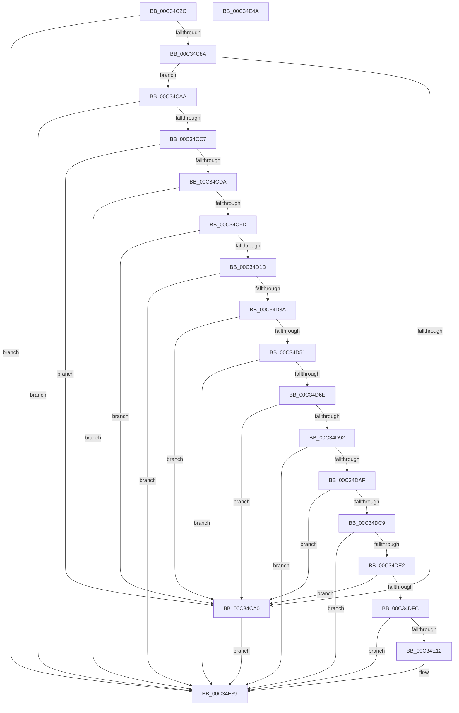

# PiAuCreateUserSids

- RVA: `0x00C34C2C`–`0x00C34E4B` (길이 `543` bytes)
- VA: `0x0000000140C34C2C`
- 실행 섹션: `INIT`
- PDB 이름 있음: `예`; PDB Function 태그: `아니요`
- unwind 정보 RVA: `0x000C8A38`
- 디코드: `154`개 명령, `543/543` bytes 표시
- 미해석 바이트: `0` (있으면 어셈블리에 `.byte`로 보존)

> 이 문서는 커널 이미지의 기계어와 PDB 기호를 분석해 생성했습니다. 4번과 5번은 함수 원형과 자료형을 바이너리 사용 방식에서 추정한 C 해석이며 원본 소스 복구 결과는 아닙니다.

## 1. Dependencies

- 직접 호출 지점: **17**; 고유 호출 대상: **3**
- 직접 호출자로 확인된 함수: **1**
- RIP 상대 이미지 참조: **0**

### Outgoing calls
- `0x00C34C6C` → [memset](../../text/6C/memset_function_006C6C40.md) (function, `0x006C6C40`)
- `0x00C34C7B` → [PiAuAllocateAndInitializeSid](../../page/73/PiAuAllocateAndInitializeSid_function_00731200.md) (function, `0x00731200`)
- `0x00C34C97` → [RtlValidSid](../../page/92/RtlValidSid_function_00929710.md) (function, `0x00929710`)
- `0x00C34CB8` → [PiAuAllocateAndInitializeSid](../../page/73/PiAuAllocateAndInitializeSid_function_00731200.md) (function, `0x00731200`)
- `0x00C34CD1` → [RtlValidSid](../../page/92/RtlValidSid_function_00929710.md) (function, `0x00929710`)
- `0x00C34CEE` → [PiAuAllocateAndInitializeSid](../../page/73/PiAuAllocateAndInitializeSid_function_00731200.md) (function, `0x00731200`)
- `0x00C34D14` → [RtlValidSid](../../page/92/RtlValidSid_function_00929710.md) (function, `0x00929710`)
- `0x00C34D2B` → [PiAuAllocateAndInitializeSid](../../page/73/PiAuAllocateAndInitializeSid_function_00731200.md) (function, `0x00731200`)
- `0x00C34D44` → [RtlValidSid](../../page/92/RtlValidSid_function_00929710.md) (function, `0x00929710`)
- `0x00C34D5F` → [PiAuAllocateAndInitializeSid](../../page/73/PiAuAllocateAndInitializeSid_function_00731200.md) (function, `0x00731200`)
- `0x00C34D85` → [RtlValidSid](../../page/92/RtlValidSid_function_00929710.md) (function, `0x00929710`)
- `0x00C34DA0` → [PiAuAllocateAndInitializeSid](../../page/73/PiAuAllocateAndInitializeSid_function_00731200.md) (function, `0x00731200`)
- `0x00C34DBC` → [RtlValidSid](../../page/92/RtlValidSid_function_00929710.md) (function, `0x00929710`)
- `0x00C34DD7` → [PiAuAllocateAndInitializeSid](../../page/73/PiAuAllocateAndInitializeSid_function_00731200.md) (function, `0x00731200`)
- `0x00C34DEF` → [RtlValidSid](../../page/92/RtlValidSid_function_00929710.md) (function, `0x00929710`)
- `0x00C34E07` → [PiAuAllocateAndInitializeSid](../../page/73/PiAuAllocateAndInitializeSid_function_00731200.md) (function, `0x00731200`)
- `0x00C34E26` → [RtlValidSid](../../page/92/RtlValidSid_function_00929710.md) (function, `0x00929710`)

### Direct callers
- [IopInitializePlugPlayServices](../C2/IopInitializePlugPlayServices_function_00C2F298.md) at `0x00C2F90E`

### Static image references
- 디코드된 RIP-relative 메모리 참조가 없습니다.

## 2. Other-region calls and transfers

- 다른 실행 섹션으로 향하는 call: **17**
  - `0x00C34C6C` → [memset](../../text/6C/memset_function_006C6C40.md) (`INIT` → `.text`)
  - `0x00C34C7B` → [PiAuAllocateAndInitializeSid](../../page/73/PiAuAllocateAndInitializeSid_function_00731200.md) (`INIT` → `PAGE`)
  - `0x00C34C97` → [RtlValidSid](../../page/92/RtlValidSid_function_00929710.md) (`INIT` → `PAGE`)
  - `0x00C34CB8` → [PiAuAllocateAndInitializeSid](../../page/73/PiAuAllocateAndInitializeSid_function_00731200.md) (`INIT` → `PAGE`)
  - `0x00C34CD1` → [RtlValidSid](../../page/92/RtlValidSid_function_00929710.md) (`INIT` → `PAGE`)
  - `0x00C34CEE` → [PiAuAllocateAndInitializeSid](../../page/73/PiAuAllocateAndInitializeSid_function_00731200.md) (`INIT` → `PAGE`)
  - `0x00C34D14` → [RtlValidSid](../../page/92/RtlValidSid_function_00929710.md) (`INIT` → `PAGE`)
  - `0x00C34D2B` → [PiAuAllocateAndInitializeSid](../../page/73/PiAuAllocateAndInitializeSid_function_00731200.md) (`INIT` → `PAGE`)
  - `0x00C34D44` → [RtlValidSid](../../page/92/RtlValidSid_function_00929710.md) (`INIT` → `PAGE`)
  - `0x00C34D5F` → [PiAuAllocateAndInitializeSid](../../page/73/PiAuAllocateAndInitializeSid_function_00731200.md) (`INIT` → `PAGE`)
  - `0x00C34D85` → [RtlValidSid](../../page/92/RtlValidSid_function_00929710.md) (`INIT` → `PAGE`)
  - `0x00C34DA0` → [PiAuAllocateAndInitializeSid](../../page/73/PiAuAllocateAndInitializeSid_function_00731200.md) (`INIT` → `PAGE`)
  - `0x00C34DBC` → [RtlValidSid](../../page/92/RtlValidSid_function_00929710.md) (`INIT` → `PAGE`)
  - `0x00C34DD7` → [PiAuAllocateAndInitializeSid](../../page/73/PiAuAllocateAndInitializeSid_function_00731200.md) (`INIT` → `PAGE`)
  - `0x00C34DEF` → [RtlValidSid](../../page/92/RtlValidSid_function_00929710.md) (`INIT` → `PAGE`)
  - `0x00C34E07` → [PiAuAllocateAndInitializeSid](../../page/73/PiAuAllocateAndInitializeSid_function_00731200.md) (`INIT` → `PAGE`)
  - `0x00C34E26` → [RtlValidSid](../../page/92/RtlValidSid_function_00929710.md) (`INIT` → `PAGE`)
- 별도 외부 분기/꼬리 이동을 확인하지 못했습니다.

## 3. Assembly (complete function range)

```asm
00C34C2C  40 55                           push rbp
00C34C2E  53                              push rbx
00C34C2F  56                              push rsi
00C34C30  57                              push rdi
00C34C31  41 54                           push r12
00C34C33  41 56                           push r14
00C34C35  41 57                           push r15
00C34C37  48 8B EC                        mov rbp, rsp
00C34C3A  48 83 EC 20                     sub rsp, 0x20
00C34C3E  45 33 F6                        xor r14d, r14d
00C34C41  66 C7 45 44 00 05               mov word ptr [rbp + 0x44], 0x500
00C34C47  33 D2                           xor edx, edx
00C34C49  44 89 75 40                     mov dword ptr [rbp + 0x40], r14d
00C34C4D  48 8B F9                        mov rdi, rcx
00C34C50  44 89 75 48                     mov dword ptr [rbp + 0x48], r14d
00C34C54  66 C7 45 4C 00 01               mov word ptr [rbp + 0x4c], 0x100
00C34C5A  45 8D 46 40                     lea r8d, [r14 + 0x40]
00C34C5E  44 89 75 50                     mov dword ptr [rbp + 0x50], r14d
00C34C62  45 8D 7E 01                     lea r15d, [r14 + 1]
00C34C66  66 C7 45 54 00 0F               mov word ptr [rbp + 0x54], 0xf00
00C34C6C  E8 CF 1F A9 FF                  call 0x1406c6c40
00C34C71  45 8B C7                        mov r8d, r15d
00C34C74  48 8D 55 40                     lea rdx, [rbp + 0x40]
00C34C78  48 8B CF                        mov rcx, rdi
00C34C7B  E8 80 C5 AF FF                  call 0x140731200
00C34C80  8B D8                           mov ebx, eax
00C34C82  85 C0                           test eax, eax
00C34C84  0F 88 AF 01 00 00               js 0x140c34e39
00C34C8A  48 8B 07                        mov rax, qword ptr [rdi]
00C34C8D  C7 40 08 12 00 00 00            mov dword ptr [rax + 8], 0x12
00C34C94  48 8B 0F                        mov rcx, qword ptr [rdi]
00C34C97  E8 74 4A CF FF                  call 0x140929710
00C34C9C  84 C0                           test al, al
00C34C9E  75 0A                           jne 0x140c34caa
00C34CA0  BB E5 00 00 C0                  mov ebx, 0xc00000e5
00C34CA5  E9 8F 01 00 00                  jmp 0x140c34e39
00C34CAA  48 8D 77 08                     lea rsi, [rdi + 8]
00C34CAE  45 8B C7                        mov r8d, r15d
00C34CB1  48 8B CE                        mov rcx, rsi
00C34CB4  48 8D 55 48                     lea rdx, [rbp + 0x48]
00C34CB8  E8 43 C5 AF FF                  call 0x140731200
00C34CBD  8B D8                           mov ebx, eax
00C34CBF  85 C0                           test eax, eax
00C34CC1  0F 88 72 01 00 00               js 0x140c34e39
00C34CC7  48 8B 06                        mov rax, qword ptr [rsi]
00C34CCA  44 89 70 08                     mov dword ptr [rax + 8], r14d
00C34CCE  48 8B 0E                        mov rcx, qword ptr [rsi]
00C34CD1  E8 3A 4A CF FF                  call 0x140929710
00C34CD6  84 C0                           test al, al
00C34CD8  74 C6                           je 0x140c34ca0
00C34CDA  48 8D 77 10                     lea rsi, [rdi + 0x10]
00C34CDE  41 BC 02 00 00 00               mov r12d, 2
00C34CE4  45 8B C4                        mov r8d, r12d
00C34CE7  48 8D 55 40                     lea rdx, [rbp + 0x40]
00C34CEB  48 8B CE                        mov rcx, rsi
00C34CEE  E8 0D C5 AF FF                  call 0x140731200
00C34CF3  8B D8                           mov ebx, eax
00C34CF5  85 C0                           test eax, eax
00C34CF7  0F 88 3C 01 00 00               js 0x140c34e39
00C34CFD  48 8B 06                        mov rax, qword ptr [rsi]
00C34D00  C7 40 08 20 00 00 00            mov dword ptr [rax + 8], 0x20
00C34D07  48 8B 06                        mov rax, qword ptr [rsi]
00C34D0A  C7 40 0C 20 02 00 00            mov dword ptr [rax + 0xc], 0x220
00C34D11  48 8B 0E                        mov rcx, qword ptr [rsi]
00C34D14  E8 F7 49 CF FF                  call 0x140929710
00C34D19  84 C0                           test al, al
00C34D1B  74 83                           je 0x140c34ca0
00C34D1D  48 8D 77 18                     lea rsi, [rdi + 0x18]
00C34D21  45 8B C7                        mov r8d, r15d
00C34D24  48 8B CE                        mov rcx, rsi
00C34D27  48 8D 55 40                     lea rdx, [rbp + 0x40]
00C34D2B  E8 D0 C4 AF FF                  call 0x140731200
00C34D30  8B D8                           mov ebx, eax
00C34D32  85 C0                           test eax, eax
00C34D34  0F 88 FF 00 00 00               js 0x140c34e39
00C34D3A  48 8B 06                        mov rax, qword ptr [rsi]
00C34D3D  44 89 60 08                     mov dword ptr [rax + 8], r12d
00C34D41  48 8B 0E                        mov rcx, qword ptr [rsi]
00C34D44  E8 C7 49 CF FF                  call 0x140929710
00C34D49  84 C0                           test al, al
00C34D4B  0F 84 4F FF FF FF               je 0x140c34ca0
00C34D51  48 8D 77 20                     lea rsi, [rdi + 0x20]
00C34D55  45 8B C4                        mov r8d, r12d
00C34D58  48 8B CE                        mov rcx, rsi
00C34D5B  48 8D 55 40                     lea rdx, [rbp + 0x40]
00C34D5F  E8 9C C4 AF FF                  call 0x140731200
00C34D64  8B D8                           mov ebx, eax
00C34D66  85 C0                           test eax, eax
00C34D68  0F 88 CB 00 00 00               js 0x140c34e39
00C34D6E  48 8B 06                        mov rax, qword ptr [rsi]
00C34D71  C7 40 08 20 00 00 00            mov dword ptr [rax + 8], 0x20
00C34D78  48 8B 06                        mov rax, qword ptr [rsi]
00C34D7B  C7 40 0C 21 02 00 00            mov dword ptr [rax + 0xc], 0x221
00C34D82  48 8B 0E                        mov rcx, qword ptr [rsi]
00C34D85  E8 86 49 CF FF                  call 0x140929710
00C34D8A  84 C0                           test al, al
00C34D8C  0F 84 0E FF FF FF               je 0x140c34ca0
00C34D92  48 8D 77 28                     lea rsi, [rdi + 0x28]
00C34D96  45 8B C7                        mov r8d, r15d
00C34D99  48 8B CE                        mov rcx, rsi
00C34D9C  48 8D 55 40                     lea rdx, [rbp + 0x40]
00C34DA0  E8 5B C4 AF FF                  call 0x140731200
00C34DA5  8B D8                           mov ebx, eax
00C34DA7  85 C0                           test eax, eax
00C34DA9  0F 88 8A 00 00 00               js 0x140c34e39
00C34DAF  48 8B 06                        mov rax, qword ptr [rsi]
00C34DB2  C7 40 08 13 00 00 00            mov dword ptr [rax + 8], 0x13
00C34DB9  48 8B 0E                        mov rcx, qword ptr [rsi]
00C34DBC  E8 4F 49 CF FF                  call 0x140929710
00C34DC1  84 C0                           test al, al
00C34DC3  0F 84 D7 FE FF FF               je 0x140c34ca0
00C34DC9  48 8D 77 30                     lea rsi, [rdi + 0x30]
00C34DCD  45 8B C7                        mov r8d, r15d
00C34DD0  48 8B CE                        mov rcx, rsi
00C34DD3  48 8D 55 40                     lea rdx, [rbp + 0x40]
00C34DD7  E8 24 C4 AF FF                  call 0x140731200
00C34DDC  8B D8                           mov ebx, eax
00C34DDE  85 C0                           test eax, eax
00C34DE0  78 57                           js 0x140c34e39
00C34DE2  48 8B 06                        mov rax, qword ptr [rsi]
00C34DE5  C7 40 08 14 00 00 00            mov dword ptr [rax + 8], 0x14
00C34DEC  48 8B 0E                        mov rcx, qword ptr [rsi]
00C34DEF  E8 1C 49 CF FF                  call 0x140929710
00C34DF4  84 C0                           test al, al
00C34DF6  0F 84 A4 FE FF FF               je 0x140c34ca0
00C34DFC  45 8B C4                        mov r8d, r12d
00C34DFF  48 8D 55 50                     lea rdx, [rbp + 0x50]
00C34E03  48 8D 4F 38                     lea rcx, [rdi + 0x38]
00C34E07  E8 F4 C3 AF FF                  call 0x140731200
00C34E0C  8B D8                           mov ebx, eax
00C34E0E  85 C0                           test eax, eax
00C34E10  78 27                           js 0x140c34e39
00C34E12  48 8B 47 38                     mov rax, qword ptr [rdi + 0x38]
00C34E16  44 89 60 08                     mov dword ptr [rax + 8], r12d
00C34E1A  48 8B 47 38                     mov rax, qword ptr [rdi + 0x38]
00C34E1E  44 89 78 0C                     mov dword ptr [rax + 0xc], r15d
00C34E22  48 8B 4F 38                     mov rcx, qword ptr [rdi + 0x38]
00C34E26  E8 E5 48 CF FF                  call 0x140929710
00C34E2B  8B CB                           mov ecx, ebx
00C34E2D  84 C0                           test al, al
00C34E2F  BB E5 00 00 C0                  mov ebx, 0xc00000e5
00C34E34  0F 44 CB                        cmove ecx, ebx
00C34E37  8B D9                           mov ebx, ecx
00C34E39  8B C3                           mov eax, ebx
00C34E3B  48 83 C4 20                     add rsp, 0x20
00C34E3F  41 5F                           pop r15
00C34E41  41 5E                           pop r14
00C34E43  41 5C                           pop r12
00C34E45  5F                              pop rdi
00C34E46  5E                              pop rsi
00C34E47  5B                              pop rbx
00C34E48  5D                              pop rbp
00C34E49  C3                              ret
00C34E4A  CC                              int3
```

## 4. C-style interpretation (structured pseudocode)

```c
__int64 __fastcall PiAuCreateUserSids(__int64 a1, int a2)
{
    __int64 result;
    __int64 v_r14;
    __int64 v_rbx;
    __int64 v_rsp;
    unsigned int v_stack_p10;
    unsigned __int16 v_stack_p14;
    unsigned int v_stack_p18;
    unsigned __int16 v_stack_p1C;
    unsigned int v_stack_p8;
    unsigned __int16 v_stack_pC;

    v_rsp = (v_rsp) - (32);
    v_r14 = 0;
    v_stack_pC = 0x500ULL;
    a2 = 0;
    v_stack_p8 = 0;
    v_stack_p10 = 0;
    v_stack_p14 = 256;
    v_stack_p18 = 0;
    v_stack_p1C = 0xF00ULL;
    result = memset(a1, a2, v_r14 + 64, a4);
    result = PiAuAllocateAndInitializeSid(a1, v_stack_p8, (unsigned int)((unsigned int)(v_r14 + 1)), a4);
    if (sign_flag) goto loc_00C34E39;
    *(unsigned int *)(*(unsigned __int64 *)(a1) + 8) = 18;
    result = RtlValidSid(*(unsigned __int64 *)(a1), v_stack_p8, (unsigned int)((unsigned int)(v_r14 + 1)), a4);
    if ((unsigned __int8)(result) != 0) goto loc_00C34CAA;
loc_00C34CA0:
    goto loc_00C34E39;
loc_00C34CAA:
    result = PiAuAllocateAndInitializeSid(a1 + 8, v_stack_p10, (unsigned int)((unsigned int)(v_r14 + 1)), a4);
    if (sign_flag) goto loc_00C34E39;
    *(unsigned int *)(*(unsigned __int64 *)(a1 + 8) + 8) = 0;
    result = RtlValidSid(*(unsigned __int64 *)(a1 + 8), v_stack_p10, (unsigned int)((unsigned int)(v_r14 + 1)), a4);
    if ((unsigned __int8)(result) == 0) goto loc_00C34CA0;
    result = PiAuAllocateAndInitializeSid(a1 + 16, v_stack_p8, 2, a4);
    if (sign_flag) goto loc_00C34E39;
    *(unsigned int *)(*(unsigned __int64 *)(a1 + 16) + 8) = 32;
    *(unsigned int *)(*(unsigned __int64 *)(a1 + 16) + 12) = 544;
    result = RtlValidSid(*(unsigned __int64 *)(a1 + 16), v_stack_p8, 2, a4);
    if ((unsigned __int8)(result) == 0) goto loc_00C34CA0;
    result = PiAuAllocateAndInitializeSid(a1 + 24, v_stack_p8, (unsigned int)((unsigned int)(v_r14 + 1)), a4);
    if (sign_flag) goto loc_00C34E39;
    *(unsigned int *)(*(unsigned __int64 *)(a1 + 24) + 8) = 2;
    result = RtlValidSid(*(unsigned __int64 *)(a1 + 24), v_stack_p8, (unsigned int)((unsigned int)(v_r14 + 1)), a4);
    if ((unsigned __int8)(result) == 0) goto loc_00C34CA0;
    result = PiAuAllocateAndInitializeSid(a1 + 32, v_stack_p8, 2, a4);
    if (sign_flag) goto loc_00C34E39;
    *(unsigned int *)(*(unsigned __int64 *)(a1 + 32) + 8) = 32;
    *(unsigned int *)(*(unsigned __int64 *)(a1 + 32) + 12) = 545;
    result = RtlValidSid(*(unsigned __int64 *)(a1 + 32), v_stack_p8, 2, a4);
    if ((unsigned __int8)(result) == 0) goto loc_00C34CA0;
    result = PiAuAllocateAndInitializeSid(a1 + 40, v_stack_p8, (unsigned int)((unsigned int)(v_r14 + 1)), a4);
    if (sign_flag) goto loc_00C34E39;
    *(unsigned int *)(*(unsigned __int64 *)(a1 + 40) + 8) = 19;
    result = RtlValidSid(*(unsigned __int64 *)(a1 + 40), v_stack_p8, (unsigned int)((unsigned int)(v_r14 + 1)), a4);
    if ((unsigned __int8)(result) == 0) goto loc_00C34CA0;
    result = PiAuAllocateAndInitializeSid(a1 + 48, v_stack_p8, (unsigned int)((unsigned int)(v_r14 + 1)), a4);
    if (sign_flag) goto loc_00C34E39;
    *(unsigned int *)(*(unsigned __int64 *)(a1 + 48) + 8) = 20;
    result = RtlValidSid(*(unsigned __int64 *)(a1 + 48), v_stack_p8, (unsigned int)((unsigned int)(v_r14 + 1)), a4);
    if ((unsigned __int8)(result) == 0) goto loc_00C34CA0;
    result = PiAuAllocateAndInitializeSid(a1 + 56, v_stack_p18, 2, a4);
    v_rbx = (unsigned int)((unsigned int)(result));
    if (!(sign_flag)) {
        result = *(unsigned __int64 *)(a1 + 56);
        *(unsigned int *)(result + 8) = 2;
        result = *(unsigned __int64 *)(a1 + 56);
        *(unsigned int *)(result + 12) = (unsigned int)(v_r14 + 1);
        a1 = *(unsigned __int64 *)(a1 + 56);
        result = RtlValidSid(a1, v_stack_p18, 2, a4);
        a1 = (unsigned int)((unsigned int)((unsigned int)(result)));
        v_rbx = 0xC00000E5ULL;
        if ((unsigned __int8)(result) == 0) { a1 = (unsigned int)(v_rbx); }
        v_rbx = (unsigned int)(a1);
    }
    v_rsp = (v_rsp) + (32);
    return (unsigned int)((unsigned int)(v_rbx));
}
```

## 5. (Beta) C Style

```c
int64_t PiAuCreateUserSids(void *Arg1, int32_t Arg2)
{
    uint8_t *arg1 = (uint8_t *)Arg1;

    int64_t result;
    int64_t local_r14;
    int64_t local_rbx;
    int64_t local_rsp;
    uint32_t v_stack_p10;
    uint16_t v_stack_p14;
    uint32_t v_stack_p18;
    uint16_t v_stack_p1C;
    uint32_t v_stack_p8;
    uint16_t v_stack_pC;

    local_rsp = (local_rsp) - (32);
    local_r14 = 0;
    v_stack_pC = 0x500ULL;
    Arg2 = 0;
    v_stack_p8 = 0;
    v_stack_p10 = 0;
    v_stack_p14 = 256;
    v_stack_p18 = 0;
    v_stack_p1C = 0xF00ULL;
    result = memset(Arg1, Arg2, local_r14 + 64, a4);
    result = PiAuAllocateAndInitializeSid(Arg1, v_stack_p8, (uint32_t)((uint32_t)(local_r14 + 1)), a4);
    if (sign_flag) goto loc_00C34E39;
    *(uint32_t *)(*(uint64_t *)(arg1) + 0x8) = 18;
    result = RtlValidSid(*(uint64_t *)(arg1), v_stack_p8, (uint32_t)((uint32_t)(local_r14 + 1)), a4);
    if ((uint8_t)(result) != 0) goto loc_00C34CAA;
loc_00C34CA0:
    goto loc_00C34E39;
loc_00C34CAA:
    result = PiAuAllocateAndInitializeSid(Arg1 + 8, v_stack_p10, (uint32_t)((uint32_t)(local_r14 + 1)), a4);
    if (sign_flag) goto loc_00C34E39;
    *(uint32_t *)(*(uint64_t *)(arg1 + 0x8) + 0x8) = 0;
    result = RtlValidSid(*(uint64_t *)(arg1 + 0x8), v_stack_p10, (uint32_t)((uint32_t)(local_r14 + 1)), a4);
    if ((uint8_t)(result) == 0) goto loc_00C34CA0;
    result = PiAuAllocateAndInitializeSid(Arg1 + 16, v_stack_p8, 2, a4);
    if (sign_flag) goto loc_00C34E39;
    *(uint32_t *)(*(uint64_t *)(arg1 + 0x10) + 0x8) = 32;
    *(uint32_t *)(*(uint64_t *)(arg1 + 0x10) + 0xC) = 544;
    result = RtlValidSid(*(uint64_t *)(arg1 + 0x10), v_stack_p8, 2, a4);
    if ((uint8_t)(result) == 0) goto loc_00C34CA0;
    result = PiAuAllocateAndInitializeSid(Arg1 + 24, v_stack_p8, (uint32_t)((uint32_t)(local_r14 + 1)), a4);
    if (sign_flag) goto loc_00C34E39;
    *(uint32_t *)(*(uint64_t *)(arg1 + 0x18) + 0x8) = 2;
    result = RtlValidSid(*(uint64_t *)(arg1 + 0x18), v_stack_p8, (uint32_t)((uint32_t)(local_r14 + 1)), a4);
    if ((uint8_t)(result) == 0) goto loc_00C34CA0;
    result = PiAuAllocateAndInitializeSid(Arg1 + 32, v_stack_p8, 2, a4);
    if (sign_flag) goto loc_00C34E39;
    *(uint32_t *)(*(uint64_t *)(arg1 + 0x20) + 0x8) = 32;
    *(uint32_t *)(*(uint64_t *)(arg1 + 0x20) + 0xC) = 545;
    result = RtlValidSid(*(uint64_t *)(arg1 + 0x20), v_stack_p8, 2, a4);
    if ((uint8_t)(result) == 0) goto loc_00C34CA0;
    result = PiAuAllocateAndInitializeSid(Arg1 + 40, v_stack_p8, (uint32_t)((uint32_t)(local_r14 + 1)), a4);
    if (sign_flag) goto loc_00C34E39;
    *(uint32_t *)(*(uint64_t *)(arg1 + 0x28) + 0x8) = 19;
    result = RtlValidSid(*(uint64_t *)(arg1 + 0x28), v_stack_p8, (uint32_t)((uint32_t)(local_r14 + 1)), a4);
    if ((uint8_t)(result) == 0) goto loc_00C34CA0;
    result = PiAuAllocateAndInitializeSid(Arg1 + 48, v_stack_p8, (uint32_t)((uint32_t)(local_r14 + 1)), a4);
    if (sign_flag) goto loc_00C34E39;
    *(uint32_t *)(*(uint64_t *)(arg1 + 0x30) + 0x8) = 20;
    result = RtlValidSid(*(uint64_t *)(arg1 + 0x30), v_stack_p8, (uint32_t)((uint32_t)(local_r14 + 1)), a4);
    if ((uint8_t)(result) == 0) goto loc_00C34CA0;
    result = PiAuAllocateAndInitializeSid(Arg1 + 56, v_stack_p18, 2, a4);
    local_rbx = (uint32_t)((uint32_t)(result));
    if (!(sign_flag)) {
        result = *(uint64_t *)(arg1 + 0x38);
        *(uint32_t *)(result + 0x8) = 2;
        result = *(uint64_t *)(arg1 + 0x38);
        *(uint32_t *)(result + 0xC) = (uint32_t)(local_r14 + 1);
        Arg1 = *(uint64_t *)(arg1 + 0x38);
        result = RtlValidSid(Arg1, v_stack_p18, 2, a4);
        Arg1 = (uint32_t)((uint32_t)((uint32_t)(result)));
        local_rbx = 0xC00000E5ULL;
        if ((uint8_t)(result) == 0) { Arg1 = (uint32_t)(local_rbx); }
        local_rbx = (uint32_t)(Arg1);
    }
    local_rsp = (local_rsp) + (32);
    return (uint32_t)((uint32_t)(local_rbx));
}
```

### 관측된 메모리 오프셋

구조체 형식이 확인되지 않은 접근은 인자 기준의 오프셋으로만 기록했습니다.

| 기준 인자 | 오프셋 표현 | 폭 (bit) | 접근 |
|---|---:|---:|---|
| `Arg1` | `+ 0x0` | `64` | `R` |
| `Arg1` | `+ 0x8` | `64` | `R` |
| `Arg1` | `+ 0x10` | `64` | `R` |
| `Arg1` | `+ 0x18` | `64` | `R` |
| `Arg1` | `+ 0x20` | `64` | `R` |
| `Arg1` | `+ 0x28` | `64` | `R` |
| `Arg1` | `+ 0x30` | `64` | `R` |
| `Arg1` | `+ 0x38` | `64` | `R` |

## 6. Execution-region graph

[열기: 2D/3D 그래프와 함수 탐색 컨트롤 패널](../../../control-panel.html?section=init&rva=0x00C34C2C&view=graph)

- 2D 그래프는 위에서 아래로 흐르고, 3D 그래프는 빈 공간을 드래그해 회전합니다. Shift+드래그는 이동, 휠은 확대·축소, 함수 노드 선택은 대상 보고서 이동입니다.

### Static fallback


