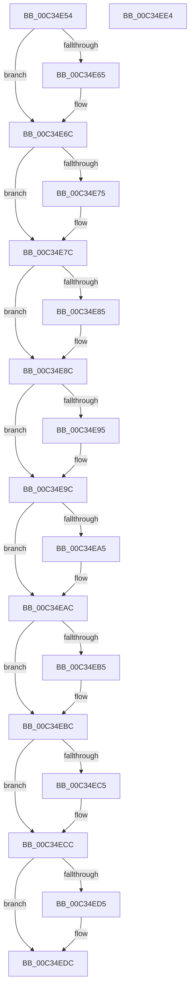

# PiAuFreeUserSids

- RVA: `0x00C34E54`–`0x00C34EE5` (길이 `145` bytes)
- VA: `0x0000000140C34E54`
- 실행 섹션: `INIT`
- PDB 이름 있음: `예`; PDB Function 태그: `아니요`
- unwind 정보 RVA: `0x0005CF00`
- 디코드: `48`개 명령, `145/145` bytes 표시
- 미해석 바이트: `0` (있으면 어셈블리에 `.byte`로 보존)

> 이 문서는 커널 이미지의 기계어와 PDB 기호를 분석해 생성했습니다. 4번과 5번은 함수 원형과 자료형을 바이너리 사용 방식에서 추정한 C 해석이며 원본 소스 복구 결과는 아닙니다.

## 1. Dependencies

- 직접 호출 지점: **8**; 고유 호출 대상: **1**
- 직접 호출자로 확인된 함수: **1**
- RIP 상대 이미지 참조: **0**

### Outgoing calls
- `0x00C34E67` → [ExFreePoolWithTag](../../poolcode/B8/ExFreePoolWithTag_function_00B82870.md) (function, `0x00B82870`)
- `0x00C34E77` → [ExFreePoolWithTag](../../poolcode/B8/ExFreePoolWithTag_function_00B82870.md) (function, `0x00B82870`)
- `0x00C34E87` → [ExFreePoolWithTag](../../poolcode/B8/ExFreePoolWithTag_function_00B82870.md) (function, `0x00B82870`)
- `0x00C34E97` → [ExFreePoolWithTag](../../poolcode/B8/ExFreePoolWithTag_function_00B82870.md) (function, `0x00B82870`)
- `0x00C34EA7` → [ExFreePoolWithTag](../../poolcode/B8/ExFreePoolWithTag_function_00B82870.md) (function, `0x00B82870`)
- `0x00C34EB7` → [ExFreePoolWithTag](../../poolcode/B8/ExFreePoolWithTag_function_00B82870.md) (function, `0x00B82870`)
- `0x00C34EC7` → [ExFreePoolWithTag](../../poolcode/B8/ExFreePoolWithTag_function_00B82870.md) (function, `0x00B82870`)
- `0x00C34ED7` → [ExFreePoolWithTag](../../poolcode/B8/ExFreePoolWithTag_function_00B82870.md) (function, `0x00B82870`)

### Direct callers
- [IopInitializePlugPlayServices](../C2/IopInitializePlugPlayServices_function_00C2F298.md) at `0x00C2F937`

### Static image references
- 디코드된 RIP-relative 메모리 참조가 없습니다.

## 2. Other-region calls and transfers

- 다른 실행 섹션으로 향하는 call: **8**
  - `0x00C34E67` → [ExFreePoolWithTag](../../poolcode/B8/ExFreePoolWithTag_function_00B82870.md) (`INIT` → `POOLCODE`)
  - `0x00C34E77` → [ExFreePoolWithTag](../../poolcode/B8/ExFreePoolWithTag_function_00B82870.md) (`INIT` → `POOLCODE`)
  - `0x00C34E87` → [ExFreePoolWithTag](../../poolcode/B8/ExFreePoolWithTag_function_00B82870.md) (`INIT` → `POOLCODE`)
  - `0x00C34E97` → [ExFreePoolWithTag](../../poolcode/B8/ExFreePoolWithTag_function_00B82870.md) (`INIT` → `POOLCODE`)
  - `0x00C34EA7` → [ExFreePoolWithTag](../../poolcode/B8/ExFreePoolWithTag_function_00B82870.md) (`INIT` → `POOLCODE`)
  - `0x00C34EB7` → [ExFreePoolWithTag](../../poolcode/B8/ExFreePoolWithTag_function_00B82870.md) (`INIT` → `POOLCODE`)
  - `0x00C34EC7` → [ExFreePoolWithTag](../../poolcode/B8/ExFreePoolWithTag_function_00B82870.md) (`INIT` → `POOLCODE`)
  - `0x00C34ED7` → [ExFreePoolWithTag](../../poolcode/B8/ExFreePoolWithTag_function_00B82870.md) (`INIT` → `POOLCODE`)
- 별도 외부 분기/꼬리 이동을 확인하지 못했습니다.

## 3. Assembly (complete function range)

```asm
00C34E54  40 53                           push rbx
00C34E56  48 83 EC 20                     sub rsp, 0x20
00C34E5A  48 8B D9                        mov rbx, rcx
00C34E5D  48 8B 09                        mov rcx, qword ptr [rcx]
00C34E60  48 85 C9                        test rcx, rcx
00C34E63  74 07                           je 0x140c34e6c
00C34E65  33 D2                           xor edx, edx
00C34E67  E8 04 DA F4 FF                  call 0x140b82870
00C34E6C  48 8B 4B 08                     mov rcx, qword ptr [rbx + 8]
00C34E70  48 85 C9                        test rcx, rcx
00C34E73  74 07                           je 0x140c34e7c
00C34E75  33 D2                           xor edx, edx
00C34E77  E8 F4 D9 F4 FF                  call 0x140b82870
00C34E7C  48 8B 4B 10                     mov rcx, qword ptr [rbx + 0x10]
00C34E80  48 85 C9                        test rcx, rcx
00C34E83  74 07                           je 0x140c34e8c
00C34E85  33 D2                           xor edx, edx
00C34E87  E8 E4 D9 F4 FF                  call 0x140b82870
00C34E8C  48 8B 4B 18                     mov rcx, qword ptr [rbx + 0x18]
00C34E90  48 85 C9                        test rcx, rcx
00C34E93  74 07                           je 0x140c34e9c
00C34E95  33 D2                           xor edx, edx
00C34E97  E8 D4 D9 F4 FF                  call 0x140b82870
00C34E9C  48 8B 4B 20                     mov rcx, qword ptr [rbx + 0x20]
00C34EA0  48 85 C9                        test rcx, rcx
00C34EA3  74 07                           je 0x140c34eac
00C34EA5  33 D2                           xor edx, edx
00C34EA7  E8 C4 D9 F4 FF                  call 0x140b82870
00C34EAC  48 8B 4B 28                     mov rcx, qword ptr [rbx + 0x28]
00C34EB0  48 85 C9                        test rcx, rcx
00C34EB3  74 07                           je 0x140c34ebc
00C34EB5  33 D2                           xor edx, edx
00C34EB7  E8 B4 D9 F4 FF                  call 0x140b82870
00C34EBC  48 8B 4B 30                     mov rcx, qword ptr [rbx + 0x30]
00C34EC0  48 85 C9                        test rcx, rcx
00C34EC3  74 07                           je 0x140c34ecc
00C34EC5  33 D2                           xor edx, edx
00C34EC7  E8 A4 D9 F4 FF                  call 0x140b82870
00C34ECC  48 8B 4B 38                     mov rcx, qword ptr [rbx + 0x38]
00C34ED0  48 85 C9                        test rcx, rcx
00C34ED3  74 07                           je 0x140c34edc
00C34ED5  33 D2                           xor edx, edx
00C34ED7  E8 94 D9 F4 FF                  call 0x140b82870
00C34EDC  33 C0                           xor eax, eax
00C34EDE  48 83 C4 20                     add rsp, 0x20
00C34EE2  5B                              pop rbx
00C34EE3  C3                              ret
00C34EE4  CC                              int3
```

## 4. C-style interpretation (structured pseudocode)

```c
__int64 __fastcall PiAuFreeUserSids(__int64 a1, int a2)
{
    __int64 result;
    __int64 v_rsp;

    v_rsp = (v_rsp) - (32);
    if (*(unsigned __int64 *)(a1) != 0) {
        a2 = 0;
        result = ExFreePoolWithTag(*(unsigned __int64 *)(a1), a2, a3, a4);
    }
    if (*(unsigned __int64 *)(a1 + 8) != 0) {
        a2 = 0;
        result = ExFreePoolWithTag(*(unsigned __int64 *)(a1 + 8), a2, a3, a4);
    }
    if (*(unsigned __int64 *)(a1 + 16) != 0) {
        a2 = 0;
        result = ExFreePoolWithTag(*(unsigned __int64 *)(a1 + 16), a2, a3, a4);
    }
    if (*(unsigned __int64 *)(a1 + 24) != 0) {
        a2 = 0;
        result = ExFreePoolWithTag(*(unsigned __int64 *)(a1 + 24), a2, a3, a4);
    }
    if (*(unsigned __int64 *)(a1 + 32) != 0) {
        a2 = 0;
        result = ExFreePoolWithTag(*(unsigned __int64 *)(a1 + 32), a2, a3, a4);
    }
    if (*(unsigned __int64 *)(a1 + 40) != 0) {
        a2 = 0;
        result = ExFreePoolWithTag(*(unsigned __int64 *)(a1 + 40), a2, a3, a4);
    }
    if (*(unsigned __int64 *)(a1 + 48) != 0) {
        a2 = 0;
        result = ExFreePoolWithTag(*(unsigned __int64 *)(a1 + 48), a2, a3, a4);
    }
    if (*(unsigned __int64 *)(a1 + 56) != 0) {
        a2 = 0;
        result = ExFreePoolWithTag(*(unsigned __int64 *)(a1 + 56), a2, a3, a4);
    }
    result = 0;
    v_rsp = (v_rsp) + (32);
    return result;
}
```

## 5. (Beta) C Style

```c
int64_t PiAuFreeUserSids(void *Arg1, int32_t Arg2)
{
    uint8_t *arg1 = (uint8_t *)Arg1;

    int64_t result;
    int64_t local_rsp;

    local_rsp = (local_rsp) - (32);
    if (*(uint64_t *)(arg1) != 0) {
        Arg2 = 0;
        result = ExFreePoolWithTag(*(uint64_t *)(arg1), Arg2, a3, a4);
    }
    if (*(uint64_t *)(arg1 + 0x8) != 0) {
        Arg2 = 0;
        result = ExFreePoolWithTag(*(uint64_t *)(arg1 + 0x8), Arg2, a3, a4);
    }
    if (*(uint64_t *)(arg1 + 0x10) != 0) {
        Arg2 = 0;
        result = ExFreePoolWithTag(*(uint64_t *)(arg1 + 0x10), Arg2, a3, a4);
    }
    if (*(uint64_t *)(arg1 + 0x18) != 0) {
        Arg2 = 0;
        result = ExFreePoolWithTag(*(uint64_t *)(arg1 + 0x18), Arg2, a3, a4);
    }
    if (*(uint64_t *)(arg1 + 0x20) != 0) {
        Arg2 = 0;
        result = ExFreePoolWithTag(*(uint64_t *)(arg1 + 0x20), Arg2, a3, a4);
    }
    if (*(uint64_t *)(arg1 + 0x28) != 0) {
        Arg2 = 0;
        result = ExFreePoolWithTag(*(uint64_t *)(arg1 + 0x28), Arg2, a3, a4);
    }
    if (*(uint64_t *)(arg1 + 0x30) != 0) {
        Arg2 = 0;
        result = ExFreePoolWithTag(*(uint64_t *)(arg1 + 0x30), Arg2, a3, a4);
    }
    if (*(uint64_t *)(arg1 + 0x38) != 0) {
        Arg2 = 0;
        result = ExFreePoolWithTag(*(uint64_t *)(arg1 + 0x38), Arg2, a3, a4);
    }
    result = 0;
    local_rsp = (local_rsp) + (32);
    return result;
}
```

### 관측된 메모리 오프셋

구조체 형식이 확인되지 않은 접근은 인자 기준의 오프셋으로만 기록했습니다.

| 기준 인자 | 오프셋 표현 | 폭 (bit) | 접근 |
|---|---:|---:|---|
| `Arg1` | `+ 0x0` | `64` | `R` |
| `Arg1` | `+ 0x8` | `64` | `R` |
| `Arg1` | `+ 0x10` | `64` | `R` |
| `Arg1` | `+ 0x18` | `64` | `R` |
| `Arg1` | `+ 0x20` | `64` | `R` |
| `Arg1` | `+ 0x28` | `64` | `R` |
| `Arg1` | `+ 0x30` | `64` | `R` |
| `Arg1` | `+ 0x38` | `64` | `R` |

## 6. Execution-region graph

[열기: 2D/3D 그래프와 함수 탐색 컨트롤 패널](../../../control-panel.html?section=init&rva=0x00C34E54&view=graph)

- 2D 그래프는 위에서 아래로 흐르고, 3D 그래프는 빈 공간을 드래그해 회전합니다. Shift+드래그는 이동, 휠은 확대·축소, 함수 노드 선택은 대상 보고서 이동입니다.

### Static fallback


