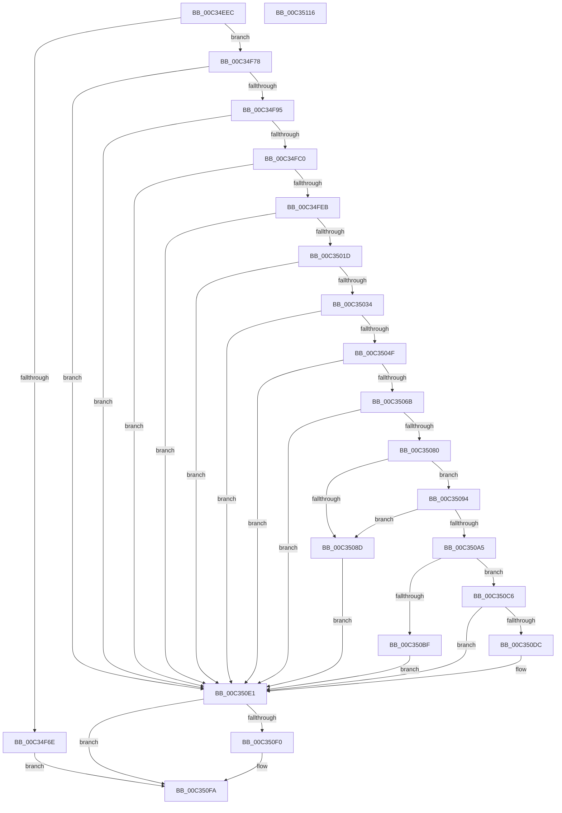

# PiAuGetDriverDataDirectorySecurityObject

- RVA: `0x00C34EEC`–`0x00C35117` (길이 `555` bytes)
- VA: `0x0000000140C34EEC`
- 실행 섹션: `INIT`
- PDB 이름 있음: `예`; PDB Function 태그: `아니요`
- unwind 정보 RVA: `0x000C8A6C`
- 디코드: `150`개 명령, `555/555` bytes 표시
- 미해석 바이트: `0` (있으면 어셈블리에 `.byte`로 보존)

> 이 문서는 커널 이미지의 기계어와 PDB 기호를 분석해 생성했습니다. 4번과 5번은 함수 원형과 자료형을 바이너리 사용 방식에서 추정한 C 해석이며 원본 소스 복구 결과는 아닙니다.

## 1. Dependencies

- 직접 호출 지점: **15**; 고유 호출 대상: **11**
- 직접 호출자로 확인된 함수: **1**
- RIP 상대 이미지 참조: **3**

### Outgoing calls
- `0x00C34F61` → [ExAllocatePool2](../../poolcode/B8/ExAllocatePool2_function_00B820F0.md) (function, `0x00B820F0`)
- `0x00C34F86` → [RtlCreateAcl](../../page/91/RtlCreateAcl_function_00916F00.md) (function, `0x00916F00`)
- `0x00C34FB1` → [RtlAddAccessAllowedAceEx](../../page/92/RtlAddAccessAllowedAceEx_function_009279D0.md) (function, `0x009279D0`)
- `0x00C34FDC` → [RtlAddAccessAllowedAceEx](../../page/92/RtlAddAccessAllowedAceEx_function_009279D0.md) (function, `0x009279D0`)
- `0x00C3500E` → [RtlAddAccessAllowedAceEx](../../page/92/RtlAddAccessAllowedAceEx_function_009279D0.md) (function, `0x009279D0`)
- `0x00C35025` → [RtlCreateSecurityDescriptor](../../page/9F/RtlCreateSecurityDescriptor_function_009F1DF0.md) (function, `0x009F1DF0`)
- `0x00C35040` → [RtlSetDaclSecurityDescriptor](../../page/9E/RtlSetDaclSecurityDescriptor_function_009EC210.md) (function, `0x009EC210`)
- `0x00C35060` → [RtlSetOwnerSecurityDescriptor](../../page/91/RtlSetOwnerSecurityDescriptor_function_00916F90.md) (function, `0x00916F90`)
- `0x00C35075` → [RtlSetGroupSecurityDescriptor](../../page/A2/RtlSetGroupSecurityDescriptor_function_00A2EB10.md) (function, `0x00A2EB10`)
- `0x00C35084` → [RtlValidSecurityDescriptor](../../page/8B/RtlValidSecurityDescriptor_function_008BD3F0.md) (function, `0x008BD3F0`)
- `0x00C35098` → [RtlLengthSecurityDescriptor](../../page/8B/RtlLengthSecurityDescriptor_function_008BC870.md) (function, `0x008BC870`)
- `0x00C350B2` → [ExAllocatePool2](../../poolcode/B8/ExAllocatePool2_function_00B820F0.md) (function, `0x00B820F0`)
- `0x00C350D1` → [RtlAbsoluteToSelfRelativeSD](../../page/A1/RtlAbsoluteToSelfRelativeSD_function_00A119B0.md) (function, `0x00A119B0`)
- `0x00C350E6` → [ExFreePoolWithTag](../../poolcode/B8/ExFreePoolWithTag_function_00B82870.md) (function, `0x00B82870`)
- `0x00C350F5` → [ExFreePoolWithTag](../../poolcode/B8/ExFreePoolWithTag_function_00B82870.md) (function, `0x00B82870`)

### Direct callers
- [PiCreateDriverDataDirectoryRoot](PiCreateDriverDataDirectoryRoot_function_00C329A8.md) at `0x00C32A1F`

### Static image references
- `0x00C34F13` → RVA `0x00FD9AA0` (`PAGEDATA`; read)
- `0x00C34F2B` → RVA `0x00FD9A68` (`PAGEDATA`; read)
- `0x00C34F3B` → RVA `0x00E67D58` (`.data`; read)

## 2. Other-region calls and transfers

- 다른 실행 섹션으로 향하는 call: **15**
  - `0x00C34F61` → [ExAllocatePool2](../../poolcode/B8/ExAllocatePool2_function_00B820F0.md) (`INIT` → `POOLCODE`)
  - `0x00C34F86` → [RtlCreateAcl](../../page/91/RtlCreateAcl_function_00916F00.md) (`INIT` → `PAGE`)
  - `0x00C34FB1` → [RtlAddAccessAllowedAceEx](../../page/92/RtlAddAccessAllowedAceEx_function_009279D0.md) (`INIT` → `PAGE`)
  - `0x00C34FDC` → [RtlAddAccessAllowedAceEx](../../page/92/RtlAddAccessAllowedAceEx_function_009279D0.md) (`INIT` → `PAGE`)
  - `0x00C3500E` → [RtlAddAccessAllowedAceEx](../../page/92/RtlAddAccessAllowedAceEx_function_009279D0.md) (`INIT` → `PAGE`)
  - `0x00C35025` → [RtlCreateSecurityDescriptor](../../page/9F/RtlCreateSecurityDescriptor_function_009F1DF0.md) (`INIT` → `PAGE`)
  - `0x00C35040` → [RtlSetDaclSecurityDescriptor](../../page/9E/RtlSetDaclSecurityDescriptor_function_009EC210.md) (`INIT` → `PAGE`)
  - `0x00C35060` → [RtlSetOwnerSecurityDescriptor](../../page/91/RtlSetOwnerSecurityDescriptor_function_00916F90.md) (`INIT` → `PAGE`)
  - `0x00C35075` → [RtlSetGroupSecurityDescriptor](../../page/A2/RtlSetGroupSecurityDescriptor_function_00A2EB10.md) (`INIT` → `PAGE`)
  - `0x00C35084` → [RtlValidSecurityDescriptor](../../page/8B/RtlValidSecurityDescriptor_function_008BD3F0.md) (`INIT` → `PAGE`)
  - `0x00C35098` → [RtlLengthSecurityDescriptor](../../page/8B/RtlLengthSecurityDescriptor_function_008BC870.md) (`INIT` → `PAGE`)
  - `0x00C350B2` → [ExAllocatePool2](../../poolcode/B8/ExAllocatePool2_function_00B820F0.md) (`INIT` → `POOLCODE`)
  - `0x00C350D1` → [RtlAbsoluteToSelfRelativeSD](../../page/A1/RtlAbsoluteToSelfRelativeSD_function_00A119B0.md) (`INIT` → `PAGE`)
  - `0x00C350E6` → [ExFreePoolWithTag](../../poolcode/B8/ExFreePoolWithTag_function_00B82870.md) (`INIT` → `POOLCODE`)
  - `0x00C350F5` → [ExFreePoolWithTag](../../poolcode/B8/ExFreePoolWithTag_function_00B82870.md) (`INIT` → `POOLCODE`)
- 별도 외부 분기/꼬리 이동을 확인하지 못했습니다.

## 3. Assembly (complete function range)

```asm
00C34EEC  48 89 5C 24 08                  mov qword ptr [rsp + 8], rbx
00C34EF1  48 89 74 24 18                  mov qword ptr [rsp + 0x18], rsi
00C34EF6  48 89 7C 24 20                  mov qword ptr [rsp + 0x20], rdi
00C34EFB  55                              push rbp
00C34EFC  41 56                           push r14
00C34EFE  41 57                           push r15
00C34F00  48 8B EC                        mov rbp, rsp
00C34F03  48 83 EC 60                     sub rsp, 0x60
00C34F07  33 C0                           xor eax, eax
00C34F09  4C 8B F9                        mov r15, rcx
00C34F0C  48 89 45 F0                     mov qword ptr [rbp - 0x10], rax
00C34F10  0F 57 C0                        xorps xmm0, xmm0
00C34F13  48 8B 05 86 4B 3A 00            mov rax, qword ptr [rip + 0x3a4b86]
00C34F1A  33 FF                           xor edi, edi
00C34F1C  0F 11 45 D0                     movups xmmword ptr [rbp - 0x30], xmm0
00C34F20  0F 11 45 E0                     movups xmmword ptr [rbp - 0x20], xmm0
00C34F24  48 8B 90 10 02 00 00            mov rdx, qword ptr [rax + 0x210]
00C34F2B  48 8B 05 36 4B 3A 00            mov rax, qword ptr [rip + 0x3a4b36]
00C34F32  44 0F B6 42 01                  movzx r8d, byte ptr [rdx + 1]
00C34F37  0F B6 50 01                     movzx edx, byte ptr [rax + 1]
00C34F3B  48 8B 05 16 2E 23 00            mov rax, qword ptr [rip + 0x232e16]
00C34F42  44 03 C2                        add r8d, edx
00C34F45  0F B6 48 01                     movzx ecx, byte ptr [rax + 1]
00C34F49  44 03 C1                        add r8d, ecx
00C34F4C  B9 00 01 00 00                  mov ecx, 0x100
00C34F51  42 8D 1C 85 38 00 00 00         lea ebx, [r8*4 + 0x38]
00C34F59  41 B8 50 70 20 20               mov r8d, 0x20207050
00C34F5F  8B D3                           mov edx, ebx
00C34F61  E8 8A D1 F4 FF                  call 0x140b820f0
00C34F66  48 8B F0                        mov rsi, rax
00C34F69  48 85 C0                        test rax, rax
00C34F6C  75 0A                           jne 0x140c34f78
00C34F6E  BB 9A 00 00 C0                  mov ebx, 0xc000009a
00C34F73  E9 82 01 00 00                  jmp 0x140c350fa
00C34F78  41 BE 02 00 00 00               mov r14d, 2
00C34F7E  8B D3                           mov edx, ebx
00C34F80  45 8B C6                        mov r8d, r14d
00C34F83  48 8B CE                        mov rcx, rsi
00C34F86  E8 75 1F CE FF                  call 0x140916f00
00C34F8B  8B D8                           mov ebx, eax
00C34F8D  85 C0                           test eax, eax
00C34F8F  0F 88 4C 01 00 00               js 0x140c350e1
00C34F95  48 8B 05 BC 2D 23 00            mov rax, qword ptr [rip + 0x232dbc]
00C34F9C  45 8D 46 01                     lea r8d, [r14 + 1]
00C34FA0  41 B9 00 00 00 10               mov r9d, 0x10000000
00C34FA6  48 89 44 24 20                  mov qword ptr [rsp + 0x20], rax
00C34FAB  41 8B D6                        mov edx, r14d
00C34FAE  48 8B CE                        mov rcx, rsi
00C34FB1  E8 1A 2A CF FF                  call 0x1409279d0
00C34FB6  8B D8                           mov ebx, eax
00C34FB8  85 C0                           test eax, eax
00C34FBA  0F 88 21 01 00 00               js 0x140c350e1
00C34FC0  48 8B 05 A1 4A 3A 00            mov rax, qword ptr [rip + 0x3a4aa1]
00C34FC7  45 8D 46 01                     lea r8d, [r14 + 1]
00C34FCB  41 B9 00 00 00 10               mov r9d, 0x10000000
00C34FD1  48 89 44 24 20                  mov qword ptr [rsp + 0x20], rax
00C34FD6  41 8B D6                        mov edx, r14d
00C34FD9  48 8B CE                        mov rcx, rsi
00C34FDC  E8 EF 29 CF FF                  call 0x1409279d0
00C34FE1  8B D8                           mov ebx, eax
00C34FE3  85 C0                           test eax, eax
00C34FE5  0F 88 F6 00 00 00               js 0x140c350e1
00C34FEB  48 8B 05 AE 4A 3A 00            mov rax, qword ptr [rip + 0x3a4aae]
00C34FF2  45 8D 46 01                     lea r8d, [r14 + 1]
00C34FF6  41 B9 00 00 00 10               mov r9d, 0x10000000
00C34FFC  41 8B D6                        mov edx, r14d
00C34FFF  48 8B 88 10 02 00 00            mov rcx, qword ptr [rax + 0x210]
00C35006  48 89 4C 24 20                  mov qword ptr [rsp + 0x20], rcx
00C3500B  48 8B CE                        mov rcx, rsi
00C3500E  E8 BD 29 CF FF                  call 0x1409279d0
00C35013  8B D8                           mov ebx, eax
00C35015  85 C0                           test eax, eax
00C35017  0F 88 C4 00 00 00               js 0x140c350e1
00C3501D  41 8D 56 FF                     lea edx, [r14 - 1]
00C35021  48 8D 4D D0                     lea rcx, [rbp - 0x30]
00C35025  E8 C6 CD DB FF                  call 0x1409f1df0
00C3502A  8B D8                           mov ebx, eax
00C3502C  85 C0                           test eax, eax
00C3502E  0F 88 AD 00 00 00               js 0x140c350e1
00C35034  45 33 C9                        xor r9d, r9d
00C35037  48 8D 4D D0                     lea rcx, [rbp - 0x30]
00C3503B  4C 8B C6                        mov r8, rsi
00C3503E  B2 01                           mov dl, 1
00C35040  E8 CB 71 DB FF                  call 0x1409ec210
00C35045  8B D8                           mov ebx, eax
00C35047  85 C0                           test eax, eax
00C35049  0F 88 92 00 00 00               js 0x140c350e1
00C3504F  4C 8B 35 02 2D 23 00            mov r14, qword ptr [rip + 0x232d02]
00C35056  48 8D 4D D0                     lea rcx, [rbp - 0x30]
00C3505A  49 8B D6                        mov rdx, r14
00C3505D  45 33 C0                        xor r8d, r8d
00C35060  E8 2B 1F CE FF                  call 0x140916f90
00C35065  8B D8                           mov ebx, eax
00C35067  85 C0                           test eax, eax
00C35069  78 76                           js 0x140c350e1
00C3506B  45 33 C0                        xor r8d, r8d
00C3506E  48 8D 4D D0                     lea rcx, [rbp - 0x30]
00C35072  49 8B D6                        mov rdx, r14
00C35075  E8 96 9A DF FF                  call 0x140a2eb10
00C3507A  8B D8                           mov ebx, eax
00C3507C  85 C0                           test eax, eax
00C3507E  78 61                           js 0x140c350e1
00C35080  48 8D 4D D0                     lea rcx, [rbp - 0x30]
00C35084  E8 67 83 C8 FF                  call 0x1408bd3f0
00C35089  84 C0                           test al, al
00C3508B  75 07                           jne 0x140c35094
00C3508D  BB E5 00 00 C0                  mov ebx, 0xc00000e5
00C35092  EB 4D                           jmp 0x140c350e1
00C35094  48 8D 4D D0                     lea rcx, [rbp - 0x30]
00C35098  E8 D3 77 C8 FF                  call 0x1408bc870
00C3509D  89 45 28                        mov dword ptr [rbp + 0x28], eax
00C350A0  83 F8 28                        cmp eax, 0x28
00C350A3  72 E8                           jb 0x140c3508d
00C350A5  8B D0                           mov edx, eax
00C350A7  B9 00 01 00 00                  mov ecx, 0x100
00C350AC  41 B8 50 70 20 20               mov r8d, 0x20207050
00C350B2  E8 39 D0 F4 FF                  call 0x140b820f0
00C350B7  48 8B F8                        mov rdi, rax
00C350BA  48 85 C0                        test rax, rax
00C350BD  75 07                           jne 0x140c350c6
00C350BF  BB 9A 00 00 C0                  mov ebx, 0xc000009a
00C350C4  EB 1B                           jmp 0x140c350e1
00C350C6  4C 8D 45 28                     lea r8, [rbp + 0x28]
00C350CA  48 8B D7                        mov rdx, rdi
00C350CD  48 8D 4D D0                     lea rcx, [rbp - 0x30]
00C350D1  E8 DA C8 DD FF                  call 0x140a119b0
00C350D6  8B D8                           mov ebx, eax
00C350D8  85 C0                           test eax, eax
00C350DA  78 05                           js 0x140c350e1
00C350DC  49 89 3F                        mov qword ptr [r15], rdi
00C350DF  33 FF                           xor edi, edi
00C350E1  33 D2                           xor edx, edx
00C350E3  48 8B CE                        mov rcx, rsi
00C350E6  E8 85 D7 F4 FF                  call 0x140b82870
00C350EB  48 85 FF                        test rdi, rdi
00C350EE  74 0A                           je 0x140c350fa
00C350F0  33 D2                           xor edx, edx
00C350F2  48 8B CF                        mov rcx, rdi
00C350F5  E8 76 D7 F4 FF                  call 0x140b82870
00C350FA  4C 8D 5C 24 60                  lea r11, [rsp + 0x60]
00C350FF  8B C3                           mov eax, ebx
00C35101  49 8B 5B 20                     mov rbx, qword ptr [r11 + 0x20]
00C35105  49 8B 73 30                     mov rsi, qword ptr [r11 + 0x30]
00C35109  49 8B 7B 38                     mov rdi, qword ptr [r11 + 0x38]
00C3510D  49 8B E3                        mov rsp, r11
00C35110  41 5F                           pop r15
00C35112  41 5E                           pop r14
00C35114  5D                              pop rbp
00C35115  C3                              ret
00C35116  CC                              int3
```

## 4. C-style interpretation (structured pseudocode)

```c
__int64 __fastcall PiAuGetDriverDataDirectorySecurityObject(__int64 a1)
{
    __int64 result;
    __int64 v_rdi;
    __int64 v_rsp;
    unsigned __int64 v_stack_m18;
    unsigned __int64 v_stack_m28;
    unsigned __int64 v_stack_m38;
    unsigned __int64 v_stack_m48;
    unsigned __int64 v_stack_m58;
    unsigned int v_stack_p10;
    unsigned __int64 v_stack_p18;
    unsigned __int64 v_stack_p20;
    unsigned __int64 v_stack_p8;

    v_stack_p8 = v_rbx;
    v_stack_p18 = v_rsi;
    v_stack_p20 = v_rdi;
    v_rsp = (v_rsp) - (96);
    result = 0;
    v_stack_m28 = 0;
    v_rdi = 0;
    v_stack_m48 = v_xmm0;
    v_stack_m38 = v_xmm0;
    a3 = (unsigned int)((*(unsigned __int8 *)(*(unsigned __int64 *)(*(unsigned __int64 *)(v_rip + 3820422) + 528) + 1)) + ((unsigned int)(*(unsigned __int8 *)(*(unsigned __int64 *)(v_rip + 3820342) + 1))));
    a3 = (unsigned int)((a3) + ((unsigned int)(*(unsigned __int8 *)(*(unsigned __int64 *)(v_rip + 2305558) + 1))));
    result = ExAllocatePool2(256, (unsigned int)((unsigned int)(a3 * 4 + 56)), (unsigned int)(0x20207050ULL), a4);
    if (result != 0) goto loc_00C34F78;
    goto loc_00C350FA;
loc_00C34F78:
    result = RtlCreateAcl(result, (unsigned int)((unsigned int)((unsigned int)(0xC000009AULL))), 2, a4);
    if (sign_flag) goto loc_00C350E1;
    v_stack_m58 = *(unsigned __int64 *)(v_rip + 2305468);
    result = RtlAddAccessAllowedAceEx(result, 2, 2 + 1, (unsigned int)(0x10000000ULL));
    if (sign_flag) goto loc_00C350E1;
    v_stack_m58 = *(unsigned __int64 *)(v_rip + 3820193);
    result = RtlAddAccessAllowedAceEx(result, 2, 2 + 1, (unsigned int)(0x10000000ULL));
    if (sign_flag) goto loc_00C350E1;
    v_stack_m58 = *(unsigned __int64 *)(*(unsigned __int64 *)(v_rip + 3820206) + 528);
    result = RtlAddAccessAllowedAceEx(result, 2, 2 + 1, (unsigned int)(0x10000000ULL));
    if (sign_flag) goto loc_00C350E1;
    result = RtlCreateSecurityDescriptor(v_stack_m48, 2 - 1, 2 + 1, (unsigned int)(0x10000000ULL));
    if (sign_flag) goto loc_00C350E1;
    a4 = 0;
    result = RtlSetDaclSecurityDescriptor(v_stack_m48, 1, result, a4);
    if (sign_flag) goto loc_00C350E1;
    a3 = 0;
    result = RtlSetOwnerSecurityDescriptor(v_stack_m48, *(unsigned __int64 *)(v_rip + 2305282), a3, a4);
    if (sign_flag) goto loc_00C350E1;
    a3 = 0;
    result = RtlSetGroupSecurityDescriptor(v_stack_m48, *(unsigned __int64 *)(v_rip + 2305282), a3, a4);
    if (sign_flag) goto loc_00C350E1;
    result = RtlValidSecurityDescriptor(v_stack_m48, *(unsigned __int64 *)(v_rip + 2305282), a3, a4);
    if ((unsigned __int8)(result) != 0) goto loc_00C35094;
loc_00C3508D:
    goto loc_00C350E1;
loc_00C35094:
    result = RtlLengthSecurityDescriptor(v_stack_m48, *(unsigned __int64 *)(v_rip + 2305282), a3, a4);
    v_stack_p10 = (unsigned int)(result);
    if (((unsigned int)(result)) < 40) goto loc_00C3508D;
    result = ExAllocatePool2(256, (unsigned int)((unsigned int)(result)), (unsigned int)(0x20207050ULL), a4);
    if (result != 0) goto loc_00C350C6;
    goto loc_00C350E1;
loc_00C350C6:
    result = RtlAbsoluteToSelfRelativeSD(v_stack_m48, result, v_stack_p10, a4);
    v_rdi = result;
    if (!(sign_flag)) {
        *(unsigned __int64 *)(a1) = result;
        v_rdi = 0;
    }
    a2 = 0;
    result = ExFreePoolWithTag(result, a2, v_stack_p10, a4);
    if (0 != 0) {
        a2 = 0;
        a1 = 0;
        result = ExFreePoolWithTag(a1, a2, v_stack_p10, a4);
    }
    return (unsigned int)((unsigned int)((unsigned int)((unsigned int)(result))));
}
```

## 5. (Beta) C Style

```c
int64_t PiAuGetDriverDataDirectorySecurityObject(void *Arg1)
{
    uint8_t *arg1 = (uint8_t *)Arg1;

    int64_t result;
    int64_t local_rdi;
    int64_t local_rsp;
    uint64_t v_stack_m18;
    uint64_t v_stack_m28;
    uint64_t v_stack_m38;
    uint64_t v_stack_m48;
    uint64_t v_stack_m58;
    uint32_t v_stack_p10;
    uint64_t v_stack_p18;
    uint64_t v_stack_p20;
    uint64_t v_stack_p8;

    v_stack_p8 = local_rbx;
    v_stack_p18 = local_rsi;
    v_stack_p20 = local_rdi;
    local_rsp = (local_rsp) - (96);
    result = 0;
    v_stack_m28 = 0;
    local_rdi = 0;
    v_stack_m48 = v_xmm0;
    v_stack_m38 = v_xmm0;
    a3 = (uint32_t)((*(uint8_t *)(*(uint64_t *)(*(uint64_t *)(v_rip + 0x3A4B86) + 0x210) + 0x1)) + ((uint32_t)(*(uint8_t *)(*(uint64_t *)(v_rip + 0x3A4B36) + 0x1))));
    a3 = (uint32_t)((a3) + ((uint32_t)(*(uint8_t *)(*(uint64_t *)(v_rip + 0x232E16) + 0x1))));
    result = ExAllocatePool2(256, (uint32_t)((uint32_t)(a3 * 4 + 56)), (uint32_t)(0x20207050ULL), a4);
    if (result != 0) goto loc_00C34F78;
    goto loc_00C350FA;
loc_00C34F78:
    result = RtlCreateAcl(result, (uint32_t)((uint32_t)((uint32_t)(0xC000009AULL))), 2, a4);
    if (sign_flag) goto loc_00C350E1;
    v_stack_m58 = *(uint64_t *)(v_rip + 0x232DBC);
    result = RtlAddAccessAllowedAceEx(result, 2, 2 + 1, (uint32_t)(0x10000000ULL));
    if (sign_flag) goto loc_00C350E1;
    v_stack_m58 = *(uint64_t *)(v_rip + 0x3A4AA1);
    result = RtlAddAccessAllowedAceEx(result, 2, 2 + 1, (uint32_t)(0x10000000ULL));
    if (sign_flag) goto loc_00C350E1;
    v_stack_m58 = *(uint64_t *)(*(uint64_t *)(v_rip + 0x3A4AAE) + 0x210);
    result = RtlAddAccessAllowedAceEx(result, 2, 2 + 1, (uint32_t)(0x10000000ULL));
    if (sign_flag) goto loc_00C350E1;
    result = RtlCreateSecurityDescriptor(v_stack_m48, 2 - 1, 2 + 1, (uint32_t)(0x10000000ULL));
    if (sign_flag) goto loc_00C350E1;
    a4 = 0;
    result = RtlSetDaclSecurityDescriptor(v_stack_m48, 1, result, a4);
    if (sign_flag) goto loc_00C350E1;
    a3 = 0;
    result = RtlSetOwnerSecurityDescriptor(v_stack_m48, *(uint64_t *)(v_rip + 0x232D02), a3, a4);
    if (sign_flag) goto loc_00C350E1;
    a3 = 0;
    result = RtlSetGroupSecurityDescriptor(v_stack_m48, *(uint64_t *)(v_rip + 0x232D02), a3, a4);
    if (sign_flag) goto loc_00C350E1;
    result = RtlValidSecurityDescriptor(v_stack_m48, *(uint64_t *)(v_rip + 0x232D02), a3, a4);
    if ((uint8_t)(result) != 0) goto loc_00C35094;
loc_00C3508D:
    goto loc_00C350E1;
loc_00C35094:
    result = RtlLengthSecurityDescriptor(v_stack_m48, *(uint64_t *)(v_rip + 0x232D02), a3, a4);
    v_stack_p10 = (uint32_t)(result);
    if (((uint32_t)(result)) < 40) goto loc_00C3508D;
    result = ExAllocatePool2(256, (uint32_t)((uint32_t)(result)), (uint32_t)(0x20207050ULL), a4);
    if (result != 0) goto loc_00C350C6;
    goto loc_00C350E1;
loc_00C350C6:
    result = RtlAbsoluteToSelfRelativeSD(v_stack_m48, result, v_stack_p10, a4);
    local_rdi = result;
    if (!(sign_flag)) {
        *(uint64_t *)(arg1) = result;
        local_rdi = 0;
    }
    a2 = 0;
    result = ExFreePoolWithTag(result, a2, v_stack_p10, a4);
    if (0 != 0) {
        a2 = 0;
        Arg1 = 0;
        result = ExFreePoolWithTag(Arg1, a2, v_stack_p10, a4);
    }
    return (uint32_t)((uint32_t)((uint32_t)((uint32_t)(result))));
}
```

### 관측된 메모리 오프셋

구조체 형식이 확인되지 않은 접근은 인자 기준의 오프셋으로만 기록했습니다.

| 기준 인자 | 오프셋 표현 | 폭 (bit) | 접근 |
|---|---:|---:|---|
| `Arg1` | `+ 0x0` | `64` | `W` |

## 6. Execution-region graph

[열기: 2D/3D 그래프와 함수 탐색 컨트롤 패널](../../../control-panel.html?section=init&rva=0x00C34EEC&view=graph)

- 2D 그래프는 위에서 아래로 흐르고, 3D 그래프는 빈 공간을 드래그해 회전합니다. Shift+드래그는 이동, 휠은 확대·축소, 함수 노드 선택은 대상 보고서 이동입니다.

### Static fallback


