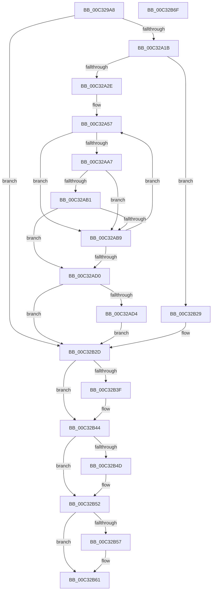

# PiCreateDriverDataDirectoryRoot

- RVA: `0x00C329A8`–`0x00C32B70` (길이 `456` bytes)
- VA: `0x0000000140C329A8`
- 실행 섹션: `INIT`
- PDB 이름 있음: `예`; PDB Function 태그: `아니요`
- unwind 정보 RVA: `0x000C83EC`
- 디코드: `115`개 명령, `456/456` bytes 표시
- 미해석 바이트: `0` (있으면 어셈블리에 `.byte`로 보존)

> 이 문서는 커널 이미지의 기계어와 PDB 기호를 분석해 생성했습니다. 4번과 5번은 함수 원형과 자료형을 바이너리 사용 방식에서 추정한 C 해석이며 원본 소스 복구 결과는 아닙니다.

## 1. Dependencies

- 직접 호출 지점: **10**; 고유 호출 대상: **9**
- 직접 호출자로 확인된 함수: **1**
- RIP 상대 이미지 참조: **4**

### Outgoing calls
- `0x00C32A0C` → [PiGetStateRootPath](../../page/A6/PiGetStateRootPath_function_00A67A70.md) (function, `0x00A67A70`)
- `0x00C32A1F` → [PiAuGetDriverDataDirectorySecurityObject](PiAuGetDriverDataDirectorySecurityObject_function_00C34EEC.md) (function, `0x00C34EEC`)
- `0x00C32A99` → [ZwCreateFile](../../text/6A/ZwCreateFile_function_006ADB70.md) (function, `0x006ADB70`)
- `0x00C32AC1` → [KeDelayExecutionThread](../../text/20/KeDelayExecutionThread_function_00209550.md) (function, `0x00209550`)
- `0x00C32ADF` → [RtlInitUnicodeString](../../text/42/RtlInitUnicodeString_function_0042A780.md) (function, `0x0042A780`)
- `0x00C32B20` → [ZwCreateSymbolicLinkObject](../../text/6A/ZwCreateSymbolicLinkObject_function_006AE9D0.md) (function, `0x006AE9D0`)
- `0x00C32B31` → [RtlFreeAnsiString](../../page/9C/RtlFreeAnsiString_function_009C0800.md) (function, `0x009C0800`)
- `0x00C32B3F` → [ZwClose](../../text/6A/ZwClose_function_006AD2B0.md) (function, `0x006AD2B0`)
- `0x00C32B4D` → [ZwClose](../../text/6A/ZwClose_function_006AD2B0.md) (function, `0x006AD2B0`)
- `0x00C32B5C` → [ExFreePoolWithTag](../../poolcode/B8/ExFreePoolWithTag_function_00B82870.md) (function, `0x00B82870`)

### Direct callers
- [IopInitializeBootDrivers](../C2/IopInitializeBootDrivers_function_00C2E6F4.md) at `0x00C2EF9A`

### Static image references
- `0x00C329CF` → RVA `0x00C7ABE0` (` ?? ::PBOPGDP::`string'`; read)
- `0x00C329DA` → RVA `0x00C7AC30` (` ?? ::PBOPGDP::`string'`; read)
- `0x00C32AD4` → RVA `0x00C7AC50` (` ?? ::PBOPGDP::`string'`; read)
- `0x00C32AFE` → RVA `0x00FD9AA8` (`PAGEDATA`; read)

## 2. Other-region calls and transfers

- 다른 실행 섹션으로 향하는 call: **9**
  - `0x00C32A0C` → [PiGetStateRootPath](../../page/A6/PiGetStateRootPath_function_00A67A70.md) (`INIT` → `PAGE`)
  - `0x00C32A99` → [ZwCreateFile](../../text/6A/ZwCreateFile_function_006ADB70.md) (`INIT` → `.text`)
  - `0x00C32AC1` → [KeDelayExecutionThread](../../text/20/KeDelayExecutionThread_function_00209550.md) (`INIT` → `.text`)
  - `0x00C32ADF` → [RtlInitUnicodeString](../../text/42/RtlInitUnicodeString_function_0042A780.md) (`INIT` → `.text`)
  - `0x00C32B20` → [ZwCreateSymbolicLinkObject](../../text/6A/ZwCreateSymbolicLinkObject_function_006AE9D0.md) (`INIT` → `.text`)
  - `0x00C32B31` → [RtlFreeAnsiString](../../page/9C/RtlFreeAnsiString_function_009C0800.md) (`INIT` → `PAGE`)
  - `0x00C32B3F` → [ZwClose](../../text/6A/ZwClose_function_006AD2B0.md) (`INIT` → `.text`)
  - `0x00C32B4D` → [ZwClose](../../text/6A/ZwClose_function_006AD2B0.md) (`INIT` → `.text`)
  - `0x00C32B5C` → [ExFreePoolWithTag](../../poolcode/B8/ExFreePoolWithTag_function_00B82870.md) (`INIT` → `POOLCODE`)
- 별도 외부 분기/꼬리 이동을 확인하지 못했습니다.

## 3. Assembly (complete function range)

```asm
00C329A8  40 55                           push rbp
00C329AA  53                              push rbx
00C329AB  56                              push rsi
00C329AC  57                              push rdi
00C329AD  48 8D 6C 24 C1                  lea rbp, [rsp - 0x3f]
00C329B2  48 81 EC C8 00 00 00            sub rsp, 0xc8
00C329B9  33 C0                           xor eax, eax
00C329BB  48 C7 45 7F C0 BD F0 FF         mov qword ptr [rbp + 0x7f], 0xfffffffffff0bdc0
00C329C3  48 21 45 6F                     and qword ptr [rbp + 0x6f], rax
00C329C7  4C 8D 4D D7                     lea r9, [rbp - 0x29]
00C329CB  48 21 45 77                     and qword ptr [rbp + 0x77], rax
00C329CF  48 8D 15 0A 82 04 00            lea rdx, [rip + 0x4820a]
00C329D6  48 21 45 D7                     and qword ptr [rbp - 0x29], rax
00C329DA  48 8D 0D 4F 82 04 00            lea rcx, [rip + 0x4824f]
00C329E1  48 21 45 DF                     and qword ptr [rbp - 0x21], rax
00C329E5  44 8D 40 01                     lea r8d, [rax + 1]
00C329E9  0F 57 C0                        xorps xmm0, xmm0
00C329EC  48 89 45 27                     mov qword ptr [rbp + 0x27], rax
00C329F0  0F 57 C9                        xorps xmm1, xmm1
00C329F3  89 45 2F                        mov dword ptr [rbp + 0x2f], eax
00C329F6  33 FF                           xor edi, edi
00C329F8  0F 11 45 F7                     movups xmmword ptr [rbp - 9], xmm0
00C329FC  48 89 7D 67                     mov qword ptr [rbp + 0x67], rdi
00C32A00  0F 11 4D E7                     movups xmmword ptr [rbp - 0x19], xmm1
00C32A04  0F 11 45 07                     movups xmmword ptr [rbp + 7], xmm0
00C32A08  0F 11 45 17                     movups xmmword ptr [rbp + 0x17], xmm0
00C32A0C  E8 5F 50 E3 FF                  call 0x140a67a70
00C32A11  8B D8                           mov ebx, eax
00C32A13  85 C0                           test eax, eax
00C32A15  0F 88 12 01 00 00               js 0x140c32b2d
00C32A1B  48 8D 4D 67                     lea rcx, [rbp + 0x67]
00C32A1F  E8 C8 24 00 00                  call 0x140c34eec
00C32A24  8B D8                           mov ebx, eax
00C32A26  85 C0                           test eax, eax
00C32A28  0F 88 FB 00 00 00               js 0x140c32b29
00C32A2E  48 21 7D 0F                     and qword ptr [rbp + 0xf], rdi
00C32A32  48 8D 45 D7                     lea rax, [rbp - 0x29]
00C32A36  48 8B 7D 67                     mov rdi, qword ptr [rbp + 0x67]
00C32A3A  48 83 65 2F 00                  and qword ptr [rbp + 0x2f], 0
00C32A3F  48 89 7D 27                     mov qword ptr [rbp + 0x27], rdi
00C32A43  33 F6                           xor esi, esi
00C32A45  C7 45 07 30 00 00 00            mov dword ptr [rbp + 7], 0x30
00C32A4C  C7 45 1F 40 02 00 00            mov dword ptr [rbp + 0x1f], 0x240
00C32A53  48 89 45 17                     mov qword ptr [rbp + 0x17], rax
00C32A57  83 64 24 50 00                  and dword ptr [rsp + 0x50], 0
00C32A5C  4C 8D 4D F7                     lea r9, [rbp - 9]
00C32A60  48 83 64 24 48 00               and qword ptr [rsp + 0x48], 0
00C32A66  4C 8D 45 07                     lea r8, [rbp + 7]
00C32A6A  C7 44 24 40 21 00 00 00         mov dword ptr [rsp + 0x40], 0x21
00C32A72  48 8D 4D 6F                     lea rcx, [rbp + 0x6f]
00C32A76  C7 44 24 38 03 00 00 00         mov dword ptr [rsp + 0x38], 3
00C32A7E  BA 01 00 10 00                  mov edx, 0x100001
00C32A83  C7 44 24 30 03 00 00 00         mov dword ptr [rsp + 0x30], 3
00C32A8B  C7 44 24 28 80 00 00 00         mov dword ptr [rsp + 0x28], 0x80
00C32A93  48 83 64 24 20 00               and qword ptr [rsp + 0x20], 0
00C32A99  E8 D2 B0 A7 FF                  call 0x1406adb70
00C32A9E  8B D8                           mov ebx, eax
00C32AA0  3D 0E 00 00 C0                  cmp eax, 0xc000000e
00C32AA5  74 12                           je 0x140c32ab9
00C32AA7  05 F0 FF FF 7F                  add eax, 0x7ffffff0
00C32AAC  83 F8 01                        cmp eax, 1
00C32AAF  76 08                           jbe 0x140c32ab9
00C32AB1  81 FB 3A 00 00 C0               cmp ebx, 0xc000003a
00C32AB7  75 17                           jne 0x140c32ad0
00C32AB9  4C 8D 45 7F                     lea r8, [rbp + 0x7f]
00C32ABD  33 D2                           xor edx, edx
00C32ABF  33 C9                           xor ecx, ecx
00C32AC1  E8 8A 6A 5D FF                  call 0x140209550
00C32AC6  FF C6                           inc esi
00C32AC8  81 FE 2C 01 00 00               cmp esi, 0x12c
00C32ACE  72 87                           jb 0x140c32a57
00C32AD0  85 DB                           test ebx, ebx
00C32AD2  78 59                           js 0x140c32b2d
00C32AD4  48 8D 15 75 81 04 00            lea rdx, [rip + 0x48175]
00C32ADB  48 8D 4D E7                     lea rcx, [rbp - 0x19]
00C32ADF  E8 9C 7C 7F FF                  call 0x14042a780
00C32AE4  48 83 65 0F 00                  and qword ptr [rbp + 0xf], 0
00C32AE9  48 8D 45 E7                     lea rax, [rbp - 0x19]
00C32AED  48 83 65 2F 00                  and qword ptr [rbp + 0x2f], 0
00C32AF2  4C 8D 4D D7                     lea r9, [rbp - 0x29]
00C32AF6  48 89 45 17                     mov qword ptr [rbp + 0x17], rax
00C32AFA  4C 8D 45 07                     lea r8, [rbp + 7]
00C32AFE  48 8B 05 A3 6F 3A 00            mov rax, qword ptr [rip + 0x3a6fa3]
00C32B05  48 8D 4D 77                     lea rcx, [rbp + 0x77]
00C32B09  BA 01 00 0F 00                  mov edx, 0xf0001
00C32B0E  48 89 45 27                     mov qword ptr [rbp + 0x27], rax
00C32B12  C7 45 07 30 00 00 00            mov dword ptr [rbp + 7], 0x30
00C32B19  C7 45 1F 50 00 00 00            mov dword ptr [rbp + 0x1f], 0x50
00C32B20  E8 AB BE A7 FF                  call 0x1406ae9d0
00C32B25  8B D8                           mov ebx, eax
00C32B27  EB 04                           jmp 0x140c32b2d
00C32B29  48 8B 7D 67                     mov rdi, qword ptr [rbp + 0x67]
00C32B2D  48 8D 4D D7                     lea rcx, [rbp - 0x29]
00C32B31  E8 CA DC D8 FF                  call 0x1409c0800
00C32B36  48 8B 4D 6F                     mov rcx, qword ptr [rbp + 0x6f]
00C32B3A  48 85 C9                        test rcx, rcx
00C32B3D  74 05                           je 0x140c32b44
00C32B3F  E8 6C A7 A7 FF                  call 0x1406ad2b0
00C32B44  48 8B 4D 77                     mov rcx, qword ptr [rbp + 0x77]
00C32B48  48 85 C9                        test rcx, rcx
00C32B4B  74 05                           je 0x140c32b52
00C32B4D  E8 5E A7 A7 FF                  call 0x1406ad2b0
00C32B52  48 85 FF                        test rdi, rdi
00C32B55  74 0A                           je 0x140c32b61
00C32B57  33 D2                           xor edx, edx
00C32B59  48 8B CF                        mov rcx, rdi
00C32B5C  E8 0F FD F4 FF                  call 0x140b82870
00C32B61  8B C3                           mov eax, ebx
00C32B63  48 81 C4 C8 00 00 00            add rsp, 0xc8
00C32B6A  5F                              pop rdi
00C32B6B  5E                              pop rsi
00C32B6C  5B                              pop rbx
00C32B6D  5D                              pop rbp
00C32B6E  C3                              ret
00C32B6F  CC                              int3
```

## 4. C-style interpretation (structured pseudocode)

```c
__int64 __fastcall PiCreateDriverDataDirectoryRoot(void)
{
    __int64 result;
    __int64 v_rdi;
    __int64 v_rsi;
    __int64 v_rsp;
    unsigned int v_stack_m30;
    unsigned __int64 v_stack_m38;
    unsigned int v_stack_m40;
    unsigned __int64 v_stack_m48;
    unsigned __int64 v_stack_m50;
    unsigned __int64 v_stack_m58;
    unsigned __int64 v_stack_m5F;
    unsigned __int64 v_stack_m68;
    unsigned __int64 v_stack_m78;
    unsigned __int64 v_stack_m80;
    unsigned __int64 v_stack_m88;
    unsigned int v_stack_m98;
    unsigned __int64 v_stack_mA0;
    unsigned int v_stack_mA8;
    unsigned int v_stack_mB0;
    unsigned int v_stack_mB8;
    unsigned int v_stack_mC0;
    unsigned __int64 v_stack_mC8;
    unsigned __int64 v_stack_p10;
    unsigned __int64 v_stack_p18;
    unsigned __int64 v_stack_p20;
    unsigned __int64 v_stack_p8;

    v_rsp = (v_rsp) - (200);
    result = 0;
    v_stack_p20 = 0xFFFFFFFFFFF0BDC0ULL;
    v_stack_m38 = 0;
    v_stack_m30 = 0;
    v_rdi = 0;
    v_stack_m68 = v_xmm0;
    v_stack_p8 = 0;
    v_stack_m78 = v_xmm1;
    v_stack_m58 = v_xmm0;
    v_stack_m48 = v_xmm0;
    result = PiGetStateRootPath(v_rip + 295503, v_rip + 295434, result + 1, v_stack_m88);
    if (sign_flag) goto loc_00C32B2D;
    result = PiAuGetDriverDataDirectorySecurityObject(v_stack_p8, v_rip + 295434, result + 1, v_stack_m88);
    if (sign_flag) goto loc_00C32B29;
    v_stack_m38 = v_stack_p8;
    v_rsi = 0;
    v_stack_m58 = 48;
    v_stack_m40 = 576;
    v_stack_m48 = v_stack_m88;
loc_00C32A57:
    v_stack_mA8 = 33;
    v_stack_mB0 = 3;
    v_stack_mB8 = 3;
    v_stack_mC0 = 128;
    result = ZwCreateFile(v_stack_p10, (unsigned int)(0x100001ULL), v_stack_m58, v_stack_m68);
    if (((unsigned int)(result)) == 0xC000000EULL) goto loc_00C32AB9;
    result = (unsigned int)((result) + (0x7FFFFFF0ULL));
    if (((unsigned int)(result)) <= 1) goto loc_00C32AB9;
    if (((unsigned int)((unsigned int)((unsigned int)(result)))) != 0xC000003AULL) goto loc_00C32AD0;
loc_00C32AB9:
    a2 = 0;
    a1 = 0;
    result = KeDelayExecutionThread(a1, a2, v_stack_p20, v_stack_m68);
    v_rsi = (unsigned int)((v_rsi) + 1);
    if (((unsigned int)(v_rsi)) < 300) goto loc_00C32A57;
loc_00C32AD0:
    if (sign_flag) goto loc_00C32B2D;
    result = RtlInitUnicodeString(v_stack_m78, v_rip + 295285, v_stack_p20, v_stack_m68);
    v_stack_m48 = v_stack_m78;
    v_stack_m38 = *(unsigned __int64 *)(v_rip + 3829667);
    v_stack_m58 = 48;
    v_stack_m40 = 80;
    result = ZwCreateSymbolicLinkObject(v_stack_p18, (unsigned int)(0xF0001ULL), v_stack_m58, v_stack_m88);
    goto loc_00C32B2D;
loc_00C32B29:
loc_00C32B2D:
    result = RtlFreeAnsiString(v_stack_m88, (unsigned int)(0xF0001ULL), v_stack_m58, v_stack_m88);
    if (v_stack_p10 != 0) {
        result = ZwClose(v_stack_p10, (unsigned int)(0xF0001ULL), v_stack_m58, v_stack_m88);
    }
    if (v_stack_p18 != 0) {
        result = ZwClose(v_stack_p18, (unsigned int)(0xF0001ULL), v_stack_m58, v_stack_m88);
    }
    if (v_stack_p8 != 0) {
        a2 = 0;
        a1 = v_stack_p8;
        result = ExFreePoolWithTag(a1, a2, v_stack_m58, v_stack_m88);
    }
    v_rsp = (v_rsp) + (200);
    return (unsigned int)((unsigned int)((unsigned int)((unsigned int)(result))));
}
```

## 5. (Beta) C Style

```c
void PiCreateDriverDataDirectoryRoot(void)
{
    int64_t result;
    int64_t local_rdi;
    int64_t local_rsi;
    int64_t local_rsp;
    uint32_t v_stack_m30;
    uint64_t v_stack_m38;
    uint32_t v_stack_m40;
    uint64_t v_stack_m48;
    uint64_t v_stack_m50;
    uint64_t v_stack_m58;
    uint64_t v_stack_m5F;
    uint64_t v_stack_m68;
    uint64_t v_stack_m78;
    uint64_t v_stack_m80;
    uint64_t v_stack_m88;
    uint32_t v_stack_m98;
    uint64_t v_stack_mA0;
    uint32_t v_stack_mA8;
    uint32_t v_stack_mB0;
    uint32_t v_stack_mB8;
    uint32_t v_stack_mC0;
    uint64_t v_stack_mC8;
    uint64_t v_stack_p10;
    uint64_t v_stack_p18;
    uint64_t v_stack_p20;
    uint64_t v_stack_p8;

    local_rsp = (local_rsp) - (200);
    result = 0;
    v_stack_p20 = 0xFFFFFFFFFFF0BDC0ULL;
    v_stack_m38 = 0;
    v_stack_m30 = 0;
    local_rdi = 0;
    v_stack_m68 = v_xmm0;
    v_stack_p8 = 0;
    v_stack_m78 = v_xmm1;
    v_stack_m58 = v_xmm0;
    v_stack_m48 = v_xmm0;
    result = PiGetStateRootPath(v_rip + 295503, v_rip + 295434, result + 1, v_stack_m88);
    if (sign_flag) goto loc_00C32B2D;
    result = PiAuGetDriverDataDirectorySecurityObject(v_stack_p8, v_rip + 295434, result + 1, v_stack_m88);
    if (sign_flag) goto loc_00C32B29;
    v_stack_m38 = v_stack_p8;
    local_rsi = 0;
    v_stack_m58 = 48;
    v_stack_m40 = 576;
    v_stack_m48 = v_stack_m88;
loc_00C32A57:
    v_stack_mA8 = 33;
    v_stack_mB0 = 3;
    v_stack_mB8 = 3;
    v_stack_mC0 = 128;
    result = ZwCreateFile(v_stack_p10, (uint32_t)(0x100001ULL), v_stack_m58, v_stack_m68);
    if (((uint32_t)(result)) == 0xC000000EULL) goto loc_00C32AB9;
    result = (uint32_t)((result) + (0x7FFFFFF0ULL));
    if (((uint32_t)(result)) <= 1) goto loc_00C32AB9;
    if (((uint32_t)((uint32_t)((uint32_t)(result)))) != 0xC000003AULL) goto loc_00C32AD0;
loc_00C32AB9:
    a2 = 0;
    a1 = 0;
    result = KeDelayExecutionThread(a1, a2, v_stack_p20, v_stack_m68);
    local_rsi = (uint32_t)((local_rsi) + 1);
    if (((uint32_t)(local_rsi)) < 300) goto loc_00C32A57;
loc_00C32AD0:
    if (sign_flag) goto loc_00C32B2D;
    result = RtlInitUnicodeString(v_stack_m78, v_rip + 295285, v_stack_p20, v_stack_m68);
    v_stack_m48 = v_stack_m78;
    v_stack_m38 = *(uint64_t *)(v_rip + 0x3A6FA3);
    v_stack_m58 = 48;
    v_stack_m40 = 80;
    result = ZwCreateSymbolicLinkObject(v_stack_p18, (uint32_t)(0xF0001ULL), v_stack_m58, v_stack_m88);
    goto loc_00C32B2D;
loc_00C32B29:
loc_00C32B2D:
    result = RtlFreeAnsiString(v_stack_m88, (uint32_t)(0xF0001ULL), v_stack_m58, v_stack_m88);
    if (v_stack_p10 != 0) {
        result = ZwClose(v_stack_p10, (uint32_t)(0xF0001ULL), v_stack_m58, v_stack_m88);
    }
    if (v_stack_p18 != 0) {
        result = ZwClose(v_stack_p18, (uint32_t)(0xF0001ULL), v_stack_m58, v_stack_m88);
    }
    if (v_stack_p8 != 0) {
        a2 = 0;
        a1 = v_stack_p8;
        result = ExFreePoolWithTag(a1, a2, v_stack_m58, v_stack_m88);
    }
    local_rsp = (local_rsp) + (200);
    return (uint32_t)((uint32_t)((uint32_t)((uint32_t)(result))));
}
```

## 6. Execution-region graph

[열기: 2D/3D 그래프와 함수 탐색 컨트롤 패널](../../../control-panel.html?section=init&rva=0x00C329A8&view=graph)

- 2D 그래프는 위에서 아래로 흐르고, 3D 그래프는 빈 공간을 드래그해 회전합니다. Shift+드래그는 이동, 휠은 확대·축소, 함수 노드 선택은 대상 보고서 이동입니다.

### Static fallback


