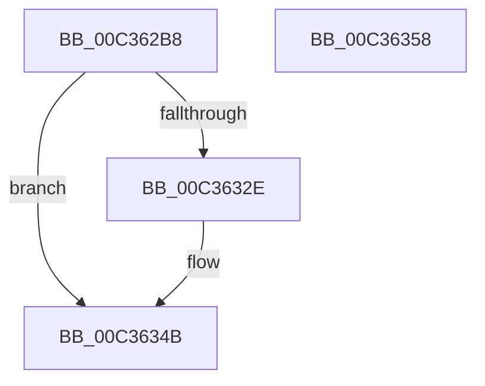

# PiCslInitialize

- RVA: `0x00C362B8`–`0x00C36359` (길이 `161` bytes)
- VA: `0x0000000140C362B8`
- 실행 섹션: `INIT`
- PDB 이름 있음: `예`; PDB Function 태그: `아니요`
- unwind 정보 RVA: `0x0009EAB4`
- 디코드: `38`개 명령, `161/161` bytes 표시
- 미해석 바이트: `0` (있으면 어셈블리에 `.byte`로 보존)

> 이 문서는 커널 이미지의 기계어와 PDB 기호를 분석해 생성했습니다. 4번과 5번은 함수 원형과 자료형을 바이너리 사용 방식에서 추정한 C 해석이며 원본 소스 복구 결과는 아닙니다.

## 1. Dependencies

- 직접 호출 지점: **3**; 고유 호출 대상: **3**
- 직접 호출자로 확인된 함수: **1**
- RIP 상대 이미지 참조: **5**

### Outgoing calls
- `0x00C362F1` → [RtlInitUnicodeString](../../text/42/RtlInitUnicodeString_function_0042A780.md) (function, `0x0042A780`)
- `0x00C36323` → [ExCreateCallback](../../page/A7/ExCreateCallback_function_00A7B9D0.md) (function, `0x00A7B9D0`)
- `0x00C3633F` → [ExRegisterCallback](../../text/4B/ExRegisterCallback_function_004BDFC0.md) (function, `0x004BDFC0`)

### Direct callers
- [IopInitializePlugPlayServices](../C2/IopInitializePlugPlayServices_function_00C2F298.md) at `0x00C2FFDD`

### Static image references
- `0x00C362C9` → RVA `0x00C7B1F0` (` ?? ::PBOPGDP::`string'`; read)
- `0x00C362E7` → RVA `0x00F8A99C` (`.data`; write)
- `0x00C36317` → RVA `0x00F8A990` (`.data`; read)
- `0x00C36335` → RVA `0x00AB5C70` (`PipCslStateChangeCallback`; read)
- `0x00C36344` → RVA `0x00F8A998` (`.data`; write)

## 2. Other-region calls and transfers

- 다른 실행 섹션으로 향하는 call: **3**
  - `0x00C362F1` → [RtlInitUnicodeString](../../text/42/RtlInitUnicodeString_function_0042A780.md) (`INIT` → `.text`)
  - `0x00C36323` → [ExCreateCallback](../../page/A7/ExCreateCallback_function_00A7B9D0.md) (`INIT` → `PAGE`)
  - `0x00C3633F` → [ExRegisterCallback](../../text/4B/ExRegisterCallback_function_004BDFC0.md) (`INIT` → `.text`)
- 별도 외부 분기/꼬리 이동을 확인하지 못했습니다.

## 3. Assembly (complete function range)

```asm
00C362B8  48 89 5C 24 08                  mov qword ptr [rsp + 8], rbx
00C362BD  55                              push rbp
00C362BE  48 8B EC                        mov rbp, rsp
00C362C1  48 83 EC 60                     sub rsp, 0x60
00C362C5  83 65 EC 00                     and dword ptr [rbp - 0x14], 0
00C362C9  48 8D 15 20 4F 04 00            lea rdx, [rip + 0x44f20]
00C362D0  0F 57 C0                        xorps xmm0, xmm0
00C362D3  48 C7 45 D0 30 00 00 00         mov qword ptr [rbp - 0x30], 0x30
00C362DB  83 65 D4 00                     and dword ptr [rbp - 0x2c], 0
00C362DF  48 8D 4D C0                     lea rcx, [rbp - 0x40]
00C362E3  0F 11 45 C0                     movups xmmword ptr [rbp - 0x40], xmm0
00C362E7  C7 05 AB 46 35 00 00 00 00 00   mov dword ptr [rip + 0x3546ab], 0
00C362F1  E8 8A 44 7F FF                  call 0x14042a780
00C362F6  48 83 65 D8 00                  and qword ptr [rbp - 0x28], 0
00C362FB  48 8D 45 C0                     lea rax, [rbp - 0x40]
00C362FF  41 B1 01                        mov r9b, 1
00C36302  C7 45 E8 50 00 00 00            mov dword ptr [rbp - 0x18], 0x50
00C36309  0F 57 C0                        xorps xmm0, xmm0
00C3630C  48 89 45 E0                     mov qword ptr [rbp - 0x20], rax
00C36310  45 8A C1                        mov r8b, r9b
00C36313  48 8D 55 D0                     lea rdx, [rbp - 0x30]
00C36317  48 8D 0D 72 46 35 00            lea rcx, [rip + 0x354672]
00C3631E  F3 0F 7F 45 F0                  movdqu xmmword ptr [rbp - 0x10], xmm0
00C36323  E8 A8 56 E4 FF                  call 0x140a7b9d0
00C36328  8B D8                           mov ebx, eax
00C3632A  85 C0                           test eax, eax
00C3632C  78 1D                           js 0x140c3634b
00C3632E  48 8B 0D 5B 46 35 00            mov rcx, qword ptr [rip + 0x35465b]
00C36335  48 8D 15 34 F9 E7 FF            lea rdx, [rip - 0x1806cc]
00C3633C  45 33 C0                        xor r8d, r8d
00C3633F  E8 7C 7C 88 FF                  call 0x1404bdfc0
00C36344  C6 05 4D 46 35 00 01            mov byte ptr [rip + 0x35464d], 1
00C3634B  8B C3                           mov eax, ebx
00C3634D  48 8B 5C 24 70                  mov rbx, qword ptr [rsp + 0x70]
00C36352  48 83 C4 60                     add rsp, 0x60
00C36356  5D                              pop rbp
00C36357  C3                              ret
00C36358  CC                              int3
```

## 4. C-style interpretation (structured pseudocode)

```c
__int64 __fastcall PiCslInitialize(void)
{
    __int64 result;
    __int64 v_rsp;
    unsigned __int64 v_stack_m18;
    unsigned int v_stack_m1C;
    unsigned int v_stack_m20;
    unsigned __int64 v_stack_m28;
    unsigned __int64 v_stack_m30;
    unsigned int v_stack_m34;
    unsigned __int64 v_stack_m38;
    unsigned __int64 v_stack_m48;
    unsigned __int64 v_stack_p8;

    v_stack_p8 = v_rbx;
    v_rsp = (v_rsp) - (96);
    v_stack_m38 = 48;
    v_stack_m48 = v_xmm0;
    *(unsigned int *)(v_rip + 3491499) = 0;
    result = RtlInitUnicodeString(v_stack_m48, v_rip + 282400, a3, a4);
    v_stack_m20 = 80;
    v_stack_m28 = v_stack_m48;
    v_stack_m18 = v_xmm0;
    result = ExCreateCallback(v_rip + 3491442, v_stack_m38, 1, 1);
    if (!(sign_flag)) {
        a1 = *(unsigned __int64 *)(v_rip + 3491419);
        a2 = v_rip - 1574604;
        a3 = 0;
        result = ExRegisterCallback(a1, a2, a3, 1);
        *(unsigned __int8 *)(v_rip + 3491405) = 1;
    }
    v_rsp = (v_rsp) + (96);
    return (unsigned int)((unsigned int)((unsigned int)((unsigned int)(result))));
}
```

## 5. (Beta) C Style

```c
void PiCslInitialize(void)
{
    int64_t result;
    int64_t local_rsp;
    uint64_t v_stack_m18;
    uint32_t v_stack_m1C;
    uint32_t v_stack_m20;
    uint64_t v_stack_m28;
    uint64_t v_stack_m30;
    uint32_t v_stack_m34;
    uint64_t v_stack_m38;
    uint64_t v_stack_m48;
    uint64_t v_stack_p8;

    v_stack_p8 = local_rbx;
    local_rsp = (local_rsp) - (96);
    v_stack_m38 = 48;
    v_stack_m48 = v_xmm0;
    *(uint32_t *)(v_rip + 0x3546AB) = 0;
    result = RtlInitUnicodeString(v_stack_m48, v_rip + 282400, a3, a4);
    v_stack_m20 = 80;
    v_stack_m28 = v_stack_m48;
    v_stack_m18 = v_xmm0;
    result = ExCreateCallback(v_rip + 3491442, v_stack_m38, 1, 1);
    if (!(sign_flag)) {
        a1 = *(uint64_t *)(v_rip + 0x35465B);
        a2 = v_rip - 1574604;
        a3 = 0;
        result = ExRegisterCallback(a1, a2, a3, 1);
        *(uint8_t *)(v_rip + 0x35464D) = 1;
    }
    local_rsp = (local_rsp) + (96);
    return (uint32_t)((uint32_t)((uint32_t)((uint32_t)(result))));
}
```

## 6. Execution-region graph

[열기: 2D/3D 그래프와 함수 탐색 컨트롤 패널](../../../control-panel.html?section=init&rva=0x00C362B8&view=graph)

- 2D 그래프는 위에서 아래로 흐르고, 3D 그래프는 빈 공간을 드래그해 회전합니다. Shift+드래그는 이동, 휠은 확대·축소, 함수 노드 선택은 대상 보고서 이동입니다.

### Static fallback


