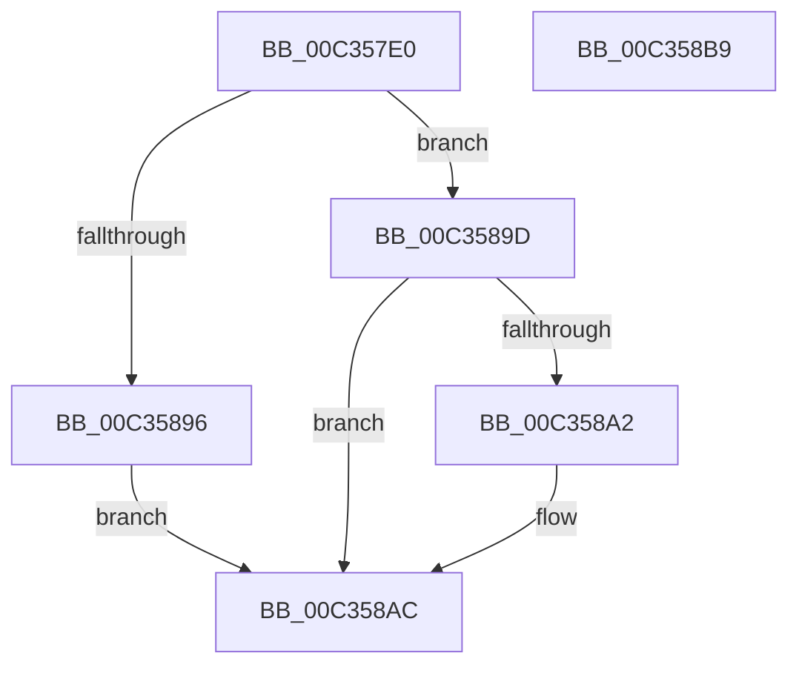

# PiDaDriverEntry

- RVA: `0x00C357E0`–`0x00C358BA` (길이 `218` bytes)
- VA: `0x0000000140C357E0`
- 실행 섹션: `INIT`
- PDB 이름 있음: `예`; PDB Function 태그: `아니요`
- unwind 정보 RVA: `0x000C8FD0`
- 디코드: `48`개 명령, `218/218` bytes 표시
- 미해석 바이트: `0` (있으면 어셈블리에 `.byte`로 보존)

> 이 문서는 커널 이미지의 기계어와 PDB 기호를 분석해 생성했습니다. 4번과 5번은 함수 원형과 자료형을 바이너리 사용 방식에서 추정한 C 해석이며 원본 소스 복구 결과는 아닙니다.

## 1. Dependencies

- 직접 호출 지점: **3**; 고유 호출 대상: **3**
- 직접 호출자로 확인된 함수: **0**
- RIP 상대 이미지 참조: **6**

### Outgoing calls
- `0x00C3582A` → [memset](../../text/6C/memset_function_006C6C40.md) (function, `0x006C6C40`)
- `0x00C35886` → [IoCreateDevice](../../page/9A/IoCreateDevice_function_009A4B00.md) (function, `0x009A4B00`)
- `0x00C358A7` → [ObfDereferenceObjectWithTag](../../text/2F/ObfDereferenceObjectWithTag_function_002F78E0.md) (function, `0x002F78E0`)

### Direct callers
- 이 함수 시작 RVA로 연결되는 직접 call은 확인되지 않았습니다. 간접 호출은 완전히 역산할 수 없습니다.

### Static image references
- `0x00C357F0` → RVA `0x00A00230` (`PiDaDispatch`; read)
- `0x00C357FC` → RVA `0x00F8A9C0` (`.data`; read)
- `0x00C3582F` → RVA `0x008EC5B0` (`PiDaFastIoDispatch`; read)
- `0x00C35836` → RVA `0x00F8A9C0` (`.data`; write)
- `0x00C35840` → RVA `0x00F8AA10` (`.data`; write)
- `0x00C3584C` → RVA `0x00C7B060` (` ?? ::PBOPGDP::`string'`; read)

## 2. Other-region calls and transfers

- 다른 실행 섹션으로 향하는 call: **3**
  - `0x00C3582A` → [memset](../../text/6C/memset_function_006C6C40.md) (`INIT` → `.text`)
  - `0x00C35886` → [IoCreateDevice](../../page/9A/IoCreateDevice_function_009A4B00.md) (`INIT` → `PAGE`)
  - `0x00C358A7` → [ObfDereferenceObjectWithTag](../../text/2F/ObfDereferenceObjectWithTag_function_002F78E0.md) (`INIT` → `.text`)
- 별도 외부 분기/꼬리 이동을 확인하지 못했습니다.

## 3. Assembly (complete function range)

```asm
00C357E0  48 89 5C 24 10                  mov qword ptr [rsp + 0x10], rbx
00C357E5  56                              push rsi
00C357E6  48 83 EC 50                     sub rsp, 0x50
00C357EA  48 83 64 24 60 00               and qword ptr [rsp + 0x60], 0
00C357F0  48 8D 05 39 AA DC FF            lea rax, [rip - 0x2355c7]
00C357F7  83 64 24 44 00                  and dword ptr [rsp + 0x44], 0
00C357FC  48 8D 35 BD 51 35 00            lea rsi, [rip + 0x3551bd]
00C35803  48 89 41 70                     mov qword ptr [rcx + 0x70], rax
00C35807  48 8B D9                        mov rbx, rcx
00C3580A  48 89 81 00 01 00 00            mov qword ptr [rcx + 0x100], rax
00C35811  33 D2                           xor edx, edx
00C35813  48 89 81 80 00 00 00            mov qword ptr [rcx + 0x80], rax
00C3581A  41 B8 E0 00 00 00               mov r8d, 0xe0
00C35820  48 89 81 E0 00 00 00            mov qword ptr [rcx + 0xe0], rax
00C35827  48 8B CE                        mov rcx, rsi
00C3582A  E8 11 14 A9 FF                  call 0x1406c6c40
00C3582F  48 8D 05 7A 6D CB FF            lea rax, [rip - 0x349286]
00C35836  C7 05 80 51 35 00 E0 00 00 00   mov dword ptr [rip + 0x355180], 0xe0
00C35840  48 89 05 C9 51 35 00            mov qword ptr [rip + 0x3551c9], rax
00C35847  4C 8D 44 24 40                  lea r8, [rsp + 0x40]
00C3584C  48 8D 05 0D 58 04 00            lea rax, [rip + 0x4580d]
00C35853  48 89 73 50                     mov qword ptr [rbx + 0x50], rsi
00C35857  48 89 44 24 48                  mov qword ptr [rsp + 0x48], rax
00C3585C  41 B9 22 00 00 00               mov r9d, 0x22
00C35862  48 8D 44 24 60                  lea rax, [rsp + 0x60]
00C35867  C7 44 24 40 22 00 24 00         mov dword ptr [rsp + 0x40], 0x240022
00C3586F  48 89 44 24 30                  mov qword ptr [rsp + 0x30], rax
00C35874  33 D2                           xor edx, edx
00C35876  C6 44 24 28 00                  mov byte ptr [rsp + 0x28], 0
00C3587B  48 8B CB                        mov rcx, rbx
00C3587E  C7 44 24 20 00 00 02 00         mov dword ptr [rsp + 0x20], 0x20000
00C35886  E8 75 F2 D6 FF                  call 0x1409a4b00
00C3588B  48 8B 4C 24 60                  mov rcx, qword ptr [rsp + 0x60]
00C35890  8B D8                           mov ebx, eax
00C35892  85 C0                           test eax, eax
00C35894  78 07                           js 0x140c3589d
00C35896  0F BA 71 30 07                  btr dword ptr [rcx + 0x30], 7
00C3589B  EB 0F                           jmp 0x140c358ac
00C3589D  48 85 C9                        test rcx, rcx
00C358A0  74 0A                           je 0x140c358ac
00C358A2  BA 44 66 6C 74                  mov edx, 0x746c6644
00C358A7  E8 34 20 6C FF                  call 0x1402f78e0
00C358AC  8B C3                           mov eax, ebx
00C358AE  48 8B 5C 24 68                  mov rbx, qword ptr [rsp + 0x68]
00C358B3  48 83 C4 50                     add rsp, 0x50
00C358B7  5E                              pop rsi
00C358B8  C3                              ret
00C358B9  CC                              int3
```

## 4. C-style interpretation (structured pseudocode)

```c
__int64 __fastcall PiDaDriverEntry(__int64 a1, int a2)
{
    __int64 result;
    __int64 v_rsp;
    unsigned __int64 v_stack_m10;
    unsigned int v_stack_m14;
    unsigned __int64 v_stack_m18;
    unsigned __int64 v_stack_m28;
    unsigned __int8 v_stack_m30;
    unsigned int v_stack_m38;
    unsigned __int64 v_stack_p10;
    unsigned __int64 v_stack_p8;

    v_stack_p10 = v_rbx;
    v_rsp = (v_rsp) - (80);
    *(unsigned __int64 *)(a1 + 112) = v_rip - 2315719;
    *(unsigned __int64 *)(a1 + 256) = v_rip - 2315719;
    a2 = 0;
    *(unsigned __int64 *)(a1 + 128) = v_rip - 2315719;
    *(unsigned __int64 *)(a1 + 224) = v_rip - 2315719;
    result = memset(v_rip + 3494333, a2, 224, a4);
    *(unsigned int *)(v_rip + 3494272) = 224;
    *(unsigned __int64 *)(v_rip + 3494345) = v_rip - 3445382;
    *(unsigned __int64 *)(a1 + 80) = v_rip + 3494333;
    v_stack_m10 = v_rip + 284685;
    v_stack_m18 = 0x240022ULL;
    v_stack_m28 = v_stack_p8;
    a2 = 0;
    v_stack_m30 = 0;
    v_stack_m38 = 0x20000ULL;
    result = IoCreateDevice(a1, a2, v_stack_m18, 34);
    if (sign_flag) goto loc_00C3589D;
    goto loc_00C358AC;
loc_00C3589D:
    if (v_stack_p8 != 0) {
        a2 = 0x746C6644ULL;
        result = ObfDereferenceObjectWithTag(v_stack_p8, a2, v_stack_m18, 34);
    }
    v_rsp = (v_rsp) + (80);
    return (unsigned int)((unsigned int)((unsigned int)((unsigned int)(result))));
}
```

## 5. (Beta) C Style

```c
int64_t PiDaDriverEntry(void *Arg1, int32_t Arg2)
{
    uint8_t *arg1 = (uint8_t *)Arg1;

    int64_t result;
    int64_t local_rsp;
    uint64_t v_stack_m10;
    uint32_t v_stack_m14;
    uint64_t v_stack_m18;
    uint64_t v_stack_m28;
    uint8_t v_stack_m30;
    uint32_t v_stack_m38;
    uint64_t v_stack_p10;
    uint64_t v_stack_p8;

    v_stack_p10 = local_rbx;
    local_rsp = (local_rsp) - (80);
    *(uint64_t *)(arg1 + 0x70) = v_rip - 2315719;
    *(uint64_t *)(arg1 + 0x100) = v_rip - 2315719;
    Arg2 = 0;
    *(uint64_t *)(arg1 + 0x80) = v_rip - 2315719;
    *(uint64_t *)(arg1 + 0xE0) = v_rip - 2315719;
    result = memset(v_rip + 3494333, Arg2, 224, a4);
    *(uint32_t *)(v_rip + 0x355180) = 224;
    *(uint64_t *)(v_rip + 0x3551C9) = v_rip - 3445382;
    *(uint64_t *)(arg1 + 0x50) = v_rip + 3494333;
    v_stack_m10 = v_rip + 284685;
    v_stack_m18 = 0x240022ULL;
    v_stack_m28 = v_stack_p8;
    Arg2 = 0;
    v_stack_m30 = 0;
    v_stack_m38 = 0x20000ULL;
    result = IoCreateDevice(Arg1, Arg2, v_stack_m18, 34);
    if (sign_flag) goto loc_00C3589D;
    goto loc_00C358AC;
loc_00C3589D:
    if (v_stack_p8 != 0) {
        Arg2 = 0x746C6644ULL;
        result = ObfDereferenceObjectWithTag(v_stack_p8, Arg2, v_stack_m18, 34);
    }
    local_rsp = (local_rsp) + (80);
    return (uint32_t)((uint32_t)((uint32_t)((uint32_t)(result))));
}
```

### 관측된 메모리 오프셋

구조체 형식이 확인되지 않은 접근은 인자 기준의 오프셋으로만 기록했습니다.

| 기준 인자 | 오프셋 표현 | 폭 (bit) | 접근 |
|---|---:|---:|---|
| `Arg1` | `+ 0x50` | `64` | `W` |
| `Arg1` | `+ 0x70` | `64` | `W` |
| `Arg1` | `+ 0x80` | `64` | `W` |
| `Arg1` | `+ 0xE0` | `64` | `W` |
| `Arg1` | `+ 0x100` | `64` | `W` |

## 6. Execution-region graph

[열기: 2D/3D 그래프와 함수 탐색 컨트롤 패널](../../../control-panel.html?section=init&rva=0x00C357E0&view=graph)

- 2D 그래프는 위에서 아래로 흐르고, 3D 그래프는 빈 공간을 드래그해 회전합니다. Shift+드래그는 이동, 휠은 확대·축소, 함수 노드 선택은 대상 보고서 이동입니다.

### Static fallback


