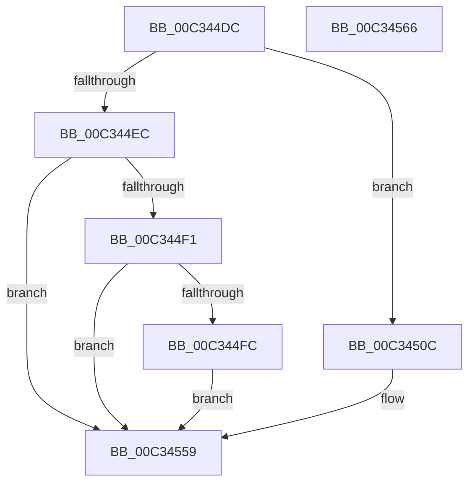

# PiDcInit

- RVA: `0x00C344DC`–`0x00C34567` (길이 `139` bytes)
- VA: `0x0000000140C344DC`
- 실행 섹션: `INIT`
- PDB 이름 있음: `예`; PDB Function 태그: `아니요`
- unwind 정보 RVA: `0x0005CAAC`
- 디코드: `35`개 명령, `139/139` bytes 표시
- 미해석 바이트: `0` (있으면 어셈블리에 `.byte`로 보존)

> 이 문서는 커널 이미지의 기계어와 PDB 기호를 분석해 생성했습니다. 4번과 5번은 함수 원형과 자료형을 바이너리 사용 방식에서 추정한 C 해석이며 원본 소스 복구 결과는 아닙니다.

## 1. Dependencies

- 직접 호출 지점: **3**; 고유 호출 대상: **3**
- 직접 호출자로 확인된 함수: **1**
- RIP 상대 이미지 참조: **10**

### Outgoing calls
- `0x00C344F1` → [PiDcInitUpdateProperties](../../page/73/PiDcInitUpdateProperties_function_00730B3C.md) (function, `0x00730B3C`)
- `0x00C34503` → [PiDcGenerateConfigNotificationIfContainerRequiresConfiguration](../../page/A5/PiDcGenerateConfigNotificationIfContainerRequiresConfiguration_function_00A506F8.md) (function, `0x00A506F8`)
- `0x00C3451C` → [memset](../../text/6C/memset_function_006C6C40.md) (function, `0x006C6C40`)

### Direct callers
- [IopInitializePlugPlayServices](../C2/IopInitializePlugPlayServices_function_00C2F298.md) at `0x00C2F8EC`
- [IopInitializePlugPlayServices](../C2/IopInitializePlugPlayServices_function_00C2F298.md) at `0x00C2FF6C`

### Static image references
- `0x00C344FC` → RVA `0x00C79F00` (` ?? ::PBOPGDP::`string'`; read)
- `0x00C3450E` → RVA `0x00F8B3A0` (`.data`; read)
- `0x00C34521` → RVA `0x00F8B400` (`.data`; read/write)
- `0x00C34528` → RVA `0x00A5EC80` (`PiDcCompareUpdateProperties`; read)
- `0x00C3452F` → RVA `0x00F8B3E8` (`.data`; write)
- `0x00C34536` → RVA `0x00730AD0` (`PiDcAllocateGenericTableEntry`; read)
- `0x00C3453D` → RVA `0x00F8B3F0` (`.data`; write)
- `0x00C34544` → RVA `0x00730B00` (`PiDcFreeGenericTableEntry`; read)
- `0x00C3454B` → RVA `0x00F8B3F8` (`.data`; write)
- `0x00C34552` → RVA `0x00F8B3A0` (`.data`; write)

## 2. Other-region calls and transfers

- 다른 실행 섹션으로 향하는 call: **3**
  - `0x00C344F1` → [PiDcInitUpdateProperties](../../page/73/PiDcInitUpdateProperties_function_00730B3C.md) (`INIT` → `PAGE`)
  - `0x00C34503` → [PiDcGenerateConfigNotificationIfContainerRequiresConfiguration](../../page/A5/PiDcGenerateConfigNotificationIfContainerRequiresConfiguration_function_00A506F8.md) (`INIT` → `PAGE`)
  - `0x00C3451C` → [memset](../../text/6C/memset_function_006C6C40.md) (`INIT` → `.text`)
- 별도 외부 분기/꼬리 이동을 확인하지 못했습니다.

## 3. Assembly (complete function range)

```asm
00C344DC  48 89 5C 24 08                  mov qword ptr [rsp + 8], rbx
00C344E1  57                              push rdi
00C344E2  48 83 EC 20                     sub rsp, 0x20
00C344E6  33 DB                           xor ebx, ebx
00C344E8  85 C9                           test ecx, ecx
00C344EA  74 20                           je 0x140c3450c
00C344EC  83 F9 01                        cmp ecx, 1
00C344EF  75 68                           jne 0x140c34559
00C344F1  E8 46 C6 AF FF                  call 0x140730b3c
00C344F6  8B D8                           mov ebx, eax
00C344F8  85 C0                           test eax, eax
00C344FA  78 5D                           js 0x140c34559
00C344FC  48 8D 0D FD 59 04 00            lea rcx, [rip + 0x459fd]
00C34503  E8 F0 C1 E1 FF                  call 0x140a506f8
00C34508  8B D8                           mov ebx, eax
00C3450A  EB 4D                           jmp 0x140c34559
00C3450C  33 D2                           xor edx, edx
00C3450E  48 8D 3D 8B 6E 35 00            lea rdi, [rip + 0x356e8b]
00C34515  48 8B CF                        mov rcx, rdi
00C34518  44 8D 42 68                     lea r8d, [rdx + 0x68]
00C3451C  E8 1F 27 A9 FF                  call 0x1406c6c40
00C34521  48 21 1D D8 6E 35 00            and qword ptr [rip + 0x356ed8], rbx
00C34528  48 8D 05 51 A7 E2 FF            lea rax, [rip - 0x1d58af]
00C3452F  48 89 05 B2 6E 35 00            mov qword ptr [rip + 0x356eb2], rax
00C34536  48 8D 05 93 C5 AF FF            lea rax, [rip - 0x503a6d]
00C3453D  48 89 05 AC 6E 35 00            mov qword ptr [rip + 0x356eac], rax
00C34544  48 8D 05 B5 C5 AF FF            lea rax, [rip - 0x503a4b]
00C3454B  48 89 05 A6 6E 35 00            mov qword ptr [rip + 0x356ea6], rax
00C34552  48 89 3D 47 6E 35 00            mov qword ptr [rip + 0x356e47], rdi
00C34559  8B C3                           mov eax, ebx
00C3455B  48 8B 5C 24 30                  mov rbx, qword ptr [rsp + 0x30]
00C34560  48 83 C4 20                     add rsp, 0x20
00C34564  5F                              pop rdi
00C34565  C3                              ret
00C34566  CC                              int3
```

## 4. C-style interpretation (structured pseudocode)

```c
__int64 __fastcall PiDcInit(int a1, int a2)
{
    __int64 result;
    __int64 v_rbx;
    __int64 v_rsp;
    unsigned __int64 v_stack_p8;

    v_stack_p8 = v_rbx;
    v_rsp = (v_rsp) - (32);
    v_rbx = 0;
    if (a1 == 0) goto loc_00C3450C;
    if (a1 != 1) goto loc_00C34559;
    result = PiDcInitUpdateProperties(a1, a2, a3, a4);
    if (sign_flag) goto loc_00C34559;
    result = PiDcGenerateConfigNotificationIfContainerRequiresConfiguration(v_rip + 285181, a2, a3, a4);
    goto loc_00C34559;
loc_00C3450C:
    a2 = 0;
    result = memset(v_rip + 3501707, a2, a2 + 104, a4);
    *(unsigned __int64 *)(v_rip + 3501746) = v_rip - 1923247;
    *(unsigned __int64 *)(v_rip + 3501740) = v_rip - 5257837;
    *(unsigned __int64 *)(v_rip + 3501734) = v_rip - 5257803;
    *(unsigned __int64 *)(v_rip + 3501639) = v_rip + 3501707;
loc_00C34559:
    v_rsp = (v_rsp) + (32);
    return (unsigned int)((unsigned int)((unsigned int)((unsigned int)(result))));
}
```

## 5. (Beta) C Style

```c
int64_t PiDcInit(int32_t Arg1, int32_t Arg2)
{
    int64_t result;
    int64_t local_rbx;
    int64_t local_rsp;
    uint64_t v_stack_p8;

    v_stack_p8 = local_rbx;
    local_rsp = (local_rsp) - (32);
    local_rbx = 0;
    if (Arg1 == 0) goto loc_00C3450C;
    if (Arg1 != 1) goto loc_00C34559;
    result = PiDcInitUpdateProperties(Arg1, Arg2, a3, a4);
    if (sign_flag) goto loc_00C34559;
    result = PiDcGenerateConfigNotificationIfContainerRequiresConfiguration(v_rip + 285181, Arg2, a3, a4);
    goto loc_00C34559;
loc_00C3450C:
    Arg2 = 0;
    result = memset(v_rip + 3501707, Arg2, Arg2 + 104, a4);
    *(uint64_t *)(v_rip + 0x356EB2) = v_rip - 1923247;
    *(uint64_t *)(v_rip + 0x356EAC) = v_rip - 5257837;
    *(uint64_t *)(v_rip + 0x356EA6) = v_rip - 5257803;
    *(uint64_t *)(v_rip + 0x356E47) = v_rip + 3501707;
loc_00C34559:
    local_rsp = (local_rsp) + (32);
    return (uint32_t)((uint32_t)((uint32_t)((uint32_t)(result))));
}
```

## 6. Execution-region graph

[열기: 2D/3D 그래프와 함수 탐색 컨트롤 패널](../../../control-panel.html?section=init&rva=0x00C344DC&view=graph)

- 2D 그래프는 위에서 아래로 흐르고, 3D 그래프는 빈 공간을 드래그해 회전합니다. Shift+드래그는 이동, 휠은 확대·축소, 함수 노드 선택은 대상 보고서 이동입니다.

### Static fallback


