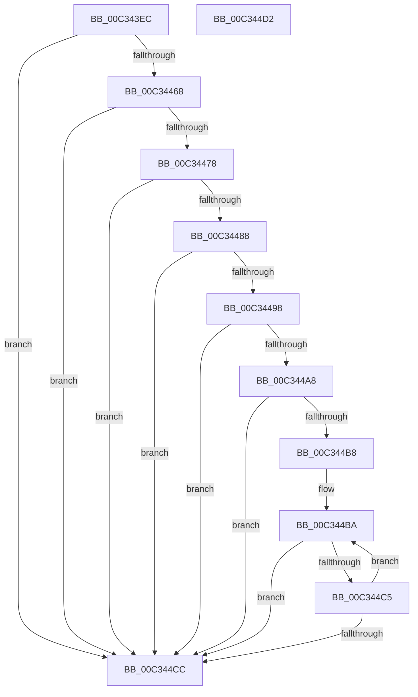

# PiDmInit

- RVA: `0x00C343EC`–`0x00C344D3` (길이 `231` bytes)
- VA: `0x0000000140C343EC`
- 실행 섹션: `INIT`
- PDB 이름 있음: `예`; PDB Function 태그: `아니요`
- unwind 정보 RVA: `0x0005CF00`
- 디코드: `56`개 명령, `231/231` bytes 표시
- 미해석 바이트: `0` (있으면 어셈블리에 `.byte`로 보존)

> 이 문서는 커널 이미지의 기계어와 PDB 기호를 분석해 생성했습니다. 4번과 5번은 함수 원형과 자료형을 바이너리 사용 방식에서 추정한 C 해석이며 원본 소스 복구 결과는 아닙니다.

## 1. Dependencies

- 직접 호출 지점: **13**; 고유 호출 대상: **3**
- 직접 호출자로 확인된 함수: **1**
- RIP 상대 이미지 참조: **6**

### Outgoing calls
- `0x00C343FE` → [PiDmObjectManagerInit](../../page/73/PiDmObjectManagerInit_function_00730548.md) (function, `0x00730548`)
- `0x00C3440F` → [PiDmObjectManagerInit](../../page/73/PiDmObjectManagerInit_function_00730548.md) (function, `0x00730548`)
- `0x00C34420` → [PiDmObjectManagerInit](../../page/73/PiDmObjectManagerInit_function_00730548.md) (function, `0x00730548`)
- `0x00C34431` → [PiDmObjectManagerInit](../../page/73/PiDmObjectManagerInit_function_00730548.md) (function, `0x00730548`)
- `0x00C34442` → [PiDmObjectManagerInit](../../page/73/PiDmObjectManagerInit_function_00730548.md) (function, `0x00730548`)
- `0x00C34453` → [PiDmObjectManagerInit](../../page/73/PiDmObjectManagerInit_function_00730548.md) (function, `0x00730548`)
- `0x00C3445F` → [PiDmObjectManagerPopulate](../../page/73/PiDmObjectManagerPopulate_function_00730598.md) (function, `0x00730598`)
- `0x00C3446F` → [PiDmObjectManagerPopulate](../../page/73/PiDmObjectManagerPopulate_function_00730598.md) (function, `0x00730598`)
- `0x00C3447F` → [PiDmObjectManagerPopulate](../../page/73/PiDmObjectManagerPopulate_function_00730598.md) (function, `0x00730598`)
- `0x00C3448F` → [PiDmObjectManagerPopulate](../../page/73/PiDmObjectManagerPopulate_function_00730598.md) (function, `0x00730598`)
- `0x00C3449F` → [PiDmObjectManagerPopulate](../../page/73/PiDmObjectManagerPopulate_function_00730598.md) (function, `0x00730598`)
- `0x00C344AF` → [PiDmObjectManagerPopulate](../../page/73/PiDmObjectManagerPopulate_function_00730598.md) (function, `0x00730598`)
- `0x00C344BC` → [PiDmListInit](../../page/73/PiDmListInit_function_00730280.md) (function, `0x00730280`)

### Direct callers
- [IopInitializePlugPlayServices](../C2/IopInitializePlugPlayServices_function_00C2F298.md) at `0x00C2F61A`

### Static image references
- `0x00C343F7` → RVA `0x00F8B880` (`.data`; read)
- `0x00C34408` → RVA `0x00F8B7A0` (`.data`; read)
- `0x00C34419` → RVA `0x00F8B6C0` (`.data`; read)
- `0x00C3442A` → RVA `0x00F8B5E0` (`.data`; read)
- `0x00C3443B` → RVA `0x00F8B500` (`.data`; read)
- `0x00C3444C` → RVA `0x00F8B420` (`.data`; read)

## 2. Other-region calls and transfers

- 다른 실행 섹션으로 향하는 call: **13**
  - `0x00C343FE` → [PiDmObjectManagerInit](../../page/73/PiDmObjectManagerInit_function_00730548.md) (`INIT` → `PAGE`)
  - `0x00C3440F` → [PiDmObjectManagerInit](../../page/73/PiDmObjectManagerInit_function_00730548.md) (`INIT` → `PAGE`)
  - `0x00C34420` → [PiDmObjectManagerInit](../../page/73/PiDmObjectManagerInit_function_00730548.md) (`INIT` → `PAGE`)
  - `0x00C34431` → [PiDmObjectManagerInit](../../page/73/PiDmObjectManagerInit_function_00730548.md) (`INIT` → `PAGE`)
  - `0x00C34442` → [PiDmObjectManagerInit](../../page/73/PiDmObjectManagerInit_function_00730548.md) (`INIT` → `PAGE`)
  - `0x00C34453` → [PiDmObjectManagerInit](../../page/73/PiDmObjectManagerInit_function_00730548.md) (`INIT` → `PAGE`)
  - `0x00C3445F` → [PiDmObjectManagerPopulate](../../page/73/PiDmObjectManagerPopulate_function_00730598.md) (`INIT` → `PAGE`)
  - `0x00C3446F` → [PiDmObjectManagerPopulate](../../page/73/PiDmObjectManagerPopulate_function_00730598.md) (`INIT` → `PAGE`)
  - `0x00C3447F` → [PiDmObjectManagerPopulate](../../page/73/PiDmObjectManagerPopulate_function_00730598.md) (`INIT` → `PAGE`)
  - `0x00C3448F` → [PiDmObjectManagerPopulate](../../page/73/PiDmObjectManagerPopulate_function_00730598.md) (`INIT` → `PAGE`)
  - `0x00C3449F` → [PiDmObjectManagerPopulate](../../page/73/PiDmObjectManagerPopulate_function_00730598.md) (`INIT` → `PAGE`)
  - `0x00C344AF` → [PiDmObjectManagerPopulate](../../page/73/PiDmObjectManagerPopulate_function_00730598.md) (`INIT` → `PAGE`)
  - `0x00C344BC` → [PiDmListInit](../../page/73/PiDmListInit_function_00730280.md) (`INIT` → `PAGE`)
- 별도 외부 분기/꼬리 이동을 확인하지 못했습니다.

## 3. Assembly (complete function range)

```asm
00C343EC  40 53                           push rbx
00C343EE  48 83 EC 20                     sub rsp, 0x20
00C343F2  BA 01 00 00 00                  mov edx, 1
00C343F7  48 8D 0D 82 74 35 00            lea rcx, [rip + 0x357482]
00C343FE  E8 45 C1 AF FF                  call 0x140730548
00C34403  BA 03 00 00 00                  mov edx, 3
00C34408  48 8D 0D 91 73 35 00            lea rcx, [rip + 0x357391]
00C3440F  E8 34 C1 AF FF                  call 0x140730548
00C34414  BA 04 00 00 00                  mov edx, 4
00C34419  48 8D 0D A0 72 35 00            lea rcx, [rip + 0x3572a0]
00C34420  E8 23 C1 AF FF                  call 0x140730548
00C34425  BA 05 00 00 00                  mov edx, 5
00C3442A  48 8D 0D AF 71 35 00            lea rcx, [rip + 0x3571af]
00C34431  E8 12 C1 AF FF                  call 0x140730548
00C34436  BA 02 00 00 00                  mov edx, 2
00C3443B  48 8D 0D BE 70 35 00            lea rcx, [rip + 0x3570be]
00C34442  E8 01 C1 AF FF                  call 0x140730548
00C34447  BA 06 00 00 00                  mov edx, 6
00C3444C  48 8D 0D CD 6F 35 00            lea rcx, [rip + 0x356fcd]
00C34453  E8 F0 C0 AF FF                  call 0x140730548
00C34458  48 8D 0D 21 74 35 00            lea rcx, [rip + 0x357421]
00C3445F  E8 34 C1 AF FF                  call 0x140730598
00C34464  85 C0                           test eax, eax
00C34466  78 64                           js 0x140c344cc
00C34468  48 8D 0D 31 73 35 00            lea rcx, [rip + 0x357331]
00C3446F  E8 24 C1 AF FF                  call 0x140730598
00C34474  85 C0                           test eax, eax
00C34476  78 54                           js 0x140c344cc
00C34478  48 8D 0D 41 72 35 00            lea rcx, [rip + 0x357241]
00C3447F  E8 14 C1 AF FF                  call 0x140730598
00C34484  85 C0                           test eax, eax
00C34486  78 44                           js 0x140c344cc
00C34488  48 8D 0D 51 71 35 00            lea rcx, [rip + 0x357151]
00C3448F  E8 04 C1 AF FF                  call 0x140730598
00C34494  85 C0                           test eax, eax
00C34496  78 34                           js 0x140c344cc
00C34498  48 8D 0D 61 70 35 00            lea rcx, [rip + 0x357061]
00C3449F  E8 F4 C0 AF FF                  call 0x140730598
00C344A4  85 C0                           test eax, eax
00C344A6  78 24                           js 0x140c344cc
00C344A8  48 8D 0D 71 6F 35 00            lea rcx, [rip + 0x356f71]
00C344AF  E8 E4 C0 AF FF                  call 0x140730598
00C344B4  85 C0                           test eax, eax
00C344B6  78 14                           js 0x140c344cc
00C344B8  33 DB                           xor ebx, ebx
00C344BA  8B CB                           mov ecx, ebx
00C344BC  E8 BF BD AF FF                  call 0x140730280
00C344C1  85 C0                           test eax, eax
00C344C3  78 07                           js 0x140c344cc
00C344C5  FF C3                           inc ebx
00C344C7  83 FB 06                        cmp ebx, 6
00C344CA  72 EE                           jb 0x140c344ba
00C344CC  48 83 C4 20                     add rsp, 0x20
00C344D0  5B                              pop rbx
00C344D1  C3                              ret
00C344D2  CC                              int3
```

## 4. C-style interpretation (structured pseudocode)

```c
__int64 __fastcall PiDmInit(void)
{
    __int64 result;
    __int64 v_rbx;
    __int64 v_rsp;

    v_rsp = (v_rsp) - (32);
    result = PiDmObjectManagerInit(v_rip + 3503234, 1, a3, a4);
    result = PiDmObjectManagerInit(v_rip + 3502993, 3, a3, a4);
    result = PiDmObjectManagerInit(v_rip + 3502752, 4, a3, a4);
    result = PiDmObjectManagerInit(v_rip + 3502511, 5, a3, a4);
    result = PiDmObjectManagerInit(v_rip + 3502270, 2, a3, a4);
    result = PiDmObjectManagerInit(v_rip + 3502029, 6, a3, a4);
    result = PiDmObjectManagerPopulate(v_rip + 3503137, 6, a3, a4);
    if (sign_flag) goto loc_00C344CC;
    result = PiDmObjectManagerPopulate(v_rip + 3502897, 6, a3, a4);
    if (sign_flag) goto loc_00C344CC;
    result = PiDmObjectManagerPopulate(v_rip + 3502657, 6, a3, a4);
    if (sign_flag) goto loc_00C344CC;
    result = PiDmObjectManagerPopulate(v_rip + 3502417, 6, a3, a4);
    if (sign_flag) goto loc_00C344CC;
    result = PiDmObjectManagerPopulate(v_rip + 3502177, 6, a3, a4);
    if (sign_flag) goto loc_00C344CC;
    result = PiDmObjectManagerPopulate(v_rip + 3501937, 6, a3, a4);
    if (sign_flag) goto loc_00C344CC;
    v_rbx = 0;
loc_00C344BA:
    result = PiDmListInit(0, 6, a3, a4);
    if (sign_flag) goto loc_00C344CC;
    v_rbx = (unsigned int)((v_rbx) + 1);
    if (((unsigned int)(v_rbx)) < 6) goto loc_00C344BA;
loc_00C344CC:
    v_rsp = (v_rsp) + (32);
    return result;
}
```

## 5. (Beta) C Style

```c
void PiDmInit(void)
{
    int64_t result;
    int64_t local_rbx;
    int64_t local_rsp;

    local_rsp = (local_rsp) - (32);
    result = PiDmObjectManagerInit(v_rip + 3503234, 1, a3, a4);
    result = PiDmObjectManagerInit(v_rip + 3502993, 3, a3, a4);
    result = PiDmObjectManagerInit(v_rip + 3502752, 4, a3, a4);
    result = PiDmObjectManagerInit(v_rip + 3502511, 5, a3, a4);
    result = PiDmObjectManagerInit(v_rip + 3502270, 2, a3, a4);
    result = PiDmObjectManagerInit(v_rip + 3502029, 6, a3, a4);
    result = PiDmObjectManagerPopulate(v_rip + 3503137, 6, a3, a4);
    if (sign_flag) goto loc_00C344CC;
    result = PiDmObjectManagerPopulate(v_rip + 3502897, 6, a3, a4);
    if (sign_flag) goto loc_00C344CC;
    result = PiDmObjectManagerPopulate(v_rip + 3502657, 6, a3, a4);
    if (sign_flag) goto loc_00C344CC;
    result = PiDmObjectManagerPopulate(v_rip + 3502417, 6, a3, a4);
    if (sign_flag) goto loc_00C344CC;
    result = PiDmObjectManagerPopulate(v_rip + 3502177, 6, a3, a4);
    if (sign_flag) goto loc_00C344CC;
    result = PiDmObjectManagerPopulate(v_rip + 3501937, 6, a3, a4);
    if (sign_flag) goto loc_00C344CC;
    local_rbx = 0;
loc_00C344BA:
    result = PiDmListInit(0, 6, a3, a4);
    if (sign_flag) goto loc_00C344CC;
    local_rbx = (uint32_t)((local_rbx) + 1);
    if (((uint32_t)(local_rbx)) < 6) goto loc_00C344BA;
loc_00C344CC:
    local_rsp = (local_rsp) + (32);
    return result;
}
```

## 6. Execution-region graph

[열기: 2D/3D 그래프와 함수 탐색 컨트롤 패널](../../../control-panel.html?section=init&rva=0x00C343EC&view=graph)

- 2D 그래프는 위에서 아래로 흐르고, 3D 그래프는 빈 공간을 드래그해 회전합니다. Shift+드래그는 이동, 휠은 확대·축소, 함수 노드 선택은 대상 보고서 이동입니다.

### Static fallback


