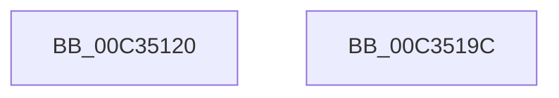

# PiDqInit

- RVA: `0x00C35120`–`0x00C3519D` (길이 `125` bytes)
- VA: `0x0000000140C35120`
- 실행 섹션: `INIT`
- PDB 이름 있음: `예`; PDB Function 태그: `아니요`
- unwind 정보 RVA: `0x0005C788`
- 디코드: `24`개 명령, `125/125` bytes 표시
- 미해석 바이트: `0` (있으면 어셈블리에 `.byte`로 보존)

> 이 문서는 커널 이미지의 기계어와 PDB 기호를 분석해 생성했습니다. 4번과 5번은 함수 원형과 자료형을 바이너리 사용 방식에서 추정한 C 해석이며 원본 소스 복구 결과는 아닙니다.

## 1. Dependencies

- 직접 호출 지점: **6**; 고유 호출 대상: **1**
- 직접 호출자로 확인된 함수: **1**
- RIP 상대 이미지 참조: **7**

### Outgoing calls
- `0x00C35130` → [PiDqObjectManagerInit](../../page/73/PiDqObjectManagerInit_function_00731A18.md) (function, `0x00731A18`)
- `0x00C35141` → [PiDqObjectManagerInit](../../page/73/PiDqObjectManagerInit_function_00731A18.md) (function, `0x00731A18`)
- `0x00C35152` → [PiDqObjectManagerInit](../../page/73/PiDqObjectManagerInit_function_00731A18.md) (function, `0x00731A18`)
- `0x00C35163` → [PiDqObjectManagerInit](../../page/73/PiDqObjectManagerInit_function_00731A18.md) (function, `0x00731A18`)
- `0x00C35174` → [PiDqObjectManagerInit](../../page/73/PiDqObjectManagerInit_function_00731A18.md) (function, `0x00731A18`)
- `0x00C35185` → [PiDqObjectManagerInit](../../page/73/PiDqObjectManagerInit_function_00731A18.md) (function, `0x00731A18`)

### Direct callers
- [IopInitializePlugPlayServices](../C2/IopInitializePlugPlayServices_function_00C2F298.md) at `0x00C2F944`

### Static image references
- `0x00C35129` → RVA `0x00F8AEA0` (`.data`; read)
- `0x00C3513A` → RVA `0x00F8ADA0` (`.data`; read)
- `0x00C3514B` → RVA `0x00F8B2A0` (`.data`; read)
- `0x00C3515C` → RVA `0x00F8B1A0` (`.data`; read)
- `0x00C3516D` → RVA `0x00F8B0A0` (`.data`; read)
- `0x00C3517E` → RVA `0x00F8AFA0` (`.data`; read)
- `0x00C3518C` → RVA `0x00F8B390` (`.data`; write)

## 2. Other-region calls and transfers

- 다른 실행 섹션으로 향하는 call: **6**
  - `0x00C35130` → [PiDqObjectManagerInit](../../page/73/PiDqObjectManagerInit_function_00731A18.md) (`INIT` → `PAGE`)
  - `0x00C35141` → [PiDqObjectManagerInit](../../page/73/PiDqObjectManagerInit_function_00731A18.md) (`INIT` → `PAGE`)
  - `0x00C35152` → [PiDqObjectManagerInit](../../page/73/PiDqObjectManagerInit_function_00731A18.md) (`INIT` → `PAGE`)
  - `0x00C35163` → [PiDqObjectManagerInit](../../page/73/PiDqObjectManagerInit_function_00731A18.md) (`INIT` → `PAGE`)
  - `0x00C35174` → [PiDqObjectManagerInit](../../page/73/PiDqObjectManagerInit_function_00731A18.md) (`INIT` → `PAGE`)
  - `0x00C35185` → [PiDqObjectManagerInit](../../page/73/PiDqObjectManagerInit_function_00731A18.md) (`INIT` → `PAGE`)
- 별도 외부 분기/꼬리 이동을 확인하지 못했습니다.

## 3. Assembly (complete function range)

```asm
00C35120  48 83 EC 28                     sub rsp, 0x28
00C35124  BA 01 00 00 00                  mov edx, 1
00C35129  48 8D 0D 70 5D 35 00            lea rcx, [rip + 0x355d70]
00C35130  E8 E3 C8 AF FF                  call 0x140731a18
00C35135  BA 03 00 00 00                  mov edx, 3
00C3513A  48 8D 0D 5F 5C 35 00            lea rcx, [rip + 0x355c5f]
00C35141  E8 D2 C8 AF FF                  call 0x140731a18
00C35146  BA 04 00 00 00                  mov edx, 4
00C3514B  48 8D 0D 4E 61 35 00            lea rcx, [rip + 0x35614e]
00C35152  E8 C1 C8 AF FF                  call 0x140731a18
00C35157  BA 05 00 00 00                  mov edx, 5
00C3515C  48 8D 0D 3D 60 35 00            lea rcx, [rip + 0x35603d]
00C35163  E8 B0 C8 AF FF                  call 0x140731a18
00C35168  BA 02 00 00 00                  mov edx, 2
00C3516D  48 8D 0D 2C 5F 35 00            lea rcx, [rip + 0x355f2c]
00C35174  E8 9F C8 AF FF                  call 0x140731a18
00C35179  BA 06 00 00 00                  mov edx, 6
00C3517E  48 8D 0D 1B 5E 35 00            lea rcx, [rip + 0x355e1b]
00C35185  E8 8E C8 AF FF                  call 0x140731a18
00C3518A  33 C0                           xor eax, eax
00C3518C  48 C7 05 F9 61 35 00 00 00 00 00  mov qword ptr [rip + 0x3561f9], 0
00C35197  48 83 C4 28                     add rsp, 0x28
00C3519B  C3                              ret
00C3519C  CC                              int3
```

## 4. C-style interpretation (structured pseudocode)

```c
__int64 __fastcall PiDqInit(void)
{
    __int64 result;
    __int64 v_rsp;

    v_rsp = (v_rsp) - (40);
    result = PiDqObjectManagerInit(v_rip + 3497328, 1, a3, a4);
    result = PiDqObjectManagerInit(v_rip + 3497055, 3, a3, a4);
    result = PiDqObjectManagerInit(v_rip + 3498318, 4, a3, a4);
    result = PiDqObjectManagerInit(v_rip + 3498045, 5, a3, a4);
    result = PiDqObjectManagerInit(v_rip + 3497772, 2, a3, a4);
    result = PiDqObjectManagerInit(v_rip + 3497499, 6, a3, a4);
    result = 0;
    *(unsigned __int64 *)(v_rip + 3498489) = 0;
    v_rsp = (v_rsp) + (40);
    return result;
}
```

## 5. (Beta) C Style

```c
void PiDqInit(void)
{
    int64_t result;
    int64_t local_rsp;

    local_rsp = (local_rsp) - (40);
    result = PiDqObjectManagerInit(v_rip + 3497328, 1, a3, a4);
    result = PiDqObjectManagerInit(v_rip + 3497055, 3, a3, a4);
    result = PiDqObjectManagerInit(v_rip + 3498318, 4, a3, a4);
    result = PiDqObjectManagerInit(v_rip + 3498045, 5, a3, a4);
    result = PiDqObjectManagerInit(v_rip + 3497772, 2, a3, a4);
    result = PiDqObjectManagerInit(v_rip + 3497499, 6, a3, a4);
    result = 0;
    *(uint64_t *)(v_rip + 0x3561F9) = 0;
    local_rsp = (local_rsp) + (40);
    return result;
}
```

## 6. Execution-region graph

[열기: 2D/3D 그래프와 함수 탐색 컨트롤 패널](../../../control-panel.html?section=init&rva=0x00C35120&view=graph)

- 2D 그래프는 위에서 아래로 흐르고, 3D 그래프는 빈 공간을 드래그해 회전합니다. Shift+드래그는 이동, 휠은 확대·축소, 함수 노드 선택은 대상 보고서 이동입니다.

### Static fallback


