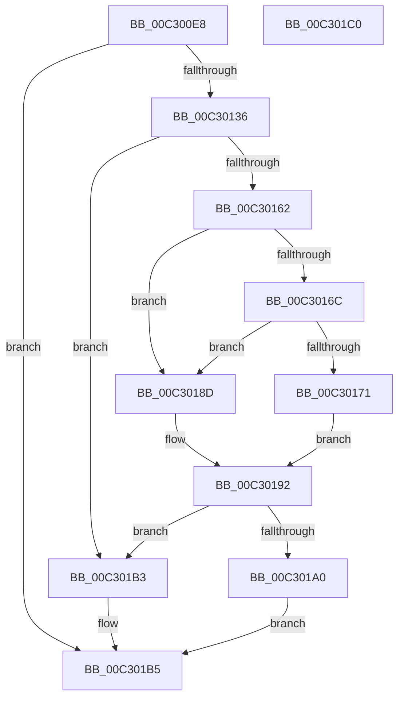

# PiInitCacheGroupInformation

- RVA: `0x00C300E8`–`0x00C301C1` (길이 `217` bytes)
- VA: `0x0000000140C300E8`
- 실행 섹션: `INIT`
- PDB 이름 있음: `예`; PDB Function 태그: `아니요`
- unwind 정보 RVA: `0x000A82BC`
- 디코드: `66`개 명령, `217/217` bytes 표시
- 미해석 바이트: `0` (있으면 어셈블리에 `.byte`로 보존)

> 이 문서는 커널 이미지의 기계어와 PDB 기호를 분석해 생성했습니다. 4번과 5번은 함수 원형과 자료형을 바이너리 사용 방식에서 추정한 C 해석이며 원본 소스 복구 결과는 아닙니다.

## 1. Dependencies

- 직접 호출 지점: **5**; 고유 호출 대상: **5**
- 직접 호출자로 확인된 함수: **1**
- RIP 상대 이미지 참조: **4**

### Outgoing calls
- `0x00C3012D` → [IopOpenRegistryKeyEx](../../page/A5/IopOpenRegistryKeyEx_function_00A51B44.md) (function, `0x00A51B44`)
- `0x00C30148` → [IopGetRegistryValue](../../page/99/IopGetRegistryValue_function_009990EC.md) (function, `0x009990EC`)
- `0x00C30153` → [ZwClose](../../text/6A/ZwClose_function_006AD2B0.md) (function, `0x006AD2B0`)
- `0x00C3017C` → [PnpRegMultiSzToUnicodeStrings](PnpRegMultiSzToUnicodeStrings_function_00C36360.md) (function, `0x00C36360`)
- `0x00C30197` → [ExFreePoolWithTag](../../poolcode/B8/ExFreePoolWithTag_function_00B82870.md) (function, `0x00B82870`)

### Direct callers
- [IopInitializePlugPlayServices](../C2/IopInitializePlugPlayServices_function_00C2F298.md) at `0x00C2F51D`

### Static image references
- `0x00C300FB` → RVA `0x00C7A270` (` ?? ::PBOPGDP::`string'`; read)
- `0x00C30141` → RVA `0x00C7A300` (` ?? ::PBOPGDP::`string'`; read)
- `0x00C301A0` → RVA `0x00E66248` (`.data`; write)
- `0x00C301A9` → RVA `0x00E66250` (`.data`; write)

## 2. Other-region calls and transfers

- 다른 실행 섹션으로 향하는 call: **4**
  - `0x00C3012D` → [IopOpenRegistryKeyEx](../../page/A5/IopOpenRegistryKeyEx_function_00A51B44.md) (`INIT` → `PAGE`)
  - `0x00C30148` → [IopGetRegistryValue](../../page/99/IopGetRegistryValue_function_009990EC.md) (`INIT` → `PAGE`)
  - `0x00C30153` → [ZwClose](../../text/6A/ZwClose_function_006AD2B0.md) (`INIT` → `.text`)
  - `0x00C30197` → [ExFreePoolWithTag](../../poolcode/B8/ExFreePoolWithTag_function_00B82870.md) (`INIT` → `POOLCODE`)
- 별도 외부 분기/꼬리 이동을 확인하지 못했습니다.

## 3. Assembly (complete function range)

```asm
00C300E8  40 55                           push rbp
00C300EA  53                              push rbx
00C300EB  56                              push rsi
00C300EC  57                              push rdi
00C300ED  41 56                           push r14
00C300EF  48 8B EC                        mov rbp, rsp
00C300F2  48 83 EC 30                     sub rsp, 0x30
00C300F6  48 83 65 40 00                  and qword ptr [rbp + 0x40], 0
00C300FB  48 8D 05 6E A1 04 00            lea rax, [rip + 0x4a16e]
00C30102  83 65 F4 00                     and dword ptr [rbp - 0xc], 0
00C30106  4C 8D 45 F0                     lea r8, [rbp - 0x10]
00C3010A  48 83 65 38 00                  and qword ptr [rbp + 0x38], 0
00C3010F  48 8D 4D 38                     lea rcx, [rbp + 0x38]
00C30113  45 33 F6                        xor r14d, r14d
00C30116  48 89 45 F8                     mov qword ptr [rbp - 8], rax
00C3011A  41 B9 19 00 02 00               mov r9d, 0x20019
00C30120  44 89 75 30                     mov dword ptr [rbp + 0x30], r14d
00C30124  33 D2                           xor edx, edx
00C30126  C7 45 F0 88 00 8A 00            mov dword ptr [rbp - 0x10], 0x8a0088
00C3012D  E8 12 1A E2 FF                  call 0x140a51b44
00C30132  85 C0                           test eax, eax
00C30134  78 7F                           js 0x140c301b5
00C30136  48 8B 4D 38                     mov rcx, qword ptr [rbp + 0x38]
00C3013A  4C 8D 4D 40                     lea r9, [rbp + 0x40]
00C3013E  45 33 C0                        xor r8d, r8d
00C30141  48 8D 15 B8 A1 04 00            lea rdx, [rip + 0x4a1b8]
00C30148  E8 9F 8F D6 FF                  call 0x1409990ec
00C3014D  48 8B 4D 38                     mov rcx, qword ptr [rbp + 0x38]
00C30151  8B D8                           mov ebx, eax
00C30153  E8 58 D1 A7 FF                  call 0x1406ad2b0
00C30158  33 F6                           xor esi, esi
00C3015A  48 89 75 48                     mov qword ptr [rbp + 0x48], rsi
00C3015E  85 DB                           test ebx, ebx
00C30160  78 51                           js 0x140c301b3
00C30162  48 8B 7D 40                     mov rdi, qword ptr [rbp + 0x40]
00C30166  83 7F 04 07                     cmp dword ptr [rdi + 4], 7
00C3016A  75 21                           jne 0x140c3018d
00C3016C  39 77 0C                        cmp dword ptr [rdi + 0xc], esi
00C3016F  74 1C                           je 0x140c3018d
00C30171  4C 8D 45 30                     lea r8, [rbp + 0x30]
00C30175  48 8B CF                        mov rcx, rdi
00C30178  48 8D 55 48                     lea rdx, [rbp + 0x48]
00C3017C  E8 DF 61 00 00                  call 0x140c36360
00C30181  48 8B 75 48                     mov rsi, qword ptr [rbp + 0x48]
00C30185  8B D8                           mov ebx, eax
00C30187  44 8B 75 30                     mov r14d, dword ptr [rbp + 0x30]
00C3018B  EB 05                           jmp 0x140c30192
00C3018D  BB 01 00 00 C0                  mov ebx, 0xc0000001
00C30192  33 D2                           xor edx, edx
00C30194  48 8B CF                        mov rcx, rdi
00C30197  E8 D4 26 F5 FF                  call 0x140b82870
00C3019C  85 DB                           test ebx, ebx
00C3019E  78 13                           js 0x140c301b3
00C301A0  48 89 35 A1 60 23 00            mov qword ptr [rip + 0x2360a1], rsi
00C301A7  33 C0                           xor eax, eax
00C301A9  66 44 89 35 9F 60 23 00         mov word ptr [rip + 0x23609f], r14w
00C301B1  EB 02                           jmp 0x140c301b5
00C301B3  8B C3                           mov eax, ebx
00C301B5  48 83 C4 30                     add rsp, 0x30
00C301B9  41 5E                           pop r14
00C301BB  5F                              pop rdi
00C301BC  5E                              pop rsi
00C301BD  5B                              pop rbx
00C301BE  5D                              pop rbp
00C301BF  C3                              ret
00C301C0  CC                              int3
```

## 4. C-style interpretation (structured pseudocode)

```c
__int64 __fastcall PiInitCacheGroupInformation(__int64 a1, int a2)
{
    __int64 result;
    __int64 v_r14;
    __int64 v_rsi;
    __int64 v_rsp;
    unsigned __int64 v_stack_m30;
    unsigned int v_stack_m34;
    unsigned __int64 v_stack_m38;
    unsigned __int64 v_stack_p10;
    unsigned __int64 v_stack_p18;
    unsigned __int64 v_stack_p20;
    unsigned int v_stack_p8;

    v_rsp = (v_rsp) - (48);
    v_r14 = 0;
    v_stack_m30 = v_rip + 303470;
    v_stack_p8 = 0;
    a2 = 0;
    v_stack_m38 = 0x8A0088ULL;
    result = IopOpenRegistryKeyEx(v_stack_p10, a2, v_stack_m38, (unsigned int)(0x20019ULL));
    if (sign_flag) goto loc_00C301B5;
    a3 = 0;
    result = IopGetRegistryValue(v_stack_p10, v_rip + 303544, a3, v_stack_p18);
    result = ZwClose(v_stack_p10, v_rip + 303544, a3, v_stack_p18);
    v_rsi = 0;
    v_stack_p20 = 0;
    if (sign_flag) goto loc_00C301B3;
    if ((*(unsigned int *)(v_stack_p18 + 4)) != 7) goto loc_00C3018D;
    if ((*(unsigned int *)(v_stack_p18 + 12)) == 0) goto loc_00C3018D;
    result = PnpRegMultiSzToUnicodeStrings(v_stack_p18, v_stack_p20, v_stack_p8, v_stack_p18);
    goto loc_00C30192;
loc_00C3018D:
loc_00C30192:
    a2 = 0;
    result = ExFreePoolWithTag(v_stack_p18, a2, v_stack_p8, v_stack_p18);
    if (sign_flag) goto loc_00C301B3;
    *(unsigned __int64 *)(v_rip + 2318497) = v_stack_p20;
    result = 0;
    *(unsigned __int16 *)(v_rip + 2318495) = (unsigned __int16)((unsigned int)(v_stack_p8));
    goto loc_00C301B5;
loc_00C301B3:
loc_00C301B5:
    v_rsp = (v_rsp) + (48);
    return (unsigned int)((unsigned int)((unsigned int)(0xC0000001ULL)));
}
```

## 5. (Beta) C Style

```c
int64_t PiInitCacheGroupInformation(int64_t Arg1, int32_t Arg2)
{
    int64_t result;
    int64_t local_r14;
    int64_t local_rsi;
    int64_t local_rsp;
    uint64_t v_stack_m30;
    uint32_t v_stack_m34;
    uint64_t v_stack_m38;
    uint64_t v_stack_p10;
    uint64_t v_stack_p18;
    uint64_t v_stack_p20;
    uint32_t v_stack_p8;

    local_rsp = (local_rsp) - (48);
    local_r14 = 0;
    v_stack_m30 = v_rip + 303470;
    v_stack_p8 = 0;
    Arg2 = 0;
    v_stack_m38 = 0x8A0088ULL;
    result = IopOpenRegistryKeyEx(v_stack_p10, Arg2, v_stack_m38, (uint32_t)(0x20019ULL));
    if (sign_flag) goto loc_00C301B5;
    a3 = 0;
    result = IopGetRegistryValue(v_stack_p10, v_rip + 303544, a3, v_stack_p18);
    result = ZwClose(v_stack_p10, v_rip + 303544, a3, v_stack_p18);
    local_rsi = 0;
    v_stack_p20 = 0;
    if (sign_flag) goto loc_00C301B3;
    if ((*(uint32_t *)(v_stack_p18 + 0x4)) != 7) goto loc_00C3018D;
    if ((*(uint32_t *)(v_stack_p18 + 0xC)) == 0) goto loc_00C3018D;
    result = PnpRegMultiSzToUnicodeStrings(v_stack_p18, v_stack_p20, v_stack_p8, v_stack_p18);
    goto loc_00C30192;
loc_00C3018D:
loc_00C30192:
    Arg2 = 0;
    result = ExFreePoolWithTag(v_stack_p18, Arg2, v_stack_p8, v_stack_p18);
    if (sign_flag) goto loc_00C301B3;
    *(uint64_t *)(v_rip + 0x2360A1) = v_stack_p20;
    result = 0;
    *(uint16_t *)(v_rip + 0x23609F) = (uint16_t)((uint32_t)(v_stack_p8));
    goto loc_00C301B5;
loc_00C301B3:
loc_00C301B5:
    local_rsp = (local_rsp) + (48);
    return (uint32_t)((uint32_t)((uint32_t)(0xC0000001ULL)));
}
```

## 6. Execution-region graph

[열기: 2D/3D 그래프와 함수 탐색 컨트롤 패널](../../../control-panel.html?section=init&rva=0x00C300E8&view=graph)

- 2D 그래프는 위에서 아래로 흐르고, 3D 그래프는 빈 공간을 드래그해 회전합니다. Shift+드래그는 이동, 휠은 확대·축소, 함수 노드 선택은 대상 보고서 이동입니다.

### Static fallback


