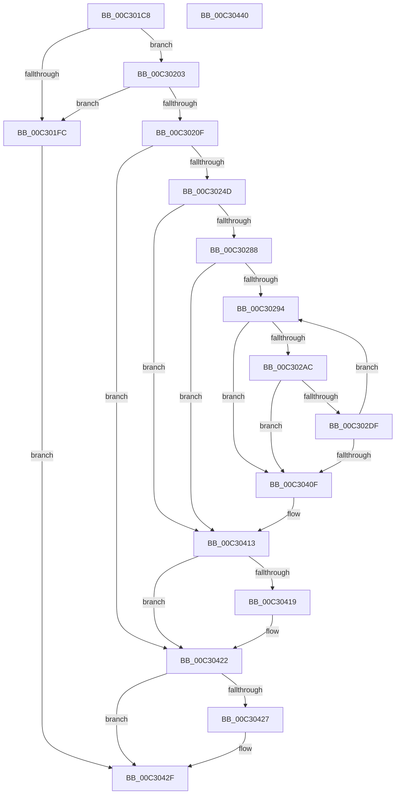

# PiInitFirmwareResources

- RVA: `0x00C301C8`–`0x00C30441` (길이 `633` bytes)
- VA: `0x0000000140C301C8`
- 실행 섹션: `INIT`
- PDB 이름 있음: `예`; PDB Function 태그: `아니요`
- unwind 정보 RVA: `0x000C810C`
- 디코드: `158`개 명령, `633/633` bytes 표시
- 미해석 바이트: `0` (있으면 어셈블리에 `.byte`로 보존)

> 이 문서는 커널 이미지의 기계어와 PDB 기호를 분석해 생성했습니다. 4번과 5번은 함수 원형과 자료형을 바이너리 사용 방식에서 추정한 C 해석이며 원본 소스 복구 결과는 아닙니다.

## 1. Dependencies

- 직접 호출 지점: **13**; 고유 호출 대상: **5**
- 직접 호출자로 확인된 함수: **1**
- RIP 상대 이미지 참조: **7**

### Outgoing calls
- `0x00C3023A` → [IopCreateRegistryKeyEx](../../page/A8/IopCreateRegistryKeyEx_function_00A89038.md) (function, `0x00A89038`)
- `0x00C30279` → [IopCreateRegistryKeyEx](../../page/A8/IopCreateRegistryKeyEx_function_00A89038.md) (function, `0x00A89038`)
- `0x00C3029D` → [RtlStringFromGUID](../../page/91/RtlStringFromGUID_function_00914BA0.md) (function, `0x00914BA0`)
- `0x00C302C7` → [IopCreateRegistryKeyEx](../../page/A8/IopCreateRegistryKeyEx_function_00A89038.md) (function, `0x00A89038`)
- `0x00C302D2` → [RtlFreeAnsiString](../../page/9C/RtlFreeAnsiString_function_009C0800.md) (function, `0x009C0800`)
- `0x00C30314` → [ZwSetValueKey](../../text/6A/ZwSetValueKey_function_006ADCD0.md) (function, `0x006ADCD0`)
- `0x00C3034B` → [ZwSetValueKey](../../text/6A/ZwSetValueKey_function_006ADCD0.md) (function, `0x006ADCD0`)
- `0x00C30382` → [ZwSetValueKey](../../text/6A/ZwSetValueKey_function_006ADCD0.md) (function, `0x006ADCD0`)
- `0x00C303B9` → [ZwSetValueKey](../../text/6A/ZwSetValueKey_function_006ADCD0.md) (function, `0x006ADCD0`)
- `0x00C303F0` → [ZwSetValueKey](../../text/6A/ZwSetValueKey_function_006ADCD0.md) (function, `0x006ADCD0`)
- `0x00C303F8` → [ZwClose](../../text/6A/ZwClose_function_006AD2B0.md) (function, `0x006AD2B0`)
- `0x00C3041D` → [ZwClose](../../text/6A/ZwClose_function_006AD2B0.md) (function, `0x006AD2B0`)
- `0x00C3042A` → [ZwClose](../../text/6A/ZwClose_function_006AD2B0.md) (function, `0x006AD2B0`)

### Direct callers
- [IopInitializePlugPlayServices](../C2/IopInitializePlugPlayServices_function_00C2F298.md) at `0x00C2F4CB`

### Static image references
- `0x00C3020F` → RVA `0x00C7A460` (` ?? ::PBOPGDP::`string'`; read)
- `0x00C3024D` → RVA `0x00C7A4A0` (` ?? ::PBOPGDP::`string'`; read)
- `0x00C302E3` → RVA `0x00C7A3E0` (` ?? ::PBOPGDP::`string'`; read)
- `0x00C30329` → RVA `0x00C7A3F0` (` ?? ::PBOPGDP::`string'`; read)
- `0x00C30360` → RVA `0x00C7A400` (` ?? ::PBOPGDP::`string'`; read)
- `0x00C30397` → RVA `0x00C7A430` (` ?? ::PBOPGDP::`string'`; read)
- `0x00C303CE` → RVA `0x00C7A4D0` (` ?? ::PBOPGDP::`string'`; read)

## 2. Other-region calls and transfers

- 다른 실행 섹션으로 향하는 call: **13**
  - `0x00C3023A` → [IopCreateRegistryKeyEx](../../page/A8/IopCreateRegistryKeyEx_function_00A89038.md) (`INIT` → `PAGE`)
  - `0x00C30279` → [IopCreateRegistryKeyEx](../../page/A8/IopCreateRegistryKeyEx_function_00A89038.md) (`INIT` → `PAGE`)
  - `0x00C3029D` → [RtlStringFromGUID](../../page/91/RtlStringFromGUID_function_00914BA0.md) (`INIT` → `PAGE`)
  - `0x00C302C7` → [IopCreateRegistryKeyEx](../../page/A8/IopCreateRegistryKeyEx_function_00A89038.md) (`INIT` → `PAGE`)
  - `0x00C302D2` → [RtlFreeAnsiString](../../page/9C/RtlFreeAnsiString_function_009C0800.md) (`INIT` → `PAGE`)
  - `0x00C30314` → [ZwSetValueKey](../../text/6A/ZwSetValueKey_function_006ADCD0.md) (`INIT` → `.text`)
  - `0x00C3034B` → [ZwSetValueKey](../../text/6A/ZwSetValueKey_function_006ADCD0.md) (`INIT` → `.text`)
  - `0x00C30382` → [ZwSetValueKey](../../text/6A/ZwSetValueKey_function_006ADCD0.md) (`INIT` → `.text`)
  - `0x00C303B9` → [ZwSetValueKey](../../text/6A/ZwSetValueKey_function_006ADCD0.md) (`INIT` → `.text`)
  - `0x00C303F0` → [ZwSetValueKey](../../text/6A/ZwSetValueKey_function_006ADCD0.md) (`INIT` → `.text`)
  - `0x00C303F8` → [ZwClose](../../text/6A/ZwClose_function_006AD2B0.md) (`INIT` → `.text`)
  - `0x00C3041D` → [ZwClose](../../text/6A/ZwClose_function_006AD2B0.md) (`INIT` → `.text`)
  - `0x00C3042A` → [ZwClose](../../text/6A/ZwClose_function_006AD2B0.md) (`INIT` → `.text`)
- 별도 외부 분기/꼬리 이동을 확인하지 못했습니다.

## 3. Assembly (complete function range)

```asm
00C301C8  40 55                           push rbp
00C301CA  53                              push rbx
00C301CB  56                              push rsi
00C301CC  57                              push rdi
00C301CD  41 54                           push r12
00C301CF  41 55                           push r13
00C301D1  41 56                           push r14
00C301D3  48 8B EC                        mov rbp, rsp
00C301D6  48 83 EC 50                     sub rsp, 0x50
00C301DA  8B 81 08 01 00 00               mov eax, dword ptr [rcx + 0x108]
00C301E0  33 DB                           xor ebx, ebx
00C301E2  48 89 5D 48                     mov qword ptr [rbp + 0x48], rbx
00C301E6  0F 57 C0                        xorps xmm0, xmm0
00C301E9  48 89 5D 40                     mov qword ptr [rbp + 0x40], rbx
00C301ED  89 5D E4                        mov dword ptr [rbp - 0x1c], ebx
00C301F0  48 89 5D 50                     mov qword ptr [rbp + 0x50], rbx
00C301F4  0F 11 45 F0                     movups xmmword ptr [rbp - 0x10], xmm0
00C301F8  A8 01                           test al, 1
00C301FA  75 07                           jne 0x140c30203
00C301FC  8B FB                           mov edi, ebx
00C301FE  E9 2C 02 00 00                  jmp 0x140c3042f
00C30203  48 8D B1 28 01 00 00            lea rsi, [rcx + 0x128]
00C3020A  48 39 36                        cmp qword ptr [rsi], rsi
00C3020D  74 ED                           je 0x140c301fc
00C3020F  48 8D 05 4A A2 04 00            lea rax, [rip + 0x4a24a]
00C30216  48 89 5C 24 28                  mov qword ptr [rsp + 0x28], rbx
00C3021B  41 B9 3F 00 0F 00               mov r9d, 0xf003f
00C30221  48 89 45 E8                     mov qword ptr [rbp - 0x18], rax
00C30225  4C 8D 45 E0                     lea r8, [rbp - 0x20]
00C30229  C7 45 E0 3E 00 40 00            mov dword ptr [rbp - 0x20], 0x40003e
00C30230  33 D2                           xor edx, edx
00C30232  89 5C 24 20                     mov dword ptr [rsp + 0x20], ebx
00C30236  48 8D 4D 48                     lea rcx, [rbp + 0x48]
00C3023A  E8 F9 8D E5 FF                  call 0x140a89038
00C3023F  4C 8B 75 48                     mov r14, qword ptr [rbp + 0x48]
00C30243  8B F8                           mov edi, eax
00C30245  85 C0                           test eax, eax
00C30247  0F 88 D5 01 00 00               js 0x140c30422
00C3024D  48 8D 05 4C A2 04 00            lea rax, [rip + 0x4a24c]
00C30254  48 89 5C 24 28                  mov qword ptr [rsp + 0x28], rbx
00C30259  41 B9 3F 00 0F 00               mov r9d, 0xf003f
00C3025F  48 89 45 E8                     mov qword ptr [rbp - 0x18], rax
00C30263  4C 8D 45 E0                     lea r8, [rbp - 0x20]
00C30267  C7 45 E0 08 00 0A 00            mov dword ptr [rbp - 0x20], 0xa0008
00C3026E  49 8B D6                        mov rdx, r14
00C30271  89 5C 24 20                     mov dword ptr [rsp + 0x20], ebx
00C30275  48 8D 4D 40                     lea rcx, [rbp + 0x40]
00C30279  E8 BA 8D E5 FF                  call 0x140a89038
00C3027E  8B F8                           mov edi, eax
00C30280  85 C0                           test eax, eax
00C30282  0F 88 8B 01 00 00               js 0x140c30413
00C30288  4C 8B 26                        mov r12, qword ptr [rsi]
00C3028B  4C 3B E6                        cmp r12, rsi
00C3028E  0F 84 7F 01 00 00               je 0x140c30413
00C30294  48 8D 55 F0                     lea rdx, [rbp - 0x10]
00C30298  49 8D 4C 24 10                  lea rcx, [r12 + 0x10]
00C3029D  E8 FE 48 CE FF                  call 0x140914ba0
00C302A2  8B F8                           mov edi, eax
00C302A4  85 C0                           test eax, eax
00C302A6  0F 88 63 01 00 00               js 0x140c3040f
00C302AC  48 8B 55 40                     mov rdx, qword ptr [rbp + 0x40]
00C302B0  4C 8D 45 F0                     lea r8, [rbp - 0x10]
00C302B4  48 89 5C 24 28                  mov qword ptr [rsp + 0x28], rbx
00C302B9  48 8D 4D 50                     lea rcx, [rbp + 0x50]
00C302BD  41 B9 3F 00 0F 00               mov r9d, 0xf003f
00C302C3  89 5C 24 20                     mov dword ptr [rsp + 0x20], ebx
00C302C7  E8 6C 8D E5 FF                  call 0x140a89038
00C302CC  48 8D 4D F0                     lea rcx, [rbp - 0x10]
00C302D0  8B F8                           mov edi, eax
00C302D2  E8 29 05 D9 FF                  call 0x1409c0800
00C302D7  85 FF                           test edi, edi
00C302D9  0F 88 30 01 00 00               js 0x140c3040f
00C302DF  48 8B 5D 50                     mov rbx, qword ptr [rbp + 0x50]
00C302E3  48 8D 05 F6 A0 04 00            lea rax, [rip + 0x4a0f6]
00C302EA  48 89 45 E8                     mov qword ptr [rbp - 0x18], rax
00C302EE  48 8D 55 E0                     lea rdx, [rbp - 0x20]
00C302F2  41 B9 04 00 00 00               mov r9d, 4
00C302F8  C7 45 E0 08 00 0A 00            mov dword ptr [rbp - 0x20], 0xa0008
00C302FF  49 8D 44 24 20                  lea rax, [r12 + 0x20]
00C30304  44 89 4C 24 28                  mov dword ptr [rsp + 0x28], r9d
00C30309  45 33 C0                        xor r8d, r8d
00C3030C  48 89 44 24 20                  mov qword ptr [rsp + 0x20], rax
00C30311  48 8B CB                        mov rcx, rbx
00C30314  E8 B7 D9 A7 FF                  call 0x1406adcd0
00C30319  B9 04 00 00 00                  mov ecx, 4
00C3031E  C7 45 E0 0E 00 10 00            mov dword ptr [rbp - 0x20], 0x10000e
00C30325  89 4C 24 28                     mov dword ptr [rsp + 0x28], ecx
00C30329  48 8D 05 C0 A0 04 00            lea rax, [rip + 0x4a0c0]
00C30330  48 89 45 E8                     mov qword ptr [rbp - 0x18], rax
00C30334  48 8D 55 E0                     lea rdx, [rbp - 0x20]
00C30338  49 8D 44 24 24                  lea rax, [r12 + 0x24]
00C3033D  44 8B C9                        mov r9d, ecx
00C30340  45 33 C0                        xor r8d, r8d
00C30343  48 89 44 24 20                  mov qword ptr [rsp + 0x20], rax
00C30348  48 8B CB                        mov rcx, rbx
00C3034B  E8 80 D9 A7 FF                  call 0x1406adcd0
00C30350  B9 04 00 00 00                  mov ecx, 4
00C30355  C7 45 E0 2C 00 2E 00            mov dword ptr [rbp - 0x20], 0x2e002c
00C3035C  89 4C 24 28                     mov dword ptr [rsp + 0x28], ecx
00C30360  48 8D 05 99 A0 04 00            lea rax, [rip + 0x4a099]
00C30367  48 89 45 E8                     mov qword ptr [rbp - 0x18], rax
00C3036B  48 8D 55 E0                     lea rdx, [rbp - 0x20]
00C3036F  49 8D 44 24 28                  lea rax, [r12 + 0x28]
00C30374  44 8B C9                        mov r9d, ecx
00C30377  45 33 C0                        xor r8d, r8d
00C3037A  48 89 44 24 20                  mov qword ptr [rsp + 0x20], rax
00C3037F  48 8B CB                        mov rcx, rbx
00C30382  E8 49 D9 A7 FF                  call 0x1406adcd0
00C30387  B9 04 00 00 00                  mov ecx, 4
00C3038C  C7 45 E0 24 00 26 00            mov dword ptr [rbp - 0x20], 0x260024
00C30393  89 4C 24 28                     mov dword ptr [rsp + 0x28], ecx
00C30397  48 8D 05 92 A0 04 00            lea rax, [rip + 0x4a092]
00C3039E  48 89 45 E8                     mov qword ptr [rbp - 0x18], rax
00C303A2  48 8D 55 E0                     lea rdx, [rbp - 0x20]
00C303A6  49 8D 44 24 30                  lea rax, [r12 + 0x30]
00C303AB  44 8B C9                        mov r9d, ecx
00C303AE  45 33 C0                        xor r8d, r8d
00C303B1  48 89 44 24 20                  mov qword ptr [rsp + 0x20], rax
00C303B6  48 8B CB                        mov rcx, rbx
00C303B9  E8 12 D9 A7 FF                  call 0x1406adcd0
00C303BE  B9 04 00 00 00                  mov ecx, 4
00C303C3  C7 45 E0 22 00 24 00            mov dword ptr [rbp - 0x20], 0x240022
00C303CA  89 4C 24 28                     mov dword ptr [rsp + 0x28], ecx
00C303CE  48 8D 05 FB A0 04 00            lea rax, [rip + 0x4a0fb]
00C303D5  48 89 45 E8                     mov qword ptr [rbp - 0x18], rax
00C303D9  48 8D 55 E0                     lea rdx, [rbp - 0x20]
00C303DD  49 8D 44 24 34                  lea rax, [r12 + 0x34]
00C303E2  44 8B C9                        mov r9d, ecx
00C303E5  45 33 C0                        xor r8d, r8d
00C303E8  48 89 44 24 20                  mov qword ptr [rsp + 0x20], rax
00C303ED  48 8B CB                        mov rcx, rbx
00C303F0  E8 DB D8 A7 FF                  call 0x1406adcd0
00C303F5  48 8B CB                        mov rcx, rbx
00C303F8  E8 B3 CE A7 FF                  call 0x1406ad2b0
00C303FD  4D 8B 24 24                     mov r12, qword ptr [r12]
00C30401  BB 00 00 00 00                  mov ebx, 0
00C30406  4C 3B E6                        cmp r12, rsi
00C30409  0F 85 85 FE FF FF               jne 0x140c30294
00C3040F  4C 8B 75 48                     mov r14, qword ptr [rbp + 0x48]
00C30413  48 39 5D 40                     cmp qword ptr [rbp + 0x40], rbx
00C30417  74 09                           je 0x140c30422
00C30419  48 8B 4D 40                     mov rcx, qword ptr [rbp + 0x40]
00C3041D  E8 8E CE A7 FF                  call 0x1406ad2b0
00C30422  4D 85 F6                        test r14, r14
00C30425  74 08                           je 0x140c3042f
00C30427  49 8B CE                        mov rcx, r14
00C3042A  E8 81 CE A7 FF                  call 0x1406ad2b0
00C3042F  8B C7                           mov eax, edi
00C30431  48 83 C4 50                     add rsp, 0x50
00C30435  41 5E                           pop r14
00C30437  41 5D                           pop r13
00C30439  41 5C                           pop r12
00C3043B  5F                              pop rdi
00C3043C  5E                              pop rsi
00C3043D  5B                              pop rbx
00C3043E  5D                              pop rbp
00C3043F  C3                              ret
00C30440  CC                              int3
```

## 4. C-style interpretation (structured pseudocode)

```c
__int64 __fastcall PiInitFirmwareResources(__int64 a1, int a2)
{
    __int64 result;
    __int64 v_rbx;
    __int64 v_rsp;
    unsigned __int64 v_stack_m48;
    unsigned __int64 v_stack_m50;
    unsigned int v_stack_m54;
    unsigned __int64 v_stack_m58;
    unsigned __int64 v_stack_m60;
    unsigned int v_stack_m68;
    unsigned __int64 v_stack_p10;
    unsigned __int64 v_stack_p18;
    unsigned __int64 v_stack_p8;

    v_rsp = (v_rsp) - (80);
    v_rbx = 0;
    v_stack_p10 = 0;
    v_stack_p8 = 0;
    v_stack_m54 = 0;
    v_stack_p18 = 0;
    v_stack_m48 = v_xmm0;
    if ((((unsigned __int8)((unsigned int)(*(unsigned int *)(a1 + 264)))) & (1)) != 0) goto loc_00C30203;
loc_00C301FC:
    goto loc_00C3042F;
loc_00C30203:
    if ((*(unsigned __int64 *)(a1 + 296)) == (a1 + 296)) goto loc_00C301FC;
    v_stack_m60 = 0;
    v_stack_m50 = v_rip + 303690;
    v_stack_m58 = 0x40003EULL;
    a2 = 0;
    v_stack_m68 = 0;
    result = IopCreateRegistryKeyEx(v_stack_p10, a2, v_stack_m58, (unsigned int)(0xF003FULL));
    if (sign_flag) goto loc_00C30422;
    v_stack_m60 = 0;
    v_stack_m50 = v_rip + 303692;
    v_stack_m58 = 0xA0008ULL;
    v_stack_m68 = 0;
    result = IopCreateRegistryKeyEx(v_stack_p8, v_stack_p10, v_stack_m58, (unsigned int)(0xF003FULL));
    if (sign_flag) goto loc_00C30413;
    if ((*(unsigned __int64 *)(a1 + 296)) == (a1 + 296)) goto loc_00C30413;
loc_00C30294:
    result = RtlStringFromGUID(*(unsigned __int64 *)(a1 + 296) + 16, v_stack_m48, v_stack_m58, (unsigned int)(0xF003FULL));
    if (sign_flag) goto loc_00C3040F;
    v_stack_m60 = 0;
    v_stack_m68 = 0;
    result = IopCreateRegistryKeyEx(v_stack_p18, v_stack_p8, v_stack_m48, (unsigned int)(0xF003FULL));
    result = RtlFreeAnsiString(v_stack_m48, v_stack_p8, v_stack_m48, (unsigned int)(0xF003FULL));
    if (sign_flag) goto loc_00C3040F;
    v_stack_m50 = v_rip + 303350;
    v_stack_m58 = 0xA0008ULL;
    v_stack_m60 = 4;
    a3 = 0;
    v_stack_m68 = *(unsigned __int64 *)(a1 + 296) + 32;
    result = ZwSetValueKey(v_stack_p18, v_stack_m58, a3, 4);
    v_stack_m58 = 0x10000EULL;
    v_stack_m60 = 4;
    v_stack_m50 = v_rip + 303296;
    a3 = 0;
    v_stack_m68 = *(unsigned __int64 *)(a1 + 296) + 36;
    result = ZwSetValueKey(v_stack_p18, v_stack_m58, a3, 4);
    v_stack_m58 = 0x2E002CULL;
    v_stack_m60 = 4;
    v_stack_m50 = v_rip + 303257;
    a3 = 0;
    v_stack_m68 = *(unsigned __int64 *)(a1 + 296) + 40;
    result = ZwSetValueKey(v_stack_p18, v_stack_m58, a3, 4);
    v_stack_m58 = 0x260024ULL;
    v_stack_m60 = 4;
    v_stack_m50 = v_rip + 303250;
    a3 = 0;
    v_stack_m68 = *(unsigned __int64 *)(a1 + 296) + 48;
    result = ZwSetValueKey(v_stack_p18, v_stack_m58, a3, 4);
    v_stack_m58 = 0x240022ULL;
    v_stack_m60 = 4;
    v_stack_m50 = v_rip + 303355;
    a3 = 0;
    v_stack_m68 = *(unsigned __int64 *)(a1 + 296) + 52;
    result = ZwSetValueKey(v_stack_p18, v_stack_m58, a3, 4);
    result = ZwClose(v_stack_p18, v_stack_m58, a3, 4);
    if ((*(unsigned __int64 *)(*(unsigned __int64 *)(a1 + 296))) != (a1 + 296)) goto loc_00C30294;
loc_00C3040F:
loc_00C30413:
    if (v_stack_p8 != 0) {
        a1 = v_stack_p8;
        result = ZwClose(a1, v_stack_m58, a3, 4);
    }
    if (v_stack_p10 != 0) {
        a1 = v_stack_p10;
        result = ZwClose(a1, v_stack_m58, a3, 4);
    }
    v_rsp = (v_rsp) + (80);
    return (unsigned int)((unsigned int)((unsigned int)((unsigned int)(result))));
}
```

## 5. (Beta) C Style

```c
int64_t PiInitFirmwareResources(void *Arg1, int32_t Arg2)
{
    uint8_t *arg1 = (uint8_t *)Arg1;

    int64_t result;
    int64_t local_rbx;
    int64_t local_rsp;
    uint64_t v_stack_m48;
    uint64_t v_stack_m50;
    uint32_t v_stack_m54;
    uint64_t v_stack_m58;
    uint64_t v_stack_m60;
    uint32_t v_stack_m68;
    uint64_t v_stack_p10;
    uint64_t v_stack_p18;
    uint64_t v_stack_p8;

    local_rsp = (local_rsp) - (80);
    local_rbx = 0;
    v_stack_p10 = 0;
    v_stack_p8 = 0;
    v_stack_m54 = 0;
    v_stack_p18 = 0;
    v_stack_m48 = v_xmm0;
    if ((((uint8_t)((uint32_t)(*(uint32_t *)(arg1 + 0x108)))) & (1)) != 0) goto loc_00C30203;
loc_00C301FC:
    goto loc_00C3042F;
loc_00C30203:
    if ((*(uint64_t *)(arg1 + 0x128)) == (Arg1 + 296)) goto loc_00C301FC;
    v_stack_m60 = 0;
    v_stack_m50 = v_rip + 303690;
    v_stack_m58 = 0x40003EULL;
    Arg2 = 0;
    v_stack_m68 = 0;
    result = IopCreateRegistryKeyEx(v_stack_p10, Arg2, v_stack_m58, (uint32_t)(0xF003FULL));
    if (sign_flag) goto loc_00C30422;
    v_stack_m60 = 0;
    v_stack_m50 = v_rip + 303692;
    v_stack_m58 = 0xA0008ULL;
    v_stack_m68 = 0;
    result = IopCreateRegistryKeyEx(v_stack_p8, v_stack_p10, v_stack_m58, (uint32_t)(0xF003FULL));
    if (sign_flag) goto loc_00C30413;
    if ((*(uint64_t *)(arg1 + 0x128)) == (Arg1 + 296)) goto loc_00C30413;
loc_00C30294:
    result = RtlStringFromGUID(*(uint64_t *)(arg1 + 0x128) + 16, v_stack_m48, v_stack_m58, (uint32_t)(0xF003FULL));
    if (sign_flag) goto loc_00C3040F;
    v_stack_m60 = 0;
    v_stack_m68 = 0;
    result = IopCreateRegistryKeyEx(v_stack_p18, v_stack_p8, v_stack_m48, (uint32_t)(0xF003FULL));
    result = RtlFreeAnsiString(v_stack_m48, v_stack_p8, v_stack_m48, (uint32_t)(0xF003FULL));
    if (sign_flag) goto loc_00C3040F;
    v_stack_m50 = v_rip + 303350;
    v_stack_m58 = 0xA0008ULL;
    v_stack_m60 = 4;
    a3 = 0;
    v_stack_m68 = *(uint64_t *)(arg1 + 0x128) + 32;
    result = ZwSetValueKey(v_stack_p18, v_stack_m58, a3, 4);
    v_stack_m58 = 0x10000EULL;
    v_stack_m60 = 4;
    v_stack_m50 = v_rip + 303296;
    a3 = 0;
    v_stack_m68 = *(uint64_t *)(arg1 + 0x128) + 36;
    result = ZwSetValueKey(v_stack_p18, v_stack_m58, a3, 4);
    v_stack_m58 = 0x2E002CULL;
    v_stack_m60 = 4;
    v_stack_m50 = v_rip + 303257;
    a3 = 0;
    v_stack_m68 = *(uint64_t *)(arg1 + 0x128) + 40;
    result = ZwSetValueKey(v_stack_p18, v_stack_m58, a3, 4);
    v_stack_m58 = 0x260024ULL;
    v_stack_m60 = 4;
    v_stack_m50 = v_rip + 303250;
    a3 = 0;
    v_stack_m68 = *(uint64_t *)(arg1 + 0x128) + 48;
    result = ZwSetValueKey(v_stack_p18, v_stack_m58, a3, 4);
    v_stack_m58 = 0x240022ULL;
    v_stack_m60 = 4;
    v_stack_m50 = v_rip + 303355;
    a3 = 0;
    v_stack_m68 = *(uint64_t *)(arg1 + 0x128) + 52;
    result = ZwSetValueKey(v_stack_p18, v_stack_m58, a3, 4);
    result = ZwClose(v_stack_p18, v_stack_m58, a3, 4);
    if ((*(uint64_t *)(*(uint64_t *)(arg1 + 0x128))) != (Arg1 + 296)) goto loc_00C30294;
loc_00C3040F:
loc_00C30413:
    if (v_stack_p8 != 0) {
        Arg1 = v_stack_p8;
        result = ZwClose(Arg1, v_stack_m58, a3, 4);
    }
    if (v_stack_p10 != 0) {
        Arg1 = v_stack_p10;
        result = ZwClose(Arg1, v_stack_m58, a3, 4);
    }
    local_rsp = (local_rsp) + (80);
    return (uint32_t)((uint32_t)((uint32_t)((uint32_t)(result))));
}
```

### 관측된 메모리 오프셋

구조체 형식이 확인되지 않은 접근은 인자 기준의 오프셋으로만 기록했습니다.

| 기준 인자 | 오프셋 표현 | 폭 (bit) | 접근 |
|---|---:|---:|---|
| `Arg1` | `+ 0x0` | `64` | `R` |
| `Arg1` | `+ 0x108` | `32` | `R` |
| `Arg1` | `+ 0x128` | `64` | `R` |

## 6. Execution-region graph

[열기: 2D/3D 그래프와 함수 탐색 컨트롤 패널](../../../control-panel.html?section=init&rva=0x00C301C8&view=graph)

- 2D 그래프는 위에서 아래로 흐르고, 3D 그래프는 빈 공간을 드래그해 회전합니다. Shift+드래그는 이동, 휠은 확대·축소, 함수 노드 선택은 대상 보고서 이동입니다.

### Static fallback


