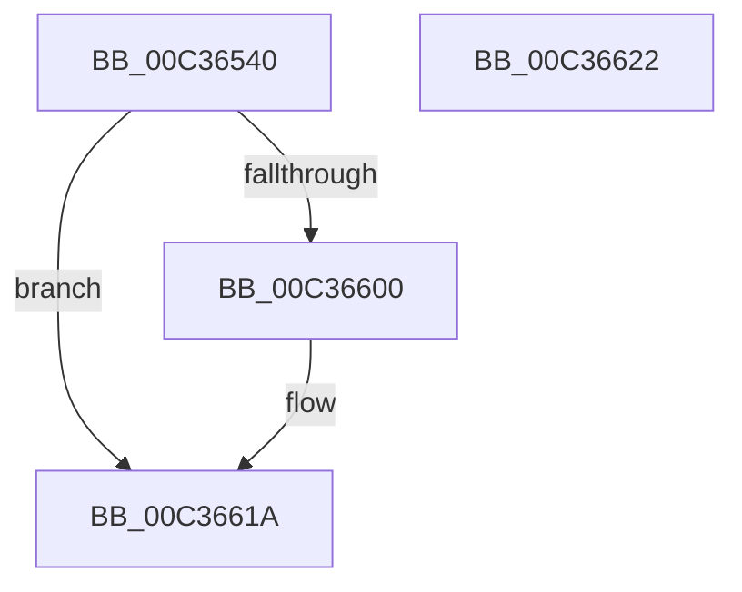

# PiKsrNotifyInitialize

- RVA: `0x00C36540`–`0x00C36623` (길이 `227` bytes)
- VA: `0x0000000140C36540`
- 실행 섹션: `INIT`
- PDB 이름 있음: `예`; PDB Function 태그: `아니요`
- unwind 정보 RVA: `0x0008A308`
- 디코드: `45`개 명령, `227/227` bytes 표시
- 미해석 바이트: `0` (있으면 어셈블리에 `.byte`로 보존)

> 이 문서는 커널 이미지의 기계어와 PDB 기호를 분석해 생성했습니다. 4번과 5번은 함수 원형과 자료형을 바이너리 사용 방식에서 추정한 C 해석이며 원본 소스 복구 결과는 아닙니다.

## 1. Dependencies

- 직접 호출 지점: **3**; 고유 호출 대상: **3**
- 직접 호출자로 확인된 함수: **1**
- RIP 상대 이미지 참조: **16**

### Outgoing calls
- `0x00C365C5` → [RtlInitUnicodeString](../../text/42/RtlInitUnicodeString_function_0042A780.md) (function, `0x0042A780`)
- `0x00C365F7` → [ExCreateCallback](../../page/A7/ExCreateCallback_function_00A7B9D0.md) (function, `0x00A7B9D0`)
- `0x00C36615` → [ExRegisterCallback](../../text/4B/ExRegisterCallback_function_004BDFC0.md) (function, `0x004BDFC0`)

### Direct callers
- [IopInitializePlugPlayServices](../C2/IopInitializePlugPlayServices_function_00C2F298.md) at `0x00C3001C`

### Static image references
- `0x00C3654D` → RVA `0x00F8A8E0` (`.data`; read)
- `0x00C36554` → RVA `0x00F8A8A8` (`.data`; read/write)
- `0x00C3655C` → RVA `0x00C7B230` (` ?? ::PBOPGDP::`string'`; read)
- `0x00C36563` → RVA `0x00F8A8B0` (`.data`; read/write)
- `0x00C3656E` → RVA `0x00F8A8BC` (`.data`; read/write)
- `0x00C36578` → RVA `0x00F8A8E8` (`.data`; write)
- `0x00C3657F` → RVA `0x00F8A8E0` (`.data`; write)
- `0x00C36586` → RVA `0x00F8A8C0` (`.data`; read)
- `0x00C36599` → RVA `0x00F8A8C8` (`.data`; write)
- `0x00C365A0` → RVA `0x00F8A8C0` (`.data`; write)
- `0x00C365AB` → RVA `0x00F8A8A0` (`.data`; write)
- `0x00C365B5` → RVA `0x00F8A8B8` (`.data`; write)
- `0x00C365BE` → RVA `0x00F8A8BA` (`.data`; write)
- `0x00C365EB` → RVA `0x00F8A888` (`.data`; read)
- `0x00C36600` → RVA `0x00F8C438` (`.data`; read)
- `0x00C36607` → RVA `0x0073E3B0` (`PipKsrCallback`; read)

## 2. Other-region calls and transfers

- 다른 실행 섹션으로 향하는 call: **3**
  - `0x00C365C5` → [RtlInitUnicodeString](../../text/42/RtlInitUnicodeString_function_0042A780.md) (`INIT` → `.text`)
  - `0x00C365F7` → [ExCreateCallback](../../page/A7/ExCreateCallback_function_00A7B9D0.md) (`INIT` → `PAGE`)
  - `0x00C36615` → [ExRegisterCallback](../../text/4B/ExRegisterCallback_function_004BDFC0.md) (`INIT` → `.text`)
- 별도 외부 분기/꼬리 이동을 확인하지 못했습니다.

## 3. Assembly (complete function range)

```asm
00C36540  40 55                           push rbp
00C36542  48 8B EC                        mov rbp, rsp
00C36545  48 83 EC 60                     sub rsp, 0x60
00C36549  83 65 EC 00                     and dword ptr [rbp - 0x14], 0
00C3654D  48 8D 05 8C 43 35 00            lea rax, [rip + 0x35438c]
00C36554  48 83 25 4C 43 35 00 00         and qword ptr [rip + 0x35434c], 0
00C3655C  48 8D 15 CD 4C 04 00            lea rdx, [rip + 0x44ccd]
00C36563  83 25 46 43 35 00 00            and dword ptr [rip + 0x354346], 0
00C3656A  48 8D 4D C0                     lea rcx, [rbp - 0x40]
00C3656E  83 25 47 43 35 00 00            and dword ptr [rip + 0x354347], 0
00C36575  0F 57 C0                        xorps xmm0, xmm0
00C36578  48 89 05 69 43 35 00            mov qword ptr [rip + 0x354369], rax
00C3657F  48 89 05 5A 43 35 00            mov qword ptr [rip + 0x35435a], rax
00C36586  48 8D 05 33 43 35 00            lea rax, [rip + 0x354333]
00C3658D  48 C7 45 D0 30 00 00 00         mov qword ptr [rbp - 0x30], 0x30
00C36595  83 65 D4 00                     and dword ptr [rbp - 0x2c], 0
00C36599  48 89 05 28 43 35 00            mov qword ptr [rip + 0x354328], rax
00C365A0  48 89 05 19 43 35 00            mov qword ptr [rip + 0x354319], rax
00C365A7  0F 11 45 C0                     movups xmmword ptr [rbp - 0x40], xmm0
00C365AB  C7 05 EB 42 35 00 01 00 00 00   mov dword ptr [rip + 0x3542eb], 1
00C365B5  66 C7 05 FA 42 35 00 01 00      mov word ptr [rip + 0x3542fa], 1
00C365BE  C6 05 F5 42 35 00 06            mov byte ptr [rip + 0x3542f5], 6
00C365C5  E8 B6 41 7F FF                  call 0x14042a780
00C365CA  48 83 65 D8 00                  and qword ptr [rbp - 0x28], 0
00C365CF  48 8D 45 C0                     lea rax, [rbp - 0x40]
00C365D3  0F 57 C0                        xorps xmm0, xmm0
00C365D6  48 89 45 E0                     mov qword ptr [rbp - 0x20], rax
00C365DA  45 33 C9                        xor r9d, r9d
00C365DD  C7 45 E8 50 00 00 00            mov dword ptr [rbp - 0x18], 0x50
00C365E4  45 33 C0                        xor r8d, r8d
00C365E7  48 8D 55 D0                     lea rdx, [rbp - 0x30]
00C365EB  48 8D 0D 96 42 35 00            lea rcx, [rip + 0x354296]
00C365F2  F3 0F 7F 45 F0                  movdqu xmmword ptr [rbp - 0x10], xmm0
00C365F7  E8 D4 53 E4 FF                  call 0x140a7b9d0
00C365FC  85 C0                           test eax, eax
00C365FE  78 1A                           js 0x140c3661a
00C36600  4C 8B 05 31 5E 35 00            mov r8, qword ptr [rip + 0x355e31]
00C36607  48 8D 15 A2 7D B0 FF            lea rdx, [rip - 0x4f825e]
00C3660E  48 8B 0D 73 42 35 00            mov rcx, qword ptr [rip + 0x354273]
00C36615  E8 A6 79 88 FF                  call 0x1404bdfc0
00C3661A  33 C0                           xor eax, eax
00C3661C  48 83 C4 60                     add rsp, 0x60
00C36620  5D                              pop rbp
00C36621  C3                              ret
00C36622  CC                              int3
```

## 4. C-style interpretation (structured pseudocode)

```c
__int64 __fastcall PiKsrNotifyInitialize(__int64 a1, __int64 a2, int a3, int a4)
{
    __int64 result;
    __int64 v_rsp;
    unsigned __int64 v_stack_m18;
    unsigned int v_stack_m1C;
    unsigned int v_stack_m20;
    unsigned __int64 v_stack_m28;
    unsigned __int64 v_stack_m30;
    unsigned int v_stack_m34;
    unsigned __int64 v_stack_m38;
    unsigned __int64 v_stack_m48;

    v_rsp = (v_rsp) - (96);
    *(unsigned __int64 *)(v_rip + 3490665) = v_rip + 3490700;
    *(unsigned __int64 *)(v_rip + 3490650) = v_rip + 3490700;
    v_stack_m38 = 48;
    *(unsigned __int64 *)(v_rip + 3490600) = v_rip + 3490611;
    *(unsigned __int64 *)(v_rip + 3490585) = v_rip + 3490611;
    v_stack_m48 = v_xmm0;
    *(unsigned int *)(v_rip + 3490539) = 1;
    *(unsigned __int16 *)(v_rip + 3490554) = 1;
    *(unsigned __int8 *)(v_rip + 3490549) = 6;
    result = RtlInitUnicodeString(v_stack_m48, v_rip + 281805, a3, a4);
    v_stack_m28 = v_stack_m48;
    a4 = 0;
    v_stack_m20 = 80;
    a3 = 0;
    v_stack_m18 = v_xmm0;
    result = ExCreateCallback(v_rip + 3490454, v_stack_m38, a3, a4);
    if (!(sign_flag)) {
        a3 = *(unsigned __int64 *)(v_rip + 3497521);
        a2 = v_rip - 5210718;
        a1 = *(unsigned __int64 *)(v_rip + 3490419);
        result = ExRegisterCallback(a1, a2, a3, a4);
    }
    result = 0;
    v_rsp = (v_rsp) + (96);
    return result;
}
```

## 5. (Beta) C Style

```c
int64_t PiKsrNotifyInitialize(int64_t Arg1, int64_t Arg2, int32_t Arg3, int32_t Arg4)
{
    int64_t result;
    int64_t local_rsp;
    uint64_t v_stack_m18;
    uint32_t v_stack_m1C;
    uint32_t v_stack_m20;
    uint64_t v_stack_m28;
    uint64_t v_stack_m30;
    uint32_t v_stack_m34;
    uint64_t v_stack_m38;
    uint64_t v_stack_m48;

    local_rsp = (local_rsp) - (96);
    *(uint64_t *)(v_rip + 0x354369) = v_rip + 3490700;
    *(uint64_t *)(v_rip + 0x35435A) = v_rip + 3490700;
    v_stack_m38 = 48;
    *(uint64_t *)(v_rip + 0x354328) = v_rip + 3490611;
    *(uint64_t *)(v_rip + 0x354319) = v_rip + 3490611;
    v_stack_m48 = v_xmm0;
    *(uint32_t *)(v_rip + 0x3542EB) = 1;
    *(uint16_t *)(v_rip + 0x3542FA) = 1;
    *(uint8_t *)(v_rip + 0x3542F5) = 6;
    result = RtlInitUnicodeString(v_stack_m48, v_rip + 281805, Arg3, Arg4);
    v_stack_m28 = v_stack_m48;
    Arg4 = 0;
    v_stack_m20 = 80;
    Arg3 = 0;
    v_stack_m18 = v_xmm0;
    result = ExCreateCallback(v_rip + 3490454, v_stack_m38, Arg3, Arg4);
    if (!(sign_flag)) {
        Arg3 = *(uint64_t *)(v_rip + 0x355E31);
        Arg2 = v_rip - 5210718;
        Arg1 = *(uint64_t *)(v_rip + 0x354273);
        result = ExRegisterCallback(Arg1, Arg2, Arg3, Arg4);
    }
    result = 0;
    local_rsp = (local_rsp) + (96);
    return result;
}
```

## 6. Execution-region graph

[열기: 2D/3D 그래프와 함수 탐색 컨트롤 패널](../../../control-panel.html?section=init&rva=0x00C36540&view=graph)

- 2D 그래프는 위에서 아래로 흐르고, 3D 그래프는 빈 공간을 드래그해 회전합니다. Shift+드래그는 이동, 휠은 확대·축소, 함수 노드 선택은 대상 보고서 이동입니다.

### Static fallback


