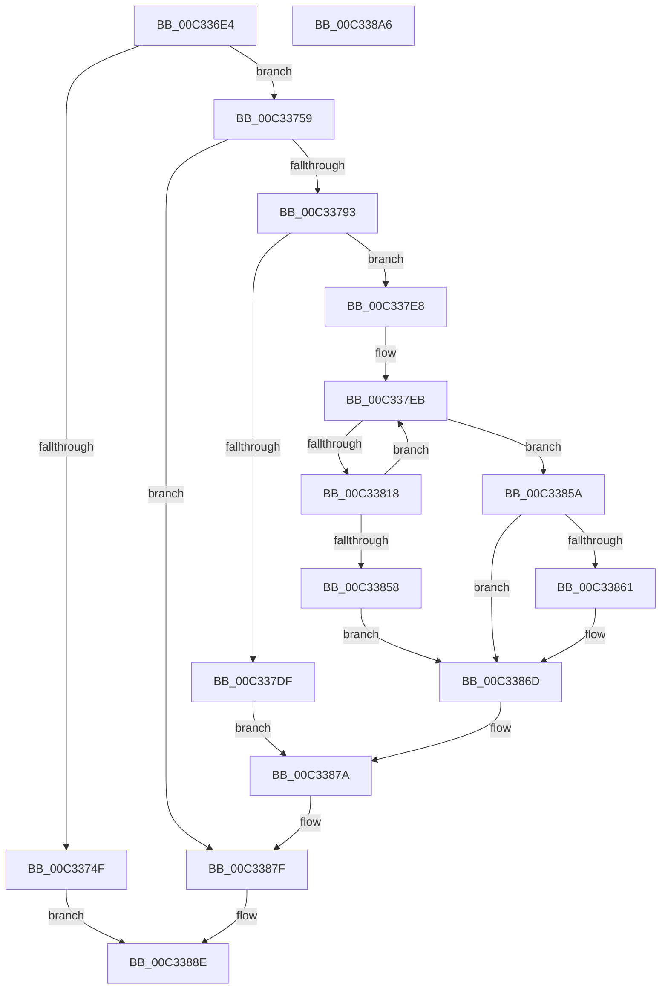

# PiLastGoodCopyKeyContents

- RVA: `0x00C336E4`–`0x00C338A7` (길이 `451` bytes)
- VA: `0x0000000140C336E4`
- 실행 섹션: `INIT`
- PDB 이름 있음: `예`; PDB Function 태그: `아니요`
- unwind 정보 RVA: `0x000C8650`
- 디코드: `118`개 명령, `451/451` bytes 표시
- 미해석 바이트: `0` (있으면 어셈블리에 `.byte`로 보존)

> 이 문서는 커널 이미지의 기계어와 PDB 기호를 분석해 생성했습니다. 4번과 5번은 함수 원형과 자료형을 바이너리 사용 방식에서 추정한 C 해석이며 원본 소스 복구 결과는 아닙니다.

## 1. Dependencies

- 직접 호출 지점: **9**; 고유 호출 대상: **8**
- 직접 호출자로 확인된 함수: **1**
- RIP 상대 이미지 참조: **0**

### Outgoing calls
- `0x00C33742` → [ExAllocatePool2](../../poolcode/B8/ExAllocatePool2_function_00B820F0.md) (function, `0x00B820F0`)
- `0x00C33784` → [ZwOpenKey](../../text/6A/ZwOpenKey_function_006AD310.md) (function, `0x006AD310`)
- `0x00C337D4` → [ZwCreateKey](../../text/6A/ZwCreateKey_function_006AD470.md) (function, `0x006AD470`)
- `0x00C3380B` → [ZwEnumerateValueKey](../../text/6A/ZwEnumerateValueKey_function_006AD330.md) (function, `0x006AD330`)
- `0x00C3384D` → [ZwSetValueKey](../../text/6A/ZwSetValueKey_function_006ADCD0.md) (function, `0x006ADCD0`)
- `0x00C33868` → [ZwDeleteKey](../../text/6A/ZwDeleteKey_function_006AEC50.md) (function, `0x006AEC50`)
- `0x00C33871` → [ZwClose](../../text/6A/ZwClose_function_006AD2B0.md) (function, `0x006AD2B0`)
- `0x00C3387A` → [ZwClose](../../text/6A/ZwClose_function_006AD2B0.md) (function, `0x006AD2B0`)
- `0x00C33887` → [ExFreePoolWithTag](../../poolcode/B8/ExFreePoolWithTag_function_00B82870.md) (function, `0x00B82870`)

### Direct callers
- [PpLastGoodDoBootProcessing](PpLastGoodDoBootProcessing_function_00C33BC4.md) at `0x00C33C60`

### Static image references
- 디코드된 RIP-relative 메모리 참조가 없습니다.

## 2. Other-region calls and transfers

- 다른 실행 섹션으로 향하는 call: **9**
  - `0x00C33742` → [ExAllocatePool2](../../poolcode/B8/ExAllocatePool2_function_00B820F0.md) (`INIT` → `POOLCODE`)
  - `0x00C33784` → [ZwOpenKey](../../text/6A/ZwOpenKey_function_006AD310.md) (`INIT` → `.text`)
  - `0x00C337D4` → [ZwCreateKey](../../text/6A/ZwCreateKey_function_006AD470.md) (`INIT` → `.text`)
  - `0x00C3380B` → [ZwEnumerateValueKey](../../text/6A/ZwEnumerateValueKey_function_006AD330.md) (`INIT` → `.text`)
  - `0x00C3384D` → [ZwSetValueKey](../../text/6A/ZwSetValueKey_function_006ADCD0.md) (`INIT` → `.text`)
  - `0x00C33868` → [ZwDeleteKey](../../text/6A/ZwDeleteKey_function_006AEC50.md) (`INIT` → `.text`)
  - `0x00C33871` → [ZwClose](../../text/6A/ZwClose_function_006AD2B0.md) (`INIT` → `.text`)
  - `0x00C3387A` → [ZwClose](../../text/6A/ZwClose_function_006AD2B0.md) (`INIT` → `.text`)
  - `0x00C33887` → [ExFreePoolWithTag](../../poolcode/B8/ExFreePoolWithTag_function_00B82870.md) (`INIT` → `POOLCODE`)
- 별도 외부 분기/꼬리 이동을 확인하지 못했습니다.

## 3. Assembly (complete function range)

```asm
00C336E4  48 8B C4                        mov rax, rsp
00C336E7  48 89 58 08                     mov qword ptr [rax + 8], rbx
00C336EB  48 89 70 10                     mov qword ptr [rax + 0x10], rsi
00C336EF  44 88 40 18                     mov byte ptr [rax + 0x18], r8b
00C336F3  55                              push rbp
00C336F4  57                              push rdi
00C336F5  41 56                           push r14
00C336F7  48 8D 68 A1                     lea rbp, [rax - 0x5f]
00C336FB  48 81 EC C0 00 00 00            sub rsp, 0xc0
00C33702  45 33 F6                        xor r14d, r14d
00C33705  48 8B F2                        mov rsi, rdx
00C33708  48 8B F9                        mov rdi, rcx
00C3370B  44 89 75 EB                     mov dword ptr [rbp - 0x15], r14d
00C3370F  0F 57 C0                        xorps xmm0, xmm0
00C33712  44 89 75 03                     mov dword ptr [rbp + 3], r14d
00C33716  BA 18 04 00 00                  mov edx, 0x418
00C3371B  44 89 75 1B                     mov dword ptr [rbp + 0x1b], r14d
00C3371F  B9 00 01 00 00                  mov ecx, 0x100
00C33724  44 89 75 33                     mov dword ptr [rbp + 0x33], r14d
00C33728  41 B8 50 70 4C 67               mov r8d, 0x674c7050
00C3372E  4C 89 75 C7                     mov qword ptr [rbp - 0x39], r14
00C33732  4C 89 75 CF                     mov qword ptr [rbp - 0x31], r14
00C33736  44 89 75 7F                     mov dword ptr [rbp + 0x7f], r14d
00C3373A  44 89 75 77                     mov dword ptr [rbp + 0x77], r14d
00C3373E  0F 11 45 D7                     movups xmmword ptr [rbp - 0x29], xmm0
00C33742  E8 A9 E9 F4 FF                  call 0x140b820f0
00C33747  48 8B D8                        mov rbx, rax
00C3374A  48 85 C0                        test rax, rax
00C3374D  75 0A                           jne 0x140c33759
00C3374F  B8 9A 00 00 C0                  mov eax, 0xc000009a
00C33754  E9 35 01 00 00                  jmp 0x140c3388e
00C33759  0F 57 C0                        xorps xmm0, xmm0
00C3375C  C7 45 E7 30 00 00 00            mov dword ptr [rbp - 0x19], 0x30
00C33763  4C 8D 45 E7                     lea r8, [rbp - 0x19]
00C33767  4C 89 75 EF                     mov qword ptr [rbp - 0x11], r14
00C3376B  BA 3F 00 0F 00                  mov edx, 0xf003f
00C33770  C7 45 FF 40 02 00 00            mov dword ptr [rbp - 1], 0x240
00C33777  48 8D 4D C7                     lea rcx, [rbp - 0x39]
00C3377B  48 89 7D F7                     mov qword ptr [rbp - 9], rdi
00C3377F  F3 0F 7F 45 07                  movdqu xmmword ptr [rbp + 7], xmm0
00C33784  E8 87 9B A7 FF                  call 0x1406ad310
00C33789  8B F8                           mov edi, eax
00C3378B  85 C0                           test eax, eax
00C3378D  0F 88 EC 00 00 00               js 0x140c3387f
00C33793  48 8D 45 77                     lea rax, [rbp + 0x77]
00C33797  C7 45 17 30 00 00 00            mov dword ptr [rbp + 0x17], 0x30
00C3379E  48 89 44 24 30                  mov qword ptr [rsp + 0x30], rax
00C337A3  4C 8D 45 17                     lea r8, [rbp + 0x17]
00C337A7  0F 57 C0                        xorps xmm0, xmm0
00C337AA  44 89 74 24 28                  mov dword ptr [rsp + 0x28], r14d
00C337AF  45 33 C9                        xor r9d, r9d
00C337B2  4C 89 74 24 20                  mov qword ptr [rsp + 0x20], r14
00C337B7  BA 3F 00 0F 00                  mov edx, 0xf003f
00C337BC  4C 89 75 1F                     mov qword ptr [rbp + 0x1f], r14
00C337C0  48 8D 4D CF                     lea rcx, [rbp - 0x31]
00C337C4  C7 45 2F 40 02 00 00            mov dword ptr [rbp + 0x2f], 0x240
00C337CB  48 89 75 27                     mov qword ptr [rbp + 0x27], rsi
00C337CF  F3 0F 7F 45 37                  movdqu xmmword ptr [rbp + 0x37], xmm0
00C337D4  E8 97 9C A7 FF                  call 0x1406ad470
00C337D9  8B F8                           mov edi, eax
00C337DB  85 C0                           test eax, eax
00C337DD  79 09                           jns 0x140c337e8
00C337DF  48 8B 4D C7                     mov rcx, qword ptr [rbp - 0x39]
00C337E3  E9 92 00 00 00                  jmp 0x140c3387a
00C337E8  41 8B F6                        mov esi, r14d
00C337EB  48 8B 4D C7                     mov rcx, qword ptr [rbp - 0x39]
00C337EF  48 8D 45 7F                     lea rax, [rbp + 0x7f]
00C337F3  48 89 44 24 28                  mov qword ptr [rsp + 0x28], rax
00C337F8  4C 8B CB                        mov r9, rbx
00C337FB  41 B8 01 00 00 00               mov r8d, 1
00C33801  C7 44 24 20 18 04 00 00         mov dword ptr [rsp + 0x20], 0x418
00C33809  8B D6                           mov edx, esi
00C3380B  E8 20 9B A7 FF                  call 0x1406ad330
00C33810  FF C6                           inc esi
00C33812  8B F8                           mov edi, eax
00C33814  85 C0                           test eax, eax
00C33816  78 42                           js 0x140c3385a
00C33818  48 8D 43 14                     lea rax, [rbx + 0x14]
00C3381C  45 33 C0                        xor r8d, r8d
00C3381F  48 89 45 DF                     mov qword ptr [rbp - 0x21], rax
00C33823  48 8D 55 D7                     lea rdx, [rbp - 0x29]
00C33827  0F B7 43 10                     movzx eax, word ptr [rbx + 0x10]
00C3382B  66 89 45 D7                     mov word ptr [rbp - 0x29], ax
00C3382F  66 89 45 D9                     mov word ptr [rbp - 0x27], ax
00C33833  8B 4B 08                        mov ecx, dword ptr [rbx + 8]
00C33836  8B 43 0C                        mov eax, dword ptr [rbx + 0xc]
00C33839  48 03 CB                        add rcx, rbx
00C3383C  44 8B 4B 04                     mov r9d, dword ptr [rbx + 4]
00C33840  89 44 24 28                     mov dword ptr [rsp + 0x28], eax
00C33844  48 89 4C 24 20                  mov qword ptr [rsp + 0x20], rcx
00C33849  48 8B 4D CF                     mov rcx, qword ptr [rbp - 0x31]
00C3384D  E8 7E A4 A7 FF                  call 0x1406adcd0
00C33852  8B F8                           mov edi, eax
00C33854  85 C0                           test eax, eax
00C33856  79 93                           jns 0x140c337eb
00C33858  EB 13                           jmp 0x140c3386d
00C3385A  3D 1A 00 00 80                  cmp eax, 0x8000001a
00C3385F  75 0C                           jne 0x140c3386d
00C33861  48 8B 4D C7                     mov rcx, qword ptr [rbp - 0x39]
00C33865  41 8B FE                        mov edi, r14d
00C33868  E8 E3 B3 A7 FF                  call 0x1406aec50
00C3386D  48 8B 4D C7                     mov rcx, qword ptr [rbp - 0x39]
00C33871  E8 3A 9A A7 FF                  call 0x1406ad2b0
00C33876  48 8B 4D CF                     mov rcx, qword ptr [rbp - 0x31]
00C3387A  E8 31 9A A7 FF                  call 0x1406ad2b0
00C3387F  BA 50 70 4C 67                  mov edx, 0x674c7050
00C33884  48 8B CB                        mov rcx, rbx
00C33887  E8 E4 EF F4 FF                  call 0x140b82870
00C3388C  8B C7                           mov eax, edi
00C3388E  4C 8D 9C 24 C0 00 00 00         lea r11, [rsp + 0xc0]
00C33896  49 8B 5B 20                     mov rbx, qword ptr [r11 + 0x20]
00C3389A  49 8B 73 28                     mov rsi, qword ptr [r11 + 0x28]
00C3389E  49 8B E3                        mov rsp, r11
00C338A1  41 5E                           pop r14
00C338A3  5F                              pop rdi
00C338A4  5D                              pop rbp
00C338A5  C3                              ret
00C338A6  CC                              int3
```

## 4. C-style interpretation (structured pseudocode)

```c
__int64 __fastcall PiLastGoodCopyKeyContents(__int64 a1, __int64 a2, unsigned __int8 a3, int a4)
{
    __int64 result;
    __int64 v_r14;
    __int64 v_rdi;
    __int64 v_rsi;
    __int64 v_rsp;
    unsigned __int64 v_stack_m18;
    unsigned __int64 v_stack_mA8;
    unsigned int v_stack_mB0;
    unsigned __int64 v_stack_mB8;

    *(unsigned __int64 *)(v_rsp + 8) = v_rbx;
    *(unsigned __int64 *)(v_rsp + 16) = v_rsi;
    *(unsigned __int8 *)(v_rsp + 24) = a3;
    v_rsp = (v_rsp) - (192);
    v_r14 = 0;
    *(unsigned int *)(v_rsp - 95 - 21) = 0;
    *(unsigned int *)(v_rsp - 95 + 3) = 0;
    *(unsigned int *)(v_rsp - 95 + 27) = 0;
    *(unsigned int *)(v_rsp - 95 + 51) = 0;
    *(unsigned __int64 *)(v_rsp - 95 - 57) = 0;
    *(unsigned __int64 *)(v_rsp - 95 - 49) = 0;
    *(unsigned int *)(v_rsp - 95 + 127) = 0;
    *(unsigned int *)(v_rsp - 95 + 119) = 0;
    *(unsigned __int64 *)(v_rsp - 95 - 41) = v_xmm0;
    result = ExAllocatePool2(256, (unsigned int)(0x418ULL), (unsigned int)(0x674C7050ULL), a4);
    if (result != 0) goto loc_00C33759;
    goto loc_00C3388E;
loc_00C33759:
    *(unsigned int *)(v_rsp - 95 - 25) = 48;
    *(unsigned __int64 *)(v_rsp - 95 - 17) = 0;
    *(unsigned int *)(v_rsp - 95 - 1) = 576;
    *(unsigned __int64 *)(v_rsp - 95 - 9) = a1;
    *(unsigned __int64 *)(v_rsp - 95 + 7) = v_xmm0;
    result = ZwOpenKey(v_rsp - 95 - 57, (unsigned int)(0xF003FULL), v_rsp - 95 - 25, a4);
    if (sign_flag) goto loc_00C3387F;
    *(unsigned int *)(v_rsp - 95 + 23) = 48;
    v_stack_mA8 = v_rsp - 95 + 119;
    v_stack_mB0 = 0;
    a4 = 0;
    v_stack_mB8 = 0;
    *(unsigned __int64 *)(v_rsp - 95 + 31) = 0;
    *(unsigned int *)(v_rsp - 95 + 47) = 576;
    *(unsigned __int64 *)(v_rsp - 95 + 39) = a2;
    *(unsigned __int64 *)(v_rsp - 95 + 55) = v_xmm0;
    result = ZwCreateKey(v_rsp - 95 - 49, (unsigned int)(0xF003FULL), v_rsp - 95 + 23, a4);
    if (!sign_flag) goto loc_00C337E8;
    goto loc_00C3387A;
loc_00C337E8:
loc_00C337EB:
    v_stack_mB0 = v_rsp - 95 + 127;
    v_stack_mB8 = 0x418ULL;
    result = ZwEnumerateValueKey(*(unsigned __int64 *)(v_rsp - 95 - 57), 0, 1, result);
    v_rsi = (unsigned int)((0) + 1);
    if (sign_flag) goto loc_00C3385A;
    a3 = 0;
    *(unsigned __int64 *)(v_rsp - 95 - 33) = result + 20;
    *(unsigned __int16 *)(v_rsp - 95 - 41) = (unsigned __int16)(*(unsigned __int16 *)(result + 16));
    *(unsigned __int16 *)(v_rsp - 95 - 39) = (unsigned __int16)(*(unsigned __int16 *)(result + 16));
    a1 = ((unsigned int)(*(unsigned int *)(result + 8))) + (result);
    v_stack_mB0 = (unsigned int)((unsigned int)(*(unsigned int *)(result + 12)));
    v_stack_mB8 = a1;
    result = ZwSetValueKey(*(unsigned __int64 *)(v_rsp - 95 - 49), v_rsp - 95 - 41, a3, (unsigned int)(*(unsigned int *)(result + 4)));
    if (!sign_flag) goto loc_00C337EB;
    goto loc_00C3386D;
loc_00C3385A:
    v_rdi = (unsigned int)((unsigned int)(result));
    if (((unsigned int)(result)) == 0x8000001AULL) {
        a1 = *(unsigned __int64 *)(v_rsp - 95 - 57);
        v_rdi = 0;
        result = ZwDeleteKey(a1, v_rsp - 95 - 41, a3, (unsigned int)(*(unsigned int *)(result + 4)));
    }
    result = ZwClose(*(unsigned __int64 *)(v_rsp - 95 - 57), v_rsp - 95 - 41, a3, (unsigned int)(*(unsigned int *)(result + 4)));
loc_00C3387A:
    result = ZwClose(*(unsigned __int64 *)(v_rsp - 95 - 49), v_rsp - 95 - 41, a3, (unsigned int)(*(unsigned int *)(result + 4)));
loc_00C3387F:
    result = ExFreePoolWithTag(result, (unsigned int)(0x674C7050ULL), a3, (unsigned int)(*(unsigned int *)(result + 4)));
loc_00C3388E:
    return (unsigned int)((unsigned int)(v_rdi));
}
```

## 5. (Beta) C Style

```c
int64_t PiLastGoodCopyKeyContents(int64_t Arg1, int64_t Arg2, uint8_t Arg3, int32_t Arg4)
{
    int64_t result;
    int64_t local_r14;
    int64_t local_rdi;
    int64_t local_rsi;
    int64_t local_rsp;
    uint64_t v_stack_m18;
    uint64_t v_stack_mA8;
    uint32_t v_stack_mB0;
    uint64_t v_stack_mB8;

    *(uint64_t *)(local_rsp + 0x8) = local_rbx;
    *(uint64_t *)(local_rsp + 0x10) = local_rsi;
    *(uint8_t *)(local_rsp + 0x18) = Arg3;
    local_rsp = (local_rsp) - (192);
    local_r14 = 0;
    *(uint32_t *)(local_rsp - 0x5F - 0x15) = 0;
    *(uint32_t *)(local_rsp - 0x5F + 0x3) = 0;
    *(uint32_t *)(local_rsp - 0x5F + 0x1B) = 0;
    *(uint32_t *)(local_rsp - 0x5F + 0x33) = 0;
    *(uint64_t *)(local_rsp - 0x5F - 0x39) = 0;
    *(uint64_t *)(local_rsp - 0x5F - 0x31) = 0;
    *(uint32_t *)(local_rsp - 0x5F + 0x7F) = 0;
    *(uint32_t *)(local_rsp - 0x5F + 0x77) = 0;
    *(uint64_t *)(local_rsp - 0x5F - 0x29) = v_xmm0;
    result = ExAllocatePool2(256, (uint32_t)(0x418ULL), (uint32_t)(0x674C7050ULL), Arg4);
    if (result != 0) goto loc_00C33759;
    goto loc_00C3388E;
loc_00C33759:
    *(uint32_t *)(local_rsp - 0x5F - 0x19) = 48;
    *(uint64_t *)(local_rsp - 0x5F - 0x11) = 0;
    *(uint32_t *)(local_rsp - 0x5F - 0x1) = 576;
    *(uint64_t *)(local_rsp - 0x5F - 0x9) = Arg1;
    *(uint64_t *)(local_rsp - 0x5F + 0x7) = v_xmm0;
    result = ZwOpenKey(local_rsp - 95 - 57, (uint32_t)(0xF003FULL), local_rsp - 95 - 25, Arg4);
    if (sign_flag) goto loc_00C3387F;
    *(uint32_t *)(local_rsp - 0x5F + 0x17) = 48;
    v_stack_mA8 = local_rsp - 95 + 119;
    v_stack_mB0 = 0;
    Arg4 = 0;
    v_stack_mB8 = 0;
    *(uint64_t *)(local_rsp - 0x5F + 0x1F) = 0;
    *(uint32_t *)(local_rsp - 0x5F + 0x2F) = 576;
    *(uint64_t *)(local_rsp - 0x5F + 0x27) = Arg2;
    *(uint64_t *)(local_rsp - 0x5F + 0x37) = v_xmm0;
    result = ZwCreateKey(local_rsp - 95 - 49, (uint32_t)(0xF003FULL), local_rsp - 95 + 23, Arg4);
    if (!sign_flag) goto loc_00C337E8;
    goto loc_00C3387A;
loc_00C337E8:
loc_00C337EB:
    v_stack_mB0 = local_rsp - 95 + 127;
    v_stack_mB8 = 0x418ULL;
    result = ZwEnumerateValueKey(*(uint64_t *)(local_rsp - 0x5F - 0x39), 0, 1, result);
    local_rsi = (uint32_t)((0) + 1);
    if (sign_flag) goto loc_00C3385A;
    Arg3 = 0;
    *(uint64_t *)(local_rsp - 0x5F - 0x21) = result + 20;
    *(uint16_t *)(local_rsp - 0x5F - 0x29) = (uint16_t)(*(uint16_t *)(result + 0x10));
    *(uint16_t *)(local_rsp - 0x5F - 0x27) = (uint16_t)(*(uint16_t *)(result + 0x10));
    Arg1 = ((uint32_t)(*(uint32_t *)(result + 0x8))) + (result);
    v_stack_mB0 = (uint32_t)((uint32_t)(*(uint32_t *)(result + 0xC)));
    v_stack_mB8 = Arg1;
    result = ZwSetValueKey(*(uint64_t *)(local_rsp - 0x5F - 0x31), local_rsp - 95 - 41, Arg3, (uint32_t)(*(uint32_t *)(result + 0x4)));
    if (!sign_flag) goto loc_00C337EB;
    goto loc_00C3386D;
loc_00C3385A:
    local_rdi = (uint32_t)((uint32_t)(result));
    if (((uint32_t)(result)) == 0x8000001AULL) {
        Arg1 = *(uint64_t *)(local_rsp - 0x5F - 0x39);
        local_rdi = 0;
        result = ZwDeleteKey(Arg1, local_rsp - 95 - 41, Arg3, (uint32_t)(*(uint32_t *)(result + 0x4)));
    }
    result = ZwClose(*(uint64_t *)(local_rsp - 0x5F - 0x39), local_rsp - 95 - 41, Arg3, (uint32_t)(*(uint32_t *)(result + 0x4)));
loc_00C3387A:
    result = ZwClose(*(uint64_t *)(local_rsp - 0x5F - 0x31), local_rsp - 95 - 41, Arg3, (uint32_t)(*(uint32_t *)(result + 0x4)));
loc_00C3387F:
    result = ExFreePoolWithTag(result, (uint32_t)(0x674C7050ULL), Arg3, (uint32_t)(*(uint32_t *)(result + 0x4)));
loc_00C3388E:
    return (uint32_t)((uint32_t)(local_rdi));
}
```

## 6. Execution-region graph

[열기: 2D/3D 그래프와 함수 탐색 컨트롤 패널](../../../control-panel.html?section=init&rva=0x00C336E4&view=graph)

- 2D 그래프는 위에서 아래로 흐르고, 3D 그래프는 빈 공간을 드래그해 회전합니다. Shift+드래그는 이동, 휠은 확대·축소, 함수 노드 선택은 대상 보고서 이동입니다.

### Static fallback


