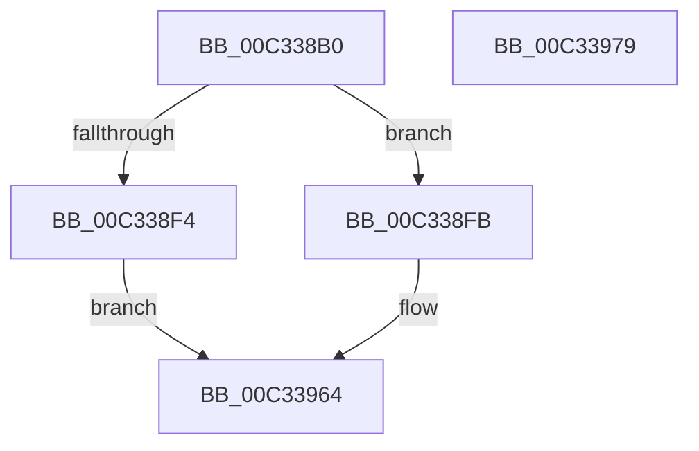

# PiLastGoodRevertCopyCallback

- RVA: `0x00C338B0`–`0x00C3397A` (길이 `202` bytes)
- VA: `0x0000000140C338B0`
- 실행 섹션: `INIT`
- PDB 이름 있음: `예`; PDB Function 태그: `아니요`
- unwind 정보 RVA: `0x00066400`
- 디코드: `56`개 명령, `202/202` bytes 표시
- 미해석 바이트: `0` (있으면 어셈블리에 `.byte`로 보존)

> 이 문서는 커널 이미지의 기계어와 PDB 기호를 분석해 생성했습니다. 4번과 5번은 함수 원형과 자료형을 바이너리 사용 방식에서 추정한 C 해석이며 원본 소스 복구 결과는 아닙니다.

## 1. Dependencies

- 직접 호출 지점: **4**; 고유 호출 대상: **4**
- 직접 호출자로 확인된 함수: **0**
- RIP 상대 이미지 참조: **0**

### Outgoing calls
- `0x00C338E7` → [ExAllocatePool2](../../poolcode/B8/ExAllocatePool2_function_00B820F0.md) (function, `0x00B820F0`)
- `0x00C33928` → [memcpy](../../text/6C/memcpy_function_006C6840.md) (function, `0x006C6840`)
- `0x00C33951` → [IopFileUtilRename](IopFileUtilRename_function_00C3662C.md) (function, `0x00C3662C`)
- `0x00C3395D` → [ExFreePoolWithTag](../../poolcode/B8/ExFreePoolWithTag_function_00B82870.md) (function, `0x00B82870`)

### Direct callers
- 이 함수 시작 RVA로 연결되는 직접 call은 확인되지 않았습니다. 간접 호출은 완전히 역산할 수 없습니다.

### Static image references
- 디코드된 RIP-relative 메모리 참조가 없습니다.

## 2. Other-region calls and transfers

- 다른 실행 섹션으로 향하는 call: **3**
  - `0x00C338E7` → [ExAllocatePool2](../../poolcode/B8/ExAllocatePool2_function_00B820F0.md) (`INIT` → `POOLCODE`)
  - `0x00C33928` → [memcpy](../../text/6C/memcpy_function_006C6840.md) (`INIT` → `.text`)
  - `0x00C3395D` → [ExFreePoolWithTag](../../poolcode/B8/ExFreePoolWithTag_function_00B82870.md) (`INIT` → `POOLCODE`)
- 별도 외부 분기/꼬리 이동을 확인하지 못했습니다.

## 3. Assembly (complete function range)

```asm
00C338B0  48 8B C4                        mov rax, rsp
00C338B3  48 89 58 08                     mov qword ptr [rax + 8], rbx
00C338B7  48 89 68 10                     mov qword ptr [rax + 0x10], rbp
00C338BB  48 89 70 18                     mov qword ptr [rax + 0x18], rsi
00C338BF  57                              push rdi
00C338C0  48 83 EC 30                     sub rsp, 0x30
00C338C4  41 0F B7 19                     movzx ebx, word ptr [r9]
00C338C8  48 8B F9                        mov rdi, rcx
00C338CB  0F B7 11                        movzx edx, word ptr [rcx]
00C338CE  0F 57 C0                        xorps xmm0, xmm0
00C338D1  66 83 C3 02                     add bx, 2
00C338D5  B9 00 01 00 00                  mov ecx, 0x100
00C338DA  41 B8 50 70 4C 67               mov r8d, 0x674c7050
00C338E0  0F B7 EB                        movzx ebp, bx
00C338E3  0F 11 40 E8                     movups xmmword ptr [rax - 0x18], xmm0
00C338E7  E8 04 E8 F4 FF                  call 0x140b820f0
00C338EC  48 8B F0                        mov rsi, rax
00C338EF  48 85 C0                        test rax, rax
00C338F2  75 07                           jne 0x140c338fb
00C338F4  B8 9A 00 00 C0                  mov eax, 0xc000009a
00C338F9  EB 69                           jmp 0x140c33964
00C338FB  48 8B 47 08                     mov rax, qword ptr [rdi + 8]
00C338FF  0F B7 CB                        movzx ecx, bx
00C33902  48 D1 E9                        shr rcx, 1
00C33905  0F 10 00                        movups xmm0, xmmword ptr [rax]
00C33908  0F 11 06                        movups xmmword ptr [rsi], xmm0
00C3390B  F2 0F 10 48 10                  movsd xmm1, qword ptr [rax + 0x10]
00C33910  F2 0F 11 4E 10                  movsd qword ptr [rsi + 0x10], xmm1
00C33915  48 8B 47 08                     mov rax, qword ptr [rdi + 8]
00C33919  44 0F B7 07                     movzx r8d, word ptr [rdi]
00C3391D  4C 2B C5                        sub r8, rbp
00C33920  48 8D 14 48                     lea rdx, [rax + rcx*2]
00C33924  48 8D 4E 18                     lea rcx, [rsi + 0x18]
00C33928  E8 13 2F A9 FF                  call 0x1406c6840
00C3392D  0F B7 07                        movzx eax, word ptr [rdi]
00C33930  48 8D 54 24 20                  lea rdx, [rsp + 0x20]
00C33935  66 2B C3                        sub ax, bx
00C33938  48 89 74 24 28                  mov qword ptr [rsp + 0x28], rsi
00C3393D  66 83 C0 18                     add ax, 0x18
00C33941  41 B0 01                        mov r8b, 1
00C33944  48 8B CF                        mov rcx, rdi
00C33947  66 89 44 24 20                  mov word ptr [rsp + 0x20], ax
00C3394C  66 89 44 24 22                  mov word ptr [rsp + 0x22], ax
00C33951  E8 D6 2C 00 00                  call 0x140c3662c
00C33956  33 D2                           xor edx, edx
00C33958  48 8B CE                        mov rcx, rsi
00C3395B  8B D8                           mov ebx, eax
00C3395D  E8 0E EF F4 FF                  call 0x140b82870
00C33962  8B C3                           mov eax, ebx
00C33964  48 8B 5C 24 40                  mov rbx, qword ptr [rsp + 0x40]
00C33969  48 8B 6C 24 48                  mov rbp, qword ptr [rsp + 0x48]
00C3396E  48 8B 74 24 50                  mov rsi, qword ptr [rsp + 0x50]
00C33973  48 83 C4 30                     add rsp, 0x30
00C33977  5F                              pop rdi
00C33978  C3                              ret
00C33979  CC                              int3
```

## 4. C-style interpretation (structured pseudocode)

```c
__int64 __fastcall PiLastGoodRevertCopyCallback(__int64 a1, __int64 a2, __int64 a3, __int64 a4)
{
    __int64 result;
    __int64 v_rbx;
    __int64 v_rsp;
    unsigned __int64 v_stack_m10;
    unsigned __int16 v_stack_m16;
    unsigned __int64 v_stack_m18;
    unsigned __int64 v_stack_p10;
    unsigned __int64 v_stack_p18;
    unsigned __int64 v_stack_p8;

    *(unsigned __int64 *)(v_rsp + 8) = v_rbx;
    *(unsigned __int64 *)(v_rsp + 16) = v_rbp;
    *(unsigned __int64 *)(v_rsp + 24) = v_rsi;
    v_rsp = (v_rsp) - (48);
    v_rbx = (unsigned __int16)((*(unsigned __int16 *)(a4)) + (2));
    *(unsigned __int64 *)(v_rsp - 24) = v_xmm0;
    result = ExAllocatePool2(256, *(unsigned __int16 *)(a1), (unsigned int)(0x674C7050ULL), a4);
    if (result != 0) goto loc_00C338FB;
    goto loc_00C33964;
loc_00C338FB:
    a1 = ((unsigned __int16)(v_rbx)) >> (1);
    *(unsigned __int64 *)(result) = v_xmm0;
    *(unsigned __int64 *)(result + 16) = v_xmm1;
    a3 = (*(unsigned __int16 *)(a1)) - ((unsigned __int16)(v_rbx));
    result = memcpy(result + 24, *(unsigned __int64 *)(a1 + 8) + a1 * 2, a3, a4);
    result = (unsigned __int16)((*(unsigned __int16 *)(a1)) - ((unsigned __int16)(v_rbx)));
    v_stack_m10 = result;
    result = (unsigned __int16)((result) + (24));
    v_stack_m18 = (unsigned __int16)(result);
    v_stack_m16 = (unsigned __int16)(result);
    result = IopFileUtilRename(a1, v_stack_m18, 1, a4);
    a2 = 0;
    result = ExFreePoolWithTag(result, a2, 1, a4);
loc_00C33964:
    v_rsp = (v_rsp) + (48);
    return (unsigned int)((unsigned int)((unsigned int)((unsigned int)(result))));
}
```

## 5. (Beta) C Style

```c
int64_t PiLastGoodRevertCopyCallback(void *Arg1, int64_t Arg2, int64_t Arg3, void *Arg4)
{
    uint8_t *arg1 = (uint8_t *)Arg1;
    uint8_t *arg4 = (uint8_t *)Arg4;

    int64_t result;
    int64_t local_rbx;
    int64_t local_rsp;
    uint64_t v_stack_m10;
    uint16_t v_stack_m16;
    uint64_t v_stack_m18;
    uint64_t v_stack_p10;
    uint64_t v_stack_p18;
    uint64_t v_stack_p8;

    *(uint64_t *)(local_rsp + 0x8) = local_rbx;
    *(uint64_t *)(local_rsp + 0x10) = local_rbp;
    *(uint64_t *)(local_rsp + 0x18) = local_rsi;
    local_rsp = (local_rsp) - (48);
    local_rbx = (uint16_t)((*(uint16_t *)(arg4)) + (2));
    *(uint64_t *)(local_rsp - 0x18) = v_xmm0;
    result = ExAllocatePool2(256, *(uint16_t *)(arg1), (uint32_t)(0x674C7050ULL), Arg4);
    if (result != 0) goto loc_00C338FB;
    goto loc_00C33964;
loc_00C338FB:
    Arg1 = ((uint16_t)(local_rbx)) >> (1);
    *(uint64_t *)(result) = v_xmm0;
    *(uint64_t *)(result + 0x10) = v_xmm1;
    Arg3 = (*(uint16_t *)(arg1)) - ((uint16_t)(local_rbx));
    result = memcpy(result + 24, *(uint64_t *)(arg1 + 0x8) + Arg1 * 2, Arg3, Arg4);
    result = (uint16_t)((*(uint16_t *)(arg1)) - ((uint16_t)(local_rbx)));
    v_stack_m10 = result;
    result = (uint16_t)((result) + (24));
    v_stack_m18 = (uint16_t)(result);
    v_stack_m16 = (uint16_t)(result);
    result = IopFileUtilRename(Arg1, v_stack_m18, 1, Arg4);
    Arg2 = 0;
    result = ExFreePoolWithTag(result, Arg2, 1, Arg4);
loc_00C33964:
    local_rsp = (local_rsp) + (48);
    return (uint32_t)((uint32_t)((uint32_t)((uint32_t)(result))));
}
```

### 관측된 메모리 오프셋

구조체 형식이 확인되지 않은 접근은 인자 기준의 오프셋으로만 기록했습니다.

| 기준 인자 | 오프셋 표현 | 폭 (bit) | 접근 |
|---|---:|---:|---|
| `Arg1` | `+ 0x0` | `16` | `R` |
| `Arg1` | `+ 0x8` | `64` | `R` |
| `Arg4` | `+ 0x0` | `16` | `R` |

## 6. Execution-region graph

[열기: 2D/3D 그래프와 함수 탐색 컨트롤 패널](../../../control-panel.html?section=init&rva=0x00C338B0&view=graph)

- 2D 그래프는 위에서 아래로 흐르고, 3D 그래프는 빈 공간을 드래그해 회전합니다. Shift+드래그는 이동, 휠은 확대·축소, 함수 노드 선택은 대상 보고서 이동입니다.

### Static fallback


