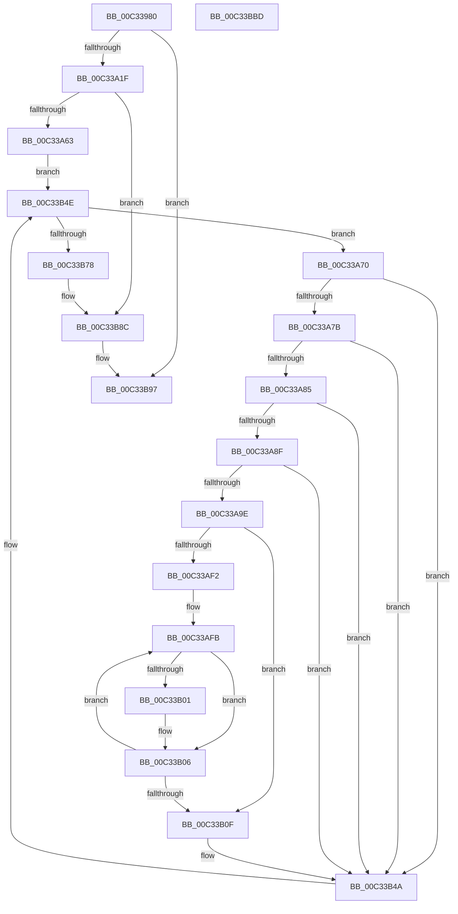

# PiLastGoodRevertLastKnownDirectory

- RVA: `0x00C33980`–`0x00C33BBE` (길이 `574` bytes)
- VA: `0x0000000140C33980`
- 실행 섹션: `INIT`
- PDB 이름 있음: `예`; PDB Function 태그: `아니요`
- unwind 정보 RVA: `0x000C8680`
- 디코드: `136`개 명령, `574/574` bytes 표시
- 미해석 바이트: `0` (있으면 어셈블리에 `.byte`로 보존)

> 이 문서는 커널 이미지의 기계어와 PDB 기호를 분석해 생성했습니다. 4번과 5번은 함수 원형과 자료형을 바이너리 사용 방식에서 추정한 C 해석이며 원본 소스 복구 결과는 아닙니다.

## 1. Dependencies

- 직접 호출 지점: **13**; 고유 호출 대상: **13**
- 직접 호출자로 확인된 함수: **1**
- RIP 상대 이미지 참조: **2**

### Outgoing calls
- `0x00C339F1` → [memset](../../text/6C/memset_function_006C6C40.md) (function, `0x006C6C40`)
- `0x00C33A0E` → [ExAllocatePool2](../../poolcode/B8/ExAllocatePool2_function_00B820F0.md) (function, `0x00B820F0`)
- `0x00C33A25` → [IopFileUtilWalkDirectoryTreeTopDown](IopFileUtilWalkDirectoryTreeTopDown_function_00C36760.md) (function, `0x00C36760`)
- `0x00C33A56` → [ZwOpenKey](../../text/6A/ZwOpenKey_function_006AD310.md) (function, `0x006AD310`)
- `0x00C33AD2` → [RtlAppendUnicodeToString](../../text/40/RtlAppendUnicodeToString_function_0040F990.md) (function, `0x0040F990`)
- `0x00C33AE1` → [RtlAppendUnicodeStringToString](../../text/40/RtlAppendUnicodeStringToString_function_0040FA50.md) (function, `0x0040FA50`)
- `0x00C33B14` → [IopFileUtilClearAttributes](../../page/73/IopFileUtilClearAttributes_function_0073FA1C.md) (function, `0x0073FA1C`)
- `0x00C33B45` → [ZwDeleteFile](../../text/6A/ZwDeleteFile_function_006AEC30.md) (function, `0x006AEC30`)
- `0x00C33B6B` → [ZwEnumerateValueKey](../../text/6A/ZwEnumerateValueKey_function_006AD330.md) (function, `0x006AD330`)
- `0x00C33B7D` → [ZwDeleteKey](../../text/6A/ZwDeleteKey_function_006AEC50.md) (function, `0x006AEC50`)
- `0x00C33B87` → [ZwClose](../../text/6A/ZwClose_function_006AD2B0.md) (function, `0x006AD2B0`)
- `0x00C33B92` → [ExFreePoolWithTag](../../poolcode/B8/ExFreePoolWithTag_function_00B82870.md) (function, `0x00B82870`)
- `0x00C33BA1` → [_security_check_cookie](../../text/6A/_security_check_cookie_function_006AC640.md) (function, `0x006AC640`)

### Direct callers
- [PpLastGoodDoBootProcessing](PpLastGoodDoBootProcessing_function_00C33BC4.md) at `0x00C33C6F`
- [PpLastGoodDoBootProcessing](PpLastGoodDoBootProcessing_function_00C33BC4.md) at `0x00C33C7C`

### Static image references
- `0x00C3399B` → RVA `0x00E0A740` (`.data`; read)
- `0x00C33AAF` → RVA `0x00C7AD20` (` ?? ::PBOPGDP::`string'`; read)

## 2. Other-region calls and transfers

- 다른 실행 섹션으로 향하는 call: **12**
  - `0x00C339F1` → [memset](../../text/6C/memset_function_006C6C40.md) (`INIT` → `.text`)
  - `0x00C33A0E` → [ExAllocatePool2](../../poolcode/B8/ExAllocatePool2_function_00B820F0.md) (`INIT` → `POOLCODE`)
  - `0x00C33A56` → [ZwOpenKey](../../text/6A/ZwOpenKey_function_006AD310.md) (`INIT` → `.text`)
  - `0x00C33AD2` → [RtlAppendUnicodeToString](../../text/40/RtlAppendUnicodeToString_function_0040F990.md) (`INIT` → `.text`)
  - `0x00C33AE1` → [RtlAppendUnicodeStringToString](../../text/40/RtlAppendUnicodeStringToString_function_0040FA50.md) (`INIT` → `.text`)
  - `0x00C33B14` → [IopFileUtilClearAttributes](../../page/73/IopFileUtilClearAttributes_function_0073FA1C.md) (`INIT` → `PAGE`)
  - `0x00C33B45` → [ZwDeleteFile](../../text/6A/ZwDeleteFile_function_006AEC30.md) (`INIT` → `.text`)
  - `0x00C33B6B` → [ZwEnumerateValueKey](../../text/6A/ZwEnumerateValueKey_function_006AD330.md) (`INIT` → `.text`)
  - `0x00C33B7D` → [ZwDeleteKey](../../text/6A/ZwDeleteKey_function_006AEC50.md) (`INIT` → `.text`)
  - `0x00C33B87` → [ZwClose](../../text/6A/ZwClose_function_006AD2B0.md) (`INIT` → `.text`)
  - `0x00C33B92` → [ExFreePoolWithTag](../../poolcode/B8/ExFreePoolWithTag_function_00B82870.md) (`INIT` → `POOLCODE`)
  - `0x00C33BA1` → [_security_check_cookie](../../text/6A/_security_check_cookie_function_006AC640.md) (`INIT` → `.text`)
- 별도 외부 분기/꼬리 이동을 확인하지 못했습니다.

## 3. Assembly (complete function range)

```asm
00C33980  48 89 5C 24 18                  mov qword ptr [rsp + 0x18], rbx
00C33985  55                              push rbp
00C33986  56                              push rsi
00C33987  57                              push rdi
00C33988  41 56                           push r14
00C3398A  41 57                           push r15
00C3398C  48 8D AC 24 10 FE FF FF         lea rbp, [rsp - 0x1f0]
00C33994  48 81 EC F0 02 00 00            sub rsp, 0x2f0
00C3399B  48 8B 05 9E 6D 1D 00            mov rax, qword ptr [rip + 0x1d6d9e]
00C339A2  48 33 C4                        xor rax, rsp
00C339A5  48 89 85 E0 01 00 00            mov qword ptr [rbp + 0x1e0], rax
00C339AC  0F 57 C0                        xorps xmm0, xmm0
00C339AF  33 C0                           xor eax, eax
00C339B1  45 33 F6                        xor r14d, r14d
00C339B4  48 89 45 80                     mov qword ptr [rbp - 0x80], rax
00C339B8  48 8B F2                        mov rsi, rdx
00C339BB  44 89 75 94                     mov dword ptr [rbp - 0x6c], r14d
00C339BF  48 8B F9                        mov rdi, rcx
00C339C2  44 89 75 AC                     mov dword ptr [rbp - 0x54], r14d
00C339C6  0F 57 C9                        xorps xmm1, xmm1
00C339C9  89 45 88                        mov dword ptr [rbp - 0x78], eax
00C339CC  33 D2                           xor edx, edx
00C339CE  4C 89 74 24 38                  mov qword ptr [rsp + 0x38], r14
00C339D3  48 8D 4D C0                     lea rcx, [rbp - 0x40]
00C339D7  41 B8 18 02 00 00               mov r8d, 0x218
00C339DD  0F 11 44 24 40                  movups xmmword ptr [rsp + 0x40], xmm0
00C339E2  0F 11 4C 24 50                  movups xmmword ptr [rsp + 0x50], xmm1
00C339E7  0F 11 44 24 60                  movups xmmword ptr [rsp + 0x60], xmm0
00C339EC  0F 11 44 24 70                  movups xmmword ptr [rsp + 0x70], xmm0
00C339F1  E8 4A 32 A9 FF                  call 0x1406c6c40
00C339F6  41 BF 50 70 4C 67               mov r15d, 0x674c7050
00C339FC  44 89 74 24 30                  mov dword ptr [rsp + 0x30], r14d
00C33A01  45 8B C7                        mov r8d, r15d
00C33A04  BA 1C 02 00 00                  mov edx, 0x21c
00C33A09  B9 00 01 00 00                  mov ecx, 0x100
00C33A0E  E8 DD E6 F4 FF                  call 0x140b820f0
00C33A13  48 8B D8                        mov rbx, rax
00C33A16  48 85 C0                        test rax, rax
00C33A19  0F 84 78 01 00 00               je 0x140c33b97
00C33A1F  4C 8B CF                        mov r9, rdi
00C33A22  48 8B CF                        mov rcx, rdi
00C33A25  E8 36 2D 00 00                  call 0x140c36760
00C33A2A  0F 57 C0                        xorps xmm0, xmm0
00C33A2D  C7 45 90 30 00 00 00            mov dword ptr [rbp - 0x70], 0x30
00C33A34  4C 8D 45 90                     lea r8, [rbp - 0x70]
00C33A38  4C 89 75 98                     mov qword ptr [rbp - 0x68], r14
00C33A3C  BA 3F 00 0F 00                  mov edx, 0xf003f
00C33A41  C7 45 A8 40 02 00 00            mov dword ptr [rbp - 0x58], 0x240
00C33A48  48 8D 4C 24 38                  lea rcx, [rsp + 0x38]
00C33A4D  48 89 75 A0                     mov qword ptr [rbp - 0x60], rsi
00C33A51  F3 0F 7F 45 B0                  movdqu xmmword ptr [rbp - 0x50], xmm0
00C33A56  E8 B5 98 A7 FF                  call 0x1406ad310
00C33A5B  85 C0                           test eax, eax
00C33A5D  0F 88 29 01 00 00               js 0x140c33b8c
00C33A63  41 8D 76 01                     lea esi, [r14 + 1]
00C33A67  33 D2                           xor edx, edx
00C33A69  8B FE                           mov edi, esi
00C33A6B  E9 DE 00 00 00                  jmp 0x140c33b4e
00C33A70  44 39 74 24 30                  cmp dword ptr [rsp + 0x30], r14d
00C33A75  0F 84 CF 00 00 00               je 0x140c33b4a
00C33A7B  83 7B 04 04                     cmp dword ptr [rbx + 4], 4
00C33A7F  0F 85 C5 00 00 00               jne 0x140c33b4a
00C33A85  83 7B 0C 04                     cmp dword ptr [rbx + 0xc], 4
00C33A89  0F 85 BB 00 00 00               jne 0x140c33b4a
00C33A8F  8B 43 08                        mov eax, dword ptr [rbx + 8]
00C33A92  8B 0C 18                        mov ecx, dword ptr [rax + rbx]
00C33A95  40 3A CE                        cmp cl, sil
00C33A98  0F 85 AC 00 00 00               jne 0x140c33b4a
00C33A9E  48 8D 45 C0                     lea rax, [rbp - 0x40]
00C33AA2  C7 44 24 40 00 00 18 02         mov dword ptr [rsp + 0x40], 0x2180000
00C33AAA  48 89 44 24 48                  mov qword ptr [rsp + 0x48], rax
00C33AAF  48 8D 15 6A 72 04 00            lea rdx, [rip + 0x4726a]
00C33AB6  48 8D 43 14                     lea rax, [rbx + 0x14]
00C33ABA  48 89 44 24 58                  mov qword ptr [rsp + 0x58], rax
00C33ABF  48 8D 4C 24 40                  lea rcx, [rsp + 0x40]
00C33AC4  0F B7 43 10                     movzx eax, word ptr [rbx + 0x10]
00C33AC8  66 89 44 24 50                  mov word ptr [rsp + 0x50], ax
00C33ACD  66 89 44 24 52                  mov word ptr [rsp + 0x52], ax
00C33AD2  E8 B9 BE 7D FF                  call 0x14040f990
00C33AD7  48 8D 54 24 50                  lea rdx, [rsp + 0x50]
00C33ADC  48 8D 4C 24 40                  lea rcx, [rsp + 0x40]
00C33AE1  E8 6A BF 7D FF                  call 0x14040fa50
00C33AE6  0F B7 44 24 40                  movzx eax, word ptr [rsp + 0x40]
00C33AEB  D1 E8                           shr eax, 1
00C33AED  83 F8 0D                        cmp eax, 0xd
00C33AF0  76 1D                           jbe 0x140c33b0f
00C33AF2  83 C0 F3                        add eax, -0xd
00C33AF5  48 8D 4D DA                     lea rcx, [rbp - 0x26]
00C33AF9  8B D0                           mov edx, eax
00C33AFB  66 83 39 2F                     cmp word ptr [rcx], 0x2f
00C33AFF  75 05                           jne 0x140c33b06
00C33B01  66 C7 01 5C 00                  mov word ptr [rcx], 0x5c
00C33B06  48 83 C1 02                     add rcx, 2
00C33B0A  48 2B D6                        sub rdx, rsi
00C33B0D  75 EC                           jne 0x140c33afb
00C33B0F  48 8D 4C 24 40                  lea rcx, [rsp + 0x40]
00C33B14  E8 03 BF B0 FF                  call 0x14073fa1c
00C33B19  48 8D 44 24 40                  lea rax, [rsp + 0x40]
00C33B1E  C7 44 24 60 30 00 00 00         mov dword ptr [rsp + 0x60], 0x30
00C33B26  0F 57 C0                        xorps xmm0, xmm0
00C33B29  48 89 44 24 70                  mov qword ptr [rsp + 0x70], rax
00C33B2E  48 8D 4C 24 60                  lea rcx, [rsp + 0x60]
00C33B33  4C 89 74 24 68                  mov qword ptr [rsp + 0x68], r14
00C33B38  F3 0F 7F 45 80                  movdqu xmmword ptr [rbp - 0x80], xmm0
00C33B3D  C7 44 24 78 40 02 00 00         mov dword ptr [rsp + 0x78], 0x240
00C33B45  E8 E6 B0 A7 FF                  call 0x1406aec30
00C33B4A  8B D7                           mov edx, edi
00C33B4C  03 FE                           add edi, esi
00C33B4E  48 8B 4C 24 38                  mov rcx, qword ptr [rsp + 0x38]
00C33B53  48 8D 44 24 30                  lea rax, [rsp + 0x30]
00C33B58  48 89 44 24 28                  mov qword ptr [rsp + 0x28], rax
00C33B5D  4C 8B CB                        mov r9, rbx
00C33B60  44 8B C6                        mov r8d, esi
00C33B63  C7 44 24 20 1C 02 00 00         mov dword ptr [rsp + 0x20], 0x21c
00C33B6B  E8 C0 97 A7 FF                  call 0x1406ad330
00C33B70  85 C0                           test eax, eax
00C33B72  0F 89 F8 FE FF FF               jns 0x140c33a70
00C33B78  48 8B 4C 24 38                  mov rcx, qword ptr [rsp + 0x38]
00C33B7D  E8 CE B0 A7 FF                  call 0x1406aec50
00C33B82  48 8B 4C 24 38                  mov rcx, qword ptr [rsp + 0x38]
00C33B87  E8 24 97 A7 FF                  call 0x1406ad2b0
00C33B8C  41 8B D7                        mov edx, r15d
00C33B8F  48 8B CB                        mov rcx, rbx
00C33B92  E8 D9 EC F4 FF                  call 0x140b82870
00C33B97  48 8B 8D E0 01 00 00            mov rcx, qword ptr [rbp + 0x1e0]
00C33B9E  48 33 CC                        xor rcx, rsp
00C33BA1  E8 9A 8A A7 FF                  call 0x1406ac640
00C33BA6  48 8B 9C 24 30 03 00 00         mov rbx, qword ptr [rsp + 0x330]
00C33BAE  48 81 C4 F0 02 00 00            add rsp, 0x2f0
00C33BB5  41 5F                           pop r15
00C33BB7  41 5E                           pop r14
00C33BB9  5F                              pop rdi
00C33BBA  5E                              pop rsi
00C33BBB  5D                              pop rbp
00C33BBC  C3                              ret
00C33BBD  CC                              int3
```

## 4. C-style interpretation (structured pseudocode)

```c
__int64 __fastcall PiLastGoodRevertLastKnownDirectory(__int64 a1, __int64 a2)
{
    __int64 result;
    __int64 v_r14;
    __int64 v_rdi;
    __int64 v_rsp;
    unsigned __int64 v_stack_m218;
    unsigned __int64 v_stack_m23E;
    unsigned __int64 v_stack_m258;
    unsigned __int64 v_stack_m268;
    unsigned int v_stack_m26C;
    unsigned int v_stack_m270;
    unsigned __int64 v_stack_m278;
    unsigned __int64 v_stack_m280;
    unsigned int v_stack_m284;
    unsigned int v_stack_m288;
    unsigned int v_stack_m290;
    unsigned __int64 v_stack_m298;
    unsigned int v_stack_m2A0;
    unsigned __int64 v_stack_m2A8;
    unsigned __int64 v_stack_m2B0;
    unsigned __int64 v_stack_m2B8;
    unsigned __int64 v_stack_m2C0;
    unsigned __int16 v_stack_m2C6;
    unsigned __int64 v_stack_m2C8;
    unsigned __int64 v_stack_m2D0;
    unsigned __int64 v_stack_m2D8;
    unsigned __int64 v_stack_m2E0;
    unsigned int v_stack_m2E8;
    unsigned __int64 v_stack_m2F0;
    unsigned int v_stack_m2F8;
    unsigned __int64 v_stack_m38;
    unsigned __int64 v_stack_p18;

    v_stack_p18 = v_rbx;
    v_rsp = (v_rsp) - (752);
    result = (*(unsigned __int64 *)(v_rip + 1928606)) ^ (v_rsp);
    v_stack_m38 = result;
    result = 0;
    v_r14 = 0;
    v_stack_m298 = 0;
    v_stack_m284 = 0;
    v_stack_m26C = 0;
    v_stack_m290 = 0;
    a2 = 0;
    v_stack_m2E0 = 0;
    v_stack_m2D8 = v_xmm0;
    v_stack_m2C8 = v_xmm1;
    v_stack_m2B8 = v_xmm0;
    v_stack_m2A8 = v_xmm0;
    result = memset(v_stack_m258, a2, 536, a4);
    v_stack_m2E8 = 0;
    result = ExAllocatePool2(256, 540, (unsigned int)((unsigned int)((unsigned int)(0x674C7050ULL))), a4);
    if (result == 0) goto loc_00C33B97;
    result = IopFileUtilWalkDirectoryTreeTopDown(a1, 540, (unsigned int)((unsigned int)((unsigned int)(0x674C7050ULL))), a1);
    v_stack_m288 = 48;
    v_stack_m280 = 0;
    v_stack_m270 = 576;
    v_stack_m278 = 0;
    v_stack_m268 = v_xmm0;
    result = ZwOpenKey(v_stack_m2E0, (unsigned int)(0xF003FULL), v_stack_m288, a1);
    if (sign_flag) goto loc_00C33B8C;
    a2 = 0;
    goto loc_00C33B4E;
loc_00C33A70:
    if (v_stack_m2E8 == 0) goto loc_00C33B4A;
    if ((*(unsigned int *)(result + 4)) != 4) goto loc_00C33B4A;
    if ((*(unsigned int *)(result + 12)) != 4) goto loc_00C33B4A;
    if (((unsigned __int8)((unsigned int)(*(unsigned int *)((unsigned int)(*(unsigned int *)(result + 8)) + result * 1)))) != ((unsigned __int8)(v_r14 + 1))) goto loc_00C33B4A;
    v_stack_m2D8 = 0x2180000ULL;
    v_stack_m2D0 = v_stack_m258;
    v_stack_m2C0 = result + 20;
    v_stack_m2C8 = (unsigned __int16)(*(unsigned __int16 *)(result + 16));
    v_stack_m2C6 = (unsigned __int16)(*(unsigned __int16 *)(result + 16));
    result = RtlAppendUnicodeToString(v_stack_m2D8, v_rip + 291434, v_stack_m288, a1);
    result = RtlAppendUnicodeStringToString(v_stack_m2D8, v_stack_m2C8, v_stack_m288, a1);
    result = (unsigned int)((v_stack_m2D8) >> (1));
    if (((unsigned int)(result)) <= 13) goto loc_00C33B0F;
    result = (unsigned int)((result) + (-13));
loc_00C33AFB:
    if ((*(unsigned __int16 *)(v_stack_m23E)) == 47) {
        *(unsigned __int16 *)(v_stack_m23E) = 92;
    }
    a1 = (v_stack_m23E) + (2);
    a2 = ((unsigned int)((unsigned int)(result))) - (v_r14 + 1);
    if (condition_is_not_equal) goto loc_00C33AFB;
loc_00C33B0F:
    result = IopFileUtilClearAttributes(v_stack_m2D8, a2, v_stack_m288, a1);
    v_stack_m2B8 = 48;
    v_stack_m2A8 = v_stack_m2D8;
    v_stack_m2B0 = 0;
    v_stack_m298 = v_xmm0;
    v_stack_m2A0 = 576;
    result = ZwDeleteFile(v_stack_m2B8, a2, v_stack_m288, a1);
loc_00C33B4A:
    v_rdi = (unsigned int)(((unsigned int)((unsigned int)(v_r14 + 1))) + ((unsigned int)(v_r14 + 1)));
loc_00C33B4E:
    v_stack_m2F0 = v_stack_m2E8;
    v_stack_m2F8 = 540;
    result = ZwEnumerateValueKey(v_stack_m2E0, (unsigned int)((unsigned int)((unsigned int)((unsigned int)(v_r14 + 1)))), (unsigned int)((unsigned int)(v_r14 + 1)), result);
    if (!sign_flag) goto loc_00C33A70;
    result = ZwDeleteKey(v_stack_m2E0, (unsigned int)((unsigned int)((unsigned int)((unsigned int)(v_r14 + 1)))), (unsigned int)((unsigned int)(v_r14 + 1)), result);
    result = ZwClose(v_stack_m2E0, (unsigned int)((unsigned int)((unsigned int)((unsigned int)(v_r14 + 1)))), (unsigned int)((unsigned int)(v_r14 + 1)), result);
loc_00C33B8C:
    result = ExFreePoolWithTag(result, (unsigned int)((unsigned int)((unsigned int)(0x674C7050ULL))), (unsigned int)((unsigned int)(v_r14 + 1)), result);
loc_00C33B97:
    a1 = (v_stack_m38) ^ (v_rsp);
    result = _security_check_cookie(a1, (unsigned int)((unsigned int)((unsigned int)(0x674C7050ULL))), (unsigned int)((unsigned int)(v_r14 + 1)), result);
    v_rsp = (v_rsp) + (752);
    return result;
}
```

## 5. (Beta) C Style

```c
int64_t PiLastGoodRevertLastKnownDirectory(int64_t Arg1, int64_t Arg2)
{
    int64_t result;
    int64_t local_r14;
    int64_t local_rdi;
    int64_t local_rsp;
    uint64_t v_stack_m218;
    uint64_t v_stack_m23E;
    uint64_t v_stack_m258;
    uint64_t v_stack_m268;
    uint32_t v_stack_m26C;
    uint32_t v_stack_m270;
    uint64_t v_stack_m278;
    uint64_t v_stack_m280;
    uint32_t v_stack_m284;
    uint32_t v_stack_m288;
    uint32_t v_stack_m290;
    uint64_t v_stack_m298;
    uint32_t v_stack_m2A0;
    uint64_t v_stack_m2A8;
    uint64_t v_stack_m2B0;
    uint64_t v_stack_m2B8;
    uint64_t v_stack_m2C0;
    uint16_t v_stack_m2C6;
    uint64_t v_stack_m2C8;
    uint64_t v_stack_m2D0;
    uint64_t v_stack_m2D8;
    uint64_t v_stack_m2E0;
    uint32_t v_stack_m2E8;
    uint64_t v_stack_m2F0;
    uint32_t v_stack_m2F8;
    uint64_t v_stack_m38;
    uint64_t v_stack_p18;

    v_stack_p18 = local_rbx;
    local_rsp = (local_rsp) - (752);
    result = (*(uint64_t *)(v_rip + 0x1D6D9E)) ^ (local_rsp);
    v_stack_m38 = result;
    result = 0;
    local_r14 = 0;
    v_stack_m298 = 0;
    v_stack_m284 = 0;
    v_stack_m26C = 0;
    v_stack_m290 = 0;
    Arg2 = 0;
    v_stack_m2E0 = 0;
    v_stack_m2D8 = v_xmm0;
    v_stack_m2C8 = v_xmm1;
    v_stack_m2B8 = v_xmm0;
    v_stack_m2A8 = v_xmm0;
    result = memset(v_stack_m258, Arg2, 536, a4);
    v_stack_m2E8 = 0;
    result = ExAllocatePool2(256, 540, (uint32_t)((uint32_t)((uint32_t)(0x674C7050ULL))), a4);
    if (result == 0) goto loc_00C33B97;
    result = IopFileUtilWalkDirectoryTreeTopDown(Arg1, 540, (uint32_t)((uint32_t)((uint32_t)(0x674C7050ULL))), Arg1);
    v_stack_m288 = 48;
    v_stack_m280 = 0;
    v_stack_m270 = 576;
    v_stack_m278 = 0;
    v_stack_m268 = v_xmm0;
    result = ZwOpenKey(v_stack_m2E0, (uint32_t)(0xF003FULL), v_stack_m288, Arg1);
    if (sign_flag) goto loc_00C33B8C;
    Arg2 = 0;
    goto loc_00C33B4E;
loc_00C33A70:
    if (v_stack_m2E8 == 0) goto loc_00C33B4A;
    if ((*(uint32_t *)(result + 0x4)) != 4) goto loc_00C33B4A;
    if ((*(uint32_t *)(result + 0xC)) != 4) goto loc_00C33B4A;
    if (((uint8_t)((uint32_t)(*(uint32_t *)((uint32_t)(*(uint32_t *)(result + 0x8)) + result * 1)))) != ((uint8_t)(local_r14 + 1))) goto loc_00C33B4A;
    v_stack_m2D8 = 0x2180000ULL;
    v_stack_m2D0 = v_stack_m258;
    v_stack_m2C0 = result + 20;
    v_stack_m2C8 = (uint16_t)(*(uint16_t *)(result + 0x10));
    v_stack_m2C6 = (uint16_t)(*(uint16_t *)(result + 0x10));
    result = RtlAppendUnicodeToString(v_stack_m2D8, v_rip + 291434, v_stack_m288, Arg1);
    result = RtlAppendUnicodeStringToString(v_stack_m2D8, v_stack_m2C8, v_stack_m288, Arg1);
    result = (uint32_t)((v_stack_m2D8) >> (1));
    if (((uint32_t)(result)) <= 13) goto loc_00C33B0F;
    result = (uint32_t)((result) + (-13));
loc_00C33AFB:
    if ((*(uint16_t *)(v_stack_m23E)) == 47) {
        *(uint16_t *)(v_stack_m23E) = 92;
    }
    Arg1 = (v_stack_m23E) + (2);
    Arg2 = ((uint32_t)((uint32_t)(result))) - (local_r14 + 1);
    if (condition_is_not_equal) goto loc_00C33AFB;
loc_00C33B0F:
    result = IopFileUtilClearAttributes(v_stack_m2D8, Arg2, v_stack_m288, Arg1);
    v_stack_m2B8 = 48;
    v_stack_m2A8 = v_stack_m2D8;
    v_stack_m2B0 = 0;
    v_stack_m298 = v_xmm0;
    v_stack_m2A0 = 576;
    result = ZwDeleteFile(v_stack_m2B8, Arg2, v_stack_m288, Arg1);
loc_00C33B4A:
    local_rdi = (uint32_t)(((uint32_t)((uint32_t)(local_r14 + 1))) + ((uint32_t)(local_r14 + 1)));
loc_00C33B4E:
    v_stack_m2F0 = v_stack_m2E8;
    v_stack_m2F8 = 540;
    result = ZwEnumerateValueKey(v_stack_m2E0, (uint32_t)((uint32_t)((uint32_t)((uint32_t)(local_r14 + 1)))), (uint32_t)((uint32_t)(local_r14 + 1)), result);
    if (!sign_flag) goto loc_00C33A70;
    result = ZwDeleteKey(v_stack_m2E0, (uint32_t)((uint32_t)((uint32_t)((uint32_t)(local_r14 + 1)))), (uint32_t)((uint32_t)(local_r14 + 1)), result);
    result = ZwClose(v_stack_m2E0, (uint32_t)((uint32_t)((uint32_t)((uint32_t)(local_r14 + 1)))), (uint32_t)((uint32_t)(local_r14 + 1)), result);
loc_00C33B8C:
    result = ExFreePoolWithTag(result, (uint32_t)((uint32_t)((uint32_t)(0x674C7050ULL))), (uint32_t)((uint32_t)(local_r14 + 1)), result);
loc_00C33B97:
    Arg1 = (v_stack_m38) ^ (local_rsp);
    result = _security_check_cookie(Arg1, (uint32_t)((uint32_t)((uint32_t)(0x674C7050ULL))), (uint32_t)((uint32_t)(local_r14 + 1)), result);
    local_rsp = (local_rsp) + (752);
    return result;
}
```

## 6. Execution-region graph

[열기: 2D/3D 그래프와 함수 탐색 컨트롤 패널](../../../control-panel.html?section=init&rva=0x00C33980&view=graph)

- 2D 그래프는 위에서 아래로 흐르고, 3D 그래프는 빈 공간을 드래그해 회전합니다. Shift+드래그는 이동, 휠은 확대·축소, 함수 노드 선택은 대상 보고서 이동입니다.

### Static fallback


