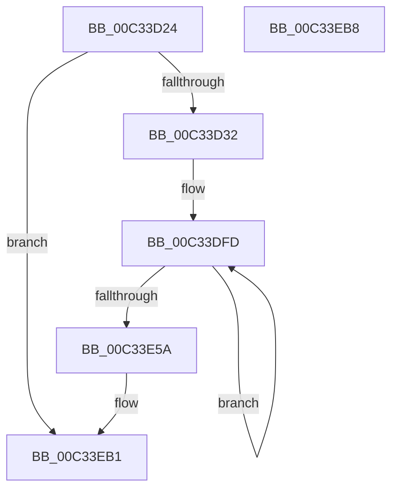

# PiUEventInit

- RVA: `0x00C33D24`–`0x00C33EB9` (길이 `405` bytes)
- VA: `0x0000000140C33D24`
- 실행 섹션: `INIT`
- PDB 이름 있음: `예`; PDB Function 태그: `아니요`
- unwind 정보 RVA: `0x0005D2F4`
- 디코드: `73`개 명령, `405/405` bytes 표시
- 미해석 바이트: `0` (있으면 어셈블리에 `.byte`로 보존)

> 이 문서는 커널 이미지의 기계어와 PDB 기호를 분석해 생성했습니다. 4번과 5번은 함수 원형과 자료형을 바이너리 사용 방식에서 추정한 C 해석이며 원본 소스 복구 결과는 아닙니다.

## 1. Dependencies

- 직접 호출 지점: **1**; 고유 호출 대상: **1**
- 직접 호출자로 확인된 함수: **1**
- RIP 상대 이미지 참조: **37**

### Outgoing calls
- `0x00C33EAA` → [ExSubscribeWnfStateChange](../../page/9D/ExSubscribeWnfStateChange_function_009D4BC0.md) (function, `0x009D4BC0`)

### Direct callers
- [IopInitializePlugPlayServices](../C2/IopInitializePlugPlayServices_function_00C2F298.md) at `0x00C2FE4B`
- [IopInitializePlugPlayServices](../C2/IopInitializePlugPlayServices_function_00C2F298.md) at `0x00C2FF7B`

### Static image references
- `0x00C33D36` → RVA `0x00F8C768` (`.data`; write)
- `0x00C33D3D` → RVA `0x00F8C780` (`.data`; read)
- `0x00C33D44` → RVA `0x00F8C760` (`.data`; write)
- `0x00C33D4B` → RVA `0x00F8C788` (`.data`; write)
- `0x00C33D56` → RVA `0x00F8C780` (`.data`; write)
- `0x00C33D5D` → RVA `0x00000000` (`image boundary/outside`; read)
- `0x00C33D64` → RVA `0x00F8CAC0` (`.data`; read)
- `0x00C33D6B` → RVA `0x00F8C770` (`.data`; write)
- `0x00C33D71` → RVA `0x00F8CAC8` (`.data`; write)
- `0x00C33D7A` → RVA `0x00F8CAC0` (`.data`; write)
- `0x00C33D81` → RVA `0x00F8CA60` (`.data`; read)
- `0x00C33D88` → RVA `0x00F8CA68` (`.data`; write)
- `0x00C33D8F` → RVA `0x00F8CA60` (`.data`; write)
- `0x00C33D96` → RVA `0x00F8C778` (`.data`; write)
- `0x00C33D9E` → RVA `0x00F8C77A` (`.data`; write)
- `0x00C33DA5` → RVA `0x00F8C77C` (`.data`; write)
- `0x00C33DAB` → RVA `0x00F8CAA0` (`.data`; write)
- `0x00C33DB2` → RVA `0x00F8CAA8` (`.data`; write)
- `0x00C33DB9` → RVA `0x00F8CAB0` (`.data`; write)
- `0x00C33DBF` → RVA `0x00F8CAB8` (`.data`; write)
- `0x00C33DC7` → RVA `0x00F8CABA` (`.data`; write)
- `0x00C33DCE` → RVA `0x00F8CABC` (`.data`; write)
- `0x00C33DD4` → RVA `0x00F8CA40` (`.data`; write)
- `0x00C33DDB` → RVA `0x00F8CA48` (`.data`; write)
- `0x00C33DE2` → RVA `0x00F8CA50` (`.data`; write)
- `0x00C33DE8` → RVA `0x00F8CA58` (`.data`; write)
- `0x00C33DF0` → RVA `0x00F8CA5A` (`.data`; write)
- `0x00C33DF7` → RVA `0x00F8CA5C` (`.data`; write)
- `0x00C33E5A` → RVA `0x00F8CA80` (`.data`; read)
- `0x00C33E66` → RVA `0x00F8CA88` (`.data`; write)
- `0x00C33E6D` → RVA `0x0001BA88` (`.rdata`; read)
- `0x00C33E74` → RVA `0x00F8CA80` (`.data`; write)
- `0x00C33E7B` → RVA `0x00E66348` (`.data`; read)
- `0x00C33E82` → RVA `0x00F8CAE0` (`.data`; read)
- `0x00C33E8C` → RVA `0x00F8CAE8` (`.data`; write)
- `0x00C33E93` → RVA `0x00F8CAE0` (`.data`; write)
- `0x00C33E9A` → RVA `0x0072E0A0` (`PiUEventMetaNotificationCallback`; read)

## 2. Other-region calls and transfers

- 다른 실행 섹션으로 향하는 call: **1**
  - `0x00C33EAA` → [ExSubscribeWnfStateChange](../../page/9D/ExSubscribeWnfStateChange_function_009D4BC0.md) (`INIT` → `PAGE`)
- 별도 외부 분기/꼬리 이동을 확인하지 못했습니다.

## 3. Assembly (complete function range)

```asm
00C33D24  48 83 EC 38                     sub rsp, 0x38
00C33D28  33 D2                           xor edx, edx
00C33D2A  85 C9                           test ecx, ecx
00C33D2C  0F 85 7F 01 00 00               jne 0x140c33eb1
00C33D32  44 8D 4A 01                     lea r9d, [rdx + 1]
00C33D36  48 89 15 2B 8A 35 00            mov qword ptr [rip + 0x358a2b], rdx
00C33D3D  48 8D 05 3C 8A 35 00            lea rax, [rip + 0x358a3c]
00C33D44  44 89 0D 15 8A 35 00            mov dword ptr [rip + 0x358a15], r9d
00C33D4B  48 89 05 36 8A 35 00            mov qword ptr [rip + 0x358a36], rax
00C33D52  44 8D 42 0E                     lea r8d, [rdx + 0xe]
00C33D56  48 89 05 23 8A 35 00            mov qword ptr [rip + 0x358a23], rax
00C33D5D  4C 8D 15 9C C2 3C FF            lea r10, [rip - 0xc33d64]
00C33D64  48 8D 05 55 8D 35 00            lea rax, [rip + 0x358d55]
00C33D6B  89 15 FF 89 35 00               mov dword ptr [rip + 0x3589ff], edx
00C33D71  48 89 05 50 8D 35 00            mov qword ptr [rip + 0x358d50], rax
00C33D78  8B CA                           mov ecx, edx
00C33D7A  48 89 05 3F 8D 35 00            mov qword ptr [rip + 0x358d3f], rax
00C33D81  48 8D 05 D8 8C 35 00            lea rax, [rip + 0x358cd8]
00C33D88  48 89 05 D9 8C 35 00            mov qword ptr [rip + 0x358cd9], rax
00C33D8F  48 89 05 CA 8C 35 00            mov qword ptr [rip + 0x358cca], rax
00C33D96  66 44 89 0D DA 89 35 00         mov word ptr [rip + 0x3589da], r9w
00C33D9E  C6 05 D5 89 35 00 06            mov byte ptr [rip + 0x3589d5], 6
00C33DA5  89 15 D1 89 35 00               mov dword ptr [rip + 0x3589d1], edx
00C33DAB  44 89 0D EE 8C 35 00            mov dword ptr [rip + 0x358cee], r9d
00C33DB2  48 89 15 EF 8C 35 00            mov qword ptr [rip + 0x358cef], rdx
00C33DB9  89 15 F1 8C 35 00               mov dword ptr [rip + 0x358cf1], edx
00C33DBF  66 44 89 0D F1 8C 35 00         mov word ptr [rip + 0x358cf1], r9w
00C33DC7  C6 05 EC 8C 35 00 06            mov byte ptr [rip + 0x358cec], 6
00C33DCE  89 15 E8 8C 35 00               mov dword ptr [rip + 0x358ce8], edx
00C33DD4  44 89 0D 65 8C 35 00            mov dword ptr [rip + 0x358c65], r9d
00C33DDB  48 89 15 66 8C 35 00            mov qword ptr [rip + 0x358c66], rdx
00C33DE2  89 15 68 8C 35 00               mov dword ptr [rip + 0x358c68], edx
00C33DE8  66 44 89 0D 68 8C 35 00         mov word ptr [rip + 0x358c68], r9w
00C33DF0  C6 05 63 8C 35 00 06            mov byte ptr [rip + 0x358c63], 6
00C33DF7  89 15 5F 8C 35 00               mov dword ptr [rip + 0x358c5f], edx
00C33DFD  49 8D 82 80 C6 F8 00            lea rax, [r10 + 0xf8c680]
00C33E04  48 03 C1                        add rax, rcx
00C33E07  4A 89 84 11 88 C6 F8 00         mov qword ptr [rcx + r10 + 0xf8c688], rax
00C33E0F  48 89 00                        mov qword ptr [rax], rax
00C33E12  49 8D 82 80 C8 F8 00            lea rax, [r10 + 0xf8c880]
00C33E19  48 03 C1                        add rax, rcx
00C33E1C  4A 89 84 11 88 C8 F8 00         mov qword ptr [rcx + r10 + 0xf8c888], rax
00C33E24  48 89 00                        mov qword ptr [rax], rax
00C33E27  49 8D 82 A0 C7 F8 00            lea rax, [r10 + 0xf8c7a0]
00C33E2E  48 03 C1                        add rax, rcx
00C33E31  4A 89 84 11 A8 C7 F8 00         mov qword ptr [rcx + r10 + 0xf8c7a8], rax
00C33E39  48 89 00                        mov qword ptr [rax], rax
00C33E3C  49 8D 82 60 C9 F8 00            lea rax, [r10 + 0xf8c960]
00C33E43  48 03 C1                        add rax, rcx
00C33E46  4A 89 84 11 68 C9 F8 00         mov qword ptr [rcx + r10 + 0xf8c968], rax
00C33E4E  48 83 C1 10                     add rcx, 0x10
00C33E52  48 89 00                        mov qword ptr [rax], rax
00C33E55  4D 2B C1                        sub r8, r9
00C33E58  75 A3                           jne 0x140c33dfd
00C33E5A  48 8D 05 1F 8C 35 00            lea rax, [rip + 0x358c1f]
00C33E61  48 89 54 24 28                  mov qword ptr [rsp + 0x28], rdx
00C33E66  48 89 05 1B 8C 35 00            mov qword ptr [rip + 0x358c1b], rax
00C33E6D  48 8D 15 14 7C 3E FF            lea rdx, [rip - 0xc183ec]
00C33E74  48 89 05 05 8C 35 00            mov qword ptr [rip + 0x358c05], rax
00C33E7B  48 8D 0D C6 24 23 00            lea rcx, [rip + 0x2324c6]
00C33E82  48 8D 05 57 8C 35 00            lea rax, [rip + 0x358c57]
00C33E89  45 33 C9                        xor r9d, r9d
00C33E8C  48 89 05 55 8C 35 00            mov qword ptr [rip + 0x358c55], rax
00C33E93  48 89 05 46 8C 35 00            mov qword ptr [rip + 0x358c46], rax
00C33E9A  48 8D 05 FF A1 AF FF            lea rax, [rip - 0x505e01]
00C33EA1  48 89 44 24 20                  mov qword ptr [rsp + 0x20], rax
00C33EA6  45 8D 41 02                     lea r8d, [r9 + 2]
00C33EAA  E8 11 0D DA FF                  call 0x1409d4bc0
00C33EAF  8B D0                           mov edx, eax
00C33EB1  8B C2                           mov eax, edx
00C33EB3  48 83 C4 38                     add rsp, 0x38
00C33EB7  C3                              ret
00C33EB8  CC                              int3
```

## 4. C-style interpretation (structured pseudocode)

```c
__int64 __fastcall PiUEventInit(int a1, int a2)
{
    __int64 result;
    __int64 v_rsp;
    unsigned __int64 v_stack_m10;
    unsigned __int64 v_stack_m18;

    v_rsp = (v_rsp) - (56);
    a2 = 0;
    if (a1 != 0) goto loc_00C33EB1;
    *(unsigned __int64 *)(v_rip + 3508779) = 0;
    *(unsigned int *)(v_rip + 3508757) = (unsigned int)(a2 + 1);
    *(unsigned __int64 *)(v_rip + 3508790) = v_rip + 3508796;
    *(unsigned __int64 *)(v_rip + 3508771) = v_rip + 3508796;
    *(unsigned int *)(v_rip + 3508735) = 0;
    *(unsigned __int64 *)(v_rip + 3509584) = v_rip + 3509589;
    *(unsigned __int64 *)(v_rip + 3509567) = v_rip + 3509589;
    *(unsigned __int64 *)(v_rip + 3509465) = v_rip + 3509464;
    *(unsigned __int64 *)(v_rip + 3509450) = v_rip + 3509464;
    *(unsigned __int16 *)(v_rip + 3508698) = (unsigned __int16)(a2 + 1);
    *(unsigned __int8 *)(v_rip + 3508693) = 6;
    *(unsigned int *)(v_rip + 3508689) = 0;
    *(unsigned int *)(v_rip + 3509486) = (unsigned int)(a2 + 1);
    *(unsigned __int64 *)(v_rip + 3509487) = 0;
    *(unsigned int *)(v_rip + 3509489) = 0;
    *(unsigned __int16 *)(v_rip + 3509489) = (unsigned __int16)(a2 + 1);
    *(unsigned __int8 *)(v_rip + 3509484) = 6;
    *(unsigned int *)(v_rip + 3509480) = 0;
    *(unsigned int *)(v_rip + 3509349) = (unsigned int)(a2 + 1);
    *(unsigned __int64 *)(v_rip + 3509350) = 0;
    *(unsigned int *)(v_rip + 3509352) = 0;
    *(unsigned __int16 *)(v_rip + 3509352) = (unsigned __int16)(a2 + 1);
    *(unsigned __int8 *)(v_rip + 3509347) = 6;
    *(unsigned int *)(v_rip + 3509343) = 0;
loc_00C33DFD:
    result = (v_rip - 12795236 + 16303744) + (0);
    *(unsigned __int64 *)(0 + v_rip - 12795236 * 1 + 16303752) = result;
    *(unsigned __int64 *)(result) = result;
    result = (v_rip - 12795236 + 16304256) + (0);
    *(unsigned __int64 *)(0 + v_rip - 12795236 * 1 + 16304264) = result;
    *(unsigned __int64 *)(result) = result;
    result = (v_rip - 12795236 + 16304032) + (0);
    *(unsigned __int64 *)(0 + v_rip - 12795236 * 1 + 16304040) = result;
    *(unsigned __int64 *)(result) = result;
    result = (v_rip - 12795236 + 16304480) + (0);
    *(unsigned __int64 *)(0 + v_rip - 12795236 * 1 + 16304488) = result;
    a1 = (0) + (16);
    *(unsigned __int64 *)(result) = result;
    a3 = (a2 + 14) - (a2 + 1);
    if (condition_is_not_equal) goto loc_00C33DFD;
    v_stack_m10 = 0;
    *(unsigned __int64 *)(v_rip + 3509275) = v_rip + 3509279;
    *(unsigned __int64 *)(v_rip + 3509253) = v_rip + 3509279;
    a4 = 0;
    *(unsigned __int64 *)(v_rip + 3509333) = v_rip + 3509335;
    *(unsigned __int64 *)(v_rip + 3509318) = v_rip + 3509335;
    v_stack_m18 = v_rip - 5266945;
    result = ExSubscribeWnfStateChange(v_rip + 2303174, v_rip - 12682220, a4 + 2, a4);
loc_00C33EB1:
    v_rsp = (v_rsp) + (56);
    return (unsigned int)((unsigned int)((unsigned int)((unsigned int)(result))));
}
```

## 5. (Beta) C Style

```c
int64_t PiUEventInit(int32_t Arg1, int32_t Arg2)
{
    int64_t result;
    int64_t local_rsp;
    uint64_t v_stack_m10;
    uint64_t v_stack_m18;

    local_rsp = (local_rsp) - (56);
    Arg2 = 0;
    if (Arg1 != 0) goto loc_00C33EB1;
    *(uint64_t *)(v_rip + 0x358A2B) = 0;
    *(uint32_t *)(v_rip + 0x358A15) = (uint32_t)(Arg2 + 1);
    *(uint64_t *)(v_rip + 0x358A36) = v_rip + 3508796;
    *(uint64_t *)(v_rip + 0x358A23) = v_rip + 3508796;
    *(uint32_t *)(v_rip + 0x3589FF) = 0;
    *(uint64_t *)(v_rip + 0x358D50) = v_rip + 3509589;
    *(uint64_t *)(v_rip + 0x358D3F) = v_rip + 3509589;
    *(uint64_t *)(v_rip + 0x358CD9) = v_rip + 3509464;
    *(uint64_t *)(v_rip + 0x358CCA) = v_rip + 3509464;
    *(uint16_t *)(v_rip + 0x3589DA) = (uint16_t)(Arg2 + 1);
    *(uint8_t *)(v_rip + 0x3589D5) = 6;
    *(uint32_t *)(v_rip + 0x3589D1) = 0;
    *(uint32_t *)(v_rip + 0x358CEE) = (uint32_t)(Arg2 + 1);
    *(uint64_t *)(v_rip + 0x358CEF) = 0;
    *(uint32_t *)(v_rip + 0x358CF1) = 0;
    *(uint16_t *)(v_rip + 0x358CF1) = (uint16_t)(Arg2 + 1);
    *(uint8_t *)(v_rip + 0x358CEC) = 6;
    *(uint32_t *)(v_rip + 0x358CE8) = 0;
    *(uint32_t *)(v_rip + 0x358C65) = (uint32_t)(Arg2 + 1);
    *(uint64_t *)(v_rip + 0x358C66) = 0;
    *(uint32_t *)(v_rip + 0x358C68) = 0;
    *(uint16_t *)(v_rip + 0x358C68) = (uint16_t)(Arg2 + 1);
    *(uint8_t *)(v_rip + 0x358C63) = 6;
    *(uint32_t *)(v_rip + 0x358C5F) = 0;
loc_00C33DFD:
    result = (v_rip - 12795236 + 16303744) + (0);
    *(uint64_t *)(0 + v_rip - 0xC33D64 * 1 + 0xF8C688) = result;
    *(uint64_t *)(result) = result;
    result = (v_rip - 12795236 + 16304256) + (0);
    *(uint64_t *)(0 + v_rip - 0xC33D64 * 1 + 0xF8C888) = result;
    *(uint64_t *)(result) = result;
    result = (v_rip - 12795236 + 16304032) + (0);
    *(uint64_t *)(0 + v_rip - 0xC33D64 * 1 + 0xF8C7A8) = result;
    *(uint64_t *)(result) = result;
    result = (v_rip - 12795236 + 16304480) + (0);
    *(uint64_t *)(0 + v_rip - 0xC33D64 * 1 + 0xF8C968) = result;
    Arg1 = (0) + (16);
    *(uint64_t *)(result) = result;
    a3 = (Arg2 + 14) - (Arg2 + 1);
    if (condition_is_not_equal) goto loc_00C33DFD;
    v_stack_m10 = 0;
    *(uint64_t *)(v_rip + 0x358C1B) = v_rip + 3509279;
    *(uint64_t *)(v_rip + 0x358C05) = v_rip + 3509279;
    a4 = 0;
    *(uint64_t *)(v_rip + 0x358C55) = v_rip + 3509335;
    *(uint64_t *)(v_rip + 0x358C46) = v_rip + 3509335;
    v_stack_m18 = v_rip - 5266945;
    result = ExSubscribeWnfStateChange(v_rip + 2303174, v_rip - 12682220, a4 + 2, a4);
loc_00C33EB1:
    local_rsp = (local_rsp) + (56);
    return (uint32_t)((uint32_t)((uint32_t)((uint32_t)(result))));
}
```

## 6. Execution-region graph

[열기: 2D/3D 그래프와 함수 탐색 컨트롤 패널](../../../control-panel.html?section=init&rva=0x00C33D24&view=graph)

- 2D 그래프는 위에서 아래로 흐르고, 3D 그래프는 빈 공간을 드래그해 회전합니다. Shift+드래그는 이동, 휠은 확대·축소, 함수 노드 선택은 대상 보고서 이동입니다.

### Static fallback


