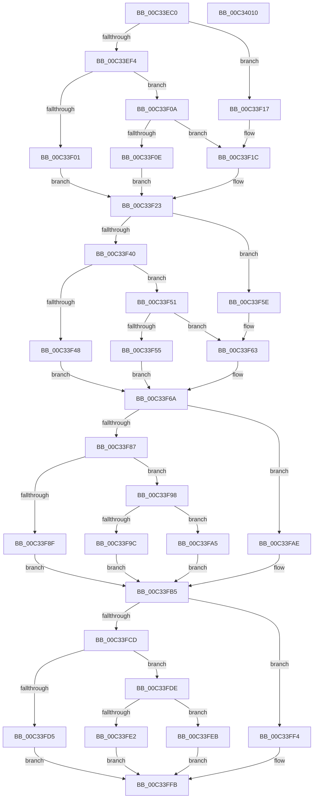

# PiUEventProcessRegistry

- RVA: `0x00C33EC0`–`0x00C34011` (길이 `337` bytes)
- VA: `0x0000000140C33EC0`
- 실행 섹션: `INIT`
- PDB 이름 있음: `예`; PDB Function 태그: `아니요`
- unwind 정보 RVA: `0x000B6A1C`
- 디코드: `88`개 명령, `337/337` bytes 표시
- 미해석 바이트: `0` (있으면 어셈블리에 `.byte`로 보존)

> 이 문서는 커널 이미지의 기계어와 PDB 기호를 분석해 생성했습니다. 4번과 5번은 함수 원형과 자료형을 바이너리 사용 방식에서 추정한 C 해석이며 원본 소스 복구 결과는 아닙니다.

## 1. Dependencies

- 직접 호출 지점: **4**; 고유 호출 대상: **1**
- 직접 호출자로 확인된 함수: **1**
- RIP 상대 이미지 참조: **8**

### Outgoing calls
- `0x00C33EE6` → [PnpGetRegistryDword](../../text/4B/PnpGetRegistryDword_function_004BFDE8.md) (function, `0x004BFDE8`)
- `0x00C33F32` → [PnpGetRegistryDword](../../text/4B/PnpGetRegistryDword_function_004BFDE8.md) (function, `0x004BFDE8`)
- `0x00C33F79` → [PnpGetRegistryDword](../../text/4B/PnpGetRegistryDword_function_004BFDE8.md) (function, `0x004BFDE8`)
- `0x00C33FC4` → [PnpGetRegistryDword](../../text/4B/PnpGetRegistryDword_function_004BFDE8.md) (function, `0x004BFDE8`)

### Direct callers
- [IopInitializePlugPlayServices](../C2/IopInitializePlugPlayServices_function_00C2F298.md) at `0x00C2F737`

### Static image references
- `0x00C33EDC` → RVA `0x00C7AE20` (` ?? ::PBOPGDP::`string'`; read)
- `0x00C33F01` → RVA `0x00E0AA10` (`.data`; write)
- `0x00C33F2B` → RVA `0x00C7AE50` (` ?? ::PBOPGDP::`string'`; read)
- `0x00C33F48` → RVA `0x00E0AA08` (`.data`; write)
- `0x00C33F72` → RVA `0x00C7AE90` (` ?? ::PBOPGDP::`string'`; read)
- `0x00C33F8F` → RVA `0x00E0AA0C` (`.data`; write)
- `0x00C33FBD` → RVA `0x00C7AEE0` (` ?? ::PBOPGDP::`string'`; read)
- `0x00C33FD5` → RVA `0x00E0AA04` (`.data`; write)

## 2. Other-region calls and transfers

- 다른 실행 섹션으로 향하는 call: **4**
  - `0x00C33EE6` → [PnpGetRegistryDword](../../text/4B/PnpGetRegistryDword_function_004BFDE8.md) (`INIT` → `.text`)
  - `0x00C33F32` → [PnpGetRegistryDword](../../text/4B/PnpGetRegistryDword_function_004BFDE8.md) (`INIT` → `.text`)
  - `0x00C33F79` → [PnpGetRegistryDword](../../text/4B/PnpGetRegistryDword_function_004BFDE8.md) (`INIT` → `.text`)
  - `0x00C33FC4` → [PnpGetRegistryDword](../../text/4B/PnpGetRegistryDword_function_004BFDE8.md) (`INIT` → `.text`)
- 별도 외부 분기/꼬리 이동을 확인하지 못했습니다.

## 3. Assembly (complete function range)

```asm
00C33EC0  48 8B C4                        mov rax, rsp
00C33EC3  48 89 58 08                     mov qword ptr [rax + 8], rbx
00C33EC7  48 89 68 18                     mov qword ptr [rax + 0x18], rbp
00C33ECB  48 89 70 20                     mov qword ptr [rax + 0x20], rsi
00C33ECF  57                              push rdi
00C33ED0  48 83 EC 20                     sub rsp, 0x20
00C33ED4  83 60 10 00                     and dword ptr [rax + 0x10], 0
00C33ED8  4C 8D 40 10                     lea r8, [rax + 0x10]
00C33EDC  48 8D 15 3D 6F 04 00            lea rdx, [rip + 0x46f3d]
00C33EE3  48 8B D9                        mov rbx, rcx
00C33EE6  E8 FD BE 88 FF                  call 0x1404bfde8
00C33EEB  BF 60 EA 00 00                  mov edi, 0xea60
00C33EF0  85 C0                           test eax, eax
00C33EF2  78 23                           js 0x140c33f17
00C33EF4  8B 44 24 38                     mov eax, dword ptr [rsp + 0x38]
00C33EF8  B9 E8 03 00 00                  mov ecx, 0x3e8
00C33EFD  3B C1                           cmp eax, ecx
00C33EFF  73 09                           jae 0x140c33f0a
00C33F01  66 89 0D 08 6B 1D 00            mov word ptr [rip + 0x1d6b08], cx
00C33F08  EB 19                           jmp 0x140c33f23
00C33F0A  3B C7                           cmp eax, edi
00C33F0C  76 0E                           jbe 0x140c33f1c
00C33F0E  66 89 3D FB 6A 1D 00            mov word ptr [rip + 0x1d6afb], di
00C33F15  EB 0C                           jmp 0x140c33f23
00C33F17  B8 30 75 00 00                  mov eax, 0x7530
00C33F1C  66 89 05 ED 6A 1D 00            mov word ptr [rip + 0x1d6aed], ax
00C33F23  4C 8D 44 24 38                  lea r8, [rsp + 0x38]
00C33F28  48 8B CB                        mov rcx, rbx
00C33F2B  48 8D 15 1E 6F 04 00            lea rdx, [rip + 0x46f1e]
00C33F32  E8 B1 BE 88 FF                  call 0x1404bfde8
00C33F37  BE FA 00 00 00                  mov esi, 0xfa
00C33F3C  85 C0                           test eax, eax
00C33F3E  78 1E                           js 0x140c33f5e
00C33F40  8B 44 24 38                     mov eax, dword ptr [rsp + 0x38]
00C33F44  3B C6                           cmp eax, esi
00C33F46  73 09                           jae 0x140c33f51
00C33F48  66 89 35 B9 6A 1D 00            mov word ptr [rip + 0x1d6ab9], si
00C33F4F  EB 19                           jmp 0x140c33f6a
00C33F51  3B C7                           cmp eax, edi
00C33F53  76 0E                           jbe 0x140c33f63
00C33F55  66 89 3D AC 6A 1D 00            mov word ptr [rip + 0x1d6aac], di
00C33F5C  EB 0C                           jmp 0x140c33f6a
00C33F5E  B8 10 27 00 00                  mov eax, 0x2710
00C33F63  66 89 05 9E 6A 1D 00            mov word ptr [rip + 0x1d6a9e], ax
00C33F6A  4C 8D 44 24 38                  lea r8, [rsp + 0x38]
00C33F6F  48 8B CB                        mov rcx, rbx
00C33F72  48 8D 15 17 6F 04 00            lea rdx, [rip + 0x46f17]
00C33F79  E8 6A BE 88 FF                  call 0x1404bfde8
00C33F7E  BD 88 13 00 00                  mov ebp, 0x1388
00C33F83  85 C0                           test eax, eax
00C33F85  78 27                           js 0x140c33fae
00C33F87  8B 44 24 38                     mov eax, dword ptr [rsp + 0x38]
00C33F8B  3B C6                           cmp eax, esi
00C33F8D  73 09                           jae 0x140c33f98
00C33F8F  66 89 35 76 6A 1D 00            mov word ptr [rip + 0x1d6a76], si
00C33F96  EB 1D                           jmp 0x140c33fb5
00C33F98  3B C7                           cmp eax, edi
00C33F9A  76 09                           jbe 0x140c33fa5
00C33F9C  66 89 3D 69 6A 1D 00            mov word ptr [rip + 0x1d6a69], di
00C33FA3  EB 10                           jmp 0x140c33fb5
00C33FA5  66 89 05 60 6A 1D 00            mov word ptr [rip + 0x1d6a60], ax
00C33FAC  EB 07                           jmp 0x140c33fb5
00C33FAE  66 89 2D 57 6A 1D 00            mov word ptr [rip + 0x1d6a57], bp
00C33FB5  4C 8D 44 24 38                  lea r8, [rsp + 0x38]
00C33FBA  48 8B CB                        mov rcx, rbx
00C33FBD  48 8D 15 1C 6F 04 00            lea rdx, [rip + 0x46f1c]
00C33FC4  E8 1F BE 88 FF                  call 0x1404bfde8
00C33FC9  85 C0                           test eax, eax
00C33FCB  78 27                           js 0x140c33ff4
00C33FCD  8B 44 24 38                     mov eax, dword ptr [rsp + 0x38]
00C33FD1  3B C6                           cmp eax, esi
00C33FD3  73 09                           jae 0x140c33fde
00C33FD5  66 89 35 28 6A 1D 00            mov word ptr [rip + 0x1d6a28], si
00C33FDC  EB 1D                           jmp 0x140c33ffb
00C33FDE  3B C7                           cmp eax, edi
00C33FE0  76 09                           jbe 0x140c33feb
00C33FE2  66 89 3D 1B 6A 1D 00            mov word ptr [rip + 0x1d6a1b], di
00C33FE9  EB 10                           jmp 0x140c33ffb
00C33FEB  66 89 05 12 6A 1D 00            mov word ptr [rip + 0x1d6a12], ax
00C33FF2  EB 07                           jmp 0x140c33ffb
00C33FF4  66 89 2D 09 6A 1D 00            mov word ptr [rip + 0x1d6a09], bp
00C33FFB  48 8B 5C 24 30                  mov rbx, qword ptr [rsp + 0x30]
00C34000  48 8B 6C 24 40                  mov rbp, qword ptr [rsp + 0x40]
00C34005  48 8B 74 24 48                  mov rsi, qword ptr [rsp + 0x48]
00C3400A  48 83 C4 20                     add rsp, 0x20
00C3400E  5F                              pop rdi
00C3400F  C3                              ret
00C34010  CC                              int3
```

## 4. C-style interpretation (structured pseudocode)

```c
__int64 __fastcall PiUEventProcessRegistry(__int64 a1)
{
    __int64 result;
    __int64 v_rsp;
    unsigned int v_stack_p10;
    unsigned __int64 v_stack_p18;
    unsigned __int64 v_stack_p20;
    unsigned __int64 v_stack_p8;

    *(unsigned __int64 *)(v_rsp + 8) = v_rbx;
    *(unsigned __int64 *)(v_rsp + 24) = v_rbp;
    *(unsigned __int64 *)(v_rsp + 32) = v_rsi;
    v_rsp = (v_rsp) - (32);
    result = PnpGetRegistryDword(a1, v_rip + 290621, v_rsp + 16, a4);
    if (sign_flag) goto loc_00C33F17;
    if (((unsigned int)((unsigned int)(v_stack_p10))) >= 1000) goto loc_00C33F0A;
    *(unsigned __int16 *)(v_rip + 1927944) = 1000;
    goto loc_00C33F23;
loc_00C33F0A:
    if (((unsigned int)((unsigned int)(v_stack_p10))) <= ((unsigned int)((unsigned int)(0xEA60ULL)))) goto loc_00C33F1C;
    *(unsigned __int16 *)(v_rip + 1927931) = (unsigned __int16)((unsigned int)(0xEA60ULL));
    goto loc_00C33F23;
loc_00C33F17:
loc_00C33F1C:
    *(unsigned __int16 *)(v_rip + 1927917) = (unsigned __int16)((unsigned int)(0x7530ULL));
loc_00C33F23:
    result = PnpGetRegistryDword(a1, v_rip + 290590, v_stack_p10, a4);
    if (sign_flag) goto loc_00C33F5E;
    if (((unsigned int)((unsigned int)(v_stack_p10))) >= 250) goto loc_00C33F51;
    *(unsigned __int16 *)(v_rip + 1927865) = 250;
    goto loc_00C33F6A;
loc_00C33F51:
    if (((unsigned int)((unsigned int)(v_stack_p10))) <= ((unsigned int)((unsigned int)(0xEA60ULL)))) goto loc_00C33F63;
    *(unsigned __int16 *)(v_rip + 1927852) = (unsigned __int16)((unsigned int)(0xEA60ULL));
    goto loc_00C33F6A;
loc_00C33F5E:
loc_00C33F63:
    *(unsigned __int16 *)(v_rip + 1927838) = (unsigned __int16)((unsigned int)(0x2710ULL));
loc_00C33F6A:
    result = PnpGetRegistryDword(a1, v_rip + 290583, v_stack_p10, a4);
    if (sign_flag) goto loc_00C33FAE;
    if (((unsigned int)((unsigned int)(v_stack_p10))) >= 250) goto loc_00C33F98;
    *(unsigned __int16 *)(v_rip + 1927798) = 250;
    goto loc_00C33FB5;
loc_00C33F98:
    if (((unsigned int)((unsigned int)(v_stack_p10))) <= ((unsigned int)((unsigned int)(0xEA60ULL)))) goto loc_00C33FA5;
    *(unsigned __int16 *)(v_rip + 1927785) = (unsigned __int16)((unsigned int)(0xEA60ULL));
    goto loc_00C33FB5;
loc_00C33FA5:
    *(unsigned __int16 *)(v_rip + 1927776) = (unsigned __int16)((unsigned int)(v_stack_p10));
    goto loc_00C33FB5;
loc_00C33FAE:
    *(unsigned __int16 *)(v_rip + 1927767) = (unsigned __int16)((unsigned int)(0x1388ULL));
loc_00C33FB5:
    result = PnpGetRegistryDword(a1, v_rip + 290588, v_stack_p10, a4);
    if (sign_flag) goto loc_00C33FF4;
    if (((unsigned int)((unsigned int)(v_stack_p10))) >= 250) goto loc_00C33FDE;
    *(unsigned __int16 *)(v_rip + 1927720) = 250;
    goto loc_00C33FFB;
loc_00C33FDE:
    if (((unsigned int)((unsigned int)(v_stack_p10))) <= ((unsigned int)((unsigned int)(0xEA60ULL)))) goto loc_00C33FEB;
    *(unsigned __int16 *)(v_rip + 1927707) = (unsigned __int16)((unsigned int)(0xEA60ULL));
    goto loc_00C33FFB;
loc_00C33FEB:
    *(unsigned __int16 *)(v_rip + 1927698) = (unsigned __int16)((unsigned int)(v_stack_p10));
    goto loc_00C33FFB;
loc_00C33FF4:
    *(unsigned __int16 *)(v_rip + 1927689) = (unsigned __int16)((unsigned int)(0x1388ULL));
loc_00C33FFB:
    v_rsp = (v_rsp) + (32);
    return (unsigned int)(v_stack_p10);
}
```

## 5. (Beta) C Style

```c
int64_t PiUEventProcessRegistry(int64_t Arg1)
{
    int64_t result;
    int64_t local_rsp;
    uint32_t v_stack_p10;
    uint64_t v_stack_p18;
    uint64_t v_stack_p20;
    uint64_t v_stack_p8;

    *(uint64_t *)(local_rsp + 0x8) = local_rbx;
    *(uint64_t *)(local_rsp + 0x18) = local_rbp;
    *(uint64_t *)(local_rsp + 0x20) = local_rsi;
    local_rsp = (local_rsp) - (32);
    result = PnpGetRegistryDword(Arg1, v_rip + 290621, local_rsp + 16, a4);
    if (sign_flag) goto loc_00C33F17;
    if (((uint32_t)((uint32_t)(v_stack_p10))) >= 1000) goto loc_00C33F0A;
    *(uint16_t *)(v_rip + 0x1D6B08) = 1000;
    goto loc_00C33F23;
loc_00C33F0A:
    if (((uint32_t)((uint32_t)(v_stack_p10))) <= ((uint32_t)((uint32_t)(0xEA60ULL)))) goto loc_00C33F1C;
    *(uint16_t *)(v_rip + 0x1D6AFB) = (uint16_t)((uint32_t)(0xEA60ULL));
    goto loc_00C33F23;
loc_00C33F17:
loc_00C33F1C:
    *(uint16_t *)(v_rip + 0x1D6AED) = (uint16_t)((uint32_t)(0x7530ULL));
loc_00C33F23:
    result = PnpGetRegistryDword(Arg1, v_rip + 290590, v_stack_p10, a4);
    if (sign_flag) goto loc_00C33F5E;
    if (((uint32_t)((uint32_t)(v_stack_p10))) >= 250) goto loc_00C33F51;
    *(uint16_t *)(v_rip + 0x1D6AB9) = 250;
    goto loc_00C33F6A;
loc_00C33F51:
    if (((uint32_t)((uint32_t)(v_stack_p10))) <= ((uint32_t)((uint32_t)(0xEA60ULL)))) goto loc_00C33F63;
    *(uint16_t *)(v_rip + 0x1D6AAC) = (uint16_t)((uint32_t)(0xEA60ULL));
    goto loc_00C33F6A;
loc_00C33F5E:
loc_00C33F63:
    *(uint16_t *)(v_rip + 0x1D6A9E) = (uint16_t)((uint32_t)(0x2710ULL));
loc_00C33F6A:
    result = PnpGetRegistryDword(Arg1, v_rip + 290583, v_stack_p10, a4);
    if (sign_flag) goto loc_00C33FAE;
    if (((uint32_t)((uint32_t)(v_stack_p10))) >= 250) goto loc_00C33F98;
    *(uint16_t *)(v_rip + 0x1D6A76) = 250;
    goto loc_00C33FB5;
loc_00C33F98:
    if (((uint32_t)((uint32_t)(v_stack_p10))) <= ((uint32_t)((uint32_t)(0xEA60ULL)))) goto loc_00C33FA5;
    *(uint16_t *)(v_rip + 0x1D6A69) = (uint16_t)((uint32_t)(0xEA60ULL));
    goto loc_00C33FB5;
loc_00C33FA5:
    *(uint16_t *)(v_rip + 0x1D6A60) = (uint16_t)((uint32_t)(v_stack_p10));
    goto loc_00C33FB5;
loc_00C33FAE:
    *(uint16_t *)(v_rip + 0x1D6A57) = (uint16_t)((uint32_t)(0x1388ULL));
loc_00C33FB5:
    result = PnpGetRegistryDword(Arg1, v_rip + 290588, v_stack_p10, a4);
    if (sign_flag) goto loc_00C33FF4;
    if (((uint32_t)((uint32_t)(v_stack_p10))) >= 250) goto loc_00C33FDE;
    *(uint16_t *)(v_rip + 0x1D6A28) = 250;
    goto loc_00C33FFB;
loc_00C33FDE:
    if (((uint32_t)((uint32_t)(v_stack_p10))) <= ((uint32_t)((uint32_t)(0xEA60ULL)))) goto loc_00C33FEB;
    *(uint16_t *)(v_rip + 0x1D6A1B) = (uint16_t)((uint32_t)(0xEA60ULL));
    goto loc_00C33FFB;
loc_00C33FEB:
    *(uint16_t *)(v_rip + 0x1D6A12) = (uint16_t)((uint32_t)(v_stack_p10));
    goto loc_00C33FFB;
loc_00C33FF4:
    *(uint16_t *)(v_rip + 0x1D6A09) = (uint16_t)((uint32_t)(0x1388ULL));
loc_00C33FFB:
    local_rsp = (local_rsp) + (32);
    return (uint32_t)(v_stack_p10);
}
```

## 6. Execution-region graph

[열기: 2D/3D 그래프와 함수 탐색 컨트롤 패널](../../../control-panel.html?section=init&rva=0x00C33EC0&view=graph)

- 2D 그래프는 위에서 아래로 흐르고, 3D 그래프는 빈 공간을 드래그해 회전합니다. Shift+드래그는 이동, 휠은 확대·축소, 함수 노드 선택은 대상 보고서 이동입니다.

### Static fallback


