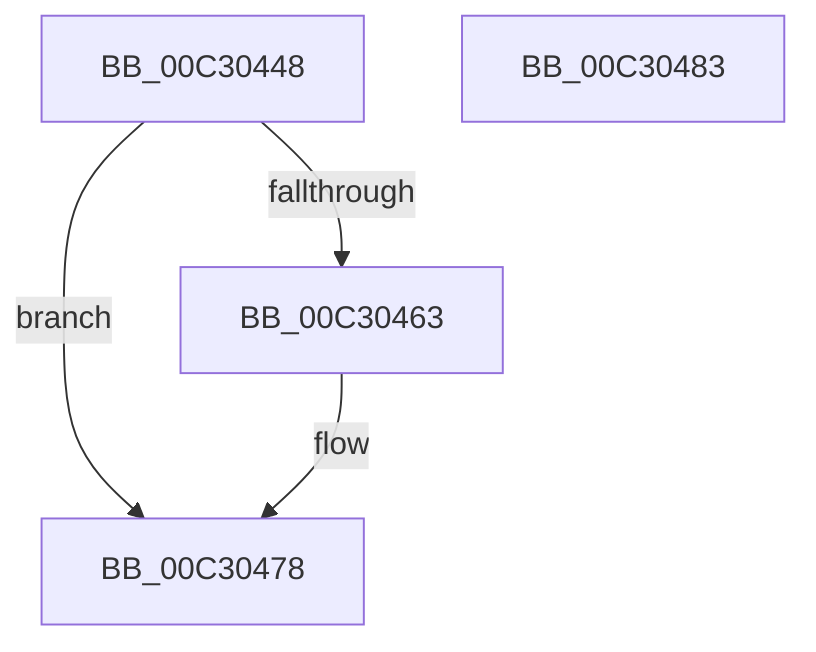

# PipAddDevicesToBootDriverWorker

- RVA: `0x00C30448`–`0x00C30484` (길이 `60` bytes)
- VA: `0x0000000140C30448`
- 실행 섹션: `INIT`
- PDB 이름 있음: `예`; PDB Function 태그: `아니요`
- unwind 정보 RVA: `0x0005CF00`
- 디코드: `18`개 명령, `60/60` bytes 표시
- 미해석 바이트: `0` (있으면 어셈블리에 `.byte`로 보존)

> 이 문서는 커널 이미지의 기계어와 PDB 기호를 분석해 생성했습니다. 4번과 5번은 함수 원형과 자료형을 바이너리 사용 방식에서 추정한 C 해석이며 원본 소스 복구 결과는 아닙니다.

## 1. Dependencies

- 직접 호출 지점: **3**; 고유 호출 대상: **3**
- 직접 호출자로 확인된 함수: **1**
- RIP 상대 이미지 참조: **0**

### Outgoing calls
- `0x00C30456` → [PnpDeviceObjectFromDeviceInstanceWithTag](../../page/8E/PnpDeviceObjectFromDeviceInstanceWithTag_function_008E7490.md) (function, `0x008E7490`)
- `0x00C30466` → [PiProcessAddBootDevices](../../page/72/PiProcessAddBootDevices_function_0072D434.md) (function, `0x0072D434`)
- `0x00C30473` → [ObfDereferenceObjectWithTag](../../text/2F/ObfDereferenceObjectWithTag_function_002F78E0.md) (function, `0x002F78E0`)

### Direct callers
- [PipApplyFunctionToServiceInstances](../../page/72/PipApplyFunctionToServiceInstances_function_0072BF40.md) at `0x0072C100`

### Static image references
- 디코드된 RIP-relative 메모리 참조가 없습니다.

## 2. Other-region calls and transfers

- 다른 실행 섹션으로 향하는 call: **3**
  - `0x00C30456` → [PnpDeviceObjectFromDeviceInstanceWithTag](../../page/8E/PnpDeviceObjectFromDeviceInstanceWithTag_function_008E7490.md) (`INIT` → `PAGE`)
  - `0x00C30466` → [PiProcessAddBootDevices](../../page/72/PiProcessAddBootDevices_function_0072D434.md) (`INIT` → `PAGE`)
  - `0x00C30473` → [ObfDereferenceObjectWithTag](../../text/2F/ObfDereferenceObjectWithTag_function_002F78E0.md) (`INIT` → `.text`)
- 별도 외부 분기/꼬리 이동을 확인하지 못했습니다.

## 3. Assembly (complete function range)

```asm
00C30448  40 53                           push rbx
00C3044A  48 83 EC 20                     sub rsp, 0x20
00C3044E  48 8B CA                        mov rcx, rdx
00C30451  BA 44 66 6C 74                  mov edx, 0x746c6644
00C30456  E8 35 70 CB FF                  call 0x1408e7490
00C3045B  48 8B D8                        mov rbx, rax
00C3045E  48 85 C0                        test rax, rax
00C30461  74 15                           je 0x140c30478
00C30463  48 8B C8                        mov rcx, rax
00C30466  E8 C9 CF AF FF                  call 0x14072d434
00C3046B  BA 44 66 6C 74                  mov edx, 0x746c6644
00C30470  48 8B CB                        mov rcx, rbx
00C30473  E8 68 74 6C FF                  call 0x1402f78e0
00C30478  B8 01 00 00 00                  mov eax, 1
00C3047D  48 83 C4 20                     add rsp, 0x20
00C30481  5B                              pop rbx
00C30482  C3                              ret
00C30483  CC                              int3
```

## 4. C-style interpretation (structured pseudocode)

```c
__int64 __fastcall PipAddDevicesToBootDriverWorker(__int64 a1, __int64 a2)
{
    __int64 result;
    __int64 v_rsp;

    v_rsp = (v_rsp) - (32);
    result = PnpDeviceObjectFromDeviceInstanceWithTag(a2, (unsigned int)(0x746C6644ULL), a3, a4);
    if (result != 0) {
        a1 = result;
        result = PiProcessAddBootDevices(a1, (unsigned int)(0x746C6644ULL), a3, a4);
        a2 = 0x746C6644ULL;
        a1 = result;
        result = ObfDereferenceObjectWithTag(a1, a2, a3, a4);
    }
    v_rsp = (v_rsp) + (32);
    return 1;
}
```

## 5. (Beta) C Style

```c
int64_t PipAddDevicesToBootDriverWorker(int64_t Arg1, int64_t Arg2)
{
    int64_t result;
    int64_t local_rsp;

    local_rsp = (local_rsp) - (32);
    result = PnpDeviceObjectFromDeviceInstanceWithTag(Arg2, (uint32_t)(0x746C6644ULL), a3, a4);
    if (result != 0) {
        Arg1 = result;
        result = PiProcessAddBootDevices(Arg1, (uint32_t)(0x746C6644ULL), a3, a4);
        Arg2 = 0x746C6644ULL;
        Arg1 = result;
        result = ObfDereferenceObjectWithTag(Arg1, Arg2, a3, a4);
    }
    local_rsp = (local_rsp) + (32);
    return 1;
}
```

## 6. Execution-region graph

[열기: 2D/3D 그래프와 함수 탐색 컨트롤 패널](../../../control-panel.html?section=init&rva=0x00C30448&view=graph)

- 2D 그래프는 위에서 아래로 흐르고, 3D 그래프는 빈 공간을 드래그해 회전합니다. Shift+드래그는 이동, 휠은 확대·축소, 함수 노드 선택은 대상 보고서 이동입니다.

### Static fallback


