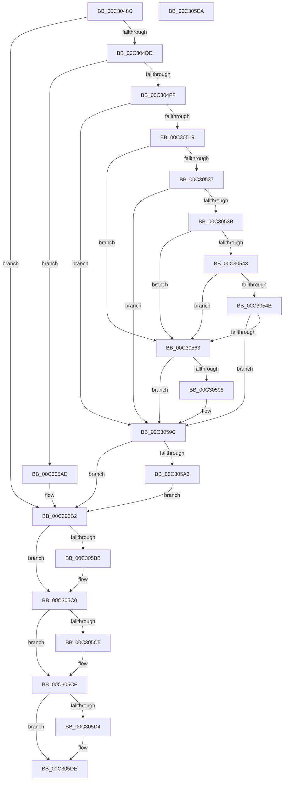

# PipCheckSystemFirmwareUpdated

- RVA: `0x00C3048C`–`0x00C305EB` (길이 `351` bytes)
- VA: `0x0000000140C3048C`
- 실행 섹션: `INIT`
- PDB 이름 있음: `예`; PDB Function 태그: `아니요`
- unwind 정보 RVA: `0x000C800C`
- 디코드: `105`개 명령, `351/351` bytes 표시
- 미해석 바이트: `0` (있으면 어셈블리에 `.byte`로 보존)

> 이 문서는 커널 이미지의 기계어와 PDB 기호를 분석해 생성했습니다. 4번과 5번은 함수 원형과 자료형을 바이너리 사용 방식에서 추정한 C 해석이며 원본 소스 복구 결과는 아닙니다.

## 1. Dependencies

- 직접 호출 지점: **10**; 고유 호출 대상: **8**
- 직접 호출자로 확인된 함수: **1**
- RIP 상대 이미지 참조: **2**

### Outgoing calls
- `0x00C304D0` → [IopOpenRegistryKeyEx](../../page/A5/IopOpenRegistryKeyEx_function_00A51B44.md) (function, `0x00A51B44`)
- `0x00C304F2` → [IopGetRegistryValue](../../page/99/IopGetRegistryValue_function_009990EC.md) (function, `0x009990EC`)
- `0x00C30508` → [PipHardwareConfigOpenKey](../../page/AD/PipHardwareConfigOpenKey_function_00AD8848.md) (function, `0x00AD8848`)
- `0x00C30527` → [IopGetRegistryValue](../../page/99/IopGetRegistryValue_function_009990EC.md) (function, `0x009990EC`)
- `0x00C3055A` → [memcmp](../../text/6C/memcmp_function_006C6B10.md) (function, `0x006C6B10`)
- `0x00C3058F` → [ZwSetValueKey](../../text/6A/ZwSetValueKey_function_006ADCD0.md) (function, `0x006ADCD0`)
- `0x00C305A7` → [PnpCtxRegCloseKey](../../page/A2/PnpCtxRegCloseKey_function_00A22E0C.md) (function, `0x00A22E0C`)
- `0x00C305BB` → [ZwClose](../../text/6A/ZwClose_function_006AD2B0.md) (function, `0x006AD2B0`)
- `0x00C305CA` → [ExFreePoolWithTag](../../poolcode/B8/ExFreePoolWithTag_function_00B82870.md) (function, `0x00B82870`)
- `0x00C305D9` → [ExFreePoolWithTag](../../poolcode/B8/ExFreePoolWithTag_function_00B82870.md) (function, `0x00B82870`)

### Direct callers
- [IopInitializePlugPlayServices](../C2/IopInitializePlugPlayServices_function_00C2F298.md) at `0x00C2F8E5`

### Static image references
- `0x00C304A0` → RVA `0x00FD9DE8` (`PAGEDATA`; read)
- `0x00C304E1` → RVA `0x00C7A620` (` ?? ::PBOPGDP::`string'`; read)

## 2. Other-region calls and transfers

- 다른 실행 섹션으로 향하는 call: **10**
  - `0x00C304D0` → [IopOpenRegistryKeyEx](../../page/A5/IopOpenRegistryKeyEx_function_00A51B44.md) (`INIT` → `PAGE`)
  - `0x00C304F2` → [IopGetRegistryValue](../../page/99/IopGetRegistryValue_function_009990EC.md) (`INIT` → `PAGE`)
  - `0x00C30508` → [PipHardwareConfigOpenKey](../../page/AD/PipHardwareConfigOpenKey_function_00AD8848.md) (`INIT` → `PAGE`)
  - `0x00C30527` → [IopGetRegistryValue](../../page/99/IopGetRegistryValue_function_009990EC.md) (`INIT` → `PAGE`)
  - `0x00C3055A` → [memcmp](../../text/6C/memcmp_function_006C6B10.md) (`INIT` → `.text`)
  - `0x00C3058F` → [ZwSetValueKey](../../text/6A/ZwSetValueKey_function_006ADCD0.md) (`INIT` → `.text`)
  - `0x00C305A7` → [PnpCtxRegCloseKey](../../page/A2/PnpCtxRegCloseKey_function_00A22E0C.md) (`INIT` → `PAGE`)
  - `0x00C305BB` → [ZwClose](../../text/6A/ZwClose_function_006AD2B0.md) (`INIT` → `.text`)
  - `0x00C305CA` → [ExFreePoolWithTag](../../poolcode/B8/ExFreePoolWithTag_function_00B82870.md) (`INIT` → `POOLCODE`)
  - `0x00C305D9` → [ExFreePoolWithTag](../../poolcode/B8/ExFreePoolWithTag_function_00B82870.md) (`INIT` → `POOLCODE`)
- 별도 외부 분기/꼬리 이동을 확인하지 못했습니다.

## 3. Assembly (complete function range)

```asm
00C3048C  40 55                           push rbp
00C3048E  53                              push rbx
00C3048F  57                              push rdi
00C30490  41 54                           push r12
00C30492  41 56                           push r14
00C30494  48 8B EC                        mov rbp, rsp
00C30497  48 83 EC 40                     sub rsp, 0x40
00C3049B  48 83 65 30 00                  and qword ptr [rbp + 0x30], 0
00C304A0  4C 8D 05 41 99 3A 00            lea r8, [rip + 0x3a9941]
00C304A7  48 83 65 40 00                  and qword ptr [rbp + 0x40], 0
00C304AC  33 DB                           xor ebx, ebx
00C304AE  88 19                           mov byte ptr [rcx], bl
00C304B0  4C 8B F1                        mov r14, rcx
00C304B3  0F 57 C0                        xorps xmm0, xmm0
00C304B6  48 89 5D 38                     mov qword ptr [rbp + 0x38], rbx
00C304BA  33 FF                           xor edi, edi
00C304BC  48 8D 4D 40                     lea rcx, [rbp + 0x40]
00C304C0  41 B9 3F 00 0F 00               mov r9d, 0xf003f
00C304C6  48 89 7D 48                     mov qword ptr [rbp + 0x48], rdi
00C304CA  33 D2                           xor edx, edx
00C304CC  0F 11 45 F0                     movups xmmword ptr [rbp - 0x10], xmm0
00C304D0  E8 6F 16 E2 FF                  call 0x140a51b44
00C304D5  85 C0                           test eax, eax
00C304D7  0F 88 D5 00 00 00               js 0x140c305b2
00C304DD  48 8B 4D 40                     mov rcx, qword ptr [rbp + 0x40]
00C304E1  4C 8D 25 38 A1 04 00            lea r12, [rip + 0x4a138]
00C304E8  49 8B D4                        mov rdx, r12
00C304EB  4C 8D 4D 38                     lea r9, [rbp + 0x38]
00C304EF  45 33 C0                        xor r8d, r8d
00C304F2  E8 F5 8B D6 FF                  call 0x1409990ec
00C304F7  85 C0                           test eax, eax
00C304F9  0F 88 AF 00 00 00               js 0x140c305ae
00C304FF  4C 8D 45 30                     lea r8, [rbp + 0x30]
00C30503  BA 3F 00 0F 00                  mov edx, 0xf003f
00C30508  E8 3B 83 EA FF                  call 0x140ad8848
00C3050D  48 8B 5D 38                     mov rbx, qword ptr [rbp + 0x38]
00C30511  85 C0                           test eax, eax
00C30513  0F 88 83 00 00 00               js 0x140c3059c
00C30519  48 8B 4D 30                     mov rcx, qword ptr [rbp + 0x30]
00C3051D  4C 8D 4D 48                     lea r9, [rbp + 0x48]
00C30521  45 33 C0                        xor r8d, r8d
00C30524  49 8B D4                        mov rdx, r12
00C30527  E8 C0 8B D6 FF                  call 0x1409990ec
00C3052C  48 8B 7D 48                     mov rdi, qword ptr [rbp + 0x48]
00C30530  3D 34 00 00 C0                  cmp eax, 0xc0000034
00C30535  74 2C                           je 0x140c30563
00C30537  85 C0                           test eax, eax
00C30539  78 61                           js 0x140c3059c
00C3053B  8B 47 04                        mov eax, dword ptr [rdi + 4]
00C3053E  39 43 04                        cmp dword ptr [rbx + 4], eax
00C30541  75 20                           jne 0x140c30563
00C30543  8B 43 0C                        mov eax, dword ptr [rbx + 0xc]
00C30546  3B 47 0C                        cmp eax, dword ptr [rdi + 0xc]
00C30549  75 18                           jne 0x140c30563
00C3054B  8B 57 08                        mov edx, dword ptr [rdi + 8]
00C3054E  44 8B C0                        mov r8d, eax
00C30551  8B 4B 08                        mov ecx, dword ptr [rbx + 8]
00C30554  48 03 D7                        add rdx, rdi
00C30557  48 03 CB                        add rcx, rbx
00C3055A  E8 B1 65 A9 FF                  call 0x1406c6b10
00C3055F  85 C0                           test eax, eax
00C30561  74 39                           je 0x140c3059c
00C30563  C7 45 F0 22 00 24 00            mov dword ptr [rbp - 0x10], 0x240022
00C3056A  48 8D 55 F0                     lea rdx, [rbp - 0x10]
00C3056E  4C 89 65 F8                     mov qword ptr [rbp - 8], r12
00C30572  45 33 C0                        xor r8d, r8d
00C30575  8B 4B 08                        mov ecx, dword ptr [rbx + 8]
00C30578  8B 43 0C                        mov eax, dword ptr [rbx + 0xc]
00C3057B  48 03 CB                        add rcx, rbx
00C3057E  44 8B 4B 04                     mov r9d, dword ptr [rbx + 4]
00C30582  89 44 24 28                     mov dword ptr [rsp + 0x28], eax
00C30586  48 89 4C 24 20                  mov qword ptr [rsp + 0x20], rcx
00C3058B  48 8B 4D 30                     mov rcx, qword ptr [rbp + 0x30]
00C3058F  E8 3C D7 A7 FF                  call 0x1406adcd0
00C30594  85 C0                           test eax, eax
00C30596  78 04                           js 0x140c3059c
00C30598  41 C6 06 01                     mov byte ptr [r14], 1
00C3059C  48 83 7D 30 00                  cmp qword ptr [rbp + 0x30], 0
00C305A1  74 0F                           je 0x140c305b2
00C305A3  48 8B 55 30                     mov rdx, qword ptr [rbp + 0x30]
00C305A7  E8 60 28 DF FF                  call 0x140a22e0c
00C305AC  EB 04                           jmp 0x140c305b2
00C305AE  48 8B 5D 38                     mov rbx, qword ptr [rbp + 0x38]
00C305B2  48 8B 4D 40                     mov rcx, qword ptr [rbp + 0x40]
00C305B6  48 85 C9                        test rcx, rcx
00C305B9  74 05                           je 0x140c305c0
00C305BB  E8 F0 CC A7 FF                  call 0x1406ad2b0
00C305C0  48 85 DB                        test rbx, rbx
00C305C3  74 0A                           je 0x140c305cf
00C305C5  33 D2                           xor edx, edx
00C305C7  48 8B CB                        mov rcx, rbx
00C305CA  E8 A1 22 F5 FF                  call 0x140b82870
00C305CF  48 85 FF                        test rdi, rdi
00C305D2  74 0A                           je 0x140c305de
00C305D4  33 D2                           xor edx, edx
00C305D6  48 8B CF                        mov rcx, rdi
00C305D9  E8 92 22 F5 FF                  call 0x140b82870
00C305DE  48 83 C4 40                     add rsp, 0x40
00C305E2  41 5E                           pop r14
00C305E4  41 5C                           pop r12
00C305E6  5F                              pop rdi
00C305E7  5B                              pop rbx
00C305E8  5D                              pop rbp
00C305E9  C3                              ret
00C305EA  CC                              int3
```

## 4. C-style interpretation (structured pseudocode)

```c
__int64 __fastcall PipCheckSystemFirmwareUpdated(__int64 a1, int a2)
{
    __int64 result;
    __int64 v_rbx;
    __int64 v_rdi;
    __int64 v_rsp;
    unsigned __int64 v_stack_m30;
    unsigned __int64 v_stack_m38;
    unsigned int v_stack_m40;
    unsigned __int64 v_stack_m48;
    unsigned __int64 v_stack_p10;
    unsigned __int64 v_stack_p18;
    unsigned __int64 v_stack_p20;
    unsigned __int64 v_stack_p8;

    v_rsp = (v_rsp) - (64);
    v_rbx = 0;
    *(unsigned __int8 *)(a1) = 0;
    v_stack_p10 = 0;
    v_rdi = 0;
    v_stack_p20 = 0;
    a2 = 0;
    v_stack_m38 = v_xmm0;
    result = IopOpenRegistryKeyEx(v_stack_p18, a2, v_rip + 3840321, (unsigned int)(0xF003FULL));
    if (sign_flag) goto loc_00C305B2;
    a3 = 0;
    result = IopGetRegistryValue(v_stack_p18, v_rip + 303416, a3, v_stack_p10);
    if (sign_flag) goto loc_00C305AE;
    result = PipHardwareConfigOpenKey(v_stack_p18, (unsigned int)(0xF003FULL), v_stack_p8, v_stack_p10);
    if (sign_flag) goto loc_00C3059C;
    a3 = 0;
    result = IopGetRegistryValue(v_stack_p8, v_rip + 303416, a3, v_stack_p20);
    if (((unsigned int)(result)) == 0xC0000034ULL) goto loc_00C30563;
    if (sign_flag) goto loc_00C3059C;
    if ((*(unsigned int *)(v_stack_p10 + 4)) != ((unsigned int)((unsigned int)(*(unsigned int *)(v_stack_p20 + 4))))) goto loc_00C30563;
    if (((unsigned int)((unsigned int)(*(unsigned int *)(v_stack_p10 + 12)))) != (*(unsigned int *)(v_stack_p20 + 12))) goto loc_00C30563;
    a2 = ((unsigned int)(*(unsigned int *)(v_stack_p20 + 8))) + (v_stack_p20);
    a1 = ((unsigned int)(*(unsigned int *)(v_stack_p10 + 8))) + (v_stack_p10);
    result = memcmp(a1, a2, (unsigned int)((unsigned int)((unsigned int)(*(unsigned int *)(v_stack_p10 + 12)))), v_stack_p20);
    if ((unsigned int)(result) == 0) goto loc_00C3059C;
loc_00C30563:
    v_stack_m38 = 0x240022ULL;
    v_stack_m30 = v_rip + 303416;
    a3 = 0;
    a1 = ((unsigned int)(*(unsigned int *)(v_stack_p10 + 8))) + (v_stack_p10);
    v_stack_m40 = (unsigned int)((unsigned int)(*(unsigned int *)(v_stack_p10 + 12)));
    v_stack_m48 = a1;
    result = ZwSetValueKey(v_stack_p8, v_stack_m38, a3, (unsigned int)(*(unsigned int *)(v_stack_p10 + 4)));
    if (!(sign_flag)) {
        *(unsigned __int8 *)(a1) = 1;
    }
    if (v_stack_p8 == 0) goto loc_00C305B2;
    result = PnpCtxRegCloseKey(v_stack_p8, v_stack_p8, a3, (unsigned int)(*(unsigned int *)(v_stack_p10 + 4)));
    goto loc_00C305B2;
loc_00C305AE:
loc_00C305B2:
    if (v_stack_p18 != 0) {
        result = ZwClose(v_stack_p18, v_stack_p8, a3, (unsigned int)(*(unsigned int *)(v_stack_p10 + 4)));
    }
    if (v_stack_p10 != 0) {
        a2 = 0;
        a1 = v_stack_p10;
        result = ExFreePoolWithTag(a1, a2, a3, (unsigned int)(*(unsigned int *)(v_stack_p10 + 4)));
    }
    if (v_stack_p20 != 0) {
        a2 = 0;
        a1 = v_stack_p20;
        result = ExFreePoolWithTag(a1, a2, a3, (unsigned int)(*(unsigned int *)(v_stack_p10 + 4)));
    }
    v_rsp = (v_rsp) + (64);
    return result;
}
```

## 5. (Beta) C Style

```c
int64_t PipCheckSystemFirmwareUpdated(void *Arg1, int32_t Arg2)
{
    uint8_t *arg1 = (uint8_t *)Arg1;

    int64_t result;
    int64_t local_rbx;
    int64_t local_rdi;
    int64_t local_rsp;
    uint64_t v_stack_m30;
    uint64_t v_stack_m38;
    uint32_t v_stack_m40;
    uint64_t v_stack_m48;
    uint64_t v_stack_p10;
    uint64_t v_stack_p18;
    uint64_t v_stack_p20;
    uint64_t v_stack_p8;

    local_rsp = (local_rsp) - (64);
    local_rbx = 0;
    *(uint8_t *)(arg1) = 0;
    v_stack_p10 = 0;
    local_rdi = 0;
    v_stack_p20 = 0;
    Arg2 = 0;
    v_stack_m38 = v_xmm0;
    result = IopOpenRegistryKeyEx(v_stack_p18, Arg2, v_rip + 3840321, (uint32_t)(0xF003FULL));
    if (sign_flag) goto loc_00C305B2;
    a3 = 0;
    result = IopGetRegistryValue(v_stack_p18, v_rip + 303416, a3, v_stack_p10);
    if (sign_flag) goto loc_00C305AE;
    result = PipHardwareConfigOpenKey(v_stack_p18, (uint32_t)(0xF003FULL), v_stack_p8, v_stack_p10);
    if (sign_flag) goto loc_00C3059C;
    a3 = 0;
    result = IopGetRegistryValue(v_stack_p8, v_rip + 303416, a3, v_stack_p20);
    if (((uint32_t)(result)) == 0xC0000034ULL) goto loc_00C30563;
    if (sign_flag) goto loc_00C3059C;
    if ((*(uint32_t *)(v_stack_p10 + 0x4)) != ((uint32_t)((uint32_t)(*(uint32_t *)(v_stack_p20 + 0x4))))) goto loc_00C30563;
    if (((uint32_t)((uint32_t)(*(uint32_t *)(v_stack_p10 + 0xC)))) != (*(uint32_t *)(v_stack_p20 + 0xC))) goto loc_00C30563;
    Arg2 = ((uint32_t)(*(uint32_t *)(v_stack_p20 + 0x8))) + (v_stack_p20);
    Arg1 = ((uint32_t)(*(uint32_t *)(v_stack_p10 + 0x8))) + (v_stack_p10);
    result = memcmp(Arg1, Arg2, (uint32_t)((uint32_t)((uint32_t)(*(uint32_t *)(v_stack_p10 + 0xC)))), v_stack_p20);
    if ((uint32_t)(result) == 0) goto loc_00C3059C;
loc_00C30563:
    v_stack_m38 = 0x240022ULL;
    v_stack_m30 = v_rip + 303416;
    a3 = 0;
    Arg1 = ((uint32_t)(*(uint32_t *)(v_stack_p10 + 0x8))) + (v_stack_p10);
    v_stack_m40 = (uint32_t)((uint32_t)(*(uint32_t *)(v_stack_p10 + 0xC)));
    v_stack_m48 = Arg1;
    result = ZwSetValueKey(v_stack_p8, v_stack_m38, a3, (uint32_t)(*(uint32_t *)(v_stack_p10 + 0x4)));
    if (!(sign_flag)) {
        *(uint8_t *)(arg1) = 1;
    }
    if (v_stack_p8 == 0) goto loc_00C305B2;
    result = PnpCtxRegCloseKey(v_stack_p8, v_stack_p8, a3, (uint32_t)(*(uint32_t *)(v_stack_p10 + 0x4)));
    goto loc_00C305B2;
loc_00C305AE:
loc_00C305B2:
    if (v_stack_p18 != 0) {
        result = ZwClose(v_stack_p18, v_stack_p8, a3, (uint32_t)(*(uint32_t *)(v_stack_p10 + 0x4)));
    }
    if (v_stack_p10 != 0) {
        Arg2 = 0;
        Arg1 = v_stack_p10;
        result = ExFreePoolWithTag(Arg1, Arg2, a3, (uint32_t)(*(uint32_t *)(v_stack_p10 + 0x4)));
    }
    if (v_stack_p20 != 0) {
        Arg2 = 0;
        Arg1 = v_stack_p20;
        result = ExFreePoolWithTag(Arg1, Arg2, a3, (uint32_t)(*(uint32_t *)(v_stack_p10 + 0x4)));
    }
    local_rsp = (local_rsp) + (64);
    return result;
}
```

### 관측된 메모리 오프셋

구조체 형식이 확인되지 않은 접근은 인자 기준의 오프셋으로만 기록했습니다.

| 기준 인자 | 오프셋 표현 | 폭 (bit) | 접근 |
|---|---:|---:|---|
| `Arg1` | `+ 0x0` | `8` | `W` |

## 6. Execution-region graph

[열기: 2D/3D 그래프와 함수 탐색 컨트롤 패널](../../../control-panel.html?section=init&rva=0x00C3048C&view=graph)

- 2D 그래프는 위에서 아래로 흐르고, 3D 그래프는 빈 공간을 드래그해 회전합니다. Shift+드래그는 이동, 휠은 확대·축소, 함수 노드 선택은 대상 보고서 이동입니다.

### Static fallback


