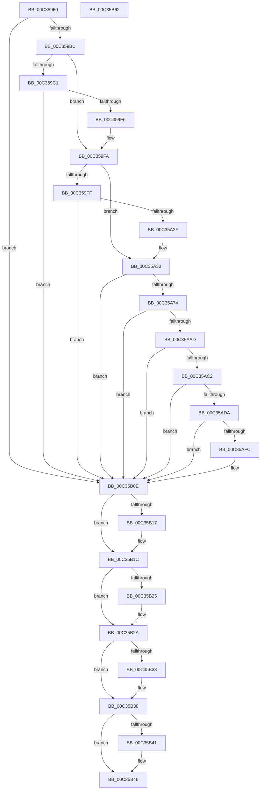

# PipCommitPendingOsExtensionResource

- RVA: `0x00C35960`–`0x00C35B63` (길이 `515` bytes)
- VA: `0x0000000140C35960`
- 실행 섹션: `INIT`
- PDB 이름 있음: `예`; PDB Function 태그: `아니요`
- unwind 정보 RVA: `0x000C9008`
- 디코드: `130`개 명령, `515/515` bytes 표시
- 미해석 바이트: `0` (있으면 어셈블리에 `.byte`로 보존)

> 이 문서는 커널 이미지의 기계어와 PDB 기호를 분석해 생성했습니다. 4번과 5번은 함수 원형과 자료형을 바이너리 사용 방식에서 추정한 C 해석이며 원본 소스 복구 결과는 아닙니다.

## 1. Dependencies

- 직접 호출 지점: **13**; 고유 호출 대상: **8**
- 직접 호출자로 확인된 함수: **0**
- RIP 상대 이미지 참조: **3**

### Outgoing calls
- `0x00C359AD` → [_PnpCtxGetCachedContextBaseKey](../../page/8E/_PnpCtxGetCachedContextBaseKey_function_008EFB2C.md) (function, `0x008EFB2C`)
- `0x00C359E7` → [PnpCtxRegOpenKey](../../page/8E/PnpCtxRegOpenKey_function_008EF7B8.md) (function, `0x008EF7B8`)
- `0x00C35A20` → [PnpCtxRegOpenKey](../../page/8E/PnpCtxRegOpenKey_function_008EF7B8.md) (function, `0x008EF7B8`)
- `0x00C35A65` → [PnpCtxRegCreateKey](../../page/A6/PnpCtxRegCreateKey_function_00A692E4.md) (function, `0x00A692E4`)
- `0x00C35AA2` → [PnpCtxRegCreateKey](../../page/A6/PnpCtxRegCreateKey_function_00A692E4.md) (function, `0x00A692E4`)
- `0x00C35AB7` → [PiDevCfgCopyDeviceKeys](../../page/99/PiDevCfgCopyDeviceKeys_function_00995E1C.md) (function, `0x00995E1C`)
- `0x00C35ACF` → [PnpCtxRegDeleteTree](../../page/96/PnpCtxRegDeleteTree_function_00965CC8.md) (function, `0x00965CC8`)
- `0x00C35AF0` → [PnpCtxRegEnumKey](../../page/99/PnpCtxRegEnumKey_function_009929C0.md) (function, `0x009929C0`)
- `0x00C35B09` → [PnpCtxRegDeleteKey](../../page/96/PnpCtxRegDeleteKey_function_00965EC8.md) (function, `0x00965EC8`)
- `0x00C35B17` → [PnpCtxRegCloseKey](../../page/A2/PnpCtxRegCloseKey_function_00A22E0C.md) (function, `0x00A22E0C`)
- `0x00C35B25` → [PnpCtxRegCloseKey](../../page/A2/PnpCtxRegCloseKey_function_00A22E0C.md) (function, `0x00A22E0C`)
- `0x00C35B33` → [PnpCtxRegCloseKey](../../page/A2/PnpCtxRegCloseKey_function_00A22E0C.md) (function, `0x00A22E0C`)
- `0x00C35B41` → [PnpCtxRegCloseKey](../../page/A2/PnpCtxRegCloseKey_function_00A22E0C.md) (function, `0x00A22E0C`)

### Direct callers
- 이 함수 시작 RVA로 연결되는 직접 call은 확인되지 않았습니다. 간접 호출은 완전히 역산할 수 없습니다.

### Static image references
- `0x00C3599C` → RVA `0x00E66398` (`.data`; read)
- `0x00C359D0` → RVA `0x00C7B180` (` ?? ::PBOPGDP::`string'`; read)
- `0x00C35A41` → RVA `0x00C7B090` (` ?? ::PBOPGDP::`string'`; read)

## 2. Other-region calls and transfers

- 다른 실행 섹션으로 향하는 call: **13**
  - `0x00C359AD` → [_PnpCtxGetCachedContextBaseKey](../../page/8E/_PnpCtxGetCachedContextBaseKey_function_008EFB2C.md) (`INIT` → `PAGE`)
  - `0x00C359E7` → [PnpCtxRegOpenKey](../../page/8E/PnpCtxRegOpenKey_function_008EF7B8.md) (`INIT` → `PAGE`)
  - `0x00C35A20` → [PnpCtxRegOpenKey](../../page/8E/PnpCtxRegOpenKey_function_008EF7B8.md) (`INIT` → `PAGE`)
  - `0x00C35A65` → [PnpCtxRegCreateKey](../../page/A6/PnpCtxRegCreateKey_function_00A692E4.md) (`INIT` → `PAGE`)
  - `0x00C35AA2` → [PnpCtxRegCreateKey](../../page/A6/PnpCtxRegCreateKey_function_00A692E4.md) (`INIT` → `PAGE`)
  - `0x00C35AB7` → [PiDevCfgCopyDeviceKeys](../../page/99/PiDevCfgCopyDeviceKeys_function_00995E1C.md) (`INIT` → `PAGE`)
  - `0x00C35ACF` → [PnpCtxRegDeleteTree](../../page/96/PnpCtxRegDeleteTree_function_00965CC8.md) (`INIT` → `PAGE`)
  - `0x00C35AF0` → [PnpCtxRegEnumKey](../../page/99/PnpCtxRegEnumKey_function_009929C0.md) (`INIT` → `PAGE`)
  - `0x00C35B09` → [PnpCtxRegDeleteKey](../../page/96/PnpCtxRegDeleteKey_function_00965EC8.md) (`INIT` → `PAGE`)
  - `0x00C35B17` → [PnpCtxRegCloseKey](../../page/A2/PnpCtxRegCloseKey_function_00A22E0C.md) (`INIT` → `PAGE`)
  - `0x00C35B25` → [PnpCtxRegCloseKey](../../page/A2/PnpCtxRegCloseKey_function_00A22E0C.md) (`INIT` → `PAGE`)
  - `0x00C35B33` → [PnpCtxRegCloseKey](../../page/A2/PnpCtxRegCloseKey_function_00A22E0C.md) (`INIT` → `PAGE`)
  - `0x00C35B41` → [PnpCtxRegCloseKey](../../page/A2/PnpCtxRegCloseKey_function_00A22E0C.md) (`INIT` → `PAGE`)
- 별도 외부 분기/꼬리 이동을 확인하지 못했습니다.

## 3. Assembly (complete function range)

```asm
00C35960  48 8B C4                        mov rax, rsp
00C35963  48 89 58 08                     mov qword ptr [rax + 8], rbx
00C35967  48 89 70 10                     mov qword ptr [rax + 0x10], rsi
00C3596B  48 89 78 18                     mov qword ptr [rax + 0x18], rdi
00C3596F  4C 89 70 20                     mov qword ptr [rax + 0x20], r14
00C35973  55                              push rbp
00C35974  48 8B EC                        mov rbp, rsp
00C35977  48 83 EC 70                     sub rsp, 0x70
00C3597B  48 83 65 D0 00                  and qword ptr [rbp - 0x30], 0
00C35980  49 8B F0                        mov rsi, r8
00C35983  48 83 65 E0 00                  and qword ptr [rbp - 0x20], 0
00C35988  4C 8D 45 D0                     lea r8, [rbp - 0x30]
00C3598C  48 83 65 D8 00                  and qword ptr [rbp - 0x28], 0
00C35991  48 8B FA                        mov rdi, rdx
00C35994  48 83 65 E8 00                  and qword ptr [rbp - 0x18], 0
00C35999  4C 8B F1                        mov r14, rcx
00C3599C  48 8B 0D F5 09 23 00            mov rcx, qword ptr [rip + 0x2309f5]
00C359A3  BA 04 00 00 00                  mov edx, 4
00C359A8  48 83 65 F0 00                  and qword ptr [rbp - 0x10], 0
00C359AD  E8 7A A1 CB FF                  call 0x1408efb2c
00C359B2  8B D8                           mov ebx, eax
00C359B4  85 C0                           test eax, eax
00C359B6  0F 88 52 01 00 00               js 0x140c35b0e
00C359BC  48 85 FF                        test rdi, rdi
00C359BF  75 39                           jne 0x140c359fa
00C359C1  48 8B 55 D0                     mov rdx, qword ptr [rbp - 0x30]
00C359C5  48 8D 45 E8                     lea rax, [rbp - 0x18]
00C359C9  48 8B 0D C8 09 23 00            mov rcx, qword ptr [rip + 0x2309c8]
00C359D0  4C 8D 05 A9 57 04 00            lea r8, [rip + 0x457a9]
00C359D7  48 89 44 24 28                  mov qword ptr [rsp + 0x28], rax
00C359DC  45 33 C9                        xor r9d, r9d
00C359DF  C7 44 24 20 1F 00 02 00         mov dword ptr [rsp + 0x20], 0x2001f
00C359E7  E8 CC 9D CB FF                  call 0x1408ef7b8
00C359EC  8B D8                           mov ebx, eax
00C359EE  85 C0                           test eax, eax
00C359F0  0F 88 18 01 00 00               js 0x140c35b0e
00C359F6  48 8B 7D E8                     mov rdi, qword ptr [rbp - 0x18]
00C359FA  48 85 F6                        test rsi, rsi
00C359FD  75 34                           jne 0x140c35a33
00C359FF  48 8B 0D 92 09 23 00            mov rcx, qword ptr [rip + 0x230992]
00C35A06  48 8D 45 F0                     lea rax, [rbp - 0x10]
00C35A0A  48 89 44 24 28                  mov qword ptr [rsp + 0x28], rax
00C35A0F  45 33 C9                        xor r9d, r9d
00C35A12  4D 8B C6                        mov r8, r14
00C35A15  C7 44 24 20 19 00 02 00         mov dword ptr [rsp + 0x20], 0x20019
00C35A1D  48 8B D7                        mov rdx, rdi
00C35A20  E8 93 9D CB FF                  call 0x1408ef7b8
00C35A25  8B D8                           mov ebx, eax
00C35A27  85 C0                           test eax, eax
00C35A29  0F 88 DF 00 00 00               js 0x140c35b0e
00C35A2F  48 8B 75 F0                     mov rsi, qword ptr [rbp - 0x10]
00C35A33  48 83 64 24 38 00               and qword ptr [rsp + 0x38], 0
00C35A39  48 8D 45 E0                     lea rax, [rbp - 0x20]
00C35A3D  48 8B 55 D0                     mov rdx, qword ptr [rbp - 0x30]
00C35A41  4C 8D 05 48 56 04 00            lea r8, [rip + 0x45648]
00C35A48  48 8B 0D 49 09 23 00            mov rcx, qword ptr [rip + 0x230949]
00C35A4F  45 33 C9                        xor r9d, r9d
00C35A52  48 89 44 24 30                  mov qword ptr [rsp + 0x30], rax
00C35A57  48 83 64 24 28 00               and qword ptr [rsp + 0x28], 0
00C35A5D  C7 44 24 20 06 00 02 00         mov dword ptr [rsp + 0x20], 0x20006
00C35A65  E8 7A 38 E3 FF                  call 0x140a692e4
00C35A6A  8B D8                           mov ebx, eax
00C35A6C  85 C0                           test eax, eax
00C35A6E  0F 88 9A 00 00 00               js 0x140c35b0e
00C35A74  48 83 64 24 38 00               and qword ptr [rsp + 0x38], 0
00C35A7A  48 8D 45 D8                     lea rax, [rbp - 0x28]
00C35A7E  48 8B 55 E0                     mov rdx, qword ptr [rbp - 0x20]
00C35A82  45 33 C9                        xor r9d, r9d
00C35A85  48 8B 0D 0C 09 23 00            mov rcx, qword ptr [rip + 0x23090c]
00C35A8C  4D 8B C6                        mov r8, r14
00C35A8F  48 89 44 24 30                  mov qword ptr [rsp + 0x30], rax
00C35A94  48 83 64 24 28 00               and qword ptr [rsp + 0x28], 0
00C35A9A  C7 44 24 20 06 00 02 00         mov dword ptr [rsp + 0x20], 0x20006
00C35AA2  E8 3D 38 E3 FF                  call 0x140a692e4
00C35AA7  8B D8                           mov ebx, eax
00C35AA9  85 C0                           test eax, eax
00C35AAB  78 61                           js 0x140c35b0e
00C35AAD  48 8B 55 D8                     mov rdx, qword ptr [rbp - 0x28]
00C35AB1  45 33 C9                        xor r9d, r9d
00C35AB4  48 8B CE                        mov rcx, rsi
00C35AB7  E8 60 03 D6 FF                  call 0x140995e1c
00C35ABC  8B D8                           mov ebx, eax
00C35ABE  85 C0                           test eax, eax
00C35AC0  78 4C                           js 0x140c35b0e
00C35AC2  48 8B 0D CF 08 23 00            mov rcx, qword ptr [rip + 0x2308cf]
00C35AC9  4D 8B C6                        mov r8, r14
00C35ACC  48 8B D7                        mov rdx, rdi
00C35ACF  E8 F4 01 D3 FF                  call 0x140965cc8
00C35AD4  8B D8                           mov ebx, eax
00C35AD6  85 C0                           test eax, eax
00C35AD8  78 34                           js 0x140c35b0e
00C35ADA  83 65 D0 00                     and dword ptr [rbp - 0x30], 0
00C35ADE  48 8D 45 D0                     lea rax, [rbp - 0x30]
00C35AE2  45 33 C9                        xor r9d, r9d
00C35AE5  48 89 44 24 20                  mov qword ptr [rsp + 0x20], rax
00C35AEA  45 33 C0                        xor r8d, r8d
00C35AED  48 8B D7                        mov rdx, rdi
00C35AF0  E8 CB CE D5 FF                  call 0x1409929c0
00C35AF5  3D 1A 00 00 80                  cmp eax, 0x8000001a
00C35AFA  75 12                           jne 0x140c35b0e
00C35AFC  48 8B 0D 95 08 23 00            mov rcx, qword ptr [rip + 0x230895]
00C35B03  45 33 C0                        xor r8d, r8d
00C35B06  48 8B D7                        mov rdx, rdi
00C35B09  E8 BA 03 D3 FF                  call 0x140965ec8
00C35B0E  48 8B 55 D8                     mov rdx, qword ptr [rbp - 0x28]
00C35B12  48 85 D2                        test rdx, rdx
00C35B15  74 05                           je 0x140c35b1c
00C35B17  E8 F0 D2 DE FF                  call 0x140a22e0c
00C35B1C  48 8B 55 E0                     mov rdx, qword ptr [rbp - 0x20]
00C35B20  48 85 D2                        test rdx, rdx
00C35B23  74 05                           je 0x140c35b2a
00C35B25  E8 E2 D2 DE FF                  call 0x140a22e0c
00C35B2A  48 8B 55 E8                     mov rdx, qword ptr [rbp - 0x18]
00C35B2E  48 85 D2                        test rdx, rdx
00C35B31  74 05                           je 0x140c35b38
00C35B33  E8 D4 D2 DE FF                  call 0x140a22e0c
00C35B38  48 8B 55 F0                     mov rdx, qword ptr [rbp - 0x10]
00C35B3C  48 85 D2                        test rdx, rdx
00C35B3F  74 05                           je 0x140c35b46
00C35B41  E8 C6 D2 DE FF                  call 0x140a22e0c
00C35B46  4C 8D 5C 24 70                  lea r11, [rsp + 0x70]
00C35B4B  8B C3                           mov eax, ebx
00C35B4D  49 8B 5B 10                     mov rbx, qword ptr [r11 + 0x10]
00C35B51  49 8B 73 18                     mov rsi, qword ptr [r11 + 0x18]
00C35B55  49 8B 7B 20                     mov rdi, qword ptr [r11 + 0x20]
00C35B59  4D 8B 73 28                     mov r14, qword ptr [r11 + 0x28]
00C35B5D  49 8B E3                        mov rsp, r11
00C35B60  5D                              pop rbp
00C35B61  C3                              ret
00C35B62  CC                              int3
```

## 4. C-style interpretation (structured pseudocode)

```c
__int64 __fastcall PipCommitPendingOsExtensionResource(__int64 a1, __int64 a2, __int64 a3, int a4)
{
    __int64 result;
    __int64 v_rsp;
    unsigned __int64 v_stack_m18;
    unsigned __int64 v_stack_m20;
    unsigned __int64 v_stack_m28;
    unsigned __int64 v_stack_m30;
    unsigned __int64 v_stack_m38;
    unsigned __int64 v_stack_m40;
    unsigned __int64 v_stack_m48;
    unsigned __int64 v_stack_m50;
    unsigned int v_stack_m58;
    unsigned __int64 v_stack_m8;

    *(unsigned __int64 *)(v_rsp + 8) = v_rbx;
    *(unsigned __int64 *)(v_rsp + 16) = v_rsi;
    *(unsigned __int64 *)(v_rsp + 24) = v_rdi;
    *(unsigned __int64 *)(v_rsp + 32) = v_r14;
    v_rsp = (v_rsp) - (112);
    result = _PnpCtxGetCachedContextBaseKey(*(unsigned __int64 *)(v_rip + 2296309), 4, v_stack_m38, a4);
    if (sign_flag) goto loc_00C35B0E;
    if (a2 != 0) goto loc_00C359FA;
    v_stack_m50 = v_stack_m20;
    a4 = 0;
    v_stack_m58 = 0x2001FULL;
    result = PnpCtxRegOpenKey(*(unsigned __int64 *)(v_rip + 2296264), v_stack_m38, v_rip + 284585, a4);
    if (sign_flag) goto loc_00C35B0E;
loc_00C359FA:
    if (a3 != 0) goto loc_00C35A33;
    v_stack_m50 = v_stack_m18;
    a4 = 0;
    v_stack_m58 = 0x20019ULL;
    result = PnpCtxRegOpenKey(*(unsigned __int64 *)(v_rip + 2296210), v_stack_m20, a1, a4);
    if (sign_flag) goto loc_00C35B0E;
loc_00C35A33:
    a4 = 0;
    v_stack_m48 = v_stack_m28;
    v_stack_m58 = 0x20006ULL;
    result = PnpCtxRegCreateKey(*(unsigned __int64 *)(v_rip + 2296137), v_stack_m38, v_rip + 284232, a4);
    if (sign_flag) goto loc_00C35B0E;
    a4 = 0;
    v_stack_m48 = v_stack_m30;
    v_stack_m58 = 0x20006ULL;
    result = PnpCtxRegCreateKey(*(unsigned __int64 *)(v_rip + 2296076), v_stack_m28, a1, a4);
    if (sign_flag) goto loc_00C35B0E;
    a4 = 0;
    result = PiDevCfgCopyDeviceKeys(v_stack_m18, v_stack_m30, a1, a4);
    if (sign_flag) goto loc_00C35B0E;
    result = PnpCtxRegDeleteTree(*(unsigned __int64 *)(v_rip + 2296015), v_stack_m20, a1, a4);
    if (sign_flag) goto loc_00C35B0E;
    a4 = 0;
    v_stack_m58 = v_stack_m38;
    a3 = 0;
    result = PnpCtxRegEnumKey(*(unsigned __int64 *)(v_rip + 2296015), v_stack_m20, a3, a4);
    if (((unsigned int)(result)) == 0x8000001AULL) {
        a1 = *(unsigned __int64 *)(v_rip + 2295957);
        a3 = 0;
        a2 = v_stack_m20;
        result = PnpCtxRegDeleteKey(a1, a2, a3, a4);
    }
    if (v_stack_m30 != 0) {
        result = PnpCtxRegCloseKey(a1, v_stack_m30, a3, a4);
    }
    if (v_stack_m28 != 0) {
        result = PnpCtxRegCloseKey(a1, v_stack_m28, a3, a4);
    }
    if (v_stack_m20 != 0) {
        result = PnpCtxRegCloseKey(a1, v_stack_m20, a3, a4);
    }
    if (v_stack_m18 != 0) {
        result = PnpCtxRegCloseKey(a1, v_stack_m18, a3, a4);
    }
    return (unsigned int)((unsigned int)((unsigned int)((unsigned int)(result))));
}
```

## 5. (Beta) C Style

```c
int64_t PipCommitPendingOsExtensionResource(int64_t Arg1, int64_t Arg2, int64_t Arg3, int32_t Arg4)
{
    int64_t result;
    int64_t local_rsp;
    uint64_t v_stack_m18;
    uint64_t v_stack_m20;
    uint64_t v_stack_m28;
    uint64_t v_stack_m30;
    uint64_t v_stack_m38;
    uint64_t v_stack_m40;
    uint64_t v_stack_m48;
    uint64_t v_stack_m50;
    uint32_t v_stack_m58;
    uint64_t v_stack_m8;

    *(uint64_t *)(local_rsp + 0x8) = local_rbx;
    *(uint64_t *)(local_rsp + 0x10) = local_rsi;
    *(uint64_t *)(local_rsp + 0x18) = local_rdi;
    *(uint64_t *)(local_rsp + 0x20) = local_r14;
    local_rsp = (local_rsp) - (112);
    result = _PnpCtxGetCachedContextBaseKey(*(uint64_t *)(v_rip + 0x2309F5), 4, v_stack_m38, Arg4);
    if (sign_flag) goto loc_00C35B0E;
    if (Arg2 != 0) goto loc_00C359FA;
    v_stack_m50 = v_stack_m20;
    Arg4 = 0;
    v_stack_m58 = 0x2001FULL;
    result = PnpCtxRegOpenKey(*(uint64_t *)(v_rip + 0x2309C8), v_stack_m38, v_rip + 284585, Arg4);
    if (sign_flag) goto loc_00C35B0E;
loc_00C359FA:
    if (Arg3 != 0) goto loc_00C35A33;
    v_stack_m50 = v_stack_m18;
    Arg4 = 0;
    v_stack_m58 = 0x20019ULL;
    result = PnpCtxRegOpenKey(*(uint64_t *)(v_rip + 0x230992), v_stack_m20, Arg1, Arg4);
    if (sign_flag) goto loc_00C35B0E;
loc_00C35A33:
    Arg4 = 0;
    v_stack_m48 = v_stack_m28;
    v_stack_m58 = 0x20006ULL;
    result = PnpCtxRegCreateKey(*(uint64_t *)(v_rip + 0x230949), v_stack_m38, v_rip + 284232, Arg4);
    if (sign_flag) goto loc_00C35B0E;
    Arg4 = 0;
    v_stack_m48 = v_stack_m30;
    v_stack_m58 = 0x20006ULL;
    result = PnpCtxRegCreateKey(*(uint64_t *)(v_rip + 0x23090C), v_stack_m28, Arg1, Arg4);
    if (sign_flag) goto loc_00C35B0E;
    Arg4 = 0;
    result = PiDevCfgCopyDeviceKeys(v_stack_m18, v_stack_m30, Arg1, Arg4);
    if (sign_flag) goto loc_00C35B0E;
    result = PnpCtxRegDeleteTree(*(uint64_t *)(v_rip + 0x2308CF), v_stack_m20, Arg1, Arg4);
    if (sign_flag) goto loc_00C35B0E;
    Arg4 = 0;
    v_stack_m58 = v_stack_m38;
    Arg3 = 0;
    result = PnpCtxRegEnumKey(*(uint64_t *)(v_rip + 0x2308CF), v_stack_m20, Arg3, Arg4);
    if (((uint32_t)(result)) == 0x8000001AULL) {
        Arg1 = *(uint64_t *)(v_rip + 0x230895);
        Arg3 = 0;
        Arg2 = v_stack_m20;
        result = PnpCtxRegDeleteKey(Arg1, Arg2, Arg3, Arg4);
    }
    if (v_stack_m30 != 0) {
        result = PnpCtxRegCloseKey(Arg1, v_stack_m30, Arg3, Arg4);
    }
    if (v_stack_m28 != 0) {
        result = PnpCtxRegCloseKey(Arg1, v_stack_m28, Arg3, Arg4);
    }
    if (v_stack_m20 != 0) {
        result = PnpCtxRegCloseKey(Arg1, v_stack_m20, Arg3, Arg4);
    }
    if (v_stack_m18 != 0) {
        result = PnpCtxRegCloseKey(Arg1, v_stack_m18, Arg3, Arg4);
    }
    return (uint32_t)((uint32_t)((uint32_t)((uint32_t)(result))));
}
```

## 6. Execution-region graph

[열기: 2D/3D 그래프와 함수 탐색 컨트롤 패널](../../../control-panel.html?section=init&rva=0x00C35960&view=graph)

- 2D 그래프는 위에서 아래로 흐르고, 3D 그래프는 빈 공간을 드래그해 회전합니다. Shift+드래그는 이동, 휠은 확대·축소, 함수 노드 선택은 대상 보고서 이동입니다.

### Static fallback


