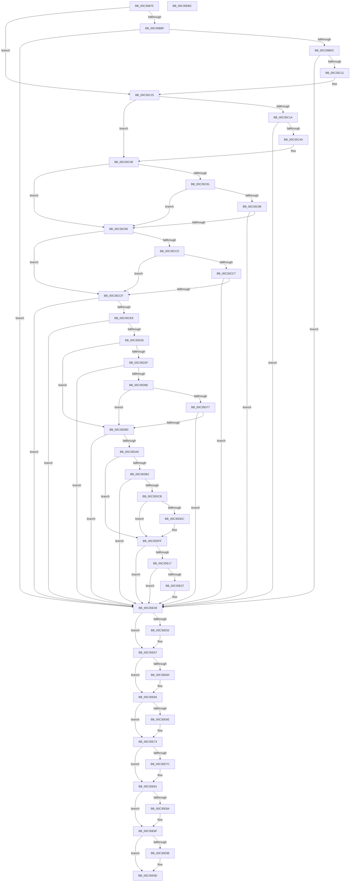

# PipCommitPendingService

- RVA: `0x00C35B70`–`0x00C35EBD` (길이 `845` bytes)
- VA: `0x0000000140C35B70`
- 실행 섹션: `INIT`
- PDB 이름 있음: `예`; PDB Function 태그: `아니요`
- unwind 정보 RVA: `0x000C9024`
- 디코드: `214`개 명령, `845/845` bytes 표시
- 미해석 바이트: `0` (있으면 어셈블리에 `.byte`로 보존)

> 이 문서는 커널 이미지의 기계어와 PDB 기호를 분석해 생성했습니다. 4번과 5번은 함수 원형과 자료형을 바이너리 사용 방식에서 추정한 C 해석이며 원본 소스 복구 결과는 아닙니다.

## 1. Dependencies

- 직접 호출 지점: **22**; 고유 호출 대상: **8**
- 직접 호출자로 확인된 함수: **0**
- RIP 상대 이미지 참조: **3**

### Outgoing calls
- `0x00C35BCD` → [_PnpCtxGetCachedContextBaseKey](../../page/8E/_PnpCtxGetCachedContextBaseKey_function_008EFB2C.md) (function, `0x008EFB2C`)
- `0x00C35C02` → [PnpCtxRegOpenKey](../../page/8E/PnpCtxRegOpenKey_function_008EF7B8.md) (function, `0x008EF7B8`)
- `0x00C35C3B` → [PnpCtxRegOpenKey](../../page/8E/PnpCtxRegOpenKey_function_008EF7B8.md) (function, `0x008EF7B8`)
- `0x00C35C73` → [PnpCtxRegOpenKey](../../page/8E/PnpCtxRegOpenKey_function_008EF7B8.md) (function, `0x008EF7B8`)
- `0x00C35CB2` → [PnpCtxRegOpenKey](../../page/8E/PnpCtxRegOpenKey_function_008EF7B8.md) (function, `0x008EF7B8`)
- `0x00C35CDF` → [_PnpCtxGetCachedContextBaseKey](../../page/8E/_PnpCtxGetCachedContextBaseKey_function_008EFB2C.md) (function, `0x008EFB2C`)
- `0x00C35D1A` → [PnpCtxRegCreateKey](../../page/A6/PnpCtxRegCreateKey_function_00A692E4.md) (function, `0x00A692E4`)
- `0x00C35D5F` → [PnpCtxRegCreateKey](../../page/A6/PnpCtxRegCreateKey_function_00A692E4.md) (function, `0x00A692E4`)
- `0x00C35D7E` → [PiDevCfgCopyDeviceKeys](../../page/99/PiDevCfgCopyDeviceKeys_function_00995E1C.md) (function, `0x00995E1C`)
- `0x00C35D97` → [PiDevCfgCopyDeviceKeys](../../page/99/PiDevCfgCopyDeviceKeys_function_00995E1C.md) (function, `0x00995E1C`)
- `0x00C35DC0` → [PnpCtxRegDeleteTree](../../page/96/PnpCtxRegDeleteTree_function_00965CC8.md) (function, `0x00965CC8`)
- `0x00C35DE2` → [PnpCtxRegEnumKey](../../page/99/PnpCtxRegEnumKey_function_009929C0.md) (function, `0x009929C0`)
- `0x00C35DFA` → [PnpCtxRegDeleteKey](../../page/96/PnpCtxRegDeleteKey_function_00965EC8.md) (function, `0x00965EC8`)
- `0x00C35E0C` → [PnpCtxRegDeleteTree](../../page/96/PnpCtxRegDeleteTree_function_00965CC8.md) (function, `0x00965CC8`)
- `0x00C35E2D` → [PnpCtxRegEnumKey](../../page/99/PnpCtxRegEnumKey_function_009929C0.md) (function, `0x009929C0`)
- `0x00C35E44` → [PnpCtxRegDeleteKey](../../page/96/PnpCtxRegDeleteKey_function_00965EC8.md) (function, `0x00965EC8`)
- `0x00C35E52` → [PnpCtxRegCloseKey](../../page/A2/PnpCtxRegCloseKey_function_00A22E0C.md) (function, `0x00A22E0C`)
- `0x00C35E60` → [PnpCtxRegCloseKey](../../page/A2/PnpCtxRegCloseKey_function_00A22E0C.md) (function, `0x00A22E0C`)
- `0x00C35E6E` → [PnpCtxRegCloseKey](../../page/A2/PnpCtxRegCloseKey_function_00A22E0C.md) (function, `0x00A22E0C`)
- `0x00C35E7C` → [PnpCtxRegCloseKey](../../page/A2/PnpCtxRegCloseKey_function_00A22E0C.md) (function, `0x00A22E0C`)
- `0x00C35E8A` → [PnpCtxRegCloseKey](../../page/A2/PnpCtxRegCloseKey_function_00A22E0C.md) (function, `0x00A22E0C`)
- `0x00C35E98` → [PnpCtxRegCloseKey](../../page/A2/PnpCtxRegCloseKey_function_00A22E0C.md) (function, `0x00A22E0C`)

### Direct callers
- 이 함수 시작 RVA로 연결되는 직접 call은 확인되지 않았습니다. 간접 호출은 완전히 역산할 수 없습니다.

### Static image references
- `0x00C35BBF` → RVA `0x00E66398` (`.data`; read)
- `0x00C35BEB` → RVA `0x00C7B120` (` ?? ::PBOPGDP::`string'`; read)
- `0x00C35C5E` → RVA `0x00C7B100` (` ?? ::PBOPGDP::`string'`; read)

## 2. Other-region calls and transfers

- 다른 실행 섹션으로 향하는 call: **22**
  - `0x00C35BCD` → [_PnpCtxGetCachedContextBaseKey](../../page/8E/_PnpCtxGetCachedContextBaseKey_function_008EFB2C.md) (`INIT` → `PAGE`)
  - `0x00C35C02` → [PnpCtxRegOpenKey](../../page/8E/PnpCtxRegOpenKey_function_008EF7B8.md) (`INIT` → `PAGE`)
  - `0x00C35C3B` → [PnpCtxRegOpenKey](../../page/8E/PnpCtxRegOpenKey_function_008EF7B8.md) (`INIT` → `PAGE`)
  - `0x00C35C73` → [PnpCtxRegOpenKey](../../page/8E/PnpCtxRegOpenKey_function_008EF7B8.md) (`INIT` → `PAGE`)
  - `0x00C35CB2` → [PnpCtxRegOpenKey](../../page/8E/PnpCtxRegOpenKey_function_008EF7B8.md) (`INIT` → `PAGE`)
  - `0x00C35CDF` → [_PnpCtxGetCachedContextBaseKey](../../page/8E/_PnpCtxGetCachedContextBaseKey_function_008EFB2C.md) (`INIT` → `PAGE`)
  - `0x00C35D1A` → [PnpCtxRegCreateKey](../../page/A6/PnpCtxRegCreateKey_function_00A692E4.md) (`INIT` → `PAGE`)
  - `0x00C35D5F` → [PnpCtxRegCreateKey](../../page/A6/PnpCtxRegCreateKey_function_00A692E4.md) (`INIT` → `PAGE`)
  - `0x00C35D7E` → [PiDevCfgCopyDeviceKeys](../../page/99/PiDevCfgCopyDeviceKeys_function_00995E1C.md) (`INIT` → `PAGE`)
  - `0x00C35D97` → [PiDevCfgCopyDeviceKeys](../../page/99/PiDevCfgCopyDeviceKeys_function_00995E1C.md) (`INIT` → `PAGE`)
  - `0x00C35DC0` → [PnpCtxRegDeleteTree](../../page/96/PnpCtxRegDeleteTree_function_00965CC8.md) (`INIT` → `PAGE`)
  - `0x00C35DE2` → [PnpCtxRegEnumKey](../../page/99/PnpCtxRegEnumKey_function_009929C0.md) (`INIT` → `PAGE`)
  - `0x00C35DFA` → [PnpCtxRegDeleteKey](../../page/96/PnpCtxRegDeleteKey_function_00965EC8.md) (`INIT` → `PAGE`)
  - `0x00C35E0C` → [PnpCtxRegDeleteTree](../../page/96/PnpCtxRegDeleteTree_function_00965CC8.md) (`INIT` → `PAGE`)
  - `0x00C35E2D` → [PnpCtxRegEnumKey](../../page/99/PnpCtxRegEnumKey_function_009929C0.md) (`INIT` → `PAGE`)
  - `0x00C35E44` → [PnpCtxRegDeleteKey](../../page/96/PnpCtxRegDeleteKey_function_00965EC8.md) (`INIT` → `PAGE`)
  - `0x00C35E52` → [PnpCtxRegCloseKey](../../page/A2/PnpCtxRegCloseKey_function_00A22E0C.md) (`INIT` → `PAGE`)
  - `0x00C35E60` → [PnpCtxRegCloseKey](../../page/A2/PnpCtxRegCloseKey_function_00A22E0C.md) (`INIT` → `PAGE`)
  - `0x00C35E6E` → [PnpCtxRegCloseKey](../../page/A2/PnpCtxRegCloseKey_function_00A22E0C.md) (`INIT` → `PAGE`)
  - `0x00C35E7C` → [PnpCtxRegCloseKey](../../page/A2/PnpCtxRegCloseKey_function_00A22E0C.md) (`INIT` → `PAGE`)
  - `0x00C35E8A` → [PnpCtxRegCloseKey](../../page/A2/PnpCtxRegCloseKey_function_00A22E0C.md) (`INIT` → `PAGE`)
  - `0x00C35E98` → [PnpCtxRegCloseKey](../../page/A2/PnpCtxRegCloseKey_function_00A22E0C.md) (`INIT` → `PAGE`)
- 별도 외부 분기/꼬리 이동을 확인하지 못했습니다.

## 3. Assembly (complete function range)

```asm
00C35B70  48 89 5C 24 08                  mov qword ptr [rsp + 8], rbx
00C35B75  48 89 74 24 18                  mov qword ptr [rsp + 0x18], rsi
00C35B7A  48 89 7C 24 20                  mov qword ptr [rsp + 0x20], rdi
00C35B7F  55                              push rbp
00C35B80  41 56                           push r14
00C35B82  41 57                           push r15
00C35B84  48 8B EC                        mov rbp, rsp
00C35B87  48 81 EC 80 00 00 00            sub rsp, 0x80
00C35B8E  45 33 FF                        xor r15d, r15d
00C35B91  4D 8B F0                        mov r14, r8
00C35B94  4C 89 7D F0                     mov qword ptr [rbp - 0x10], r15
00C35B98  48 8B FA                        mov rdi, rdx
00C35B9B  4C 89 7D D8                     mov qword ptr [rbp - 0x28], r15
00C35B9F  48 8B F1                        mov rsi, rcx
00C35BA2  4C 89 7D D0                     mov qword ptr [rbp - 0x30], r15
00C35BA6  4C 89 7D 28                     mov qword ptr [rbp + 0x28], r15
00C35BAA  4C 89 7D C0                     mov qword ptr [rbp - 0x40], r15
00C35BAE  4C 89 7D C8                     mov qword ptr [rbp - 0x38], r15
00C35BB2  4C 89 7D E0                     mov qword ptr [rbp - 0x20], r15
00C35BB6  4C 89 7D E8                     mov qword ptr [rbp - 0x18], r15
00C35BBA  48 85 D2                        test rdx, rdx
00C35BBD  75 56                           jne 0x140c35c15
00C35BBF  48 8B 0D D2 07 23 00            mov rcx, qword ptr [rip + 0x2307d2]
00C35BC6  4C 8D 45 F0                     lea r8, [rbp - 0x10]
00C35BCA  8D 57 04                        lea edx, [rdi + 4]
00C35BCD  E8 5A 9F CB FF                  call 0x1408efb2c
00C35BD2  8B D8                           mov ebx, eax
00C35BD4  85 C0                           test eax, eax
00C35BD6  0F 88 6D 02 00 00               js 0x140c35e49
00C35BDC  48 8B 55 F0                     mov rdx, qword ptr [rbp - 0x10]
00C35BE0  48 8D 45 E0                     lea rax, [rbp - 0x20]
00C35BE4  48 8B 0D AD 07 23 00            mov rcx, qword ptr [rip + 0x2307ad]
00C35BEB  4C 8D 05 2E 55 04 00            lea r8, [rip + 0x4552e]
00C35BF2  48 89 44 24 28                  mov qword ptr [rsp + 0x28], rax
00C35BF7  45 33 C9                        xor r9d, r9d
00C35BFA  C7 44 24 20 1F 00 02 00         mov dword ptr [rsp + 0x20], 0x2001f
00C35C02  E8 B1 9B CB FF                  call 0x1408ef7b8
00C35C07  8B D8                           mov ebx, eax
00C35C09  85 C0                           test eax, eax
00C35C0B  0F 88 38 02 00 00               js 0x140c35e49
00C35C11  48 8B 7D E0                     mov rdi, qword ptr [rbp - 0x20]
00C35C15  4D 85 F6                        test r14, r14
00C35C18  75 34                           jne 0x140c35c4e
00C35C1A  48 8B 0D 77 07 23 00            mov rcx, qword ptr [rip + 0x230777]
00C35C21  48 8D 45 E8                     lea rax, [rbp - 0x18]
00C35C25  48 89 44 24 28                  mov qword ptr [rsp + 0x28], rax
00C35C2A  45 33 C9                        xor r9d, r9d
00C35C2D  4C 8B C6                        mov r8, rsi
00C35C30  C7 44 24 20 19 00 02 00         mov dword ptr [rsp + 0x20], 0x20019
00C35C38  48 8B D7                        mov rdx, rdi
00C35C3B  E8 78 9B CB FF                  call 0x1408ef7b8
00C35C40  8B D8                           mov ebx, eax
00C35C42  85 C0                           test eax, eax
00C35C44  0F 88 FF 01 00 00               js 0x140c35e49
00C35C4A  4C 8B 75 E8                     mov r14, qword ptr [rbp - 0x18]
00C35C4E  48 8B 0D 43 07 23 00            mov rcx, qword ptr [rip + 0x230743]
00C35C55  48 8D 45 C0                     lea rax, [rbp - 0x40]
00C35C59  48 89 44 24 28                  mov qword ptr [rsp + 0x28], rax
00C35C5E  4C 8D 05 9B 54 04 00            lea r8, [rip + 0x4549b]
00C35C65  45 33 C9                        xor r9d, r9d
00C35C68  C7 44 24 20 1F 00 02 00         mov dword ptr [rsp + 0x20], 0x2001f
00C35C70  48 8B D7                        mov rdx, rdi
00C35C73  E8 40 9B CB FF                  call 0x1408ef7b8
00C35C78  8B D8                           mov ebx, eax
00C35C7A  3D 34 00 00 C0                  cmp eax, 0xc0000034
00C35C7F  74 0F                           je 0x140c35c90
00C35C81  3D 7C 01 00 C0                  cmp eax, 0xc000017c
00C35C86  74 08                           je 0x140c35c90
00C35C88  85 C0                           test eax, eax
00C35C8A  0F 88 B9 01 00 00               js 0x140c35e49
00C35C90  48 8B 55 C0                     mov rdx, qword ptr [rbp - 0x40]
00C35C94  48 8D 45 C8                     lea rax, [rbp - 0x38]
00C35C98  48 8B 0D F9 06 23 00            mov rcx, qword ptr [rip + 0x2306f9]
00C35C9F  45 33 C9                        xor r9d, r9d
00C35CA2  48 89 44 24 28                  mov qword ptr [rsp + 0x28], rax
00C35CA7  4C 8B C6                        mov r8, rsi
00C35CAA  C7 44 24 20 19 00 02 00         mov dword ptr [rsp + 0x20], 0x20019
00C35CB2  E8 01 9B CB FF                  call 0x1408ef7b8
00C35CB7  8B D8                           mov ebx, eax
00C35CB9  3D 34 00 00 C0                  cmp eax, 0xc0000034
00C35CBE  74 0F                           je 0x140c35ccf
00C35CC0  3D 7C 01 00 C0                  cmp eax, 0xc000017c
00C35CC5  74 08                           je 0x140c35ccf
00C35CC7  85 C0                           test eax, eax
00C35CC9  0F 88 7A 01 00 00               js 0x140c35e49
00C35CCF  48 8B 0D C2 06 23 00            mov rcx, qword ptr [rip + 0x2306c2]
00C35CD6  4C 8D 45 28                     lea r8, [rbp + 0x28]
00C35CDA  BA 06 00 00 00                  mov edx, 6
00C35CDF  E8 48 9E CB FF                  call 0x1408efb2c
00C35CE4  8B D8                           mov ebx, eax
00C35CE6  85 C0                           test eax, eax
00C35CE8  0F 88 5B 01 00 00               js 0x140c35e49
00C35CEE  48 8B 55 28                     mov rdx, qword ptr [rbp + 0x28]
00C35CF2  48 8D 45 D0                     lea rax, [rbp - 0x30]
00C35CF6  48 8B 0D 9B 06 23 00            mov rcx, qword ptr [rip + 0x23069b]
00C35CFD  45 33 C9                        xor r9d, r9d
00C35D00  4C 89 7C 24 38                  mov qword ptr [rsp + 0x38], r15
00C35D05  4C 8B C6                        mov r8, rsi
00C35D08  48 89 44 24 30                  mov qword ptr [rsp + 0x30], rax
00C35D0D  4C 89 7C 24 28                  mov qword ptr [rsp + 0x28], r15
00C35D12  C7 44 24 20 06 00 02 00         mov dword ptr [rsp + 0x20], 0x20006
00C35D1A  E8 C5 35 E3 FF                  call 0x140a692e4
00C35D1F  8B D8                           mov ebx, eax
00C35D21  85 C0                           test eax, eax
00C35D23  0F 88 20 01 00 00               js 0x140c35e49
00C35D29  4C 39 7D C8                     cmp qword ptr [rbp - 0x38], r15
00C35D2D  74 5E                           je 0x140c35d8d
00C35D2F  48 8B 55 28                     mov rdx, qword ptr [rbp + 0x28]
00C35D33  48 8D 45 D8                     lea rax, [rbp - 0x28]
00C35D37  48 8B 0D 5A 06 23 00            mov rcx, qword ptr [rip + 0x23065a]
00C35D3E  4C 8D 05 BB 53 04 00            lea r8, [rip + 0x453bb]
00C35D45  4C 89 7C 24 38                  mov qword ptr [rsp + 0x38], r15
00C35D4A  45 33 C9                        xor r9d, r9d
00C35D4D  48 89 44 24 30                  mov qword ptr [rsp + 0x30], rax
00C35D52  4C 89 7C 24 28                  mov qword ptr [rsp + 0x28], r15
00C35D57  C7 44 24 20 06 00 02 00         mov dword ptr [rsp + 0x20], 0x20006
00C35D5F  E8 80 35 E3 FF                  call 0x140a692e4
00C35D64  8B D8                           mov ebx, eax
00C35D66  85 C0                           test eax, eax
00C35D68  0F 88 DB 00 00 00               js 0x140c35e49
00C35D6E  48 8B 4D C8                     mov rcx, qword ptr [rbp - 0x38]
00C35D72  48 85 C9                        test rcx, rcx
00C35D75  74 16                           je 0x140c35d8d
00C35D77  48 8B 55 D8                     mov rdx, qword ptr [rbp - 0x28]
00C35D7B  45 33 C9                        xor r9d, r9d
00C35D7E  E8 99 00 D6 FF                  call 0x140995e1c
00C35D83  8B D8                           mov ebx, eax
00C35D85  85 C0                           test eax, eax
00C35D87  0F 88 BC 00 00 00               js 0x140c35e49
00C35D8D  48 8B 55 D0                     mov rdx, qword ptr [rbp - 0x30]
00C35D91  45 33 C9                        xor r9d, r9d
00C35D94  49 8B CE                        mov rcx, r14
00C35D97  E8 80 00 D6 FF                  call 0x140995e1c
00C35D9C  8B D8                           mov ebx, eax
00C35D9E  85 C0                           test eax, eax
00C35DA0  0F 88 A3 00 00 00               js 0x140c35e49
00C35DA6  41 BE 1A 00 00 80               mov r14d, 0x8000001a
00C35DAC  4C 39 7D C8                     cmp qword ptr [rbp - 0x38], r15
00C35DB0  74 4D                           je 0x140c35dff
00C35DB2  48 8B 55 C0                     mov rdx, qword ptr [rbp - 0x40]
00C35DB6  4C 8B C6                        mov r8, rsi
00C35DB9  48 8B 0D D8 05 23 00            mov rcx, qword ptr [rip + 0x2305d8]
00C35DC0  E8 03 FF D2 FF                  call 0x140965cc8
00C35DC5  8B D8                           mov ebx, eax
00C35DC7  85 C0                           test eax, eax
00C35DC9  78 7E                           js 0x140c35e49
00C35DCB  48 8B 55 C0                     mov rdx, qword ptr [rbp - 0x40]
00C35DCF  48 8D 45 28                     lea rax, [rbp + 0x28]
00C35DD3  45 33 C9                        xor r9d, r9d
00C35DD6  48 89 44 24 20                  mov qword ptr [rsp + 0x20], rax
00C35DDB  45 33 C0                        xor r8d, r8d
00C35DDE  44 89 7D 28                     mov dword ptr [rbp + 0x28], r15d
00C35DE2  E8 D9 CB D5 FF                  call 0x1409929c0
00C35DE7  41 3B C6                        cmp eax, r14d
00C35DEA  75 13                           jne 0x140c35dff
00C35DEC  48 8B 55 C0                     mov rdx, qword ptr [rbp - 0x40]
00C35DF0  45 33 C0                        xor r8d, r8d
00C35DF3  48 8B 0D 9E 05 23 00            mov rcx, qword ptr [rip + 0x23059e]
00C35DFA  E8 C9 00 D3 FF                  call 0x140965ec8
00C35DFF  48 8B 0D 92 05 23 00            mov rcx, qword ptr [rip + 0x230592]
00C35E06  4C 8B C6                        mov r8, rsi
00C35E09  48 8B D7                        mov rdx, rdi
00C35E0C  E8 B7 FE D2 FF                  call 0x140965cc8
00C35E11  8B D8                           mov ebx, eax
00C35E13  85 C0                           test eax, eax
00C35E15  78 32                           js 0x140c35e49
00C35E17  48 8D 45 28                     lea rax, [rbp + 0x28]
00C35E1B  44 89 7D 28                     mov dword ptr [rbp + 0x28], r15d
00C35E1F  45 33 C9                        xor r9d, r9d
00C35E22  48 89 44 24 20                  mov qword ptr [rsp + 0x20], rax
00C35E27  45 33 C0                        xor r8d, r8d
00C35E2A  48 8B D7                        mov rdx, rdi
00C35E2D  E8 8E CB D5 FF                  call 0x1409929c0
00C35E32  41 3B C6                        cmp eax, r14d
00C35E35  75 12                           jne 0x140c35e49
00C35E37  48 8B 0D 5A 05 23 00            mov rcx, qword ptr [rip + 0x23055a]
00C35E3E  45 33 C0                        xor r8d, r8d
00C35E41  48 8B D7                        mov rdx, rdi
00C35E44  E8 7F 00 D3 FF                  call 0x140965ec8
00C35E49  48 8B 55 D0                     mov rdx, qword ptr [rbp - 0x30]
00C35E4D  48 85 D2                        test rdx, rdx
00C35E50  74 05                           je 0x140c35e57
00C35E52  E8 B5 CF DE FF                  call 0x140a22e0c
00C35E57  48 8B 55 D8                     mov rdx, qword ptr [rbp - 0x28]
00C35E5B  48 85 D2                        test rdx, rdx
00C35E5E  74 05                           je 0x140c35e65
00C35E60  E8 A7 CF DE FF                  call 0x140a22e0c
00C35E65  48 8B 55 C0                     mov rdx, qword ptr [rbp - 0x40]
00C35E69  48 85 D2                        test rdx, rdx
00C35E6C  74 05                           je 0x140c35e73
00C35E6E  E8 99 CF DE FF                  call 0x140a22e0c
00C35E73  48 8B 55 C8                     mov rdx, qword ptr [rbp - 0x38]
00C35E77  48 85 D2                        test rdx, rdx
00C35E7A  74 05                           je 0x140c35e81
00C35E7C  E8 8B CF DE FF                  call 0x140a22e0c
00C35E81  48 8B 55 E0                     mov rdx, qword ptr [rbp - 0x20]
00C35E85  48 85 D2                        test rdx, rdx
00C35E88  74 05                           je 0x140c35e8f
00C35E8A  E8 7D CF DE FF                  call 0x140a22e0c
00C35E8F  48 8B 55 E8                     mov rdx, qword ptr [rbp - 0x18]
00C35E93  48 85 D2                        test rdx, rdx
00C35E96  74 05                           je 0x140c35e9d
00C35E98  E8 6F CF DE FF                  call 0x140a22e0c
00C35E9D  4C 8D 9C 24 80 00 00 00         lea r11, [rsp + 0x80]
00C35EA5  8B C3                           mov eax, ebx
00C35EA7  49 8B 5B 20                     mov rbx, qword ptr [r11 + 0x20]
00C35EAB  49 8B 73 30                     mov rsi, qword ptr [r11 + 0x30]
00C35EAF  49 8B 7B 38                     mov rdi, qword ptr [r11 + 0x38]
00C35EB3  49 8B E3                        mov rsp, r11
00C35EB6  41 5F                           pop r15
00C35EB8  41 5E                           pop r14
00C35EBA  5D                              pop rbp
00C35EBB  C3                              ret
00C35EBC  CC                              int3
```

## 4. C-style interpretation (structured pseudocode)

```c
__int64 __fastcall PipCommitPendingService(__int64 a1, __int64 a2, __int64 a3, int a4)
{
    __int64 result;
    __int64 v_r15;
    __int64 v_rsp;
    unsigned __int64 v_stack_m18;
    unsigned __int64 v_stack_m28;
    unsigned __int64 v_stack_m30;
    unsigned __int64 v_stack_m38;
    unsigned __int64 v_stack_m40;
    unsigned __int64 v_stack_m48;
    unsigned __int64 v_stack_m50;
    unsigned __int64 v_stack_m58;
    unsigned __int64 v_stack_m60;
    unsigned __int64 v_stack_m68;
    unsigned __int64 v_stack_m70;
    unsigned int v_stack_m78;
    unsigned __int64 v_stack_p10;
    unsigned __int64 v_stack_p18;
    unsigned __int64 v_stack_p20;
    unsigned __int64 v_stack_p8;

    v_stack_p8 = v_rbx;
    v_stack_p18 = v_rsi;
    v_stack_p20 = v_rdi;
    v_rsp = (v_rsp) - (128);
    v_r15 = 0;
    v_stack_m28 = 0;
    v_stack_m40 = 0;
    v_stack_m48 = 0;
    v_stack_p10 = 0;
    v_stack_m58 = 0;
    v_stack_m50 = 0;
    v_stack_m38 = 0;
    v_stack_m30 = 0;
    if (a2 != 0) goto loc_00C35C15;
    result = _PnpCtxGetCachedContextBaseKey(*(unsigned __int64 *)(v_rip + 2295762), a2 + 4, v_stack_m28, a4);
    if (sign_flag) goto loc_00C35E49;
    v_stack_m70 = v_stack_m38;
    a4 = 0;
    v_stack_m78 = 0x2001FULL;
    result = PnpCtxRegOpenKey(*(unsigned __int64 *)(v_rip + 2295725), v_stack_m28, v_rip + 283950, a4);
    if (sign_flag) goto loc_00C35E49;
loc_00C35C15:
    if (a3 != 0) goto loc_00C35C4E;
    v_stack_m70 = v_stack_m30;
    a4 = 0;
    v_stack_m78 = 0x20019ULL;
    result = PnpCtxRegOpenKey(*(unsigned __int64 *)(v_rip + 2295671), v_stack_m38, a1, a4);
    if (sign_flag) goto loc_00C35E49;
loc_00C35C4E:
    v_stack_m70 = v_stack_m58;
    a4 = 0;
    v_stack_m78 = 0x2001FULL;
    result = PnpCtxRegOpenKey(*(unsigned __int64 *)(v_rip + 2295619), v_stack_m38, v_rip + 283803, a4);
    if (((unsigned int)(result)) == 0xC0000034ULL) goto loc_00C35C90;
    if (((unsigned int)(result)) == 0xC000017CULL) goto loc_00C35C90;
    if (sign_flag) goto loc_00C35E49;
loc_00C35C90:
    a4 = 0;
    v_stack_m70 = v_stack_m50;
    v_stack_m78 = 0x20019ULL;
    result = PnpCtxRegOpenKey(*(unsigned __int64 *)(v_rip + 2295545), v_stack_m58, a1, a4);
    if (((unsigned int)(result)) == 0xC0000034ULL) goto loc_00C35CCF;
    if (((unsigned int)(result)) == 0xC000017CULL) goto loc_00C35CCF;
    if (sign_flag) goto loc_00C35E49;
loc_00C35CCF:
    result = _PnpCtxGetCachedContextBaseKey(*(unsigned __int64 *)(v_rip + 2295490), 6, v_stack_p10, a4);
    if (sign_flag) goto loc_00C35E49;
    a4 = 0;
    v_stack_m60 = 0;
    v_stack_m68 = v_stack_m48;
    v_stack_m70 = 0;
    v_stack_m78 = 0x20006ULL;
    result = PnpCtxRegCreateKey(*(unsigned __int64 *)(v_rip + 2295451), v_stack_p10, a1, a4);
    if (sign_flag) goto loc_00C35E49;
    if (v_stack_m50 == 0) goto loc_00C35D8D;
    v_stack_m60 = 0;
    a4 = 0;
    v_stack_m68 = v_stack_m40;
    v_stack_m70 = 0;
    v_stack_m78 = 0x20006ULL;
    result = PnpCtxRegCreateKey(*(unsigned __int64 *)(v_rip + 2295386), v_stack_p10, v_rip + 283579, a4);
    if (sign_flag) goto loc_00C35E49;
    if (v_stack_m50 == 0) goto loc_00C35D8D;
    a4 = 0;
    result = PiDevCfgCopyDeviceKeys(v_stack_m50, v_stack_m40, v_rip + 283579, a4);
    if (sign_flag) goto loc_00C35E49;
loc_00C35D8D:
    a4 = 0;
    result = PiDevCfgCopyDeviceKeys(v_stack_m30, v_stack_m48, v_rip + 283579, a4);
    if (sign_flag) goto loc_00C35E49;
    if (v_stack_m50 == 0) goto loc_00C35DFF;
    result = PnpCtxRegDeleteTree(*(unsigned __int64 *)(v_rip + 2295256), v_stack_m58, a1, a4);
    if (sign_flag) goto loc_00C35E49;
    a4 = 0;
    v_stack_m78 = v_stack_p10;
    a3 = 0;
    v_stack_p10 = 0;
    result = PnpCtxRegEnumKey(*(unsigned __int64 *)(v_rip + 2295256), v_stack_m58, a3, a4);
    if (((unsigned int)(result)) == ((unsigned int)((unsigned int)(0x8000001AULL)))) {
        a2 = v_stack_m58;
        a3 = 0;
        a1 = *(unsigned __int64 *)(v_rip + 2295198);
        result = PnpCtxRegDeleteKey(a1, a2, a3, a4);
    }
    result = PnpCtxRegDeleteTree(*(unsigned __int64 *)(v_rip + 2295186), v_stack_m38, a1, a4);
    if (sign_flag) goto loc_00C35E49;
    v_stack_p10 = 0;
    a4 = 0;
    v_stack_m78 = v_stack_p10;
    a3 = 0;
    result = PnpCtxRegEnumKey(*(unsigned __int64 *)(v_rip + 2295186), v_stack_m38, a3, a4);
    if (((unsigned int)(result)) == ((unsigned int)((unsigned int)(0x8000001AULL)))) {
        a1 = *(unsigned __int64 *)(v_rip + 2295130);
        a3 = 0;
        a2 = v_stack_m38;
        result = PnpCtxRegDeleteKey(a1, a2, a3, a4);
    }
    if (v_stack_m48 != 0) {
        result = PnpCtxRegCloseKey(a1, v_stack_m48, a3, a4);
    }
    if (v_stack_m40 != 0) {
        result = PnpCtxRegCloseKey(a1, v_stack_m40, a3, a4);
    }
    if (v_stack_m58 != 0) {
        result = PnpCtxRegCloseKey(a1, v_stack_m58, a3, a4);
    }
    if (v_stack_m50 != 0) {
        result = PnpCtxRegCloseKey(a1, v_stack_m50, a3, a4);
    }
    if (v_stack_m38 != 0) {
        result = PnpCtxRegCloseKey(a1, v_stack_m38, a3, a4);
    }
    if (v_stack_m30 != 0) {
        result = PnpCtxRegCloseKey(a1, v_stack_m30, a3, a4);
    }
    return (unsigned int)((unsigned int)((unsigned int)((unsigned int)(result))));
}
```

## 5. (Beta) C Style

```c
int64_t PipCommitPendingService(int64_t Arg1, void *Arg2, int64_t Arg3, int32_t Arg4)
{
    uint8_t *arg2 = (uint8_t *)Arg2;

    int64_t result;
    int64_t local_r15;
    int64_t local_rsp;
    uint64_t v_stack_m18;
    uint64_t v_stack_m28;
    uint64_t v_stack_m30;
    uint64_t v_stack_m38;
    uint64_t v_stack_m40;
    uint64_t v_stack_m48;
    uint64_t v_stack_m50;
    uint64_t v_stack_m58;
    uint64_t v_stack_m60;
    uint64_t v_stack_m68;
    uint64_t v_stack_m70;
    uint32_t v_stack_m78;
    uint64_t v_stack_p10;
    uint64_t v_stack_p18;
    uint64_t v_stack_p20;
    uint64_t v_stack_p8;

    v_stack_p8 = local_rbx;
    v_stack_p18 = local_rsi;
    v_stack_p20 = local_rdi;
    local_rsp = (local_rsp) - (128);
    local_r15 = 0;
    v_stack_m28 = 0;
    v_stack_m40 = 0;
    v_stack_m48 = 0;
    v_stack_p10 = 0;
    v_stack_m58 = 0;
    v_stack_m50 = 0;
    v_stack_m38 = 0;
    v_stack_m30 = 0;
    if (Arg2 != NULL) goto loc_00C35C15;
    result = _PnpCtxGetCachedContextBaseKey(*(uint64_t *)(v_rip + 0x2307D2), Arg2 + 4, v_stack_m28, Arg4);
    if (sign_flag) goto loc_00C35E49;
    v_stack_m70 = v_stack_m38;
    Arg4 = 0;
    v_stack_m78 = 0x2001FULL;
    result = PnpCtxRegOpenKey(*(uint64_t *)(v_rip + 0x2307AD), v_stack_m28, v_rip + 283950, Arg4);
    if (sign_flag) goto loc_00C35E49;
loc_00C35C15:
    if (Arg3 != 0) goto loc_00C35C4E;
    v_stack_m70 = v_stack_m30;
    Arg4 = 0;
    v_stack_m78 = 0x20019ULL;
    result = PnpCtxRegOpenKey(*(uint64_t *)(v_rip + 0x230777), v_stack_m38, Arg1, Arg4);
    if (sign_flag) goto loc_00C35E49;
loc_00C35C4E:
    v_stack_m70 = v_stack_m58;
    Arg4 = 0;
    v_stack_m78 = 0x2001FULL;
    result = PnpCtxRegOpenKey(*(uint64_t *)(v_rip + 0x230743), v_stack_m38, v_rip + 283803, Arg4);
    if (((uint32_t)(result)) == 0xC0000034ULL) goto loc_00C35C90;
    if (((uint32_t)(result)) == 0xC000017CULL) goto loc_00C35C90;
    if (sign_flag) goto loc_00C35E49;
loc_00C35C90:
    Arg4 = 0;
    v_stack_m70 = v_stack_m50;
    v_stack_m78 = 0x20019ULL;
    result = PnpCtxRegOpenKey(*(uint64_t *)(v_rip + 0x2306F9), v_stack_m58, Arg1, Arg4);
    if (((uint32_t)(result)) == 0xC0000034ULL) goto loc_00C35CCF;
    if (((uint32_t)(result)) == 0xC000017CULL) goto loc_00C35CCF;
    if (sign_flag) goto loc_00C35E49;
loc_00C35CCF:
    result = _PnpCtxGetCachedContextBaseKey(*(uint64_t *)(v_rip + 0x2306C2), 6, v_stack_p10, Arg4);
    if (sign_flag) goto loc_00C35E49;
    Arg4 = 0;
    v_stack_m60 = 0;
    v_stack_m68 = v_stack_m48;
    v_stack_m70 = 0;
    v_stack_m78 = 0x20006ULL;
    result = PnpCtxRegCreateKey(*(uint64_t *)(v_rip + 0x23069B), v_stack_p10, Arg1, Arg4);
    if (sign_flag) goto loc_00C35E49;
    if (v_stack_m50 == 0) goto loc_00C35D8D;
    v_stack_m60 = 0;
    Arg4 = 0;
    v_stack_m68 = v_stack_m40;
    v_stack_m70 = 0;
    v_stack_m78 = 0x20006ULL;
    result = PnpCtxRegCreateKey(*(uint64_t *)(v_rip + 0x23065A), v_stack_p10, v_rip + 283579, Arg4);
    if (sign_flag) goto loc_00C35E49;
    if (v_stack_m50 == 0) goto loc_00C35D8D;
    Arg4 = 0;
    result = PiDevCfgCopyDeviceKeys(v_stack_m50, v_stack_m40, v_rip + 283579, Arg4);
    if (sign_flag) goto loc_00C35E49;
loc_00C35D8D:
    Arg4 = 0;
    result = PiDevCfgCopyDeviceKeys(v_stack_m30, v_stack_m48, v_rip + 283579, Arg4);
    if (sign_flag) goto loc_00C35E49;
    if (v_stack_m50 == 0) goto loc_00C35DFF;
    result = PnpCtxRegDeleteTree(*(uint64_t *)(v_rip + 0x2305D8), v_stack_m58, Arg1, Arg4);
    if (sign_flag) goto loc_00C35E49;
    Arg4 = 0;
    v_stack_m78 = v_stack_p10;
    Arg3 = 0;
    v_stack_p10 = 0;
    result = PnpCtxRegEnumKey(*(uint64_t *)(v_rip + 0x2305D8), v_stack_m58, Arg3, Arg4);
    if (((uint32_t)(result)) == ((uint32_t)((uint32_t)(0x8000001AULL)))) {
        Arg2 = v_stack_m58;
        Arg3 = 0;
        Arg1 = *(uint64_t *)(v_rip + 0x23059E);
        result = PnpCtxRegDeleteKey(Arg1, Arg2, Arg3, Arg4);
    }
    result = PnpCtxRegDeleteTree(*(uint64_t *)(v_rip + 0x230592), v_stack_m38, Arg1, Arg4);
    if (sign_flag) goto loc_00C35E49;
    v_stack_p10 = 0;
    Arg4 = 0;
    v_stack_m78 = v_stack_p10;
    Arg3 = 0;
    result = PnpCtxRegEnumKey(*(uint64_t *)(v_rip + 0x230592), v_stack_m38, Arg3, Arg4);
    if (((uint32_t)(result)) == ((uint32_t)((uint32_t)(0x8000001AULL)))) {
        Arg1 = *(uint64_t *)(v_rip + 0x23055A);
        Arg3 = 0;
        Arg2 = v_stack_m38;
        result = PnpCtxRegDeleteKey(Arg1, Arg2, Arg3, Arg4);
    }
    if (v_stack_m48 != 0) {
        result = PnpCtxRegCloseKey(Arg1, v_stack_m48, Arg3, Arg4);
    }
    if (v_stack_m40 != 0) {
        result = PnpCtxRegCloseKey(Arg1, v_stack_m40, Arg3, Arg4);
    }
    if (v_stack_m58 != 0) {
        result = PnpCtxRegCloseKey(Arg1, v_stack_m58, Arg3, Arg4);
    }
    if (v_stack_m50 != 0) {
        result = PnpCtxRegCloseKey(Arg1, v_stack_m50, Arg3, Arg4);
    }
    if (v_stack_m38 != 0) {
        result = PnpCtxRegCloseKey(Arg1, v_stack_m38, Arg3, Arg4);
    }
    if (v_stack_m30 != 0) {
        result = PnpCtxRegCloseKey(Arg1, v_stack_m30, Arg3, Arg4);
    }
    return (uint32_t)((uint32_t)((uint32_t)((uint32_t)(result))));
}
```

### 관측된 메모리 오프셋

구조체 형식이 확인되지 않은 접근은 인자 기준의 오프셋으로만 기록했습니다.

| 기준 인자 | 오프셋 표현 | 폭 (bit) | 접근 |
|---|---:|---:|---|
| `Arg2` | `+ 0x4` | `32` | `R` |

## 6. Execution-region graph

[열기: 2D/3D 그래프와 함수 탐색 컨트롤 패널](../../../control-panel.html?section=init&rva=0x00C35B70&view=graph)

- 2D 그래프는 위에서 아래로 흐르고, 3D 그래프는 빈 공간을 드래그해 회전합니다. Shift+드래그는 이동, 휠은 확대·축소, 함수 노드 선택은 대상 보고서 이동입니다.

### Static fallback


