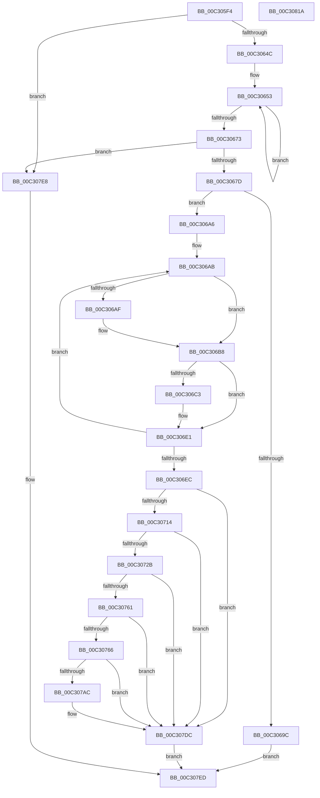

# PipCreateComputerId

- RVA: `0x00C305F4`–`0x00C3081B` (길이 `551` bytes)
- VA: `0x0000000140C305F4`
- 실행 섹션: `INIT`
- PDB 이름 있음: `예`; PDB Function 태그: `아니요`
- unwind 정보 RVA: `0x000C7FE4`
- 디코드: `150`개 명령, `551/551` bytes 표시
- 미해석 바이트: `0` (있으면 어셈블리에 `.byte`로 보존)

> 이 문서는 커널 이미지의 기계어와 PDB 기호를 분석해 생성했습니다. 4번과 5번은 함수 원형과 자료형을 바이너리 사용 방식에서 추정한 C 해석이며 원본 소스 복구 결과는 아닙니다.

## 1. Dependencies

- 직접 호출 지점: **11**; 고유 호출 대상: **9**
- 직접 호출자로 확인된 함수: **1**
- RIP 상대 이미지 참조: **4**

### Outgoing calls
- `0x00C3068F` → [ExAllocatePool2](../../poolcode/B8/ExAllocatePool2_function_00B820F0.md) (function, `0x00B820F0`)
- `0x00C306CD` → [memcpy](../../text/6C/memcpy_function_006C6840.md) (function, `0x006C6840`)
- `0x00C30705` → [RtlGenerateClass5Guid](../../page/AC/RtlGenerateClass5Guid_function_00AC4510.md) (function, `0x00AC4510`)
- `0x00C3071C` → [PnpStringFromGuid](../../page/8F/PnpStringFromGuid_function_008F5A2C.md) (function, `0x008F5A2C`)
- `0x00C30735` → [RtlInitUnicodeString](../../text/42/RtlInitUnicodeString_function_0042A780.md) (function, `0x0042A780`)
- `0x00C30756` → [ZwSetValueKey](../../text/6A/ZwSetValueKey_function_006ADCD0.md) (function, `0x006ADCD0`)
- `0x00C307A1` → [RtlStringCbPrintfExW](../../text/46/RtlStringCbPrintfExW_function_00461AD4.md) (function, `0x00461AD4`)
- `0x00C307B9` → [RtlInitUnicodeString](../../text/42/RtlInitUnicodeString_function_0042A780.md) (function, `0x0042A780`)
- `0x00C307D5` → [ZwSetValueKey](../../text/6A/ZwSetValueKey_function_006ADCD0.md) (function, `0x006ADCD0`)
- `0x00C307E1` → [ExFreePoolWithTag](../../poolcode/B8/ExFreePoolWithTag_function_00B82870.md) (function, `0x00B82870`)
- `0x00C307FA` → [_security_check_cookie](../../text/6A/_security_check_cookie_function_006AC640.md) (function, `0x006AC640`)

### Direct callers
- [PipInitComputerIds](../C7/PipInitComputerIds_function_00C74734.md) at `0x00C74EAC`
- [PipInitComputerIds](../C7/PipInitComputerIds_function_00C74734.md) at `0x00C74F35`
- [PipInitComputerIds](../C7/PipInitComputerIds_function_00C74734.md) at `0x00C74FA9`
- [PipInitComputerIds](../C7/PipInitComputerIds_function_00C74734.md) at `0x00C75094`
- [PipInitComputerIds](../C7/PipInitComputerIds_function_00C74734.md) at `0x00C7510B`
- [PipInitComputerIds](../C7/PipInitComputerIds_function_00C74734.md) at `0x00C7516C`
- [PipInitComputerIds](../C7/PipInitComputerIds_function_00C74734.md) at `0x00C75210`
- [PipInitComputerIds](../C7/PipInitComputerIds_function_00C74734.md) at `0x00C75266`
- [PipInitComputerIds](../C7/PipInitComputerIds_function_00C74734.md) at `0x00C75301`
- [PipInitComputerIds](../C7/PipInitComputerIds_function_00C74734.md) at `0x00C75357`
- [PipInitComputerIds](../C7/PipInitComputerIds_function_00C74734.md) at `0x00C753F9`
- [PipInitComputerIds](../C7/PipInitComputerIds_function_00C74734.md) at `0x00C7544F`
- [PipInitComputerIds](../C7/PipInitComputerIds_function_00C74734.md) at `0x00C754EF`
- [PipInitComputerIds](../C7/PipInitComputerIds_function_00C74734.md) at `0x00C7557F`
- [PipInitComputerIds](../C7/PipInitComputerIds_function_00C74734.md) at `0x00C755C6`

### Static image references
- `0x00C3060B` → RVA `0x00E0A740` (`.data`; read)
- `0x00C306EE` → RVA `0x00027AE0` (`.rdata`; read)
- `0x00C30766` → RVA `0x00C7A850` (` ?? ::PBOPGDP::`string'`; read)
- `0x00C3078D` → RVA `0x00C7A790` (` ?? ::PBOPGDP::`string'`; read)

## 2. Other-region calls and transfers

- 다른 실행 섹션으로 향하는 call: **11**
  - `0x00C3068F` → [ExAllocatePool2](../../poolcode/B8/ExAllocatePool2_function_00B820F0.md) (`INIT` → `POOLCODE`)
  - `0x00C306CD` → [memcpy](../../text/6C/memcpy_function_006C6840.md) (`INIT` → `.text`)
  - `0x00C30705` → [RtlGenerateClass5Guid](../../page/AC/RtlGenerateClass5Guid_function_00AC4510.md) (`INIT` → `PAGE`)
  - `0x00C3071C` → [PnpStringFromGuid](../../page/8F/PnpStringFromGuid_function_008F5A2C.md) (`INIT` → `PAGE`)
  - `0x00C30735` → [RtlInitUnicodeString](../../text/42/RtlInitUnicodeString_function_0042A780.md) (`INIT` → `.text`)
  - `0x00C30756` → [ZwSetValueKey](../../text/6A/ZwSetValueKey_function_006ADCD0.md) (`INIT` → `.text`)
  - `0x00C307A1` → [RtlStringCbPrintfExW](../../text/46/RtlStringCbPrintfExW_function_00461AD4.md) (`INIT` → `.text`)
  - `0x00C307B9` → [RtlInitUnicodeString](../../text/42/RtlInitUnicodeString_function_0042A780.md) (`INIT` → `.text`)
  - `0x00C307D5` → [ZwSetValueKey](../../text/6A/ZwSetValueKey_function_006ADCD0.md) (`INIT` → `.text`)
  - `0x00C307E1` → [ExFreePoolWithTag](../../poolcode/B8/ExFreePoolWithTag_function_00B82870.md) (`INIT` → `POOLCODE`)
  - `0x00C307FA` → [_security_check_cookie](../../text/6A/_security_check_cookie_function_006AC640.md) (`INIT` → `.text`)
- 별도 외부 분기/꼬리 이동을 확인하지 못했습니다.

## 3. Assembly (complete function range)

```asm
00C305F4  48 89 5C 24 20                  mov qword ptr [rsp + 0x20], rbx
00C305F9  55                              push rbp
00C305FA  56                              push rsi
00C305FB  57                              push rdi
00C305FC  41 54                           push r12
00C305FE  41 55                           push r13
00C30600  41 56                           push r14
00C30602  41 57                           push r15
00C30604  48 81 EC 20 01 00 00            sub rsp, 0x120
00C3060B  48 8B 05 2E A1 1D 00            mov rax, qword ptr [rip + 0x1da12e]
00C30612  48 33 C4                        xor rax, rsp
00C30615  48 89 84 24 10 01 00 00         mov qword ptr [rsp + 0x110], rax
00C3061D  4C 8B AC 24 80 01 00 00         mov r13, qword ptr [rsp + 0x180]
00C30625  33 ED                           xor ebp, ebp
00C30627  48 89 4C 24 50                  mov qword ptr [rsp + 0x50], rcx
00C3062C  0F 57 C0                        xorps xmm0, xmm0
00C3062F  4D 8B F0                        mov r14, r8
00C30632  45 8B F9                        mov r15d, r9d
00C30635  4C 8B E2                        mov r12, rdx
00C30638  0F B7 DD                        movzx ebx, bp
00C3063B  44 8B C5                        mov r8d, ebp
00C3063E  0F 11 44 24 40                  movups xmmword ptr [rsp + 0x40], xmm0
00C30643  45 85 C9                        test r9d, r9d
00C30646  0F 84 9C 01 00 00               je 0x140c307e8
00C3064C  49 8B D6                        mov rdx, r14
00C3064F  44 8D 4D 02                     lea r9d, [rbp + 2]
00C30653  48 8B 02                        mov rax, qword ptr [rdx]
00C30656  41 8D 0C 19                     lea ecx, [r9 + rbx]
00C3065A  45 85 C0                        test r8d, r8d
00C3065D  48 8D 52 08                     lea rdx, [rdx + 8]
00C30661  66 0F 44 CB                     cmove cx, bx
00C30665  41 FF C0                        inc r8d
00C30668  0F B7 D9                        movzx ebx, cx
00C3066B  66 03 18                        add bx, word ptr [rax]
00C3066E  45 3B C7                        cmp r8d, r15d
00C30671  72 E0                           jb 0x140c30653
00C30673  66 41 3B D9                     cmp bx, r9w
00C30677  0F 86 6B 01 00 00               jbe 0x140c307e8
00C3067D  66 41 03 D9                     add bx, r9w
00C30681  B9 00 01 00 00                  mov ecx, 0x100
00C30686  0F B7 D3                        movzx edx, bx
00C30689  41 B8 50 70 69 6E               mov r8d, 0x6e697050
00C3068F  E8 5C 1A F5 FF                  call 0x140b820f0
00C30694  48 8B F0                        mov rsi, rax
00C30697  48 85 C0                        test rax, rax
00C3069A  75 0A                           jne 0x140c306a6
00C3069C  BB 9A 00 00 C0                  mov ebx, 0xc000009a
00C306A1  E9 47 01 00 00                  jmp 0x140c307ed
00C306A6  48 8B FE                        mov rdi, rsi
00C306A9  33 C9                           xor ecx, ecx
00C306AB  85 ED                           test ebp, ebp
00C306AD  74 09                           je 0x140c306b8
00C306AF  66 C7 07 26 00                  mov word ptr [rdi], 0x26
00C306B4  48 83 C7 02                     add rdi, 2
00C306B8  49 8B 16                        mov rdx, qword ptr [r14]
00C306BB  0F B7 02                        movzx eax, word ptr [rdx]
00C306BE  66 85 C0                        test ax, ax
00C306C1  74 1E                           je 0x140c306e1
00C306C3  48 8B 52 08                     mov rdx, qword ptr [rdx + 8]
00C306C7  44 8B C0                        mov r8d, eax
00C306CA  48 8B CF                        mov rcx, rdi
00C306CD  E8 6E 61 A9 FF                  call 0x1406c6840
00C306D2  49 8B 06                        mov rax, qword ptr [r14]
00C306D5  0F B7 08                        movzx ecx, word ptr [rax]
00C306D8  48 D1 E9                        shr rcx, 1
00C306DB  48 8D 3C 4F                     lea rdi, [rdi + rcx*2]
00C306DF  33 C9                           xor ecx, ecx
00C306E1  FF C5                           inc ebp
00C306E3  49 83 C6 08                     add r14, 8
00C306E7  41 3B EF                        cmp ebp, r15d
00C306EA  72 BF                           jb 0x140c306ab
00C306EC  33 ED                           xor ebp, ebp
00C306EE  48 8D 0D EB 73 3F FF            lea rcx, [rip - 0xc08c15]
00C306F5  66 89 2F                        mov word ptr [rdi], bp
00C306F8  4D 8B CD                        mov r9, r13
00C306FB  0F B7 FB                        movzx edi, bx
00C306FE  48 8B D6                        mov rdx, rsi
00C30701  44 8D 47 FE                     lea r8d, [rdi - 2]
00C30705  E8 06 3E E9 FF                  call 0x140ac4510
00C3070A  8B D8                           mov ebx, eax
00C3070C  85 C0                           test eax, eax
00C3070E  0F 88 C8 00 00 00               js 0x140c307dc
00C30714  48 8D 54 24 60                  lea rdx, [rsp + 0x60]
00C30719  49 8B CD                        mov rcx, r13
00C3071C  E8 0B 53 CC FF                  call 0x1408f5a2c
00C30721  8B D8                           mov ebx, eax
00C30723  85 C0                           test eax, eax
00C30725  0F 88 B1 00 00 00               js 0x140c307dc
00C3072B  48 8D 54 24 60                  lea rdx, [rsp + 0x60]
00C30730  48 8D 4C 24 40                  lea rcx, [rsp + 0x40]
00C30735  E8 46 A0 7F FF                  call 0x14042a780
00C3073A  48 8B 4C 24 50                  mov rcx, qword ptr [rsp + 0x50]
00C3073F  48 8D 54 24 40                  lea rdx, [rsp + 0x40]
00C30744  89 7C 24 28                     mov dword ptr [rsp + 0x28], edi
00C30748  45 33 C0                        xor r8d, r8d
00C3074B  8D 7D 01                        lea edi, [rbp + 1]
00C3074E  48 89 74 24 20                  mov qword ptr [rsp + 0x20], rsi
00C30753  44 8B CF                        mov r9d, edi
00C30756  E8 75 D5 A7 FF                  call 0x1406adcd0
00C3075B  8B D8                           mov ebx, eax
00C3075D  85 C0                           test eax, eax
00C3075F  78 7B                           js 0x140c307dc
00C30761  4D 85 E4                        test r12, r12
00C30764  74 76                           je 0x140c307dc
00C30766  48 8D 05 E3 A0 04 00            lea rax, [rip + 0x4a0e3]
00C3076D  45 33 C9                        xor r9d, r9d
00C30770  48 89 44 24 38                  mov qword ptr [rsp + 0x38], rax
00C30775  8D 55 5C                        lea edx, [rbp + 0x5c]
00C30778  48 8D 44 24 60                  lea rax, [rsp + 0x60]
00C3077D  45 33 C0                        xor r8d, r8d
00C30780  48 89 44 24 30                  mov qword ptr [rsp + 0x30], rax
00C30785  48 8D 8C 24 B0 00 00 00         lea rcx, [rsp + 0xb0]
00C3078D  48 8D 05 FC 9F 04 00            lea rax, [rip + 0x49ffc]
00C30794  48 89 44 24 28                  mov qword ptr [rsp + 0x28], rax
00C30799  C7 44 24 20 00 08 00 00         mov dword ptr [rsp + 0x20], 0x800
00C307A1  E8 2E 13 83 FF                  call 0x140461ad4
00C307A6  8B D8                           mov ebx, eax
00C307A8  85 C0                           test eax, eax
00C307AA  78 30                           js 0x140c307dc
00C307AC  48 8D 94 24 B0 00 00 00         lea rdx, [rsp + 0xb0]
00C307B4  48 8D 4C 24 40                  lea rcx, [rsp + 0x40]
00C307B9  E8 C2 9F 7F FF                  call 0x14042a780
00C307BE  44 8B CF                        mov r9d, edi
00C307C1  89 6C 24 28                     mov dword ptr [rsp + 0x28], ebp
00C307C5  45 33 C0                        xor r8d, r8d
00C307C8  48 89 6C 24 20                  mov qword ptr [rsp + 0x20], rbp
00C307CD  48 8D 54 24 40                  lea rdx, [rsp + 0x40]
00C307D2  49 8B CC                        mov rcx, r12
00C307D5  E8 F6 D4 A7 FF                  call 0x1406adcd0
00C307DA  8B D8                           mov ebx, eax
00C307DC  33 D2                           xor edx, edx
00C307DE  48 8B CE                        mov rcx, rsi
00C307E1  E8 8A 20 F5 FF                  call 0x140b82870
00C307E6  EB 05                           jmp 0x140c307ed
00C307E8  BB 0D 00 00 C0                  mov ebx, 0xc000000d
00C307ED  8B C3                           mov eax, ebx
00C307EF  48 8B 8C 24 10 01 00 00         mov rcx, qword ptr [rsp + 0x110]
00C307F7  48 33 CC                        xor rcx, rsp
00C307FA  E8 41 BE A7 FF                  call 0x1406ac640
00C307FF  48 8B 9C 24 78 01 00 00         mov rbx, qword ptr [rsp + 0x178]
00C30807  48 81 C4 20 01 00 00            add rsp, 0x120
00C3080E  41 5F                           pop r15
00C30810  41 5E                           pop r14
00C30812  41 5D                           pop r13
00C30814  41 5C                           pop r12
00C30816  5F                              pop rdi
00C30817  5E                              pop rsi
00C30818  5D                              pop rbp
00C30819  C3                              ret
00C3081A  CC                              int3
```

## 4. C-style interpretation (structured pseudocode)

```c
__int64 __fastcall PipCreateComputerId(__int64 a1, __int64 a2, __int64 a3, int a4, __int64 a5)
{
    __int64 result;
    __int64 v_r14;
    __int64 v_rbp;
    __int64 v_rbx;
    __int64 v_rdi;
    __int64 v_rsp;
    unsigned __int64 v_stack_m108;
    unsigned __int64 v_stack_m118;
    unsigned __int64 v_stack_m120;
    unsigned __int64 v_stack_m128;
    unsigned int v_stack_m130;
    unsigned __int64 v_stack_m138;
    unsigned __int64 v_stack_m48;
    unsigned __int64 v_stack_mA8;
    unsigned __int64 v_stack_mF8;
    unsigned __int64 v_stack_p20;

    v_stack_p20 = v_rbx;
    v_rsp = (v_rsp) - (288);
    result = (*(unsigned __int64 *)(v_rip + 1941806)) ^ (v_rsp);
    v_stack_m48 = result;
    v_rbp = 0;
    v_stack_m108 = a1;
    v_stack_m118 = v_xmm0;
    if (a4 == 0) goto loc_00C307E8;
loc_00C30653:
    a1 = v_rbp + 2 + 0 * 1;
    if (0 == 0) { a1 = 0; }
    a3 = (unsigned int)((0) + 1);
    v_rbx = (unsigned __int16)(((unsigned __int16)(a1)) + (*(unsigned __int16 *)(*(unsigned __int64 *)(a3))));
    if (((unsigned int)(a3)) < ((unsigned int)((unsigned int)(a4)))) goto loc_00C30653;
    if (((unsigned __int16)(v_rbx)) <= ((unsigned __int16)(v_rbp + 2))) goto loc_00C307E8;
    v_rbx = (unsigned __int16)((v_rbx) + ((unsigned __int16)(v_rbp + 2)));
    result = ExAllocatePool2(256, (unsigned __int16)(v_rbx), (unsigned int)(0x6E697050ULL), v_rbp + 2);
    if (result != 0) goto loc_00C306A6;
    goto loc_00C307ED;
loc_00C306A6:
    a1 = 0;
loc_00C306AB:
    v_rdi = result;
    if (0 != 0) {
        *(unsigned __int16 *)(result) = 38;
        v_rdi = (result) + (2);
    }
    result = *(unsigned __int16 *)(*(unsigned __int64 *)(a3));
    if ((unsigned __int16)(*(unsigned __int16 *)(*(unsigned __int64 *)(a3))) != 0) {
        a2 = *(unsigned __int64 *)(*(unsigned __int64 *)(a3) + 8);
        a3 = (unsigned int)(*(unsigned __int16 *)(*(unsigned __int64 *)(a3)));
        a1 = v_rdi;
        result = memcpy(a1, a2, a3, v_rbp + 2);
        result = *(unsigned __int64 *)(a3);
        a1 = *(unsigned __int16 *)(result);
        a1 = (a1) >> (1);
        v_rdi = v_rdi + a1 * 2;
        a1 = 0;
    }
    v_rbp = (unsigned int)((v_rbp) + 1);
    v_r14 = (a3) + (8);
    if (((unsigned int)(v_rbp)) < ((unsigned int)((unsigned int)(a4)))) goto loc_00C306AB;
    v_rbp = 0;
    *(unsigned __int16 *)(v_rdi) = 0;
    result = RtlGenerateClass5Guid(v_rip - 12618773, result, (unsigned __int16)((unsigned int)(0xC000009AULL)) - 2, a5);
    if (sign_flag) goto loc_00C307DC;
    result = PnpStringFromGuid(a5, v_stack_mF8, (unsigned __int16)((unsigned int)(0xC000009AULL)) - 2, a5);
    if (sign_flag) goto loc_00C307DC;
    result = RtlInitUnicodeString(v_stack_m118, v_stack_mF8, (unsigned __int16)((unsigned int)(0xC000009AULL)) - 2, a5);
    v_stack_m130 = (unsigned int)((unsigned __int16)((unsigned int)(0xC000009AULL)));
    a3 = 0;
    v_stack_m138 = result;
    result = ZwSetValueKey(v_stack_m108, v_stack_m118, a3, (unsigned int)((unsigned int)(v_rbp + 1)));
    if (sign_flag) goto loc_00C307DC;
    if (a2 == 0) goto loc_00C307DC;
    a4 = 0;
    v_stack_m120 = v_rip + 303331;
    a3 = 0;
    v_stack_m128 = v_stack_mF8;
    v_stack_m130 = v_rip + 303100;
    v_stack_m138 = 0x800ULL;
    result = RtlStringCbPrintfExW(v_stack_mA8, v_rbp + 92, a3, a4);
    v_rbx = (unsigned int)((unsigned int)(result));
    if (!(sign_flag)) {
        a2 = v_stack_mA8;
        a1 = v_stack_m118;
        result = RtlInitUnicodeString(a1, a2, a3, a4);
        a4 = (unsigned int)(v_rbp + 1);
        v_stack_m130 = 0;
        a3 = 0;
        v_stack_m138 = 0;
        a2 = v_stack_m118;
        a1 = a2;
        result = ZwSetValueKey(a1, a2, a3, a4);
        v_rbx = (unsigned int)(result);
    }
    a2 = 0;
    result = ExFreePoolWithTag(result, a2, a3, a4);
    goto loc_00C307ED;
loc_00C307E8:
loc_00C307ED:
    a1 = (v_stack_m48) ^ (v_rsp);
    result = _security_check_cookie(a1, a2, a3, a4);
    v_rsp = (v_rsp) + (288);
    return result;
}
```

## 5. (Beta) C Style

```c
int64_t PipCreateComputerId(int64_t Arg1, int64_t Arg2, void *Arg3, int32_t Arg4, int64_t Arg5)
{
    uint8_t *arg3 = (uint8_t *)Arg3;

    int64_t result;
    int64_t local_r14;
    int64_t local_rbp;
    int64_t local_rbx;
    int64_t local_rdi;
    int64_t local_rsp;
    uint64_t v_stack_m108;
    uint64_t v_stack_m118;
    uint64_t v_stack_m120;
    uint64_t v_stack_m128;
    uint32_t v_stack_m130;
    uint64_t v_stack_m138;
    uint64_t v_stack_m48;
    uint64_t v_stack_mA8;
    uint64_t v_stack_mF8;
    uint64_t v_stack_p20;

    v_stack_p20 = local_rbx;
    local_rsp = (local_rsp) - (288);
    result = (*(uint64_t *)(v_rip + 0x1DA12E)) ^ (local_rsp);
    v_stack_m48 = result;
    local_rbp = 0;
    v_stack_m108 = Arg1;
    v_stack_m118 = v_xmm0;
    if (Arg4 == 0) goto loc_00C307E8;
loc_00C30653:
    Arg1 = local_rbp + 2 + 0 * 1;
    if (0 == 0) { Arg1 = 0; }
    Arg3 = (uint32_t)((0) + 1);
    local_rbx = (uint16_t)(((uint16_t)(Arg1)) + (*(uint16_t *)(*(uint64_t *)(arg3))));
    if (((uint32_t)(Arg3)) < ((uint32_t)((uint32_t)(Arg4)))) goto loc_00C30653;
    if (((uint16_t)(local_rbx)) <= ((uint16_t)(local_rbp + 2))) goto loc_00C307E8;
    local_rbx = (uint16_t)((local_rbx) + ((uint16_t)(local_rbp + 2)));
    result = ExAllocatePool2(256, (uint16_t)(local_rbx), (uint32_t)(0x6E697050ULL), local_rbp + 2);
    if (result != 0) goto loc_00C306A6;
    goto loc_00C307ED;
loc_00C306A6:
    Arg1 = 0;
loc_00C306AB:
    local_rdi = result;
    if (0 != 0) {
        *(uint16_t *)(result) = 38;
        local_rdi = (result) + (2);
    }
    result = *(uint16_t *)(*(uint64_t *)(arg3));
    if ((uint16_t)(*(uint16_t *)(*(uint64_t *)(arg3))) != 0) {
        Arg2 = *(uint64_t *)(*(uint64_t *)(arg3) + 0x8);
        Arg3 = (uint32_t)(*(uint16_t *)(*(uint64_t *)(arg3)));
        Arg1 = local_rdi;
        result = memcpy(Arg1, Arg2, Arg3, local_rbp + 2);
        result = *(uint64_t *)(arg3);
        Arg1 = *(uint16_t *)(result);
        Arg1 = (Arg1) >> (1);
        local_rdi = local_rdi + Arg1 * 2;
        Arg1 = 0;
    }
    local_rbp = (uint32_t)((local_rbp) + 1);
    local_r14 = (Arg3) + (8);
    if (((uint32_t)(local_rbp)) < ((uint32_t)((uint32_t)(Arg4)))) goto loc_00C306AB;
    local_rbp = 0;
    *(uint16_t *)(local_rdi) = 0;
    result = RtlGenerateClass5Guid(v_rip - 12618773, result, (uint16_t)((uint32_t)(0xC000009AULL)) - 2, Arg5);
    if (sign_flag) goto loc_00C307DC;
    result = PnpStringFromGuid(Arg5, v_stack_mF8, (uint16_t)((uint32_t)(0xC000009AULL)) - 2, Arg5);
    if (sign_flag) goto loc_00C307DC;
    result = RtlInitUnicodeString(v_stack_m118, v_stack_mF8, (uint16_t)((uint32_t)(0xC000009AULL)) - 2, Arg5);
    v_stack_m130 = (uint32_t)((uint16_t)((uint32_t)(0xC000009AULL)));
    Arg3 = 0;
    v_stack_m138 = result;
    result = ZwSetValueKey(v_stack_m108, v_stack_m118, Arg3, (uint32_t)((uint32_t)(local_rbp + 1)));
    if (sign_flag) goto loc_00C307DC;
    if (Arg2 == 0) goto loc_00C307DC;
    Arg4 = 0;
    v_stack_m120 = v_rip + 303331;
    Arg3 = 0;
    v_stack_m128 = v_stack_mF8;
    v_stack_m130 = v_rip + 303100;
    v_stack_m138 = 0x800ULL;
    result = RtlStringCbPrintfExW(v_stack_mA8, local_rbp + 92, Arg3, Arg4);
    local_rbx = (uint32_t)((uint32_t)(result));
    if (!(sign_flag)) {
        Arg2 = v_stack_mA8;
        Arg1 = v_stack_m118;
        result = RtlInitUnicodeString(Arg1, Arg2, Arg3, Arg4);
        Arg4 = (uint32_t)(local_rbp + 1);
        v_stack_m130 = 0;
        Arg3 = 0;
        v_stack_m138 = 0;
        Arg2 = v_stack_m118;
        Arg1 = Arg2;
        result = ZwSetValueKey(Arg1, Arg2, Arg3, Arg4);
        local_rbx = (uint32_t)(result);
    }
    Arg2 = 0;
    result = ExFreePoolWithTag(result, Arg2, Arg3, Arg4);
    goto loc_00C307ED;
loc_00C307E8:
loc_00C307ED:
    Arg1 = (v_stack_m48) ^ (local_rsp);
    result = _security_check_cookie(Arg1, Arg2, Arg3, Arg4);
    local_rsp = (local_rsp) + (288);
    return result;
}
```

### 관측된 메모리 오프셋

구조체 형식이 확인되지 않은 접근은 인자 기준의 오프셋으로만 기록했습니다.

| 기준 인자 | 오프셋 표현 | 폭 (bit) | 접근 |
|---|---:|---:|---|
| `Arg3` | `+ 0x0` | `64` | `R` |
| `Arg3` | `+ 0x8` | `64` | `R` |

## 6. Execution-region graph

[열기: 2D/3D 그래프와 함수 탐색 컨트롤 패널](../../../control-panel.html?section=init&rva=0x00C305F4&view=graph)

- 2D 그래프는 위에서 아래로 흐르고, 3D 그래프는 빈 공간을 드래그해 회전합니다. Shift+드래그는 이동, 휠은 확대·축소, 함수 노드 선택은 대상 보고서 이동입니다.

### Static fallback


