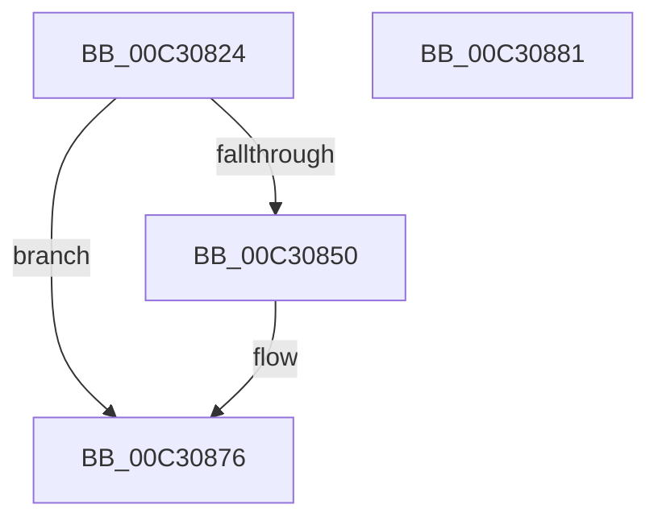

# PipCreateEntry

- RVA: `0x00C30824`–`0x00C30882` (길이 `94` bytes)
- VA: `0x0000000140C30824`
- 실행 섹션: `INIT`
- PDB 이름 있음: `예`; PDB Function 태그: `아니요`
- unwind 정보 RVA: `0x0005CAAC`
- 디코드: `27`개 명령, `94/94` bytes 표시
- 미해석 바이트: `0` (있으면 어셈블리에 `.byte`로 보존)

> 이 문서는 커널 이미지의 기계어와 PDB 기호를 분석해 생성했습니다. 4번과 5번은 함수 원형과 자료형을 바이너리 사용 방식에서 추정한 C 해석이며 원본 소스 복구 결과는 아닙니다.

## 1. Dependencies

- 직접 호출 지점: **2**; 고유 호출 대상: **2**
- 직접 호출자로 확인된 함수: **1**
- RIP 상대 이미지 참조: **0**

### Outgoing calls
- `0x00C30843` → [ExAllocatePool2](../../poolcode/B8/ExAllocatePool2_function_00B820F0.md) (function, `0x00B820F0`)
- `0x00C3086E` → [memcpy](../../text/6C/memcpy_function_006C6840.md) (function, `0x006C6840`)

### Direct callers
- [PipLookupGroupName](PipLookupGroupName_function_00C31578.md) at `0x00C315AA`
- [PipLookupGroupName](PipLookupGroupName_function_00C31578.md) at `0x00C315E9`
- [PipLookupGroupName](PipLookupGroupName_function_00C31578.md) at `0x00C315FA`
- [PipLookupGroupName](PipLookupGroupName_function_00C31578.md) at `0x00C31643`

### Static image references
- 디코드된 RIP-relative 메모리 참조가 없습니다.

## 2. Other-region calls and transfers

- 다른 실행 섹션으로 향하는 call: **2**
  - `0x00C30843` → [ExAllocatePool2](../../poolcode/B8/ExAllocatePool2_function_00B820F0.md) (`INIT` → `POOLCODE`)
  - `0x00C3086E` → [memcpy](../../text/6C/memcpy_function_006C6840.md) (`INIT` → `.text`)
- 별도 외부 분기/꼬리 이동을 확인하지 못했습니다.

## 3. Assembly (complete function range)

```asm
00C30824  48 89 5C 24 08                  mov qword ptr [rsp + 8], rbx
00C30829  57                              push rdi
00C3082A  48 83 EC 20                     sub rsp, 0x20
00C3082E  0F B7 11                        movzx edx, word ptr [rcx]
00C30831  48 8B F9                        mov rdi, rcx
00C30834  48 83 C2 30                     add rdx, 0x30
00C30838  B9 00 01 00 00                  mov ecx, 0x100
00C3083D  41 B8 50 70 69 6E               mov r8d, 0x6e697050
00C30843  E8 A8 18 F5 FF                  call 0x140b820f0
00C30848  48 8B D8                        mov rbx, rax
00C3084B  48 85 C0                        test rax, rax
00C3084E  74 26                           je 0x140c30876
00C30850  0F B7 07                        movzx eax, word ptr [rdi]
00C30853  48 8D 4B 30                     lea rcx, [rbx + 0x30]
00C30857  66 89 43 20                     mov word ptr [rbx + 0x20], ax
00C3085B  0F B7 07                        movzx eax, word ptr [rdi]
00C3085E  66 89 43 22                     mov word ptr [rbx + 0x22], ax
00C30862  48 89 4B 28                     mov qword ptr [rbx + 0x28], rcx
00C30866  44 0F B7 07                     movzx r8d, word ptr [rdi]
00C3086A  48 8B 57 08                     mov rdx, qword ptr [rdi + 8]
00C3086E  E8 CD 5F A9 FF                  call 0x1406c6840
00C30873  48 8B C3                        mov rax, rbx
00C30876  48 8B 5C 24 30                  mov rbx, qword ptr [rsp + 0x30]
00C3087B  48 83 C4 20                     add rsp, 0x20
00C3087F  5F                              pop rdi
00C30880  C3                              ret
00C30881  CC                              int3
```

## 4. C-style interpretation (structured pseudocode)

```c
__int64 __fastcall PipCreateEntry(__int64 a1)
{
    __int64 result;
    __int64 v_rsp;
    unsigned __int64 v_stack_p8;

    v_stack_p8 = v_rbx;
    v_rsp = (v_rsp) - (32);
    a2 = (*(unsigned __int16 *)(a1)) + (48);
    result = ExAllocatePool2(256, a2, (unsigned int)(0x6E697050ULL), a4);
    if (result != 0) {
        result = *(unsigned __int16 *)(a1);
        a1 = result + 48;
        *(unsigned __int16 *)(result + 32) = (unsigned __int16)(result);
        result = *(unsigned __int16 *)(a1);
        *(unsigned __int16 *)(result + 34) = (unsigned __int16)(result);
        *(unsigned __int64 *)(result + 40) = a1;
        a3 = *(unsigned __int16 *)(a1);
        a2 = *(unsigned __int64 *)(a1 + 8);
        result = memcpy(a1, a2, a3, a4);
        result = result;
    }
    v_rsp = (v_rsp) + (32);
    return result;
}
```

## 5. (Beta) C Style

```c
int64_t PipCreateEntry(void *Arg1)
{
    uint8_t *arg1 = (uint8_t *)Arg1;

    int64_t result;
    int64_t local_rsp;
    uint64_t v_stack_p8;

    v_stack_p8 = local_rbx;
    local_rsp = (local_rsp) - (32);
    a2 = (*(uint16_t *)(arg1)) + (48);
    result = ExAllocatePool2(256, a2, (uint32_t)(0x6E697050ULL), a4);
    if (result != 0) {
        result = *(uint16_t *)(arg1);
        Arg1 = result + 48;
        *(uint16_t *)(result + 0x20) = (uint16_t)(result);
        result = *(uint16_t *)(arg1);
        *(uint16_t *)(result + 0x22) = (uint16_t)(result);
        *(void **)(result + 0x28) = Arg1;
        a3 = *(uint16_t *)(arg1);
        a2 = *(uint64_t *)(arg1 + 0x8);
        result = memcpy(Arg1, a2, a3, a4);
        result = result;
    }
    local_rsp = (local_rsp) + (32);
    return result;
}
```

### 관측된 메모리 오프셋

구조체 형식이 확인되지 않은 접근은 인자 기준의 오프셋으로만 기록했습니다.

| 기준 인자 | 오프셋 표현 | 폭 (bit) | 접근 |
|---|---:|---:|---|
| `Arg1` | `+ 0x0` | `16` | `R` |
| `Arg1` | `+ 0x8` | `64` | `R` |

## 6. Execution-region graph

[열기: 2D/3D 그래프와 함수 탐색 컨트롤 패널](../../../control-panel.html?section=init&rva=0x00C30824&view=graph)

- 2D 그래프는 위에서 아래로 흐르고, 3D 그래프는 빈 공간을 드래그해 회전합니다. Shift+드래그는 이동, 휠은 확대·축소, 함수 노드 선택은 대상 보고서 이동입니다.

### Static fallback


