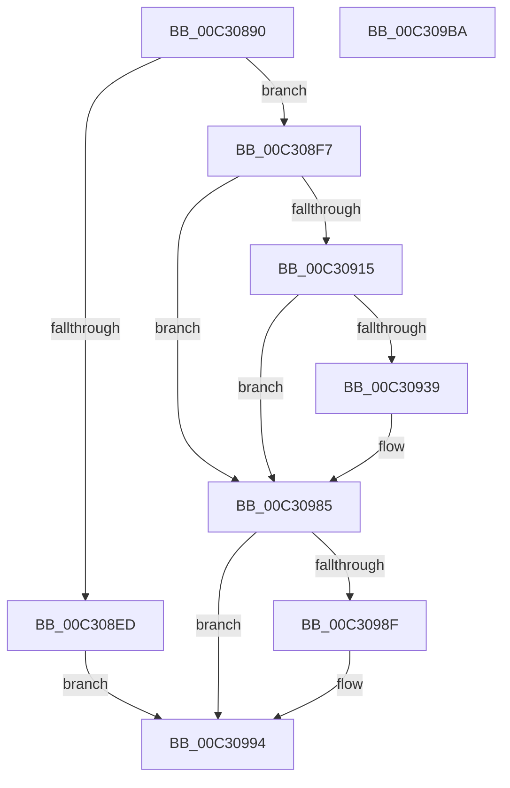

# PipCriticalDeviceWaitCallback

- RVA: `0x00C30890`–`0x00C309BB` (길이 `299` bytes)
- VA: `0x0000000140C30890`
- 실행 섹션: `INIT`
- PDB 이름 있음: `예`; PDB Function 태그: `아니요`
- unwind 정보 RVA: `0x000C7F58`
- 디코드: `70`개 명령, `299/299` bytes 표시
- 미해석 바이트: `0` (있으면 어셈블리에 `.byte`로 보존)

> 이 문서는 커널 이미지의 기계어와 PDB 기호를 분석해 생성했습니다. 4번과 5번은 함수 원형과 자료형을 바이너리 사용 방식에서 추정한 C 해석이며 원본 소스 복구 결과는 아닙니다.

## 1. Dependencies

- 직접 호출 지점: **6**; 고유 호출 대상: **6**
- 직접 호출자로 확인된 함수: **0**
- RIP 상대 이미지 참조: **2**

### Outgoing calls
- `0x00C3090A` → [RtlStringCchPrintfA](../../text/59/RtlStringCchPrintfA_function_00596BC8.md) (function, `0x00596BC8`)
- `0x00C3091E` → [RtlInitAnsiString](../../text/47/RtlInitAnsiString_function_00470F40.md) (function, `0x00470F40`)
- `0x00C3092E` → [RtlAnsiStringToUnicodeString](../../page/90/RtlAnsiStringToUnicodeString_function_0090BEA0.md) (function, `0x0090BEA0`)
- `0x00C3097E` → [ZwOpenFile](../../text/6A/ZwOpenFile_function_006AD730.md) (function, `0x006AD730`)
- `0x00C3098F` → [ZwClose](../../text/6A/ZwClose_function_006AD2B0.md) (function, `0x006AD2B0`)
- `0x00C309A0` → [_security_check_cookie](../../text/6A/_security_check_cookie_function_006AC640.md) (function, `0x006AC640`)

### Direct callers
- 이 함수 시작 RVA로 연결되는 직접 call은 확인되지 않았습니다. 간접 호출은 완전히 역산할 수 없습니다.

### Static image references
- `0x00C308AA` → RVA `0x00E0A740` (`.data`; read)
- `0x00C308FA` → RVA `0x00C79A00` (` ?? ::PBOPGDP::`string'`; read)

## 2. Other-region calls and transfers

- 다른 실행 섹션으로 향하는 call: **6**
  - `0x00C3090A` → [RtlStringCchPrintfA](../../text/59/RtlStringCchPrintfA_function_00596BC8.md) (`INIT` → `.text`)
  - `0x00C3091E` → [RtlInitAnsiString](../../text/47/RtlInitAnsiString_function_00470F40.md) (`INIT` → `.text`)
  - `0x00C3092E` → [RtlAnsiStringToUnicodeString](../../page/90/RtlAnsiStringToUnicodeString_function_0090BEA0.md) (`INIT` → `PAGE`)
  - `0x00C3097E` → [ZwOpenFile](../../text/6A/ZwOpenFile_function_006AD730.md) (`INIT` → `.text`)
  - `0x00C3098F` → [ZwClose](../../text/6A/ZwClose_function_006AD2B0.md) (`INIT` → `.text`)
  - `0x00C309A0` → [_security_check_cookie](../../text/6A/_security_check_cookie_function_006AC640.md) (`INIT` → `.text`)
- 별도 외부 분기/꼬리 이동을 확인하지 못했습니다.

## 3. Assembly (complete function range)

```asm
00C30890  48 89 5C 24 08                  mov qword ptr [rsp + 8], rbx
00C30895  48 89 7C 24 20                  mov qword ptr [rsp + 0x20], rdi
00C3089A  55                              push rbp
00C3089B  48 8D AC 24 60 FF FF FF         lea rbp, [rsp - 0xa0]
00C308A3  48 81 EC A0 01 00 00            sub rsp, 0x1a0
00C308AA  48 8B 05 8F 9E 1D 00            mov rax, qword ptr [rip + 0x1d9e8f]
00C308B1  48 33 C4                        xor rax, rsp
00C308B4  48 89 85 90 00 00 00            mov qword ptr [rbp + 0x90], rax
00C308BB  33 C0                           xor eax, eax
00C308BD  0F 57 C0                        xorps xmm0, xmm0
00C308C0  48 21 44 24 30                  and qword ptr [rsp + 0x30], rax
00C308C5  0F 57 C9                        xorps xmm1, xmm1
00C308C8  48 89 44 24 58                  mov qword ptr [rsp + 0x58], rax
00C308CD  49 8B F8                        mov rdi, r8
00C308D0  89 44 24 60                     mov dword ptr [rsp + 0x60], eax
00C308D4  0F 11 44 24 68                  movups xmmword ptr [rsp + 0x68], xmm0
00C308D9  0F 11 4C 24 78                  movups xmmword ptr [rsp + 0x78], xmm1
00C308DE  0F 11 44 24 38                  movups xmmword ptr [rsp + 0x38], xmm0
00C308E3  0F 11 44 24 48                  movups xmmword ptr [rsp + 0x48], xmm0
00C308E8  48 85 D2                        test rdx, rdx
00C308EB  75 0A                           jne 0x140c308f7
00C308ED  BB 0D 00 00 C0                  mov ebx, 0xc000000d
00C308F2  E9 9D 00 00 00                  jmp 0x140c30994
00C308F7  4C 8B CA                        mov r9, rdx
00C308FA  4C 8D 05 FF 90 04 00            lea r8, [rip + 0x490ff]
00C30901  BA 00 01 00 00                  mov edx, 0x100
00C30906  48 8D 4D 90                     lea rcx, [rbp - 0x70]
00C3090A  E8 B9 62 96 FF                  call 0x140596bc8
00C3090F  8B D8                           mov ebx, eax
00C30911  85 C0                           test eax, eax
00C30913  78 70                           js 0x140c30985
00C30915  48 8D 55 90                     lea rdx, [rbp - 0x70]
00C30919  48 8D 4C 24 68                  lea rcx, [rsp + 0x68]
00C3091E  E8 1D 06 84 FF                  call 0x140470f40
00C30923  41 B0 01                        mov r8b, 1
00C30926  48 8D 54 24 68                  lea rdx, [rsp + 0x68]
00C3092B  48 8B CF                        mov rcx, rdi
00C3092E  E8 6D B5 CD FF                  call 0x14090bea0
00C30933  8B D8                           mov ebx, eax
00C30935  85 C0                           test eax, eax
00C30937  78 4C                           js 0x140c30985
00C30939  48 83 64 24 40 00               and qword ptr [rsp + 0x40], 0
00C3093F  4C 8D 4C 24 78                  lea r9, [rsp + 0x78]
00C30944  0F 57 C0                        xorps xmm0, xmm0
00C30947  C7 44 24 28 40 00 00 00         mov dword ptr [rsp + 0x28], 0x40
00C3094F  83 64 24 20 00                  and dword ptr [rsp + 0x20], 0
00C30954  4C 8D 44 24 38                  lea r8, [rsp + 0x38]
00C30959  BA 80 00 00 00                  mov edx, 0x80
00C3095E  C7 44 24 38 30 00 00 00         mov dword ptr [rsp + 0x38], 0x30
00C30966  48 8D 4C 24 30                  lea rcx, [rsp + 0x30]
00C3096B  C7 44 24 50 40 02 00 00         mov dword ptr [rsp + 0x50], 0x240
00C30973  F3 0F 7F 44 24 58               movdqu xmmword ptr [rsp + 0x58], xmm0
00C30979  48 89 7C 24 48                  mov qword ptr [rsp + 0x48], rdi
00C3097E  E8 AD CD A7 FF                  call 0x1406ad730
00C30983  8B D8                           mov ebx, eax
00C30985  48 8B 4C 24 30                  mov rcx, qword ptr [rsp + 0x30]
00C3098A  48 85 C9                        test rcx, rcx
00C3098D  74 05                           je 0x140c30994
00C3098F  E8 1C C9 A7 FF                  call 0x1406ad2b0
00C30994  8B C3                           mov eax, ebx
00C30996  48 8B 8D 90 00 00 00            mov rcx, qword ptr [rbp + 0x90]
00C3099D  48 33 CC                        xor rcx, rsp
00C309A0  E8 9B BC A7 FF                  call 0x1406ac640
00C309A5  4C 8D 9C 24 A0 01 00 00         lea r11, [rsp + 0x1a0]
00C309AD  49 8B 5B 10                     mov rbx, qword ptr [r11 + 0x10]
00C309B1  49 8B 7B 28                     mov rdi, qword ptr [r11 + 0x28]
00C309B5  49 8B E3                        mov rsp, r11
00C309B8  5D                              pop rbp
00C309B9  C3                              ret
00C309BA  CC                              int3
```

## 4. C-style interpretation (structured pseudocode)

```c
__int64 __fastcall PipCriticalDeviceWaitCallback(__int64 a1, __int64 a2, __int64 a3)
{
    __int64 result;
    __int64 v_rbx;
    __int64 v_rsp;
    unsigned __int64 v_stack_m118;
    unsigned __int64 v_stack_m130;
    unsigned __int64 v_stack_m140;
    unsigned int v_stack_m148;
    unsigned __int64 v_stack_m150;
    unsigned int v_stack_m158;
    unsigned __int64 v_stack_m160;
    unsigned __int64 v_stack_m168;
    unsigned __int64 v_stack_m170;
    unsigned __int64 v_stack_m178;
    unsigned __int64 v_stack_m18;
    unsigned int v_stack_m180;
    unsigned int v_stack_m188;
    unsigned __int64 v_stack_m8;
    unsigned __int64 v_stack_mA8;
    unsigned __int64 v_stack_p20;
    unsigned __int64 v_stack_p8;

    v_stack_p8 = v_rbx;
    v_stack_p20 = v_rdi;
    v_rsp = (v_rsp) - (416);
    result = (*(unsigned __int64 *)(v_rip + 1941135)) ^ (v_rsp);
    v_stack_m18 = result;
    result = 0;
    v_stack_m150 = 0;
    v_stack_m148 = 0;
    v_stack_m140 = v_xmm0;
    v_stack_m130 = v_xmm1;
    v_stack_m170 = v_xmm0;
    v_stack_m160 = v_xmm0;
    if (a2 != 0) goto loc_00C308F7;
    goto loc_00C30994;
loc_00C308F7:
    result = RtlStringCchPrintfA(v_stack_m118, 256, v_rip + 299263, a2);
    if (sign_flag) goto loc_00C30985;
    result = RtlInitAnsiString(v_stack_m140, v_stack_m118, v_rip + 299263, a2);
    result = RtlAnsiStringToUnicodeString(a3, v_stack_m140, 1, a2);
    v_rbx = (unsigned int)((unsigned int)(result));
    if (!(sign_flag)) {
        a4 = v_stack_m130;
        v_stack_m180 = 64;
        a3 = v_stack_m170;
        a2 = 128;
        v_stack_m170 = 48;
        a1 = v_stack_m178;
        v_stack_m158 = 576;
        v_stack_m150 = v_xmm0;
        v_stack_m160 = a3;
        result = ZwOpenFile(a1, a2, a3, a4);
        v_rbx = (unsigned int)(result);
    }
    if (v_stack_m178 != 0) {
        result = ZwClose(v_stack_m178, a2, a3, a4);
    }
    a1 = (v_stack_m18) ^ (v_rsp);
    result = _security_check_cookie(a1, a2, a3, a4);
    return result;
}
```

## 5. (Beta) C Style

```c
int64_t PipCriticalDeviceWaitCallback(int64_t Arg1, int64_t Arg2, int64_t Arg3)
{
    int64_t result;
    int64_t local_rbx;
    int64_t local_rsp;
    uint64_t v_stack_m118;
    uint64_t v_stack_m130;
    uint64_t v_stack_m140;
    uint32_t v_stack_m148;
    uint64_t v_stack_m150;
    uint32_t v_stack_m158;
    uint64_t v_stack_m160;
    uint64_t v_stack_m168;
    uint64_t v_stack_m170;
    uint64_t v_stack_m178;
    uint64_t v_stack_m18;
    uint32_t v_stack_m180;
    uint32_t v_stack_m188;
    uint64_t v_stack_m8;
    uint64_t v_stack_mA8;
    uint64_t v_stack_p20;
    uint64_t v_stack_p8;

    v_stack_p8 = local_rbx;
    v_stack_p20 = local_rdi;
    local_rsp = (local_rsp) - (416);
    result = (*(uint64_t *)(v_rip + 0x1D9E8F)) ^ (local_rsp);
    v_stack_m18 = result;
    result = 0;
    v_stack_m150 = 0;
    v_stack_m148 = 0;
    v_stack_m140 = v_xmm0;
    v_stack_m130 = v_xmm1;
    v_stack_m170 = v_xmm0;
    v_stack_m160 = v_xmm0;
    if (Arg2 != 0) goto loc_00C308F7;
    goto loc_00C30994;
loc_00C308F7:
    result = RtlStringCchPrintfA(v_stack_m118, 256, v_rip + 299263, Arg2);
    if (sign_flag) goto loc_00C30985;
    result = RtlInitAnsiString(v_stack_m140, v_stack_m118, v_rip + 299263, Arg2);
    result = RtlAnsiStringToUnicodeString(Arg3, v_stack_m140, 1, Arg2);
    local_rbx = (uint32_t)((uint32_t)(result));
    if (!(sign_flag)) {
        a4 = v_stack_m130;
        v_stack_m180 = 64;
        Arg3 = v_stack_m170;
        Arg2 = 128;
        v_stack_m170 = 48;
        Arg1 = v_stack_m178;
        v_stack_m158 = 576;
        v_stack_m150 = v_xmm0;
        v_stack_m160 = Arg3;
        result = ZwOpenFile(Arg1, Arg2, Arg3, a4);
        local_rbx = (uint32_t)(result);
    }
    if (v_stack_m178 != 0) {
        result = ZwClose(v_stack_m178, Arg2, Arg3, a4);
    }
    Arg1 = (v_stack_m18) ^ (local_rsp);
    result = _security_check_cookie(Arg1, Arg2, Arg3, a4);
    return result;
}
```

## 6. Execution-region graph

[열기: 2D/3D 그래프와 함수 탐색 컨트롤 패널](../../../control-panel.html?section=init&rva=0x00C30890&view=graph)

- 2D 그래프는 위에서 아래로 흐르고, 3D 그래프는 빈 공간을 드래그해 회전합니다. Shift+드래그는 이동, 휠은 확대·축소, 함수 노드 선택은 대상 보고서 이동입니다.

### Static fallback


