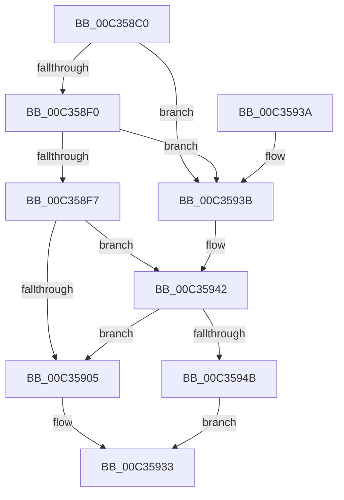

# PipDmgInitPhaseZero

- RVA: `0x00C358C0`–`0x00C35954` (길이 `148` bytes)
- VA: `0x0000000140C358C0`
- 실행 섹션: `INIT`
- PDB 이름 있음: `예`; PDB Function 태그: `아니요`
- unwind 정보 RVA: `0x0006886C`
- 디코드: `33`개 명령, `148/148` bytes 표시
- 미해석 바이트: `0` (있으면 어셈블리에 `.byte`로 보존)

> 이 문서는 커널 이미지의 기계어와 PDB 기호를 분석해 생성했습니다. 4번과 5번은 함수 원형과 자료형을 바이너리 사용 방식에서 추정한 C 해석이며 원본 소스 복구 결과는 아닙니다.

## 1. Dependencies

- 직접 호출 지점: **2**; 고유 호출 대상: **2**
- 직접 호출자로 확인된 함수: **1**
- RIP 상대 이미지 참조: **9**

### Outgoing calls
- `0x00C358E7` → [guard_dispatch_icall](../../text/6B/guard_dispatch_icall_function_006BAAD0.md) (function, `0x006BAAD0`)
- `0x00C35919` → [ExInitializeResourceLite2](../../text/41/ExInitializeResourceLite2_function_0041F710.md) (function, `0x0041F710`)

### Direct callers
- [PiDmaGuardInitialize](../../text/5A/PiDmaGuardInitialize_function_005A9F0C.md) at `0x005A9F16`

### Static image references
- `0x00C358C4` → RVA `0x00E00638` (`.data`; read)
- `0x00C358FB` → RVA `0x00F8A9A8` (`.data`; write)
- `0x00C35908` → RVA `0x00F8A9AC` (`.data`; write)
- `0x00C35912` → RVA `0x00F8A800` (`.data`; read)
- `0x00C3591E` → RVA `0x00F8A7F0` (`.data`; read)
- `0x00C35925` → RVA `0x00F8A7F8` (`.data`; write)
- `0x00C3592C` → RVA `0x00F8A7F0` (`.data`; write)
- `0x00C35942` → RVA `0x00F8B408` (`.data`; read)
- `0x00C3594B` → RVA `0x00F8A9AC` (`.data`; read/write)

## 2. Other-region calls and transfers

- 다른 실행 섹션으로 향하는 call: **2**
  - `0x00C358E7` → [guard_dispatch_icall](../../text/6B/guard_dispatch_icall_function_006BAAD0.md) (`INIT` → `.text`)
  - `0x00C35919` → [ExInitializeResourceLite2](../../text/41/ExInitializeResourceLite2_function_0041F710.md) (`INIT` → `.text`)
- 별도 외부 분기/꼬리 이동을 확인하지 못했습니다.

## 3. Assembly (complete function range)

```asm
00C358C0  48 83 EC 38                     sub rsp, 0x38
00C358C4  48 8B 05 6D AD 1C 00            mov rax, qword ptr [rip + 0x1cad6d]
00C358CB  4C 8D 4C 24 48                  lea r9, [rsp + 0x48]
00C358D0  83 64 24 48 00                  and dword ptr [rsp + 0x48], 0
00C358D5  4C 8D 44 24 40                  lea r8, [rsp + 0x40]
00C358DA  BA 01 00 00 00                  mov edx, 1
00C358DF  C6 44 24 40 00                  mov byte ptr [rsp + 0x40], 0
00C358E4  8D 4A 2F                        lea ecx, [rdx + 0x2f]
00C358E7  E8 E4 51 A8 FF                  call 0x1406baad0
00C358EC  85 C0                           test eax, eax
00C358EE  78 4B                           js 0x140c3593b
00C358F0  83 7C 24 48 01                  cmp dword ptr [rsp + 0x48], 1
00C358F5  75 44                           jne 0x140c3593b
00C358F7  8A 44 24 40                     mov al, byte ptr [rsp + 0x40]
00C358FB  88 05 A7 50 35 00               mov byte ptr [rip + 0x3550a7], al
00C35901  84 C0                           test al, al
00C35903  74 3D                           je 0x140c35942
00C35905  83 CA FF                        or edx, 0xffffffff
00C35908  C7 05 9A 50 35 00 03 00 00 00   mov dword ptr [rip + 0x35509a], 3
00C35912  48 8D 0D E7 4E 35 00            lea rcx, [rip + 0x354ee7]
00C35919  E8 F2 9D 7E FF                  call 0x14041f710
00C3591E  48 8D 05 CB 4E 35 00            lea rax, [rip + 0x354ecb]
00C35925  48 89 05 CC 4E 35 00            mov qword ptr [rip + 0x354ecc], rax
00C3592C  48 89 05 BD 4E 35 00            mov qword ptr [rip + 0x354ebd], rax
00C35933  33 C0                           xor eax, eax
00C35935  48 83 C4 38                     add rsp, 0x38
00C35939  C3                              ret
00C3593A  CC                              int3
00C3593B  C6 05 66 50 35 00 00            mov byte ptr [rip + 0x355066], 0
00C35942  80 3D BF 5A 35 00 00            cmp byte ptr [rip + 0x355abf], 0
00C35949  75 BA                           jne 0x140c35905
00C3594B  83 25 5A 50 35 00 00            and dword ptr [rip + 0x35505a], 0
00C35952  EB DF                           jmp 0x140c35933
```

## 4. C-style interpretation (structured pseudocode)

```c
__int64 __fastcall PipDmgInitPhaseZero(void)
{
    __int64 result;
    __int64 v_rsp;
    unsigned __int64 v_stack_p10;
    unsigned __int64 v_stack_p8;

    v_rsp = (v_rsp) - (56);
    v_stack_p8 = 0;
    result = guard_dispatch_icall(1 + 47, 1, v_stack_p8, v_stack_p10);
    if (sign_flag) goto loc_00C3593B;
    if (v_stack_p10 != 1) goto loc_00C3593B;
    *(unsigned __int8 *)(v_rip + 3494055) = (unsigned __int8)(v_stack_p8);
    if ((unsigned __int8)(v_stack_p8) == 0) goto loc_00C35942;
loc_00C35905:
    a2 = (unsigned int)((1) | (0xFFFFFFFFULL));
    *(unsigned int *)(v_rip + 3494042) = 3;
    result = ExInitializeResourceLite2(v_rip + 3493607, a2, v_stack_p8, v_stack_p10);
    *(unsigned __int64 *)(v_rip + 3493580) = v_rip + 3493579;
    *(unsigned __int64 *)(v_rip + 3493565) = v_rip + 3493579;
loc_00C35933:
    result = 0;
    v_rsp = (v_rsp) + (56);
    return result;
loc_00C3593B:
    *(unsigned __int8 *)(v_rip + 3493990) = 0;
loc_00C35942:
    if ((*(unsigned __int8 *)(v_rip + 3496639)) != 0) goto loc_00C35905;
    goto loc_00C35933;
}
```

## 5. (Beta) C Style

```c
void PipDmgInitPhaseZero(void)
{
    int64_t result;
    int64_t local_rsp;
    uint64_t v_stack_p10;
    uint64_t v_stack_p8;

    local_rsp = (local_rsp) - (56);
    v_stack_p8 = 0;
    result = guard_dispatch_icall(1 + 47, 1, v_stack_p8, v_stack_p10);
    if (sign_flag) goto loc_00C3593B;
    if (v_stack_p10 != 1) goto loc_00C3593B;
    *(uint8_t *)(v_rip + 0x3550A7) = (uint8_t)(v_stack_p8);
    if ((uint8_t)(v_stack_p8) == 0) goto loc_00C35942;
loc_00C35905:
    a2 = (uint32_t)((1) | (0xFFFFFFFFULL));
    *(uint32_t *)(v_rip + 0x35509A) = 3;
    result = ExInitializeResourceLite2(v_rip + 3493607, a2, v_stack_p8, v_stack_p10);
    *(uint64_t *)(v_rip + 0x354ECC) = v_rip + 3493579;
    *(uint64_t *)(v_rip + 0x354EBD) = v_rip + 3493579;
loc_00C35933:
    result = 0;
    local_rsp = (local_rsp) + (56);
    return result;
loc_00C3593B:
    *(uint8_t *)(v_rip + 0x355066) = 0;
loc_00C35942:
    if ((*(uint8_t *)(v_rip + 0x355ABF)) != 0) goto loc_00C35905;
    goto loc_00C35933;
}
```

## 6. Execution-region graph

[열기: 2D/3D 그래프와 함수 탐색 컨트롤 패널](../../../control-panel.html?section=init&rva=0x00C358C0&view=graph)

- 2D 그래프는 위에서 아래로 흐르고, 3D 그래프는 빈 공간을 드래그해 회전합니다. Shift+드래그는 이동, 휠은 확대·축소, 함수 노드 선택은 대상 보고서 이동입니다.

### Static fallback


