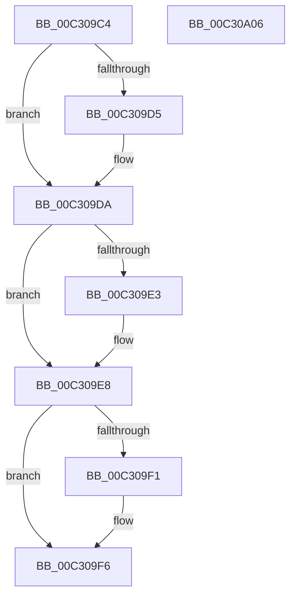

# PipFreeGroupTree

- RVA: `0x00C309C4`–`0x00C30A07` (길이 `67` bytes)
- VA: `0x0000000140C309C4`
- 실행 섹션: `INIT`
- PDB 이름 있음: `예`; PDB Function 태그: `아니요`
- unwind 정보 RVA: `0x0005CF00`
- 디코드: `22`개 명령, `67/67` bytes 표시
- 미해석 바이트: `0` (있으면 어셈블리에 `.byte`로 보존)

> 이 문서는 커널 이미지의 기계어와 PDB 기호를 분석해 생성했습니다. 4번과 5번은 함수 원형과 자료형을 바이너리 사용 방식에서 추정한 C 해석이며 원본 소스 복구 결과는 아닙니다.

## 1. Dependencies

- 직접 호출 지점: **4**; 고유 호출 대상: **2**
- 직접 호출자로 확인된 함수: **2**
- RIP 상대 이미지 참조: **0**

### Outgoing calls
- `0x00C309D5` → [PipFreeGroupTree](PipFreeGroupTree_function_00C309C4.md) (function, `0x00C309C4`)
- `0x00C309E3` → [PipFreeGroupTree](PipFreeGroupTree_function_00C309C4.md) (function, `0x00C309C4`)
- `0x00C309F1` → [PipFreeGroupTree](PipFreeGroupTree_function_00C309C4.md) (function, `0x00C309C4`)
- `0x00C309FB` → [ExFreePoolWithTag](../../poolcode/B8/ExFreePoolWithTag_function_00B82870.md) (function, `0x00B82870`)

### Direct callers
- [PipFreeGroupTree](PipFreeGroupTree_function_00C309C4.md) at `0x00C309D5`
- [PipFreeGroupTree](PipFreeGroupTree_function_00C309C4.md) at `0x00C309E3`
- [PipFreeGroupTree](PipFreeGroupTree_function_00C309C4.md) at `0x00C309F1`
- [IopInitializeSystemDrivers](../C7/IopInitializeSystemDrivers_function_00C73590.md) at `0x00C737D9`

### Static image references
- 디코드된 RIP-relative 메모리 참조가 없습니다.

## 2. Other-region calls and transfers

- 다른 실행 섹션으로 향하는 call: **1**
  - `0x00C309FB` → [ExFreePoolWithTag](../../poolcode/B8/ExFreePoolWithTag_function_00B82870.md) (`INIT` → `POOLCODE`)
- 별도 외부 분기/꼬리 이동을 확인하지 못했습니다.

## 3. Assembly (complete function range)

```asm
00C309C4  40 53                           push rbx
00C309C6  48 83 EC 20                     sub rsp, 0x20
00C309CA  48 8B D9                        mov rbx, rcx
00C309CD  48 8B 09                        mov rcx, qword ptr [rcx]
00C309D0  48 85 C9                        test rcx, rcx
00C309D3  74 05                           je 0x140c309da
00C309D5  E8 EA FF FF FF                  call 0x140c309c4
00C309DA  48 8B 4B 10                     mov rcx, qword ptr [rbx + 0x10]
00C309DE  48 85 C9                        test rcx, rcx
00C309E1  74 05                           je 0x140c309e8
00C309E3  E8 DC FF FF FF                  call 0x140c309c4
00C309E8  48 8B 4B 08                     mov rcx, qword ptr [rbx + 8]
00C309EC  48 85 C9                        test rcx, rcx
00C309EF  74 05                           je 0x140c309f6
00C309F1  E8 CE FF FF FF                  call 0x140c309c4
00C309F6  33 D2                           xor edx, edx
00C309F8  48 8B CB                        mov rcx, rbx
00C309FB  E8 70 1E F5 FF                  call 0x140b82870
00C30A00  48 83 C4 20                     add rsp, 0x20
00C30A04  5B                              pop rbx
00C30A05  C3                              ret
00C30A06  CC                              int3
```

## 4. C-style interpretation (structured pseudocode)

```c
__int64 __fastcall PipFreeGroupTree(__int64 a1, int a2)
{
    __int64 result;
    __int64 v_rsp;

    v_rsp = (v_rsp) - (32);
    if (*(unsigned __int64 *)(a1) != 0) {
        result = PipFreeGroupTree(*(unsigned __int64 *)(a1), a2, a3, a4);
    }
    if (*(unsigned __int64 *)(a1 + 16) != 0) {
        result = PipFreeGroupTree(*(unsigned __int64 *)(a1 + 16), a2, a3, a4);
    }
    if (*(unsigned __int64 *)(a1 + 8) != 0) {
        result = PipFreeGroupTree(*(unsigned __int64 *)(a1 + 8), a2, a3, a4);
    }
    a2 = 0;
    result = ExFreePoolWithTag(a1, a2, a3, a4);
    v_rsp = (v_rsp) + (32);
    return result;
}
```

## 5. (Beta) C Style

```c
int64_t PipFreeGroupTree(void *Arg1, int32_t Arg2)
{
    uint8_t *arg1 = (uint8_t *)Arg1;

    int64_t result;
    int64_t local_rsp;

    local_rsp = (local_rsp) - (32);
    if (*(uint64_t *)(arg1) != 0) {
        result = PipFreeGroupTree(*(uint64_t *)(arg1), Arg2, a3, a4);
    }
    if (*(uint64_t *)(arg1 + 0x10) != 0) {
        result = PipFreeGroupTree(*(uint64_t *)(arg1 + 0x10), Arg2, a3, a4);
    }
    if (*(uint64_t *)(arg1 + 0x8) != 0) {
        result = PipFreeGroupTree(*(uint64_t *)(arg1 + 0x8), Arg2, a3, a4);
    }
    Arg2 = 0;
    result = ExFreePoolWithTag(Arg1, Arg2, a3, a4);
    local_rsp = (local_rsp) + (32);
    return result;
}
```

### 관측된 메모리 오프셋

구조체 형식이 확인되지 않은 접근은 인자 기준의 오프셋으로만 기록했습니다.

| 기준 인자 | 오프셋 표현 | 폭 (bit) | 접근 |
|---|---:|---:|---|
| `Arg1` | `+ 0x0` | `64` | `R` |
| `Arg1` | `+ 0x8` | `64` | `R` |
| `Arg1` | `+ 0x10` | `64` | `R` |

## 6. Execution-region graph

[열기: 2D/3D 그래프와 함수 탐색 컨트롤 패널](../../../control-panel.html?section=init&rva=0x00C309C4&view=graph)

- 2D 그래프는 위에서 아래로 흐르고, 3D 그래프는 빈 공간을 드래그해 회전합니다. Shift+드래그는 이동, 휠은 확대·축소, 함수 노드 선택은 대상 보고서 이동입니다.

### Static fallback


