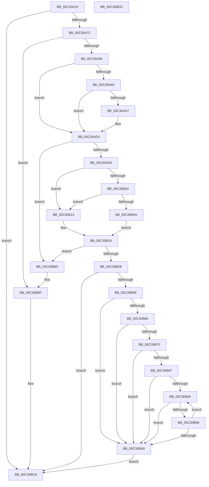

# PipGetDriverTagPriority

- RVA: `0x00C30A10`–`0x00C30BDD` (길이 `461` bytes)
- VA: `0x0000000140C30A10`
- 실행 섹션: `INIT`
- PDB 이름 있음: `예`; PDB Function 태그: `아니요`
- unwind 정보 RVA: `0x000BD1CC`
- 디코드: `130`개 명령, `461/461` bytes 표시
- 미해석 바이트: `0` (있으면 어셈블리에 `.byte`로 보존)

> 이 문서는 커널 이미지의 기계어와 PDB 기호를 분석해 생성했습니다. 4번과 5번은 함수 원형과 자료형을 바이너리 사용 방식에서 추정한 C 해석이며 원본 소스 복구 결과는 아닙니다.

## 1. Dependencies

- 직접 호출 지점: **11**; 고유 호출 대상: **5**
- 직접 호출자로 확인된 함수: **1**
- RIP 상대 이미지 참조: **3**

### Outgoing calls
- `0x00C30A65` → [IopOpenRegistryKeyEx](../../page/A5/IopOpenRegistryKeyEx_function_00A51B44.md) (function, `0x00A51B44`)
- `0x00C30A83` → [IopGetRegistryValue](../../page/99/IopGetRegistryValue_function_009990EC.md) (function, `0x009990EC`)
- `0x00C30AB5` → [PnpRegSzToString](../../page/A5/PnpRegSzToString_function_00A5DC40.md) (function, `0x00A5DC40`)
- `0x00C30AE9` → [IopGetRegistryValue](../../page/99/IopGetRegistryValue_function_009990EC.md) (function, `0x009990EC`)
- `0x00C30B1E` → [ExFreePoolWithTag](../../poolcode/B8/ExFreePoolWithTag_function_00B82870.md) (function, `0x00B82870`)
- `0x00C30B3D` → [IopGetRegistryValue](../../page/99/IopGetRegistryValue_function_009990EC.md) (function, `0x009990EC`)
- `0x00C30B49` → [ExFreePoolWithTag](../../poolcode/B8/ExFreePoolWithTag_function_00B82870.md) (function, `0x00B82870`)
- `0x00C30B52` → [ZwClose](../../text/6A/ZwClose_function_006AD2B0.md) (function, `0x006AD2B0`)
- `0x00C30BAE` → [ExFreePoolWithTag](../../poolcode/B8/ExFreePoolWithTag_function_00B82870.md) (function, `0x00B82870`)
- `0x00C30BBA` → [ExFreePoolWithTag](../../poolcode/B8/ExFreePoolWithTag_function_00B82870.md) (function, `0x00B82870`)
- `0x00C30BC3` → [ZwClose](../../text/6A/ZwClose_function_006AD2B0.md) (function, `0x006AD2B0`)

### Direct callers
- [IopInitializeBootDrivers](../C2/IopInitializeBootDrivers_function_00C2E6F4.md) at `0x00C2EAB8`

### Static image references
- `0x00C30A28` → RVA `0x00C7A340` (` ?? ::PBOPGDP::`string'`; read)
- `0x00C30A79` → RVA `0x00C7A180` (` ?? ::PBOPGDP::`string'`; read)
- `0x00C30ADB` → RVA `0x00C7A3D0` (` ?? ::PBOPGDP::`string'`; read)

## 2. Other-region calls and transfers

- 다른 실행 섹션으로 향하는 call: **11**
  - `0x00C30A65` → [IopOpenRegistryKeyEx](../../page/A5/IopOpenRegistryKeyEx_function_00A51B44.md) (`INIT` → `PAGE`)
  - `0x00C30A83` → [IopGetRegistryValue](../../page/99/IopGetRegistryValue_function_009990EC.md) (`INIT` → `PAGE`)
  - `0x00C30AB5` → [PnpRegSzToString](../../page/A5/PnpRegSzToString_function_00A5DC40.md) (`INIT` → `PAGE`)
  - `0x00C30AE9` → [IopGetRegistryValue](../../page/99/IopGetRegistryValue_function_009990EC.md) (`INIT` → `PAGE`)
  - `0x00C30B1E` → [ExFreePoolWithTag](../../poolcode/B8/ExFreePoolWithTag_function_00B82870.md) (`INIT` → `POOLCODE`)
  - `0x00C30B3D` → [IopGetRegistryValue](../../page/99/IopGetRegistryValue_function_009990EC.md) (`INIT` → `PAGE`)
  - `0x00C30B49` → [ExFreePoolWithTag](../../poolcode/B8/ExFreePoolWithTag_function_00B82870.md) (`INIT` → `POOLCODE`)
  - `0x00C30B52` → [ZwClose](../../text/6A/ZwClose_function_006AD2B0.md) (`INIT` → `.text`)
  - `0x00C30BAE` → [ExFreePoolWithTag](../../poolcode/B8/ExFreePoolWithTag_function_00B82870.md) (`INIT` → `POOLCODE`)
  - `0x00C30BBA` → [ExFreePoolWithTag](../../poolcode/B8/ExFreePoolWithTag_function_00B82870.md) (`INIT` → `POOLCODE`)
  - `0x00C30BC3` → [ZwClose](../../text/6A/ZwClose_function_006AD2B0.md) (`INIT` → `.text`)
- 별도 외부 분기/꼬리 이동을 확인하지 못했습니다.

## 3. Assembly (complete function range)

```asm
00C30A10  48 89 5C 24 08                  mov qword ptr [rsp + 8], rbx
00C30A15  55                              push rbp
00C30A16  56                              push rsi
00C30A17  57                              push rdi
00C30A18  41 54                           push r12
00C30A1A  41 56                           push r14
00C30A1C  48 8B EC                        mov rbp, rsp
00C30A1F  48 83 EC 40                     sub rsp, 0x40
00C30A23  48 83 65 38 00                  and qword ptr [rbp + 0x38], 0
00C30A28  48 8D 05 11 99 04 00            lea rax, [rip + 0x49911]
00C30A2F  48 83 65 48 00                  and qword ptr [rbp + 0x48], 0
00C30A34  4C 8D 45 E8                     lea r8, [rbp - 0x18]
00C30A38  48 83 65 E0 00                  and qword ptr [rbp - 0x20], 0
00C30A3D  48 8B D9                        mov rbx, rcx
00C30A40  83 65 EC 00                     and dword ptr [rbp - 0x14], 0
00C30A44  48 8D 4D 40                     lea rcx, [rbp + 0x40]
00C30A48  48 83 65 40 00                  and qword ptr [rbp + 0x40], 0
00C30A4D  41 B9 19 00 02 00               mov r9d, 0x20019
00C30A53  33 D2                           xor edx, edx
00C30A55  48 89 45 F0                     mov qword ptr [rbp - 0x10], rax
00C30A59  BF FF FF 00 00                  mov edi, 0xffff
00C30A5E  C7 45 E8 82 00 84 00            mov dword ptr [rbp - 0x18], 0x840082
00C30A65  E8 DA 10 E2 FF                  call 0x140a51b44
00C30A6A  85 C0                           test eax, eax
00C30A6C  0F 88 56 01 00 00               js 0x140c30bc8
00C30A72  4C 8D 4D 38                     lea r9, [rbp + 0x38]
00C30A76  45 33 C0                        xor r8d, r8d
00C30A79  48 8D 15 00 97 04 00            lea rdx, [rip + 0x49700]
00C30A80  48 8B CB                        mov rcx, rbx
00C30A83  E8 64 86 D6 FF                  call 0x1409990ec
00C30A88  85 C0                           test eax, eax
00C30A8A  0F 88 2F 01 00 00               js 0x140c30bbf
00C30A90  48 8B 75 38                     mov rsi, qword ptr [rbp + 0x38]
00C30A94  41 BC 01 00 00 00               mov r12d, 1
00C30A9A  44 39 66 04                     cmp dword ptr [rsi + 4], r12d
00C30A9E  75 34                           jne 0x140c30ad4
00C30AA0  8B 56 0C                        mov edx, dword ptr [rsi + 0xc]
00C30AA3  85 D2                           test edx, edx
00C30AA5  74 2D                           je 0x140c30ad4
00C30AA7  8B 4E 08                        mov ecx, dword ptr [rsi + 8]
00C30AAA  4C 8D 45 38                     lea r8, [rbp + 0x38]
00C30AAE  83 65 38 00                     and dword ptr [rbp + 0x38], 0
00C30AB2  48 03 CE                        add rcx, rsi
00C30AB5  E8 86 D1 E2 FF                  call 0x140a5dc40
00C30ABA  0F B7 4D 38                     movzx ecx, word ptr [rbp + 0x38]
00C30ABE  66 89 4D E8                     mov word ptr [rbp - 0x18], cx
00C30AC2  0F B7 46 0C                     movzx eax, word ptr [rsi + 0xc]
00C30AC6  66 89 45 EA                     mov word ptr [rbp - 0x16], ax
00C30ACA  8B 46 08                        mov eax, dword ptr [rsi + 8]
00C30ACD  48 03 C6                        add rax, rsi
00C30AD0  48 89 45 F0                     mov qword ptr [rbp - 0x10], rax
00C30AD4  45 33 F6                        xor r14d, r14d
00C30AD7  4C 8D 4D 48                     lea r9, [rbp + 0x48]
00C30ADB  48 8D 15 EE 98 04 00            lea rdx, [rip + 0x498ee]
00C30AE2  48 8B CB                        mov rcx, rbx
00C30AE5  45 8D 46 50                     lea r8d, [r14 + 0x50]
00C30AE9  E8 FE 85 D6 FF                  call 0x1409990ec
00C30AEE  8B D8                           mov ebx, eax
00C30AF0  85 C0                           test eax, eax
00C30AF2  0F 88 BD 00 00 00               js 0x140c30bb5
00C30AF8  4C 8B 45 48                     mov r8, qword ptr [rbp + 0x48]
00C30AFC  41 83 78 04 04                  cmp dword ptr [r8 + 4], 4
00C30B01  75 11                           jne 0x140c30b14
00C30B03  41 83 78 0C 04                  cmp dword ptr [r8 + 0xc], 4
00C30B08  75 0A                           jne 0x140c30b14
00C30B0A  41 8B 48 08                     mov ecx, dword ptr [r8 + 8]
00C30B0E  46 8B 34 01                     mov r14d, dword ptr [rcx + r8]
00C30B12  EB 05                           jmp 0x140c30b19
00C30B14  BB 01 00 00 C0                  mov ebx, 0xc0000001
00C30B19  33 D2                           xor edx, edx
00C30B1B  49 8B C8                        mov rcx, r8
00C30B1E  E8 4D 1D F5 FF                  call 0x140b82870
00C30B23  85 DB                           test ebx, ebx
00C30B25  0F 88 8A 00 00 00               js 0x140c30bb5
00C30B2B  48 8B 55 F0                     mov rdx, qword ptr [rbp - 0x10]
00C30B2F  4C 8D 4D E0                     lea r9, [rbp - 0x20]
00C30B33  48 8B 4D 40                     mov rcx, qword ptr [rbp + 0x40]
00C30B37  41 B8 50 00 00 00               mov r8d, 0x50
00C30B3D  E8 AA 85 D6 FF                  call 0x1409990ec
00C30B42  33 D2                           xor edx, edx
00C30B44  48 8B CE                        mov rcx, rsi
00C30B47  8B D8                           mov ebx, eax
00C30B49  E8 22 1D F5 FF                  call 0x140b82870
00C30B4E  48 8B 4D 40                     mov rcx, qword ptr [rbp + 0x40]
00C30B52  E8 59 C7 A7 FF                  call 0x1406ad2b0
00C30B57  85 DB                           test ebx, ebx
00C30B59  78 6D                           js 0x140c30bc8
00C30B5B  4C 8B 45 E0                     mov r8, qword ptr [rbp - 0x20]
00C30B5F  41 83 78 04 03                  cmp dword ptr [r8 + 4], 3
00C30B64  75 43                           jne 0x140c30ba9
00C30B66  45 8B 50 0C                     mov r10d, dword ptr [r8 + 0xc]
00C30B6A  41 83 FA 04                     cmp r10d, 4
00C30B6E  72 39                           jb 0x140c30ba9
00C30B70  41 8B 50 08                     mov edx, dword ptr [r8 + 8]
00C30B74  49 03 D0                        add rdx, r8
00C30B77  44 8B 0A                        mov r9d, dword ptr [rdx]
00C30B7A  41 8D 49 01                     lea ecx, [r9 + 1]
00C30B7E  48 C1 E1 02                     shl rcx, 2
00C30B82  49 3B CA                        cmp rcx, r10
00C30B85  77 22                           ja 0x140c30ba9
00C30B87  48 83 C2 04                     add rdx, 4
00C30B8B  41 0F B7 FC                     movzx edi, r12w
00C30B8F  45 3B CC                        cmp r9d, r12d
00C30B92  72 15                           jb 0x140c30ba9
00C30B94  44 3B 32                        cmp r14d, dword ptr [rdx]
00C30B97  74 10                           je 0x140c30ba9
00C30B99  66 41 03 FC                     add di, r12w
00C30B9D  48 83 C2 04                     add rdx, 4
00C30BA1  0F B7 C7                        movzx eax, di
00C30BA4  41 3B C1                        cmp eax, r9d
00C30BA7  76 EB                           jbe 0x140c30b94
00C30BA9  33 D2                           xor edx, edx
00C30BAB  49 8B C8                        mov rcx, r8
00C30BAE  E8 BD 1C F5 FF                  call 0x140b82870
00C30BB3  EB 13                           jmp 0x140c30bc8
00C30BB5  33 D2                           xor edx, edx
00C30BB7  48 8B CE                        mov rcx, rsi
00C30BBA  E8 B1 1C F5 FF                  call 0x140b82870
00C30BBF  48 8B 4D 40                     mov rcx, qword ptr [rbp + 0x40]
00C30BC3  E8 E8 C6 A7 FF                  call 0x1406ad2b0
00C30BC8  48 8B 5C 24 70                  mov rbx, qword ptr [rsp + 0x70]
00C30BCD  0F B7 C7                        movzx eax, di
00C30BD0  48 83 C4 40                     add rsp, 0x40
00C30BD4  41 5E                           pop r14
00C30BD6  41 5C                           pop r12
00C30BD8  5F                              pop rdi
00C30BD9  5E                              pop rsi
00C30BDA  5D                              pop rbp
00C30BDB  C3                              ret
00C30BDC  CC                              int3
```

## 4. C-style interpretation (structured pseudocode)

```c
__int64 __fastcall PipGetDriverTagPriority(__int64 a1, int a2)
{
    __int64 result;
    __int64 v_r14;
    __int64 v_rdi;
    __int64 v_rsp;
    unsigned __int64 v_stack_m38;
    unsigned int v_stack_m3C;
    unsigned __int16 v_stack_m3E;
    unsigned __int64 v_stack_m40;
    unsigned __int64 v_stack_m48;
    unsigned __int64 v_stack_p10;
    unsigned __int64 v_stack_p18;
    unsigned __int64 v_stack_p20;
    unsigned __int64 v_stack_p8;

    v_stack_p8 = v_rbx;
    v_rsp = (v_rsp) - (64);
    a2 = 0;
    v_stack_m38 = v_rip + 301329;
    v_stack_m40 = 0x840082ULL;
    result = IopOpenRegistryKeyEx(v_stack_p18, a2, v_stack_m40, (unsigned int)(0x20019ULL));
    if (sign_flag) goto loc_00C30BC8;
    a3 = 0;
    result = IopGetRegistryValue(a1, v_rip + 300800, a3, v_stack_p10);
    if (sign_flag) goto loc_00C30BBF;
    if ((*(unsigned int *)(v_stack_p10 + 4)) != 1) goto loc_00C30AD4;
    if ((unsigned int)((unsigned int)(*(unsigned int *)(v_stack_p10 + 12))) != 0) {
        a1 = *(unsigned int *)(v_stack_p10 + 8);
        a3 = v_stack_p10;
        a1 = (a1) + (v_stack_p10);
        result = PnpRegSzToString(a1, (unsigned int)(*(unsigned int *)(v_stack_p10 + 12)), a3, v_stack_p10);
        a1 = v_stack_p10;
        v_stack_m40 = (unsigned __int16)(a1);
        result = *(unsigned __int16 *)(v_stack_p10 + 12);
        v_stack_m3E = (unsigned __int16)(result);
        result = *(unsigned int *)(v_stack_p10 + 8);
        result = (result) + (v_stack_p10);
        v_stack_m38 = result;
    }
    v_r14 = 0;
    result = IopGetRegistryValue(a1, v_rip + 301294, v_r14 + 80, v_stack_p20);
    if (sign_flag) goto loc_00C30BB5;
    if ((*(unsigned int *)(v_stack_p20 + 4)) != 4) goto loc_00C30B14;
    if ((*(unsigned int *)(v_stack_p20 + 12)) != 4) goto loc_00C30B14;
    goto loc_00C30B19;
loc_00C30B14:
loc_00C30B19:
    a2 = 0;
    result = ExFreePoolWithTag(v_stack_p20, a2, v_stack_p20, v_stack_p20);
    if (sign_flag) goto loc_00C30BB5;
    result = IopGetRegistryValue(v_stack_p18, v_stack_m38, 80, v_stack_m48);
    a2 = 0;
    result = ExFreePoolWithTag(v_stack_p10, a2, 80, v_stack_m48);
    result = ZwClose(v_stack_p18, a2, 80, v_stack_m48);
    if (sign_flag) goto loc_00C30BC8;
    if ((*(unsigned int *)(v_stack_m48 + 4)) != 3) goto loc_00C30BA9;
    if (((unsigned int)((unsigned int)(*(unsigned int *)(v_stack_m48 + 12)))) < 4) goto loc_00C30BA9;
    a2 = ((unsigned int)(*(unsigned int *)(v_stack_m48 + 8))) + (v_stack_m48);
    a1 = ((unsigned int)(*(unsigned int *)(a2)) + 1) << (2);
    if (a1 > ((unsigned int)(*(unsigned int *)(v_stack_m48 + 12)))) goto loc_00C30BA9;
    a2 = (a2) + (4);
    if (((unsigned int)((unsigned int)(*(unsigned int *)(a2)))) < 1) goto loc_00C30BA9;
loc_00C30B94:
    if (((unsigned int)((unsigned int)(*(unsigned int *)((unsigned int)(*(unsigned int *)(v_stack_p20 + 8)) + v_stack_p20 * 1)))) == (*(unsigned int *)(a2))) goto loc_00C30BA9;
    v_rdi = (unsigned __int16)((1) + (1));
    a2 = (a2) + (4);
    if (((unsigned int)((unsigned __int16)(v_rdi))) <= ((unsigned int)((unsigned int)(*(unsigned int *)(a2))))) goto loc_00C30B94;
loc_00C30BA9:
    a2 = 0;
    result = ExFreePoolWithTag(v_stack_m48, a2, v_stack_m48, (unsigned int)(*(unsigned int *)(a2)));
    goto loc_00C30BC8;
loc_00C30BB5:
    a2 = 0;
    result = ExFreePoolWithTag(v_stack_p10, a2, v_stack_m48, (unsigned int)(*(unsigned int *)(a2)));
loc_00C30BBF:
    result = ZwClose(v_stack_p18, a2, v_stack_m48, (unsigned int)(*(unsigned int *)(a2)));
loc_00C30BC8:
    v_rsp = (v_rsp) + (64);
    return (unsigned __int16)(v_rdi);
}
```

## 5. (Beta) C Style

```c
int64_t PipGetDriverTagPriority(int64_t Arg1, int32_t Arg2)
{
    int64_t result;
    int64_t local_r14;
    int64_t local_rdi;
    int64_t local_rsp;
    uint64_t v_stack_m38;
    uint32_t v_stack_m3C;
    uint16_t v_stack_m3E;
    uint64_t v_stack_m40;
    uint64_t v_stack_m48;
    uint64_t v_stack_p10;
    uint64_t v_stack_p18;
    uint64_t v_stack_p20;
    uint64_t v_stack_p8;

    v_stack_p8 = local_rbx;
    local_rsp = (local_rsp) - (64);
    Arg2 = 0;
    v_stack_m38 = v_rip + 301329;
    v_stack_m40 = 0x840082ULL;
    result = IopOpenRegistryKeyEx(v_stack_p18, Arg2, v_stack_m40, (uint32_t)(0x20019ULL));
    if (sign_flag) goto loc_00C30BC8;
    a3 = 0;
    result = IopGetRegistryValue(Arg1, v_rip + 300800, a3, v_stack_p10);
    if (sign_flag) goto loc_00C30BBF;
    if ((*(uint32_t *)(v_stack_p10 + 0x4)) != 1) goto loc_00C30AD4;
    if ((uint32_t)((uint32_t)(*(uint32_t *)(v_stack_p10 + 0xC))) != 0) {
        Arg1 = *(uint32_t *)(v_stack_p10 + 0x8);
        a3 = v_stack_p10;
        Arg1 = (Arg1) + (v_stack_p10);
        result = PnpRegSzToString(Arg1, (uint32_t)(*(uint32_t *)(v_stack_p10 + 0xC)), a3, v_stack_p10);
        Arg1 = v_stack_p10;
        v_stack_m40 = (uint16_t)(Arg1);
        result = *(uint16_t *)(v_stack_p10 + 0xC);
        v_stack_m3E = (uint16_t)(result);
        result = *(uint32_t *)(v_stack_p10 + 0x8);
        result = (result) + (v_stack_p10);
        v_stack_m38 = result;
    }
    local_r14 = 0;
    result = IopGetRegistryValue(Arg1, v_rip + 301294, local_r14 + 80, v_stack_p20);
    if (sign_flag) goto loc_00C30BB5;
    if ((*(uint32_t *)(v_stack_p20 + 0x4)) != 4) goto loc_00C30B14;
    if ((*(uint32_t *)(v_stack_p20 + 0xC)) != 4) goto loc_00C30B14;
    goto loc_00C30B19;
loc_00C30B14:
loc_00C30B19:
    Arg2 = 0;
    result = ExFreePoolWithTag(v_stack_p20, Arg2, v_stack_p20, v_stack_p20);
    if (sign_flag) goto loc_00C30BB5;
    result = IopGetRegistryValue(v_stack_p18, v_stack_m38, 80, v_stack_m48);
    Arg2 = 0;
    result = ExFreePoolWithTag(v_stack_p10, Arg2, 80, v_stack_m48);
    result = ZwClose(v_stack_p18, Arg2, 80, v_stack_m48);
    if (sign_flag) goto loc_00C30BC8;
    if ((*(uint32_t *)(v_stack_m48 + 0x4)) != 3) goto loc_00C30BA9;
    if (((uint32_t)((uint32_t)(*(uint32_t *)(v_stack_m48 + 0xC)))) < 4) goto loc_00C30BA9;
    Arg2 = ((uint32_t)(*(uint32_t *)(v_stack_m48 + 0x8))) + (v_stack_m48);
    Arg1 = ((uint32_t)(*(uint32_t *)(Arg2)) + 1) << (2);
    if (Arg1 > ((uint32_t)(*(uint32_t *)(v_stack_m48 + 0xC)))) goto loc_00C30BA9;
    Arg2 = (Arg2) + (4);
    if (((uint32_t)((uint32_t)(*(uint32_t *)(Arg2)))) < 1) goto loc_00C30BA9;
loc_00C30B94:
    if (((uint32_t)((uint32_t)(*(uint32_t *)((uint32_t)(*(uint32_t *)(v_stack_p20 + 0x8)) + v_stack_p20 * 1)))) == (*(uint32_t *)(Arg2))) goto loc_00C30BA9;
    local_rdi = (uint16_t)((1) + (1));
    Arg2 = (Arg2) + (4);
    if (((uint32_t)((uint16_t)(local_rdi))) <= ((uint32_t)((uint32_t)(*(uint32_t *)(Arg2))))) goto loc_00C30B94;
loc_00C30BA9:
    Arg2 = 0;
    result = ExFreePoolWithTag(v_stack_m48, Arg2, v_stack_m48, (uint32_t)(*(uint32_t *)(Arg2)));
    goto loc_00C30BC8;
loc_00C30BB5:
    Arg2 = 0;
    result = ExFreePoolWithTag(v_stack_p10, Arg2, v_stack_m48, (uint32_t)(*(uint32_t *)(Arg2)));
loc_00C30BBF:
    result = ZwClose(v_stack_p18, Arg2, v_stack_m48, (uint32_t)(*(uint32_t *)(Arg2)));
loc_00C30BC8:
    local_rsp = (local_rsp) + (64);
    return (uint16_t)(local_rdi);
}
```

## 6. Execution-region graph

[열기: 2D/3D 그래프와 함수 탐색 컨트롤 패널](../../../control-panel.html?section=init&rva=0x00C30A10&view=graph)

- 2D 그래프는 위에서 아래로 흐르고, 3D 그래프는 빈 공간을 드래그해 회전합니다. Shift+드래그는 이동, 휠은 확대·축소, 함수 노드 선택은 대상 보고서 이동입니다.

### Static fallback


